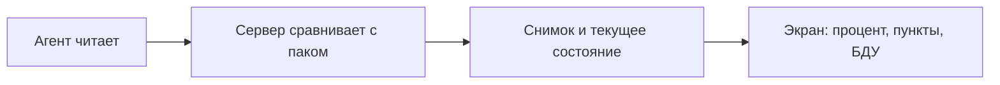

# Шпаргалка на 5 минут

Подробности — в главах по ссылкам. Здесь только то, что нужно сказать вслух.

## Схема



Агент не знает норму. Норма — поле `assert` в YAML, её применяет `evaluate_pack` на сервере ([7](07-packs.md), [12](12-scoring-fstec.md)).

## Путь данных в 7 шагов

1. Администратор создаёт ключ площадки `yak_`. Агент меняет его на ключ хоста `yah_` (`POST /api/agent/enroll`). [3](03-enrollment-keys.md)
2. Агент скачивает манифесты и проверяет подпись Ed25519. Неверная подпись — прогон не начинается. [7](07-packs.md)
3. `detect` выбирает паки. Агент читает только то, что разрешает белый список проб. [8](08-probes.md)
4. На сервер уходит JSON: актив, ПО, `probe_results` (`found`, `value`, `evidence`). Ожиданий в нём нет. [6](06-agent-modes.md)
5. `ingest_payload` в одной транзакции пишет актив, сырьё, текущие проверки и снимок. [11](11-ingest-snapshots.md)
6. `check_assertion` ставит `pass`, `fail` или `error`. Процент = pass / (pass + fail без принятого риска). [12](12-scoring-fstec.md)
7. БДУ считается не здесь, а когда открывают «Уязвимости»: версия пакета против диапазона в копии БДУ. [14](14-bdu.md)

## Формулы

Процент, `compute_compliance_score`:

```
passed / (passed + failed_без_риска) × 100
```

`error` («не проверено») не входит. Принятый риск — это по-прежнему `fail`, но из дроби вынут. Нет ни одного pass и fail — процента нет, это не 100.

Покрытие: `(pass + fail вместе с риском) / все проверки`.

Критичность находки, `criticality`:

```
V = Icvss × (0,5·K + 0,2·L + 0,3·P) × (Iat + Iimp)
```

Для нарушения конфигурации V нет. Срок берётся из `severity` пака: 24 часа, 7 дней, 4 недели, 4 месяца.

## 15 цифр

Подсчёт 1 ноября 2026: pytest `--collect-only` и `npx playwright test --list`.

| | |
|---|---|
| Актуальных паков | 26 |
| Проверок в них | 353 |
| Файлов YAML вместе со старыми версиями | 43 |
| Миграций, голова | 19, `a1d9c4f27e63` |
| Пунктов методики | 70 = 44 проверки + 10 БДУ + 16 вне модели |
| Операторов сравнения | 13 в коде, `lt` и `gt` в паках не используются |
| Статусов движка | 3: `pass`, `fail`, `error` |
| Тесты бэкенда / агента / Playwright / утилиты UI | 629 / 300 / 134 / 7 |
| Образов Linux в CI | 16, плюс Windows Server 2022 и 2025 |
| `baseline` | 3 пака: Ubuntu, Docker, Windows Server |
| Лабораторные стенды, уровень всё ещё `draft` | UserGate 7.4.1 и Континент 4.2.1 |
| Повторная регистрация хоста | молчит дольше 7 дней |
| Лимит приёма | 30 запросов/мин на ключ, 6 одновременных |
| Срок токена человека | 8 часов, плюс отзыв при смене пароля |
| Блокировка входа | 5 ошибок, потом 15 минут |

## Откуда и с чем

**Откуда «PermitRootLogin no»?** `probe_file_kv` читает `/etc/ssh/sshd_config`. Сравнение `eq no` — на сервере. [27](27-worked-examples.md)

**Откуда настройки UserGate и Континента?** Агент рядом с устройством: XML-RPC и SSH, либо три GET к ЦУС по ГОСТ TLS. Сервер на устройство не ходит. [9](09-network-devices.md)

**С чем сравнивается версия ПО?** С диапазоном в `bdu_software`. Для Ubuntu ещё с OVAL. Это не процент харденинга. [14](14-bdu.md)

**Чем аудитор отличается от наблюдателя?** Подписью. Оба только читают. [1](01-auth.md)

**Почему много паков draft?** `baseline` требует `verified_on`. Его нет у сетевых паков, даже если формат сверяли со стендом. [7](07-packs.md)
