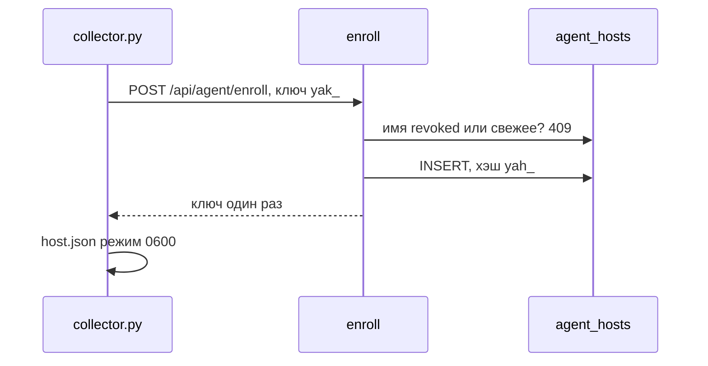

# 3. Ключи агента и регистрация хоста

## Зачем нужно

Один общий ключ на все компьютеры офиса удобно положить в GPO, но им нельзя принимать отчёты: украденный с одного ПК ключ позволил бы прислать отчёт от чужого имени. Поэтому ключ площадки только регистрирует хосты. У каждого хоста после этого свой ключ, и сервер принимает отчёт только с его именем.

## Два ключа

| | Ключ площадки | Ключ хоста |
|---|---|---|
| Префикс | `yak_` + `token_urlsafe(32)` | `yah_` + `token_urlsafe(32)` |
| Где генерируется | `generate_agent_api_key` | `generate_agent_host_key` |
| Где лежит хэш | `agent_api_keys.key_hash` | `agent_hosts.key_hash` |
| Что можно | Манифесты и `POST /api/agent/enroll` | Манифесты и `POST /api/ingest` только со своим hostname |
| Прямой отчёт | Только если `direct_use=true` (старые ключи) | Да, со своим именем |

Оба хэша — SHA-256 в hex (`hash_agent_api_key` в `core/security.py`). Открытый ключ в базе не хранится и показывается один раз.

Заголовок на всех запросах агента: `X-Agent-Api-Key`.

`get_agent_identity` (`api/deps.py`) ищет хэш сначала в `agent_hosts` со статусом `active` и обновляет `last_seen_at` и IP. Если там нет — ищет активный ключ площадки с неистёкшим `expires_at`. Любая неудача — один и тот же 401 «Недействительный ключ агента», без уточнения, какой именно ключ не подошёл.

## Как регистрируется хост

`enroll` в `api/routes/agent.py`, `POST /api/agent/enroll`, код 201.

1. Если пришли уже ключом хоста — 409.
2. Имя нормализуется: `normalize_hostname` приводит к нижнему регистру.
3. Ищется прежняя регистрация с тем же именем, кроме статуса `replaced`.
4. Статус `revoked` — 409, пока запись не удалят.
5. Если `last_seen_at` моложе `AGENT_REENROLL_AFTER_DAYS` (7 дней) — 409, имя занято.
6. Иначе старая запись помечается `replaced`, создаётся новая: `enrollment_key_id`, hostname, ОС, IP, хэш нового ключа.
7. Ответ: `host_id`, `hostname`, `key`. Ключ больше не повторяется.

На агенте это `enroll_host` в `agent/collector.py`:

1. Создаётся приватный каталог состояния (`make_private_dir`).
2. POST с ключом площадки.
3. Ответ атомарно пишется в `host.json` с правами 0600: `host_id`, `hostname`, `key`, `server`, `enrolled_at`.
4. 404 или 405 — сервер ещё без регистрации, агент продолжает с ключом площадки. 409 — `EnrollmentConflict`, выход с кодом 1.

Порядок в `main`: если `host.json` уже есть, дальше используется ключ хоста. Флаг `--enroll` делает только регистрацию и выходит. Код 75 — сервер недоступен, установщик может повторить. Обычный прогон без ключа хоста регистрируется **после** сбора и перед отправкой. Если отправка получила 401, а ключ площадки ещё есть, `reenroll` удаляет `host.json` и регистрируется заново. Отозванный хост получит 409, и это окончательно.

`check_agent_may_report` (`ingest.py`): ключ хоста с чужим hostname — 403. Ключ площадки без `direct_use` на `/api/ingest` — тоже 403. 403, а не 401: ключ верный, но этот отчёт ему нельзя слать. Агент такой прогон в очереди не выбрасывает как безнадёжный сразу при 401/403 досылки — см. главу про режимы.

Отзыв хоста: `POST /api/organizations/{org}/agent-hosts/{id}/revoke`. Удаление записи: `DELETE` той же пары. Удаление освобождает имя. Отзыв — нет. Обе ручки требуют администратора организации (`api/routes/agent_keys.py`).

Ключ площадки: создание с именем и сроком, отзыв. `direct_use` у новых ключей выключен. Отзыв ключа площадки не гасит уже выданные ключи хостов: у хоста `enrollment_key_id` может стать пустым, свой ключ остаётся.

## Где хранится

- `agent_api_keys`: организация, имя, хэш, `is_active`, срок, `revoked_at`, `last_used_at`, `last_used_ip`, `direct_use`.
- `agent_hosts`: организация, `enrollment_key_id`, hostname, `hostname_norm`, хэш, ОС, статус `active|revoked|replaced`, время и IP регистрации и последнего визита.
- На хосте: `host.json` в каталоге состояния. Linux — `StateDirectory` службы или `/var/lib/hardening-agent`. Windows — `%ProgramData%\HardeningAgent`.

Уникальность: один хэш ключа; одно активное имя хоста в организации — частичный индекс по `(organization_id, hostname_norm)` где статус не `replaced`.

## Где в коде

| Что | Где |
|---|---|
| Генерация | `generate_agent_api_key`, `generate_agent_host_key` в `core/security.py` |
| Проверка заголовка | `get_agent_identity` в `api/deps.py` |
| Регистрация | `enroll` в `api/routes/agent.py` |
| Сторона агента | `enroll_host`, `save_host_registration`, `load_host_key` в `agent/collector.py` |
| Интерфейс ключей | `api/routes/agent_keys.py`, страница `src/pages/AgentKeys.jsx` |
| Команда без интерфейса | `python -m app.commands.create_agent_key` |

## Ограничения

- Ключ хоста в ответе enroll показывается один раз. Потеря `host.json` при живом имени младше 7 дней требует удаления регистрации администратором или ожидания срока.
- Отозванный хост сам не перерегистрируется.
- Старые ключи с `direct_use` ещё могут слать отчёт без регистрации. Новые так не могут.
- Онлайн-отчёт отдельной подписью тела не защищён. Его защищают HTTPS, ключ в заголовке и необязательный пин сертификата. Подпись HMAC есть у файла `--out`, не у обычного POST. Это разобрано в главе про режимы.

## Вопросы на защите

**Чем ключ площадки отличается от ключа хоста?** Площадка (`yak_`) регистрирует и получает манифесты. Хост (`yah_`) шлёт отчёт только со своим именем. Хэши лежат в разных таблицах.

**Что будет, если украсть ключ с одного ПК?** Им можно слать отчёт только этого hostname. Чужой хост получит 403. Подписывать паки этот ключ не умеет: подпись паков — отдельный ключ Ed25519, на агенте только открытая половина.

**Почему повторная установка через неделю проходит, а на следующий день нет?** `AGENT_REENROLL_AFTER_DAYS` равен 7. Пока `last_seen_at` свежее, имя занято. Так нельзя перехватить хост, который на связи.

**Где лежит ключ на диске?** В `host.json` каталога состояния, права 0600 на Linux. В репозиторий и в пак он не попадает.
