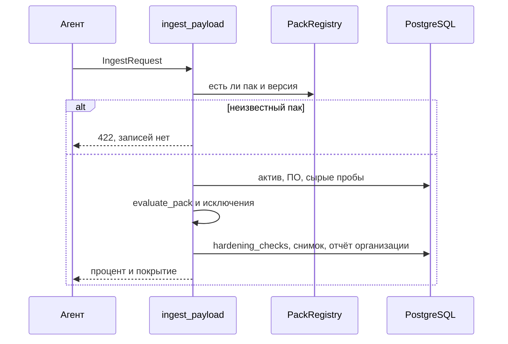

# 11. Приём отчёта и снимки

## Зачем нужно

Один прогон должен атомарно обновить «как сейчас» и дописать «как было». Если посередине упадёт база, не должно остаться нового актива без проверок или второго скана с тем же номером. Повторная отправка из очереди не должна создавать второй снимок.

Общая функция — `ingest_payload` в `src/backend/app/api/routes/ingest.py`. Её вызывают:

| Кто | HTTP | `source` |
|---|---|---|
| Агент | `POST /api/ingest` | `agent` |
| Загрузка выгрузки | `POST …/offline-scans` | `offline-upload` |
| Опрос | `POST …/manual-scans` | `manual` |
| Файл `--out` | `POST …/agent-reports` | `agent-report-file` |

## Как сервер принимает отчёт

`ingest` сначала вызывает `check_agent_may_report`. Дальше всё в одной транзакции.

1. Время. `_collected_at`: метка с часовым поясом, не больше чем на 10 минут в будущем и не старше 31 дня. В снимок пишется минимум из времени сбора и времени приёма.
2. Повтор `run_id` в этой организации — 409. То же самое ловит уникальный индекс, если два запроса пришли одновременно (`IntegrityError`). Агент считает 409 успехом.
3. Все пары (id, версия) ищутся в реестре **до любой записи**. Неизвестный пак — 422, в базе ничего нового нет.
4. Создаётся `ingestion_batches`: источник, `run_id`, `collected_at`, статус `processing`.
5. Окружение и актив находятся или создаются.
6. `_upsert_inventory`: одна строка паспорта на актив. Если `inventory` в теле нет, шаг пропускается и старый паспорт не стирается.
7. ПО актива удаляется и вставляется пакетом. Пустой список означает «ПО нет», а не «поле забыли»: список заменяется целиком.
8. `DELETE` из `asset_vulnerability_state`. Находки БДУ станут считаться устаревшими и пересчитаются при следующем открытии страницы, не внутри этого запроса.
9. `agent_collections.collected_data` — сырые факты и `probe_results` по каждому паку. Лишние ключи в результатах проб оценка игнорирует.
10. Если есть старые `facts` или паков нет, дополнительно считается `evaluate_asset` по `hardening_rules`. Если паки есть, а facts пустые, старые правила не запускаются: иначе каждая из них стала бы ложным «не проверено».
11. Для каждого пака — `evaluate_pack`.
12. `apply_exceptions` проставляет принятый риск на текущие `fail`.
13. `compute_compliance_score`, `count_accepted`, `compute_coverage`.
14. `hardening_checks` актива удаляются и пишутся заново. Это текущее состояние, не история.
15. `pg_advisory_xact_lock` по ключу `scan_number:<организация>`, затем `MAX(scan_number)+1`. Так параллельные хосты одной организации не получают одинаковый номер.
16. `scan_snapshots` и строки `scan_check_results`. В строку копируются название, критичность, рекомендация, ожидание и свидетельство на этот момент.
17. `record_org_report` пересчитывает процент организации по всем текущим проверкам всех активов и пишет `hardening_reports`.
18. `commit`. Ответ `IngestResponse`: id партии, актива и снимка, счётчики, процент, число принятых рисков, покрытие, итог по каждому паку.

## Что такое снимок

`scan_snapshots` — один на прогон, обычно один актив. Поля агрегатов: `total_checks`, `passed`, `failed`, `accepted_risks`, `compliance_score`, `total_assets` (здесь 1), `total_software`, `snapshot_label`, `collection`, `scan_number`.

Отдельных колонок `errors` и покрытия нет. «Не проверено» = `total - passed - failed - accepted_risks`. Покрытие есть только в ответе приёма (`compute_coverage`), в снимок оно не пишется.

`collection` пустой — живой хост или живое устройство. Иначе JSON источника: выгрузка, опрос или файл.

Колонки `exported_pdf_path` и `exported_excel_path` в модели есть и миграцией созданы. Текущая выгрузка пишет файл в ответ HTTP и эти колонки не заполняет.

`scan_check_results` хранит копию результата. Если завтра поменять текст рекомендации в YAML, старый PDF всё равно покажет старый текст: он лежит в строке снимка, а не читается из пака заново.

## Прогон организации

Снимок по-прежнему один хост. **Прогон** (`scan_runs`) собирает снимки многих хостов одной организации в одно окно, чтобы волна GPO не превращалась в сотни отдельных сканов.

Дефолт — **ежедневно**, как `hardening-agent@.timer` (`OnCalendar=daily`, `RandomizedDelaySec=1h`) и задача Windows без `-Schedule Weekly`. Окно — локальные сутки `DISPLAY_TIMEZONE` (по умолчанию UTC) **плюс час** RandomDelay: `[полночь, полночь следующих суток + 1 ч)`. Снимок в первый час после полуночи остаётся в прогоне предыдущих суток: это хвост случайной задержки, который может перешагнуть полночь. Ровно в 01:00 начинается новый прогон. Расписание организации можно сменить на **еженедельно** (понедельник 00:00, 7 суток + тот же час): `PUT /api/organizations/{id}/scan-schedule`. Уже открытое окно от этого не переписывается.

Администратор может открыть прогон вручную (`POST …/scan-runs`) — на всю организацию или на одно окружение. Пока он открыт, новые снимки этой области идут в него, а не в автоокно. Так волна, которая длится дольше суток, остаётся одним прогоном. Отдельной «группы хостов» нет: граница — окружение. Автопрогон всегда на всю организацию. Закрытие — кнопка или `closes_at`. Окно, у которого вышло время, закрывается при следующем приёме или при открытии списка. Своего cron на сервере нет.

Один хост — один снимок в прогоне, последний по времени сбора. Более ранний снимок того же хоста из прогона выходит (`run_id` пустой), строка в `scan_snapshots` остаётся: старые ручки по id её отдают. Опоздавший отчёт, чей `collected_at` ещё внутри окна, дописывается в этот прогон, даже если окно уже закрыли. Прогон заново не открывается.

Привязка в `attach_snapshot` (`services/scan_runs.py`), в той же транзакции, что `ingest_payload`. Агентский JSON не менялся: поле `scan_run_id` в ответе приёма новое, агент его не разбирает. Выгрузка, опрос и файл отчёта принимают необязательный `scan_run_id` и могут выбрать открытый прогон. Сетевое устройство идёт тем же `ingest_payload`, поэтому попадает в прогон само.

Оценка прогона при приёме не считается. На чтении это та же дробь, что `compute_compliance_score`, но по суммам `passed` и `failed` снимков прогона: соблюдено / (соблюдено + нарушено без принятого риска). Это не среднее процентов хостов.

Уже накопленные снимки миграция `f0c2a7e91b54` раскладывает волнами: от полуночи суток первого снимка — двое суток плюс час. Волна, начавшаяся 2 ноября, включает и 3 ноября (до 4 ноября 01:00) и становится одним прогоном. Снимок 6 ноября открывает следующую. Внутри волны остаётся последний снимок хоста. Downgrade снимает прогоны и колонки, строки снимков не удаляет.

## Сравнение двух снимков

`GET /api/snapshots/compare` (`compare_snapshots` в `api/routes/snapshots.py`). Оба снимка должны быть доступны пользователю и относиться к одной организации.

Ключ строки — `(asset_id, check_key)`, где `check_key` — `rule_code` старого правила или `check_id` пака. Id проверки стабилен между версиями пака, поэтому 1.3.0 и 1.4.0 сравниваются.

Сравниваются только активы, которые есть в обоих снимках. Актив, которого нет в одном из них, не показывается ни как новый, ни как удалённый.

`classify(before, after, before_accepted, after_accepted)`:

| Было → стало | Тип |
|---|---|
| не было → есть | `new`, или `accepted`, если сразу с риском |
| было → нет | `removed` |
| fail → pass | `fixed` |
| pass → fail | `regressed`, даже если риск уже принят |
| fail → fail, риск появился | `accepted` |
| fail → fail, риск был и остался | не показывается |
| fail → fail без риска | `still_failed` |
| участвует error и статус изменился | `changed`, или `accepted`, если стало fail с риском |
| pass→pass, error→error | не показывается |

Порядок на экране: ухудшилось, новое, всё ещё нарушено, изменилось, риск принят, исправлено, исчезло. Константа `CHANGE_ORDER`.

История не переписывается, когда риск принимают или отзывают задним числом. Меняется только `hardening_checks` и новый отчёт организации (`sync_current_state`). Старый снимок помнит, был ли риск на момент прогона.

## Где в коде

| Что | Где |
|---|---|
| Приём | `ingest`, `ingest_payload` в `api/routes/ingest.py` |
| Схема | `schemas/ingest.py` |
| Снимок | модель `ScanSnapshot` в `models/scan_snapshot.py` |
| Сравнение снимков | `classify`, `compare_snapshots` в `api/routes/snapshots.py` |
| Прогон | `services/scan_runs.py`, `api/routes/scan_runs.py` |
| Страницы | `src/pages/Scans.jsx`, `ScanRun.jsx`, `ScanRunCompare.jsx`, `ScanCompare.jsx` |

## Ограничения

- Один запрос — один актив. Тысяча хостов — это тысяча запросов, не один пакетный файл. В списке они собираются в один прогон, если попали в одно окно.
- Сравнение двух снимков по-прежнему не показывает хост, который есть только в одном из них. Сравнение прогонов показывает добавленные и пропавшие хосты отдельно.
- Переоценки старого снимка новым паком нет. Сырьё для этого в `agent_collections` сохранено, отдельной ручки нет.
- Сравнение не видит актив, который есть только в одном снимке.
- Статус `skipped` разрешён CHECK-ограничением исходной миграции, но `evaluate_pack` его не пишет. Фактические статусы — `pass`, `fail`, `error`.

## Вопросы на защите

**Что сервер делает в момент приёма?** Проверяет ключ и схему, находит пак той версии, которую прислал агент, сравнивает каждую пробу с `assert`, применяет исключения, пишет снимок и текущее состояние.

**Где лежат сырые факты, если норму потом поправят?** В `agent_collections.collected_data`. Автоматически история не пересчитывается.

**Почему два хранилища результатов?** `hardening_checks` — что сейчас, для дашборда и методики. `scan_check_results` — что было в конкретном прогоне. Второе не переписывается.

**Откуда номер скана?** `MAX+1` внутри организации под advisory-блокировкой. Два параллельных отчёта не получают один номер.
