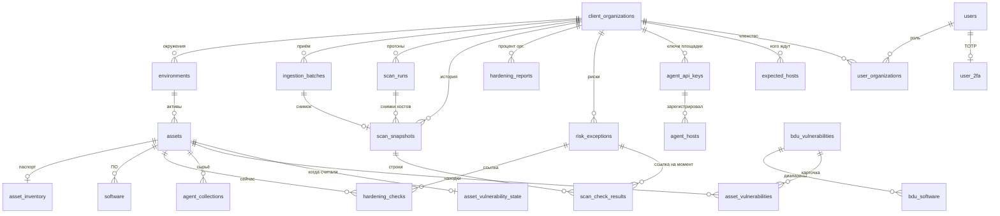

# 19. Модель данных и миграции

## Зачем нужно

Почти каждый экран — это чтение одной-двух таблиц. На защите проще показать связи, чем перечислять экраны заново.

Схема меняется только Alembic. При старте контейнера миграции сами не запускаются: их гоняют отдельной командой после копирования базы. Так записано в `docs/project-description.md` и в скриптах выката.

Подсчёт на 8 ноября 2026: в `src/backend/alembic/versions/` **20** файлов. Голова цепочки — `f0c2a7e91b54` (прогоны). Она ревизит `a1d9c4f27e63` (паспорт актива). Документ `project-description.md` до прогонов называл головой `a1d9c4f27e63`. Это устарело.

## Связи

`hardening_rules` связана с `hardening_checks.rule_id` только у старого режима фактов. У паков `rule_id` пустой, заполнены `check_id`, `pack_id`, `pack_version`.

Таблицы БДУ не описаны классами SQLAlchemy. Их создают миграции `f3c1a9e7b2d4` (БДУ), `a7d2e9c4f1b8` (OVAL), `b4e8d1f6a2c9` (находки) и читает текст SQL.

## Что в какой таблице

| Таблица | Зачем | Кто пишет |
|---|---|---|
| `client_organizations` | заказчик | суперадмин |
| `user_organizations` | роль | админ организации |
| `users`, `user_2fa` | вход | суперадмин и сам пользователь |
| `environments`, `assets` | куда лёг отчёт | `ingest_payload` |
| `asset_inventory` | паспорт и опциональные ПДн | `_upsert_inventory` |
| `software` | пакеты или прошивка, замена целиком | приём |
| `ingestion_batches` | один приём, `run_id` | приём |
| `agent_collections` | сырые пробы | приём |
| `hardening_checks` | текущие статусы актива | приём и смена риска |
| `scan_runs` | окно многих хостов | приём и администратор |
| `organization_scan_settings` | daily или weekly | администратор |
| `scan_snapshots`, `scan_check_results` | история; `run_id` пустой у вытесненного снимка | приём |
| `hardening_reports` | процент организации | приём и смена риска |
| `risk_exceptions` | принятый риск | админ организации |
| `agent_api_keys`, `agent_hosts` | ключи | интерфейс и enroll |
| `expected_hosts` | список охвата | загрузка CSV |
| `policies` | карточки документов | админ организации |
| `hardening_rules` | 14 стартовых правил старого режима | миграция-сид |
| `bdu_*`, `distro_*` | копия БДУ и OVAL | команда `bdu` |
| `asset_vulnerabilities` | находки и V | `refresh_findings` |
| `asset_vulnerability_state` | отметка свежести | то же; приём строку удаляет |
| `vulnerability_org_state` | число активов для L | `_score` |

Не используются логикой: `auditor_organizations`, `user_roles`, `configs`. Они из базовой миграции `91c43e6f135e`.

## Миграции по порядку смыслов

Цепочка одна, без веток. Имена файлов:

| Ревизия | О чём |
|---|---|
| `91c43e6f135e` | базовая схема |
| `332ce34492ff` | ключи площадки |
| `df4fc6d56bf8` | сид правил |
| `5bbca4cdfbaa` | индексы внешних ключей |
| `a3f1c9d27b40` | колонки результата пака |
| `b7d2e4f18c63` | название и рекомендация в снимке |
| `c4e8a1d2f905` | `password_changed_at` |
| `d91b3f7a2c64` | `locked_until` |
| `e5a7c3b9d102` | принятый риск |
| `f3c1a9e7b2d4` | БДУ |
| `a7d2e9c4f1b8` | OVAL Ubuntu |
| `b8e3f0a5c217` | `collection` у снимка |
| `c4f2a8d6e913` | транспорт агента, `run_id` |
| `d7a1e4c9f350` | регистрация хостов |
| `e8b2f5a1c470` | индексы на много хостов |
| `f1c3d6a8b925` | ожидаемые хосты |
| `b4e8d1f6a2c9` | сохранённые находки |
| `c9f2a7e4d815` | поиск ПО, pg_trgm |
| `a1d9c4f27e63` | паспорт |
| `f0c2a7e91b54` | прогоны, голова |

Проверить на живой базе: `alembic current` должен показать `f0c2a7e91b54`.

Индексы прогона, без которых страница на 500 хостов читает таблицу целиком: частичный `scan_snapshots(run_id)`, уникальный `(run_id, asset_id)` (один хост в прогоне), частичный `scan_check_results(snapshot_id) WHERE status = 'fail'` для сводки нарушений, уникальный один открытый прогон на пару (организация, окружение). Оценка в строку прогона не пишется.

## Индексы, без которых тысячи хостов встают

Их добавляли отдельные миграции, не «вообще индексы»:

- `software.asset_id` — иначе удаление ПО хоста при каждом отчёте читает таблицу целиком
- GIN `pg_trgm` по имени ПО — поиск на странице инвентаризации
- уникальность `(organization_id, scan_number)`
- уникальность `(organization_id, run_id)` где `run_id` не пуст
- частичная уникальность имени хоста, пока статус не `replaced`
- `(organization_id, level_rank, v)` у находок — первая страница уязвимостей без полной сортировки

## Ограничения

- CHECK статуса проверки разрешает ещё и `skipped`. Движок паков его не пишет.
- Времена — `timestamptz`. В отчёте их переводят в `DISPLAY_TIMEZONE`.
- JSONB используется для сырых проб, состава выгрузки, тегов, дисков, деталей OVAL. Это не второй источник правды для статуса: статус продублирован колонкой.

## Вопросы на защите

**Сколько миграций и какая голова?** 20 файлов, голова `f0c2a7e91b54`, прогоны. Паспорт оборудования — предыдущая ревизия `a1d9c4f27e63`.

**Где текущее состояние, а где история?** `hardening_checks` и `scan_check_results`. Вторая не переписывается.

**Где БДУ?** `bdu_vulnerabilities` и `bdu_software`. Находки конкретного хоста — `asset_vulnerabilities`. Это разные таблицы: справочник и результат сопоставления.
