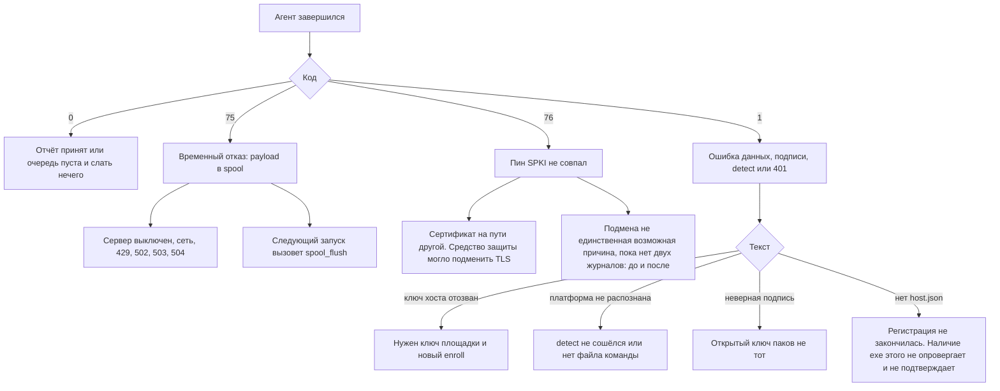

# 31. Отказы и дерево диагностики

Коды и тексты — из `agent/collector.py` коммита `1a5997d`. Это подсказка, куда смотреть, а не доказательство причины конкретного инцидента. Один пустой журнал или отсутствие события в отфильтрованной выборке не называют причину.

## Коды

| Код | Где | Смысл |
|---|---|---|
| 0 | `main()` | Успех, в том числе тихий успех, когда слать нечего |
| 75 | `return 75` после `TransientError` | `EX_TEMPFAIL`. Отчёт лежит в `{state}/spool`. Следующий запуск пытается дослать. При `--no-spool` будет 1 |
| 76 | `SystemExit(76)` в `ServerConnection` | SHA-256 SPKI сервера не совпал с `--pin-sha256` |
| 1 | остальные `return 1` и `SystemExit` с текстом | Постоянная ошибка: 401, битый JSON, неузнанная платформа, файл выгрузки больше лимита |

Повтор внутри одного запуска: коды HTTP 429, 502, 503, 504 и отсутствие соединения. Пауза — full jitter. Бюджет по умолчанию 1800 секунд (`--retry-budget-seconds`). Ответ 500 в цикле повторов запроса не крутится: для очереди он всё ещё временный, но не бесконечный цикл внутри запуска. Подробности — [глава 6](06-agent-modes.md).

## Что смотреть по симптому

| Симптом | Куда смотреть в коде | Чего из симптома не следует |
|---|---|---|
| На диске есть exe, нет `host.json` | `enroll_host` пишет `host.json` только после ответа `POST /api/agent/enroll` | Что политика «не применялась», что виноват только антивирус, что сервер отверг хост |
| Журнал агента старый | путь журнала GPO — `gpo-startup.log` рядом со сценарием, не единственный источник | Что более поздних попыток не было: журнал мог быть другим файлом или не попасть в выборку |
| В событиях планировщика нет Scripts | фильтр выборки | Что узла Scripts в политике нет. Так писать нельзя |
| Сервер не видит enroll | таблица `agent_hosts`, журнал API | Что агент не запускался: он мог не дойти по сети или не дойти до enroll |
| Задача от SYSTEM не видит то, что видит пользовательский PowerShell | разные учётные записи и разные хранилища сертификатов | Что причина одна и уже найдена |
| 401 на `/api/ingest` | `check_agent_may_report`: имя хоста ключа `yah_` не совпало или ключ отозван | Что «сломался пак» |
| Пак не выбран | `select_manifests`: нужны все правила `detect` | Что агент возьмёт «похожий» пак. Он не возьмёт |
| Процент высокий, покрытие низкое | `compute_coverage`: `error` не в знаменателе процента | Что хост хорошо настроен |
| Отчёт не пришёл ночью | очередь и расписание агента, не cron сервера | Что приём на сервере сломан. Серверного планировщика нет, [глава 20](20-schedulers.md) |
| Выгрузка отклонена | `offline_split.split_bytes`, лимит `MAX_TEXT_BYTES` | Что устройство «не поддерживается», пока не показан текст ошибки |

## Чего документация не требует удалять

`host.json` и ключ хоста — рабочее состояние агента. Их удаление запускает новую регистрацию и не является шагом диагностики по умолчанию. Сначала копируют журнал и код выхода. Удаление уместно, когда ключ отозван и оператор сознательно регистрирует хост заново ключом площадки.

Секреты в примеры не подставлять. В журнале GPO сценарий маскирует ключ площадки функцией `Redact` в `deploy/windows/gpo/gpo-startup.ps1`.
