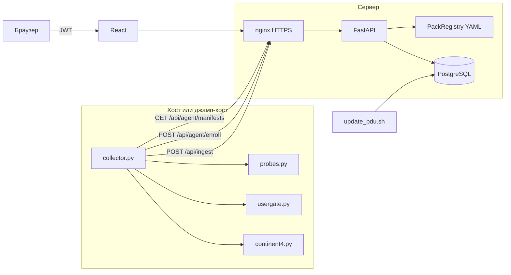
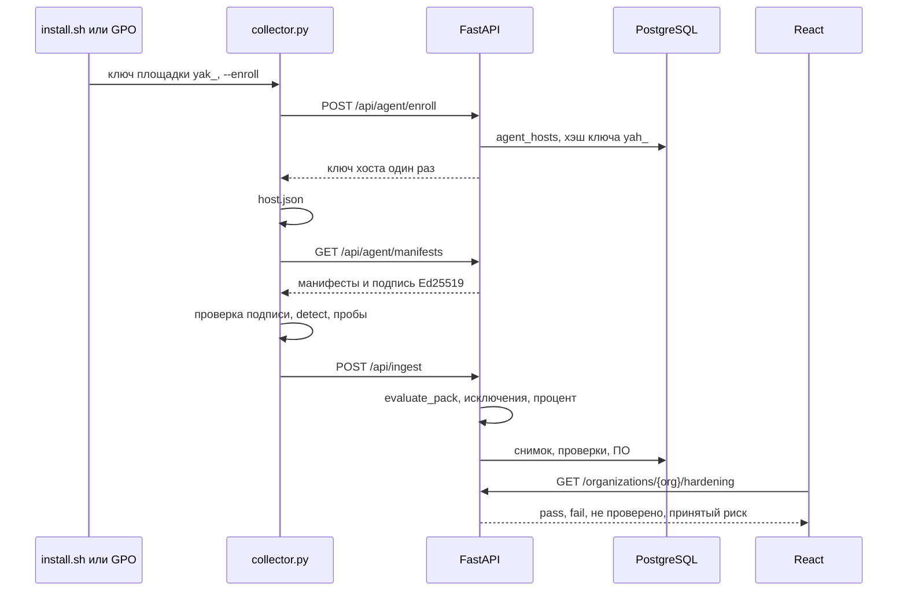
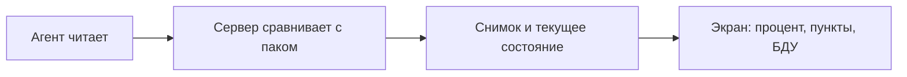
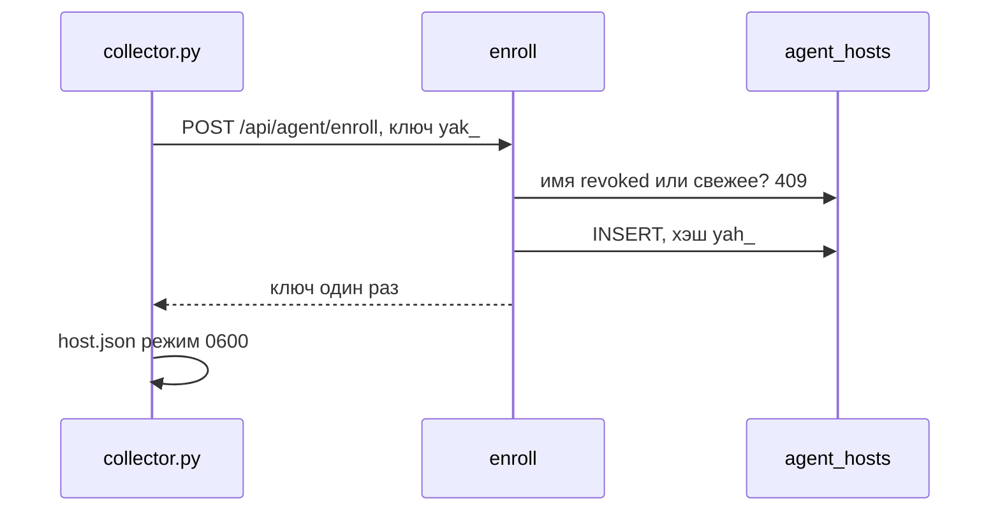
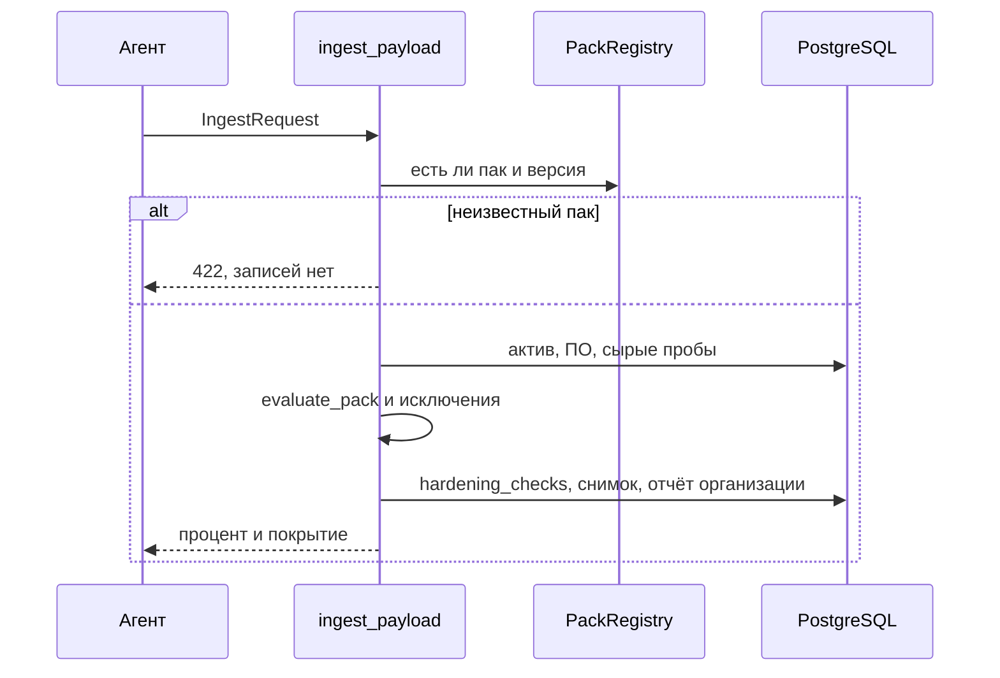
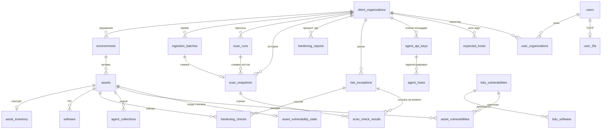
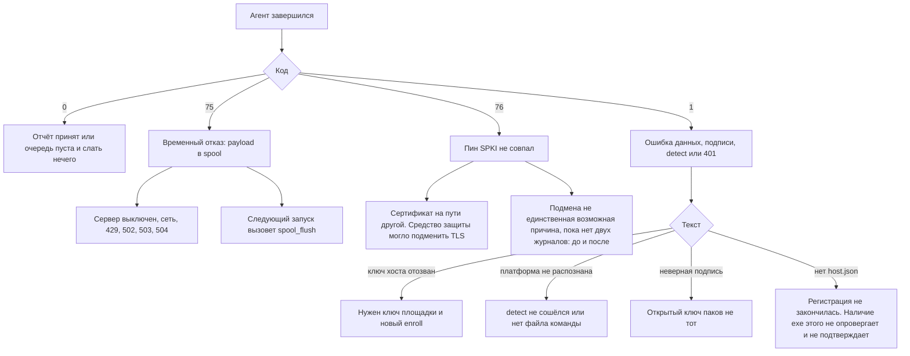

<!-- Сгенерировано docs/how-it-works/assemble_full.py. Не редактировать вручную. -->

# Харденинг. Полный справочник для защиты

Файл собран из глав каталога `docs/how-it-works/` в фиксированном порядке.
Если текст расходится с главой, верна глава: её и нужно править, затем снова
запустить `python3 docs/how-it-works/assemble_full.py`.

Якоря одинаковых заголовков в длинном файле на GitHub могут совпасть.
Для перехода по ссылке открывайте отдельную главу.


---

<!-- README.md -->

# Справочник «Как работает Харденинг»

Документ для автора диплома и научного руководителя. Он отвечает на вопросы собрания: откуда берутся данные, где и что с чем сравнивается, как получается оценка и находки.

Источник истины — код в `main`, коммит `1ec48dbc370fb070138915430421e371610bd728` («Убрать страницу «Проверка по опросу» из интерфейса (#23)», 2026-11-23 00:04:01 +0500). Сверка — **22 ноября 2026**. Это коммит репозитория, не подтверждение выкладки в прод. К продакшену и машинам заказчика подключение не делалось. Заметки, которые здесь не подтверждены повторно, собраны в [истории](24-history-limits.md) и в [матрице доказательств](28-evidence-matrix.md).

Главный принцип, который держит весь код: **агент собирает факты, сервер сравнивает их с нормой пака**. В манифесте, который уходит агенту, нет полей `assert`, `severity`, `title`, `remediation` и `refs` — их знает только сервер (`build_manifest` в `src/backend/app/services/packs/manifest.py`).

## Оглавление

| № | Раздел | О чём |
|---|---|---|
| 0 | [Шпаргалка на 5 минут](00-cheatsheet.md) | Схема, 7 шагов, формулы, 15 цифр |
| 1 | [Вход, JWT, роли, 2FA](01-auth.md) | Как человек попадает в систему |
| 2 | [Организации, окружения, хосты](02-organizations-hosts.md) | Куда складываются активы и кто их видит |
| 3 | [Ключи агента и enrollment](03-enrollment-keys.md) | Ключ площадки → ключ хоста |
| 4 | [Публикация дистрибутива](04-agent-publish.md) | `publish_agent.sh`, `version.json`, `/downloads/` |
| 5 | [Установка Linux и Windows](05-agent-install.md) | systemd, weekly, GPO, планировщик. Раскатка на домен — [gpo-rollout.md](../gpo-rollout.md) |
| 6 | [Режимы агента](06-agent-modes.md) | Онлайн, очередь, файл, CLI |
| 7 | [Паки](07-packs.md) | Формат YAML, каталог всех паков, подпись |
| 8 | [Пробы](08-probes.md) | Каждый тип сборщика |
| 9 | [Сетевые устройства](09-network-devices.md) | SSH, выгрузка, UserGate, Континент 4 |
| 10 | [Опрос](10-manual.md) | API и паки `manual`. Страницы анкеты в интерфейсе нет |
| 11 | [Приём и снимки](11-ingest-snapshots.md) | Что делает сервер с отчётом |
| 12 | [Оценка и методика ФСТЭК](12-scoring-fstec.md) | Процент, покрытие, 70 пунктов |
| 13 | [Принятый риск](13-exceptions.md) | Исключения |
| 14 | [БДУ и OVAL](14-bdu.md) | Загрузка, версии, критичность V |
| 15 | [Инвентаризация](15-inventory.md) | Паспорт железа и ПДн |
| 16 | [Отчёты](16-reports.md) | PDF, Excel, сравнение сканов |
| 17 | [Страницы интерфейса](17-ui.md) | Что показывает каждая страница |
| 18 | [API](18-api.md) | Метод, путь, кто имеет право |
| 19 | [Модель данных](19-data-model.md) | Таблицы и миграции |
| 20 | [Планировщики](20-schedulers.md) | Что крутится само, а что нет |
| 21 | [Развёртывание](21-deploy.md) | Docker, nginx, HTTPS, откат |
| 22 | [1000 хостов](22-scale.md) | Лимиты и очередь |
| 23 | [Тесты и CI](23-tests-ci.md) | Что и на каких ОС проверяется |
| 24 | [История и ограничения](24-history-limits.md) | Этапы и то, чего в коде нет |
| 25 | [FAQ и глоссарий](25-faq-glossary.md) | Сводка вопросов защиты |
| 26 | [Карта модулей](26-module-map.md) | Каждый файл → раздел |
| 27 | [След одной проверки](27-worked-examples.md) | SSH, Континент 4, БДУ и принятый риск на фрагментах из репозитория |
| 28 | [Матрица платформ и доказательств](28-evidence-matrix.md) | Пак, способ сбора, фикстуры, CI, живой стенд, чего тест не доказывает |
| 29 | [Вопросы комиссии](29-defense-qa.md) | Развёрнутые ответы со ссылками на главы и код |
| 30 | [Сценарий защиты](30-diploma-show.md) | Что показать и как требование трассируется в код и тест |
| 31 | [Диагностика отказов](31-diagnostics.md) | Дерево симптомов, коды выхода, что не следует из одного журнала |
| 32 | [Предлагаемые изменения](32-proposed-changes.md) | PR 21: не в `main`, не описывать как прод |
| 33 | [Снятие страницы опроса](33-proposed-pr23.md) | Уже в `main` `1ec48db`. Прод этой выкладкой не подтверждён |
| 34 | [Файлы для администратора](34-operator-files.md) | Точный JSON Континента, форматы сетевых паков, CSV, отчёт агента |

Печатная сборка тех же глав без второй редакции: [POLNYJ-SPRAVOCHNIK.md](POLNYJ-SPRAVOCHNIK.md). Её пересобирает `python3 docs/how-it-works/assemble_full.py`. Править нужно главы, затем пересобрать файл.

Цифры на 22 ноября 2026 по дереву с `1ec48db`, метод — в [тестах](23-tests-ci.md): **26** паков, **353** проверки, **43** файла YAML, **20** миграций, голова `f0c2a7e91b54`. Сбор pytest: бэкенд **670**, агент **334**. Список Playwright: **128** в 8 файлах. Юнит-тесты интерфейса: **15**. Браузер и pytest бэкенда не запускались.

## Общая схема



Четыре способа, которыми факт попадает на сервер:

1. Агент на самом хосте (`LocalTransport`) — файлы, команды из белого списка, реестр Windows.
2. Агент рядом с устройством: обычный SSH (`SshTransport`), UserGate (`UserGateTransport`: XML-RPC, затем SSH), Континент 4 (`Continent4Transport`: три GET к API ЦУС по ГОСТ TLS).
3. Выгрузка конфигурации: каталог файлов у агента (`--offline-dir`) или загрузка тех же файлов в интерфейсе. Сервер гоняет тот же `probes.py`.
4. Опрос: ответы на вопросы пака `transport: manual` принимает `POST …/manual-scans`. Страницы анкеты в интерфейсе нет. Сравнение с нормой всё равно делает сервер.

## Сквозной сценарий

Один прогон хоста от установки до экрана «Харденинг».



По шагам, со ссылками на главы:

1. Администратор организации создаёт ключ площадки `yak_` на странице «Агенты». Сам ключ показывается один раз, в базе лежит SHA-256. [Ключи](03-enrollment-keys.md).
2. На Linux `install.sh` или Ansible ставит службу. На Windows GPO ставит `hardening-agent.exe` и задачу планировщика. Строку параметров и архив для ключа страница «Агенты» собирает при создании ключа. [Установка](05-agent-install.md), [раскатка](../gpo-rollout.md). Дистрибутив перед этим публикует [publish_agent.sh](04-agent-publish.md).
3. Первый запуск с `--enroll` обменивает ключ площадки на ключ хоста `yah_`. Дальше агент ходит только им и только от своего имени. [Enrollment](03-enrollment-keys.md).
4. Агент запрашивает манифесты актуальных паков нужного транспорта. Сервер подписывает канонический JSON ключом Ed25519. Неверная подпись останавливает весь прогон. [Паки](07-packs.md).
5. `select_manifests` оставляет паки, у которых совпали **все** правила `detect`. Подходят все совпавшие сразу: ОС, Docker и PostgreSQL уходят одним запросом. [Режимы](06-agent-modes.md), [пробы](08-probes.md).
6. Каждая проверка манифеста — это проба. Результат: `found`, `value`, `evidence`. Секреты маскируются. На сервер не уходят ожидания и критичность. [Пробы](08-probes.md).
7. `POST /api/ingest` в одной транзакции пишет актив, паспорт, список ПО, сырые пробы, текущие проверки и снимок. Сравнение делает `evaluate_pack`. [Приём](11-ingest-snapshots.md).
8. Процент — `pass / (pass + fail без принятого риска)`. «Не проверено» (`error`) в знаменатель не входит. Покрытие показывает, какая доля проверок вообще выполнилась. [Оценка](12-scoring-fstec.md).
9. Принятый риск не меняет статус: это по-прежнему `fail`, но с `risk_exception_id`. В процент он не входит. [Исключения](13-exceptions.md).
10. Список ПО сопоставляется с БДУ, когда открывают «Уязвимости» или «ФСТЭК», а не в момент приёма. [БДУ](14-bdu.md).
11. Человек видит это на страницах обзора, харденинга, уязвимостей, методики и сканов. [Интерфейс](17-ui.md).

Сетевое устройство проходит те же шаги 4–11, но транспорт другой: [сетевые устройства](09-network-devices.md). То, чего нет ни в файле, ни в API, закрывает [опрос](10-manual.md).

## Что считать «сравнением»

В продукте слово «сравнение» встречается в трёх разных местах. Их легко перепутать на защите.

| Что сравнивается | Где в коде | Результат |
|---|---|---|
| Значение пробы и поле `assert` пака | `check_assertion` в `services/packs/assertions.py`, вызывает `evaluate_pack` | `pass`, `fail` или `error` |
| Два снимка одной организации | `classify` в `api/routes/snapshots.py` | исправлено, ухудшилось, новое, риск принят |
| Версия пакета и диапазон версии в БДУ | `VersionRange.contains` в `services/bdu/versions.py` | находка или её нет |

Первое — это оценка харденинга. Второе — история. Третье — уязвимости ПО. Формулы и примеры — в соответствующих главах.


---

<!-- 00-cheatsheet.md -->

# Шпаргалка на 5 минут

Подробности — в главах по ссылкам. Здесь только то, что нужно сказать вслух.

## Схема



Агент не знает норму. Норма — поле `assert` в YAML, её применяет `evaluate_pack` на сервере ([7](07-packs.md), [12](12-scoring-fstec.md)).

## Путь данных в 7 шагов

1. Администратор создаёт ключ площадки `yak_`. Страница «Агенты» сразу даёт строку параметров GPO и архив. Агент меняет ключ на ключ хоста `yah_` (`POST /api/agent/enroll`). [3](03-enrollment-keys.md), раскатка — [gpo-rollout.md](../gpo-rollout.md)
2. Агент скачивает манифесты и проверяет подпись Ed25519. Неверная подпись — прогон не начинается. [7](07-packs.md)
3. `detect` выбирает паки. Агент читает только то, что разрешает белый список проб. [8](08-probes.md)
4. На сервер уходит JSON: актив, ПО, `probe_results` (`found`, `value`, `evidence`). Ожиданий в нём нет. [6](06-agent-modes.md)
5. `ingest_payload` в одной транзакции пишет актив, сырьё, текущие проверки и снимок и кладёт снимок в прогон организации. [11](11-ingest-snapshots.md)
6. `check_assertion` ставит `pass`, `fail` или `error`. Процент = pass / (pass + fail без принятого риска). [12](12-scoring-fstec.md)
7. БДУ считается не здесь, а когда открывают «Уязвимости»: версия пакета против диапазона в копии БДУ. [14](14-bdu.md)

## Формулы

Процент, `compute_compliance_score`:

```
passed / (passed + failed_без_риска) × 100
```

`error` («не проверено») не входит. Принятый риск — это по-прежнему `fail`, но из дроби вынут. Нет ни одного pass и fail — процента нет, это не 100.

Покрытие: `(pass + fail вместе с риском) / все проверки`.

Критичность находки, `criticality`:

```
V = Icvss × (0,5·K + 0,2·L + 0,3·P) × (Iat + Iimp)
```

Для нарушения конфигурации V нет. Срок берётся из `severity` пака: 24 часа, 7 дней, 4 недели, 4 месяца.

## 15 цифр

Подсчёт 22 ноября 2026 на дереве с `1ec48db`: YAML, `pytest --collect-only -q`, `npx playwright test --list`. Прогон бэкенда и браузера не выполнялся.

| | |
|---|---|
| Актуальных паков | 26 |
| Проверок в них | 353 |
| Файлов YAML вместе со старыми версиями | 43 |
| Миграций, голова | 20, `f0c2a7e91b54` |
| Пунктов методики | 70 = 44 проверки + 10 БДУ + 16 вне модели |
| Операторов сравнения | 13 в коде, `lt` и `gt` в паках не используются |
| Статусов движка | 3: `pass`, `fail`, `error` |
| Тесты бэкенда / агента / Playwright / утилиты UI | сбор 670 / сбор 334 / список 128 в 8 файлах / 15 |
| Образов Linux в CI | 16, плюс Windows Server 2022 и 2025 |
| `baseline` | 3 пака: Ubuntu, Docker, Windows Server |
| Лабораторные стенды, уровень всё ещё `draft` | UserGate 7.4.1 и Континент 4.2.1 |
| Повторная регистрация хоста | молчит дольше 7 дней |
| Лимит приёма | 30 запросов/мин на ключ, 6 одновременных |
| Срок токена человека | 8 часов, плюс отзыв при смене пароля |
| Блокировка входа | 5 ошибок, потом 15 минут |

## Откуда и с чем

**Откуда «PermitRootLogin no»?** `probe_file_kv` читает `/etc/ssh/sshd_config`. Сравнение `eq no` — на сервере. [27](27-worked-examples.md)

**Откуда настройки UserGate и Континента?** Агент рядом с устройством: XML-RPC и SSH, либо три GET к ЦУС по ГОСТ TLS. Сервер на устройство не ходит. [9](09-network-devices.md)

**С чем сравнивается версия ПО?** С диапазоном в `bdu_software`. Для Ubuntu ещё с OVAL. Это не процент харденинга. [14](14-bdu.md)

**Чем аудитор отличается от наблюдателя?** Подписью. Оба только читают. [1](01-auth.md)

**Почему много паков draft?** `baseline` требует `verified_on`. Его нет у сетевых паков, даже если формат сверяли со стендом. [7](07-packs.md)


---

<!-- 01-auth.md -->

# 1. Вход, JWT, роли и 2FA

## Зачем нужно

Люди работают в браузере. Данные организаций нельзя отдавать по одному паролю, если сайт открыт из интернета. Поэтому вход — это пароль, затем одноразовый код, затем токен, который сервер проверяет на каждом запросе.

Самостоятельной регистрации нет. Учётку создаёт суперадминистратор. Об этом прямо написано на странице входа.

## Как работает по шагам

1. `POST /api/auth/login` ищет пользователя по email в нижнем регистре (`login` в `src/backend/app/api/routes/auth.py`).
2. До проверки пароля `ensure_not_locked` смотрит `users.locked_until`. Если блокировка ещё идёт, ответ 429 и пароль не проверяется (`login_guard.py`).
3. Неверный пароль увеличивает `failed_login_attempts` атомарным `UPDATE`. После 5 подряд (`LOGIN_MAX_FAILED_ATTEMPTS`) счётчик обнуляется и ставится `locked_until` на 15 минут (`LOGIN_LOCKOUT_MINUTES`).
4. Если email не найден, пароль всё равно прогоняется через bcrypt по заготовленному хэшу (`_DUMMY_HASH`). Иначе по времени ответа можно было бы узнать, какие адреса есть в базе.
5. Неактивный или не `active` пользователь получает 403.
6. Если 2FA включена, сервер не выдаёт доступ. Он возвращает короткий JWT `type=pre_2fa` на 5 минут (`PRE_2FA_TOKEN_EXPIRE_MINUTES`). Счётчик неудач при этом не сбрасывается: иначе, зная пароль, можно было бы бесконечно подбирать код, чередуя его с верным паролем.
7. `POST /api/auth/verify-2fa` принимает код приложения или резервный код (`check_second_factor` в `api/routes/twofa.py`). Верный код сбрасывает счётчик и выдаёт обычный токен.
8. Обычный токен создаёт `create_access_token` (`core/security.py`): HS256, `sub` = id пользователя, `type=access`, `exp` через 8 часов (`ACCESS_TOKEN_EXPIRE_MINUTES = 60 * 8`), `iat` с долями секунды.
9. Браузер кладёт токен в `localStorage` под ключом `hardening_access_token` (`src/api/client.js`, `setStoredAccessToken`) и шлёт заголовок `Authorization: Bearer`.
10. `get_current_user_allow_password_change` (`api/deps.py`) отклоняет токен без `type=access`, токен старше `password_changed_at` и заблокированного пользователя.
11. Если `REQUIRE_2FA=true` (значение по умолчанию) и 2FA не включена, почти все ручки отвечают 403 «Нужно подключить двухфакторную защиту». Открыты смена пароля и подключение 2FA.
12. Временный пароль (`must_change_password`) закрывает API, пока его не сменят. Смена пароля (`POST /api/auth/change-password`) пишет новый bcrypt, обновляет `password_changed_at` и возвращает новый токен. Старые токены умирают из-за сравнения `iat`.

Пароль: bcrypt, 12 раундов, учитываются первые 72 байта. Новый пароль — от 12 до 128 символов, не равен email, не из одних пробелов (`password_problem`). Это проверка только для паролей, которые задают через API. Старые хэши не пересматриваются.

2FA — TOTP (pyotp, RFC 6238). Секрет в `user_2fa.secret_encrypted` зашифрован Fernet. Ключ Fernet — SHA-256 от `TOTP_SECRET_ENCRYPTION_KEY`, не сам секрет в открытом виде. Восемь резервных кодов хранятся как SHA-256. Принятый код запоминается в `last_used_at` (начало 30-секундного окна), повтор того же кода не проходит.

Подключение: `GET /api/auth/2fa`, `POST /api/auth/2fa/setup` (QR), `POST /api/auth/2fa/confirm`. Отключение — пароль и код (`POST /api/auth/2fa/disable`). Суперадмин может сбросить 2FA чужому пользователю (`POST /api/admin/users/{id}/reset-2fa`): запись `user_2fa` удаляется, и при обязательной 2FA человеку снова нужно её подключить.

## Откуда берутся данные

| Данные | Откуда |
|---|---|
| Email и пароль | Форма входа, их ввёл человек |
| Учётка | Суперадмин, `POST /api/admin/users`, или команда `python -m app.commands.create_admin` |
| Секрет TOTP | Сервер генерирует при setup, телефон показывает код |
| Токен | Сервер, после пароля и, если нужно, кода |

Сравнения здесь нет в смысле харденинга. Сравниваются: пароль с bcrypt-хэшем, код TOTP с секретом, `iat` токена с `password_changed_at`, роль с требуемым доступом.

## Где хранится

- `users` — email, `password_hash`, `is_superadmin`, `account_status` (`pending|active|blocked`), `must_change_password`, `failed_login_attempts`, `locked_until`, `password_changed_at`.
- `user_2fa` — секрет, флаги, хэши резервных кодов, `last_used_at`.
- `user_organizations` — роль в конкретной организации: `admin`, `auditor` или `viewer`.
- Токен на сервере не хранится. Отзыв — только через срок жизни и через `password_changed_at`.

Поля `users.role_id` и `users.organization_id` — от старой схемы, текущий код их не использует. Роль берётся из `user_organizations`.

## Роли

`get_user_role_in_org` (`api/deps.py`): суперадмин везде считается `admin`. Иначе читается строка членства. Нет строки — доступа к организации нет (403, а если организации нет — 404).

`require_org_access` пускает любую из трёх ролей. `require_org_admin` пускает только `admin` (и суперадмина).

`GET /api/organizations/{id}/my-role` отдаёт флаги. Смотреть дашборд, активы и отчёты могут все три роли. `manage_users` и `manage_policies` — только `admin`.

Что закрыто не-админу по коду ручек: ключи агента, загрузка выгрузки, опрос, список ожидаемых хостов, участники организации, политики (изменение), принятие риска. Чтение проверок, снимков, уязвимостей и методики открыто и аудитору, и наблюдателю.

**Роли `auditor` и `viewer` в коде не различаются.** Обе проходят `require_org_access` и не проходят `require_org_admin`. Интерфейс показывает разные подписи («Аудитор» и «Наблюдатель», `src/utils/roles.js`), но отдельные права для аудитора не реализованы.

Суперадмин дополнительно: `POST /api/admin/organizations`, список пользователей, сброс пароля, сброс 2FA, блок и разблокировка (`api/routes/admin_users.py`, `admin_organizations.py`). Разблокировка снимает и `locked_until`.

## Где в коде

| Что | Где |
|---|---|
| Вход и смена пароля | `login`, `verify_2fa`, `change_password` в `api/routes/auth.py` |
| Разбор токена | `get_current_user_allow_password_change` в `api/deps.py` |
| Хэш и JWT | `hash_password`, `create_access_token` в `core/security.py` |
| Подбор | `check_password`, `register_failure` в `services/login_guard.py` |
| 2FA | `api/routes/twofa.py`, `services/twofa_service.py` |
| Роли | `get_user_role_in_org`, `require_org_admin` в `api/deps.py`; `api/routes/members.py` |
| Токен в браузере | `setStoredAccessToken` в `src/api/client.js` |
| Страницы | `src/pages/Login.jsx`, `TwoFactor.jsx`, `ChangePassword.jsx`, `AdminUsers.jsx`, `OrganizationUsers.jsx` |

## Ограничения

- Регистрации «с улицы» нет.
- `auditor` и `viewer` сейчас одинаковы по правам.
- JWT лежит в `localStorage`. Это доступно скрипту страницы. На сервере есть заголовки CSP у nginx, но отдельного хранилища токена в httpOnly-cookie нет.
- Серверных сессий нет: украденный токен действует до `exp` или до смены пароля.
- Лимита неудачных входов по IP в коде приложения нет. Комментарий в `login_guard.py` объясняет почему: за nginx все клиенты выглядели бы одним адресом. Лимит запросов к входу есть в nginx (`limit_req zone=login`, 10 запросов в минуту на IP, `deploy/nginx/limits.conf`).
- Блокировку можно навести на чужой email серией ошибок. Она временная, суперадмин может снять её раньше.

## Вопросы на защите

**Откуда берётся пользователь?** Его создаёт суперадмин. Саморегистрации в коде нет.

**Где хранится пароль?** Только bcrypt-хэш в `users.password_hash`. Проверка — `verify_password`.

**Чем аудитор отличается от наблюдателя?** Подписью в интерфейсе. На сервере обе роли только читают. Менять могут администратор организации и суперадмин.

**Почему после смены пароля старый токен не работает?** В токене есть `iat`. Сервер сравнивает его с `users.password_changed_at` в `get_current_user_allow_password_change`.

**Что будет, если украсть пароль, но не телефон?** При включённой 2FA пароль даёт только `pre_2fa` на 5 минут. Данные организации этим токеном не открываются: `get_current_user` принимает только `type=access`.


---

<!-- 02-organizations-hosts.md -->

# 2. Организации, окружения и хосты

## Зачем нужно

Один сервер обслуживает несколько заказчиков. Отчёт агента и экран человека должны видеть только свою организацию. Хост внутри организации живёт в окружении: «prod», «network», имя, которое агент передал в поле `environment`.

## Как работает по шагам

1. Суперадмин создаёт организацию: `POST /api/admin/organizations` (`create_organization` в `api/routes/admin_organizations.py`). Таблица `client_organizations`: имя, отрасль, страна.
2. Участников добавляет администратор организации: `POST /api/organizations/{id}/users` (`add_member` в `api/routes/members.py`). Роль — `admin`, `auditor` или `viewer`. Последнего администратора снять нельзя: перед сменой роли или удалением код считает оставшихся админов.
3. Человек запрашивает `GET /api/organizations`. Суперадмин видит все. Остальные — только организации из `user_organizations` (`get_organizations` в `api/routes/data.py`).
4. Агент не выбирает организацию в теле отчёта. Организация берётся из ключа (`AgentIdentity.organization_id` в `api/deps.py`).
5. При приёме отчёта ` _get_or_create_environment` ищет окружение по имени внутри организации и создаёт его, если имени ещё нет (`ingest.py`).
6. Актив ищется по паре (окружение, hostname). Если его нет, создаётся. Если есть, обновляются IP, ОС, тип, критичность и `platform_tags` (`_get_or_create_asset`).
7. Тип актива берёт агент из первого совпавшего пака, у которого `asset_type` не пустой. Порядок паков — алфавит id (`PackRegistry.latest`). Если ни у одного пака типа нет, в отчёт попадает аргумент `--asset-type`, по умолчанию `server` (`build_pack_payload` в `agent/collector.py`).

Имена хостов для охвата сравниваются коротко и без регистра: `pc-001.corp.local` и `PC-001` — одно и то же (`short_hostname` в `api/routes/coverage.py`). Это отдельно от регистрации агента, где нормализация — `hostname.lower()` целиком (`normalize_hostname`).

## Откуда берутся данные

| Поле актива | Откуда |
|---|---|
| hostname | Агент: аргумент, имя устройства из транспорта или `socket.gethostname()` |
| ip_address | Аргумент, адрес устройства или основной адрес интерфейса хоста |
| os | На живом хосте — pretty name ОС. У сетевого устройства в этом поле пусто, версия уходит в ПО как прошивка |
| asset_type | Поле пака. Примеры: `linux-server`, `windows-server`, `windows-workstation`, `database-server`, `network-device` |
| criticality | Аргумент агента или тело запроса опроса: `low`, `medium`, `high`, `critical` |
| platform_tags | Объединение `tags` всех подошедших паков |

Теги задаёт автор пака в YAML. Код сам тег `internet-facing` никуда не пишет. Он встречается в формуле критичности и в тестах, но не в паках. Подробнее в главе про БДУ.

## Что с чем сравнивается

На этом шаге сравнения с нормой ещё нет. Сервер только находит или создаёт строки. Сравнение проверок — после записи, в `evaluate_pack`.

Для охвата список ожидаемых хостов сравнивается с теми, кто уже прислал отчёт. Статусы считает `coverage` в `api/routes/coverage.py`:

| Статус | Условие |
|---|---|
| `reporting` | Есть проверка не старше N дней (по умолчанию 7, параметр `days` от 1 до 90) |
| `stale` | Отчёт был раньше или агент зарегистрирован, но свежего отчёта нет |
| `revoked` | Регистрация хоста отозвана |
| `not_installed` | Нет ни регистрации, ни отчёта |
| `unexpected` | Свежий отчёт есть, а в загруженном списке имени нет |

Список ожидаемых хостов грузит администратор файлом CSV из AD или простым списком имён (`parse_host_list`). Колонки имени: Name, Hostname, DNSHostName, ComputerName, «Имя». Строки с `Enabled=false` пропускаются. Файл до 5 МБ, до 50 000 имён. Загрузка заменяет список целиком.

## Где хранится

- `client_organizations` — заказчики.
- `user_organizations` — кто в какой организации и с какой ролью.
- `environments` — окружения внутри организации.
- `assets` — хосты и устройства.
- `expected_hosts` — кого ждут в отчёте об охвате.
- `auditor_organizations` — таблица исходной схемы. Текущая логика её не читает. Она оставлена, чтобы не ломать старые внешние ключи.

## Где в коде

| Что | Где |
|---|---|
| Создание организации | `api/routes/admin_organizations.py` |
| Участники | `list_members`, `add_member`, `change_role` в `api/routes/members.py` |
| Список организаций и активов | `api/routes/data.py` |
| Создание актива при приёме | `_get_or_create_environment`, `_get_or_create_asset` в `api/routes/ingest.py` |
| Охват | `coverage`, `parse_host_list` в `api/routes/coverage.py` |
| Модели | `models/organization.py`, `models/environment.py`, `models/asset.py`, `ExpectedHost` в `models/hardening.py` |
| Страницы | `src/pages/Assets.jsx`, `AssetDetails.jsx`, `OrganizationUsers.jsx`; охват — `src/components/AgentCoverage.jsx` на странице «Агенты» |

## Ограничения

- Политики (`policies`) — это карточки документов организации, а не правила проверок. На оценку харденинга они не влияют. Их меняет только администратор организации.
- `GET /api/assets` без организации отдаёт не больше 50 активов. Рабочий список — `GET /api/organizations/{id}/assets`.
- Имя актива уникально внутри окружения, а не внутри всей организации. Два окружения могут иметь одинаковый hostname. Охват при этом схлопывает их по короткому имени.
- Тип `database-server` (пак PostgreSQL) и `windows-workstation` (пак Windows-клиента) не входят в таблицу коэффициента K методики. На критичность уязвимостей это влияет. Разбор — в главе про БДУ.

## Вопросы на защите

**Как агент указывает организацию?** Никак. Организация записана в ключе. Подменить её полем JSON нельзя: `ingest` берёт `identity.organization_id`.

**Откуда берётся окружение?** Из аргумента `--environment`. Нет такого имени — сервер создаёт строку.

**Почему хост из AD «не установлен», хотя агент отчитывается?** Имена сравниваются по короткой форме. Если в списке полное DNS-имя, а агент прислал NetBIOS, они сойдутся. Если список не загружали, все свежие хосты попадут в `unexpected`, а не в `reporting`.

**Что такое политика в интерфейсе?** Запись в таблице `policies`: название, статус, владелец. Это реестр документов, не движок проверок.


---

<!-- 03-enrollment-keys.md -->

# 3. Ключи агента и регистрация хоста

## Зачем нужно

Один общий ключ на все компьютеры офиса удобно положить в GPO, но им нельзя принимать отчёты: украденный с одного ПК ключ позволил бы прислать отчёт от чужого имени. Поэтому ключ площадки только регистрирует хосты. У каждого хоста после этого свой ключ, и сервер принимает отчёт только с его именем.

## Два ключа

| | Ключ площадки | Ключ хоста |
|---|---|---|
| Префикс | `yak_` + `token_urlsafe(32)` | `yah_` + `token_urlsafe(32)` |
| Где генерируется | `generate_agent_api_key` | `generate_agent_host_key` |
| Где лежит хэш | `agent_api_keys.key_hash` | `agent_hosts.key_hash` |
| Что можно | Манифесты и `POST /api/agent/enroll` | Манифесты и `POST /api/ingest` только со своим hostname |
| Прямой отчёт | Только если `direct_use=true` (старые ключи) | Да, со своим именем |

Оба хэша — SHA-256 в hex (`hash_agent_api_key` в `core/security.py`). Открытый ключ в базе не хранится и показывается один раз.

Заголовок на всех запросах агента: `X-Agent-Api-Key`.

`get_agent_identity` (`api/deps.py`) ищет хэш сначала в `agent_hosts` со статусом `active` и обновляет `last_seen_at` и IP. Если там нет — ищет активный ключ площадки с неистёкшим `expires_at`. Любая неудача — один и тот же 401 «Недействительный ключ агента», без уточнения, какой именно ключ не подошёл.

## Как регистрируется хост

`enroll` в `api/routes/agent.py`, `POST /api/agent/enroll`, код 201.

1. Если пришли уже ключом хоста — 409.
2. Имя нормализуется: `normalize_hostname` приводит к нижнему регистру.
3. Ищется прежняя регистрация с тем же именем, кроме статуса `replaced`.
4. Статус `revoked` — 409, пока запись не удалят.
5. Если `last_seen_at` моложе `AGENT_REENROLL_AFTER_DAYS` (7 дней) — 409, имя занято.
6. Иначе старая запись помечается `replaced`, создаётся новая: `enrollment_key_id`, hostname, ОС, IP, хэш нового ключа.
7. Ответ: `host_id`, `hostname`, `key`. Ключ больше не повторяется.

На агенте это `enroll_host` в `agent/collector.py`:

1. Создаётся приватный каталог состояния (`make_private_dir`).
2. POST с ключом площадки.
3. Ответ атомарно пишется в `host.json` с правами 0600: `host_id`, `hostname`, `key`, `server`, `enrolled_at`.
4. 404 или 405 — сервер ещё без регистрации, агент продолжает с ключом площадки. 409 — `EnrollmentConflict`, выход с кодом 1. Код 75 — нет связи или перегрузка после бюджета повторов. Код 76 — пин SPKI не совпал (`TLS_PIN_MISMATCH`), повтор в этом запуске не делается.

Порядок в `main`: если `host.json` уже есть, дальше используется ключ хоста. Флаг `--enroll` делает только регистрацию и выходит. Код 75 — сервер недоступен, установщик может повторить. Обычный прогон без ключа хоста регистрируется **после** сбора и перед отправкой. Если отправка получила 401, а ключ площадки ещё есть, `reenroll` удаляет `host.json` и регистрируется заново. Отозванный хост получит 409, и это окончательно.

`check_agent_may_report` (`ingest.py`): ключ хоста с чужим hostname — 403. Ключ площадки без `direct_use` на `/api/ingest` — тоже 403. 403, а не 401: ключ верный, но этот отчёт ему нельзя слать. Агент такой прогон в очереди не выбрасывает как безнадёжный сразу при 401/403 досылки — см. главу про режимы.

Отзыв хоста: `POST /api/organizations/{org}/agent-hosts/{id}/revoke`. Удаление записи: `DELETE` той же пары. Удаление освобождает имя. Отзыв — нет. Обе ручки требуют администратора организации (`api/routes/agent_keys.py`).

Ключ площадки: создание с именем и сроком, отзыв. `direct_use` у новых ключей выключен. Отзыв ключа площадки не гасит уже выданные ключи хостов: у хоста `enrollment_key_id` может стать пустым, свой ключ остаётся.



## Где хранится

- `agent_api_keys`: организация, имя, хэш, `is_active`, срок, `revoked_at`, `last_used_at`, `last_used_ip`, `direct_use`.
- `agent_hosts`: организация, `enrollment_key_id`, hostname, `hostname_norm`, хэш, ОС, статус `active|revoked|replaced`, время и IP регистрации и последнего визита.
- На хосте: `host.json` в каталоге состояния. Linux — `StateDirectory` службы или `/var/lib/hardening-agent`. Windows — `%ProgramData%\HardeningAgent`.

Уникальность: один хэш ключа; одно активное имя хоста в организации — частичный индекс по `(organization_id, hostname_norm)` где статус не `replaced`.

## Где в коде

| Что | Где |
|---|---|
| Генерация | `generate_agent_api_key`, `generate_agent_host_key` в `core/security.py` |
| Проверка заголовка | `get_agent_identity` в `api/deps.py` |
| Регистрация | `enroll` в `api/routes/agent.py` |
| Сторона агента | `enroll_host`, `save_host_registration`, `load_host_key` в `agent/collector.py` |
| Интерфейс ключей | `api/routes/agent_keys.py`, страница `src/pages/AgentKeys.jsx` |
| Команда без интерфейса | `python -m app.commands.create_agent_key` |

## Ограничения

- Ключ хоста в ответе enroll показывается один раз. Потеря `host.json` при живом имени младше 7 дней требует удаления регистрации администратором или ожидания срока.
- Отозванный хост сам не перерегистрируется.
- Старые ключи с `direct_use` ещё могут слать отчёт без регистрации. Новые так не могут.
- Онлайн-отчёт отдельной подписью тела не защищён. Его защищают HTTPS, ключ в заголовке и необязательный пин сертификата. Подпись HMAC есть у файла `--out`, не у обычного POST. Это разобрано в главе про режимы.

## Вопросы на защите

**Чем ключ площадки отличается от ключа хоста?** Площадка (`yak_`) регистрирует и получает манифесты. Хост (`yah_`) шлёт отчёт только со своим именем. Хэши лежат в разных таблицах.

**Что будет, если украсть ключ с одного ПК?** Им можно слать отчёт только этого hostname. Чужой хост получит 403. Подписывать паки этот ключ не умеет: подпись паков — отдельный ключ Ed25519, на агенте только открытая половина.

**Почему повторная установка через неделю проходит, а на следующий день нет?** `AGENT_REENROLL_AFTER_DAYS` равен 7. Пока `last_seen_at` свежее, имя занято. Так нельзя перехватить хост, который на связи.

**Где лежит ключ на диске?** В `host.json` каталога состояния, права 0600 на Linux. В репозиторий и в пак он не попадает.


---

<!-- 04-agent-publish.md -->

# 4. Сборка и публикация дистрибутива агента

## Зачем нужно

На хостах заказчика не запускают `git clone`. Администратор скачивает архив или exe со страницы «Агенты». Файл должен совпасть с известным SHA-256, а в настройках должен оказаться отпечаток ключа сервера, чтобы агент не пошёл на подменённый адрес.

Новая проверка в YAML пака агент получает сам с сервера. Публиковать дистрибутив заново нужно, когда менялся код в `agent/`: новая проба, новый транспорт, исправление.

## Как работает `deploy/publish_agent.sh`

Скрипт запускают на сервере, где уже есть `deploy/frontend.env` с доменом.

1. Отказывается работать, если в `agent/` или `docs/agent-install.md` есть незакоммиченные изменения. Публикуется только коммит.
2. Версия — дата последнего коммита, затронувшего `agent/`, и короткий хэш: `ГГГГ.ММ.ДД-<short>`.
3. Считает отпечаток открытого ключа сервера (SPKI, SHA-256, префикс `sha256//`). Сначала пробует `${HARDENING_DOMAIN}:443` с таймаутом 15 секунд. Если с самого сервера домен не открывается (нет обратного NAT), повторяет через `127.0.0.1:443` с тем же SNI. Пустой отпечаток — выход с ошибкой, файлы в каталоге загрузок не заменяются.
4. Собирает `hardening-agent-linux.tar.gz` командой `git archive` из того коммита, не из рабочего каталога. В архив входят `collector.py`, `probes.py`, `usergate.py`, `continent4.py`, `agent/README.md`, `agent/deploy/` и инструкция установки.
5. Ищет `hardening-agent.exe` в последней успешной сборке GitHub Actions workflow `windows-packs.yml` с тем же содержимым файлов агента. Сборку делает CI на Windows (PyInstaller). Если exe с этим кодом ещё нет, публикуется Linux-архив, а прежний exe остаётся. Скрипт об этом пишет и его можно запустить снова после сборки.
6. Кладёт рядом `gpo-startup.ps1` из `deploy/windows/gpo/gpo-startup.ps1` (коммит, который менял сам сценарий).
7. Пишет `version.json`: время публикации, `server_url`, `server_pin`, список файлов с платформой, именем, версией, SHA-256 и размером.
8. nginx раздаёт каталог как `/downloads/` (`deploy/nginx/app.conf`).

Страница «Агенты» читает `/downloads/version.json` отдельным `fetch`, не через API с JWT (`getAgentDownloads` в `src/api/agentKeys.js`). GPO и Ansible сверяют SHA-256 скачанного файла с этим JSON и только потом ставят его.

## Откуда берётся exe

Workflow `.github/workflows/windows-packs.yml`, job сборки на `windows-2022`. Команда по смыслу такая: PyInstaller `--onefile --name hardening-agent`, вход — `agent/collector.py`, рядом должны попасть `probes.py`, `usergate.py`, `continent4.py`. На Windows у заказчика Python не нужен.

Linux-агент — это исходники на системном Python. Отдельного бинарника для Linux скрипт не собирает.

Тот же exe по тегу `agent-*` или `v*` прикладывает к GitHub Release workflow `.github/workflows/windows-release.yml`. В репозиторий бинарник не коммитится. Для раскатки на домен берут файл с `/downloads/hardening-agent.exe` или из этого релиза. Пошагово — [gpo-rollout.md](../gpo-rollout.md).

## Что с чем сравнивается

Публикация не оценивает харденинг. Сравниваются две вещи:

- SHA-256 файла на диске и поле в `version.json` — это делают GPO и Ansible перед установкой.
- Отпечаток сертификата, который агент потом получит в `--pin-sha256`, и реальный ключ сервера. Сам пин снимает `publish_agent.sh` в момент публикации.

## Где хранится

Каталог `deploy/generated/downloads` на сервере (его нет в git как содержимое поставки). В интерфейсе — URL `/downloads/version.json` и файлы рядом.

В базе дистрибутив не хранится.

## Где в коде

| Что | Где |
|---|---|
| Публикация | `deploy/publish_agent.sh` |
| Раздача | `deploy/nginx/app.conf`, location `/downloads/` |
| Проверка SHA при установке | `deploy/windows/gpo/gpo-startup.ps1`, `agent/deploy/ansible/hardening-agent.yml` |
| Сборка exe | `.github/workflows/windows-packs.yml` |
| Релиз exe по тегу | `.github/workflows/windows-release.yml` (теги `agent-*` и `v*`, файл релиза; в git бинарника нет) |
| Скачивание в UI | `src/pages/AgentKeys.jsx`, `src/api/agentKeys.js` |

## Ограничения

- Скрипт рассчитан на машину, где есть `gh`, openssl, git и домен в `frontend.env`. В репозитории нет второй, «переносной» сборки.
- Пока CI не собрал exe с тем же коммитом агента, Windows-файл может отставать от Linux-архива. Скрипт это не скрывает.
- Смена только YAML-паков публикацию не требует. Смена `probes.py` — требует, иначе старый агент не поймёт новый тип пробы.

## Вопросы на защите

**Нужно ли обновлять агент, когда добавили проверку в пак?** Нет. Агент скачивает новый манифест. Обновлять дистрибутив нужно, когда изменился код агента.

**Откуда берётся версия вроде 2026.10.30-…?** Это дата и короткий хэш последнего коммита, который трогал каталог `agent/`. Её пишет `publish_agent.sh`, не руками.

**Как установщик понимает, что файл не подменили?** Он считает SHA-256 и сравнивает с `version.json`, который отдаёт тот же сервер. Подпись паков — отдельный механизм и к архиву агента не относится.


---

<!-- 05-agent-install.md -->

# 5. Установка агента: Linux и Windows

## Зачем нужно

Агент должен запускаться сам, от отдельной учётной записи, без права писать куда попало, и не приходить на сервер со всех машин в одну секунду. Установка это и настраивает. Сбор фактов описан в следующих главах.

## Linux

Точка входа — `agent/deploy/install.sh`. Его вызывает человек или Ansible (`agent/deploy/ansible/hardening-agent.yml`).

Что получается:

- Системный пользователь `hardening-agent` без входа и без домашнего каталога.
- Код в `/opt/hardening-agent/`. Им владеет root. Агент пишет только в каталог состояния.
- Настройки `/etc/hardening-agent/<экземпляр>.env`, права 0640, группа `hardening-agent`.
- Юниты `hardening-agent@.service` и `hardening-agent@.timer`.

Экземпляр — это имя файла настроек. `local` — сам хост. `sw-core` — отдельный экземпляр со своим `--ssh-host` или `--device-config` для устройства.

`ExecStart` запускает системный `python3` и `collector.py` с адресом сервера, окружением, критичностью, меткой скана и `--use-packs`. Дополнительные аргументы берутся из `HARDENING_EXTRA_ARGS`.

Служба: `NoNewPrivileges`, пустой `CapabilityBoundingSet`, `ProtectSystem=strict`, `ProtectHome=read-only`, `PrivateTmp`, `PrivateDevices`, ограничения адресных семейств. Каталог записи — `StateDirectory=hardening-agent/%i`. Таймаут прогона 60 минут: бюджет сетевых повторов одного запуска — 30 минут, остальное — сам сбор и запись очереди.

Таймер по умолчанию (`agent/deploy/hardening-agent@.timer`):

- `OnCalendar=daily`
- `RandomizedDelaySec=1h` — случайный сдвиг до часа, чтобы тысяча хостов не постучалась разом
- `Persistent=yes` — пропущенный из-за выключения прогон выполнится после включения

Еженедельный режим делает Ansible, не правка самого unit-файла. Переменная `hardening_schedule: weekly` кладёт drop-in `schedule.conf`: пустой `OnCalendar=` и затем `OnCalendar=weekly` (понедельник в терминах systemd). При `daily` drop-in убирается. Это в `agent/deploy/ansible/hardening-agent.yml`.

Нужен Python 3.6 или новее: CI гоняет тесты агента на системном Python Rocky Linux 8. Аннотации в коде агента взяты в кавычки, чтобы 3.6 их не отвергал. Отдельных pip-пакетов агент не ставит.

## Windows

Сценарий `deploy/windows/gpo/gpo-startup.ps1` рассчитан на автозагрузку компьютера через GPO, от SYSTEM. Сама автозагрузка сеть не ждёт и вход пользователя не держит. Пошаговая раскатка на домен и пакет со страницы «Агенты» — [gpo-rollout.md](../gpo-rollout.md). После создания ключа площадки страница собирает строку параметров сама: `-Server`, `-SiteKey`, `-PackPublicKey`, `-Pin` из `version.json`, `-Share`, `-InitialJitterMaxSeconds 900`, `-RetryBudgetSeconds 1800`, `-BootstrapEveryMinutes 15`, `-BootstrapRandomDelayMinutes 15`. Ключ в эту строку попадает один раз.

Что делает запуск из GPO, ещё до успешной регистрации:

1. Кладёт ключ площадки в `C:\ProgramData\HardeningAgent\site.key`. Каталог и файл — только SYSTEM (`S-1-5-18`) и группа администраторов (`S-1-5-32-544`). В журнал и в аргументы задачи ключ не пишется.
2. Создаёт задачу «Hardening agent bootstrap» от SYSTEM, `RunLevel` Highest, `MultipleInstances = IgnoreNew`, `StartWhenAvailable`. Период — `-BootstrapEveryMinutes` (15) плюс случайная добавка `-BootstrapRandomDelayMinutes` (15), то есть повтор раз в 15–30 минут, пока регистрация не пройдёт. Лимит одного запуска задачи — 90 минут.
3. Стартует эту задачу, если она ещё не выполняется, и выходит с кодом 0.

Дальше работает уже задача, не сценарий автозагрузки:

- `version.json` и exe качаются с таймаутом 60 секунд и теми же повторами с full jitter. Если SHA-256 уже установленного exe совпал с опубликованным, файл заново не копируется и не скачивается.
- Общая папка (`-Share`) по-прежнему единственный источник файла, когда она задана: подмена в папке не подменяется тихой загрузкой с сервера.
- Первая регистрация и первый сбор ждут случайную паузу U(0, `-InitialJitterMaxSeconds`). По умолчанию 900 секунд. Паузу делает агент (переменная `HARDENING_INITIAL_JITTER_MAX`), один раз на каталог состояния: маркеры `jitter-enroll.done` и `jitter-collect.done`. Повтор bootstrap эту паузу не добавляет.
- Один запуск агента повторяет сеть и ответы 429/502/503/504 в пределах `-RetryBudgetSeconds` (1800). Код 75 после бюджета — задача bootstrap попробует снова через 15–30 минут. Код 76 (`TLS_PIN_MISMATCH`) в том же запуске не повторяется.
- После `host.json` создаётся задача «Hardening agent»: каждый день в 03:00 или `-Schedule Weekly` (понедельник), случайная задержка до 1 часа, лимит 1 час, `IgnoreNew`. Сразу стартует первый прогон — один раз, маркер `first-collect.started`.
- Ключ площадки удаляется. Задача bootstrap снимается. Следующая загрузка создаст её снова, увидит регистрацию и снова снимет.

Повторный запуск GPO ничего не ломает: файлы и задача сбора обновляются идемпотентно.

Журнал `gpo-startup.log` — строки `stage=… code=…`. Коды, которые имеют значение при разборе: `TASK_SCHEDULED`, `VERSION_UNAVAILABLE`, `SHA256_MISMATCH`, `ENROLL_TRANSIENT` (выход 75), `ENROLL_REJECTED` (выход 1), `TLS_PIN_MISMATCH` (выход 76), `LOCK_HELD`, `UP_TO_DATE`, `INSTALLED`.

`-Pin` — список. Можно повторить параметр или перечислить через запятую: текущий и резервный SPKI. Пустой список у ещё не зарегистрированного хоста один раз берёт `server_pin` из `version.json`. После `TLS_PIN_MISMATCH` этот источник запирается файлом `pin-mismatch.lock`: следующее чтение `version.json` пин не подменяет. Явный `-Pin` в политике сильнее замка — так и вводят уже проверенный резервный ключ. Увиденный на проводе ключ в список сам не добавляется.

secedit, auditpol и чтение AD требуют прав администратора. Поэтому обе задачи идут от SYSTEM, а не от пользователя.

Сборка exe — в CI, см. главу про публикацию. На Windows режим без `--use-packs` запрещён: встроенные факты `collector.py` написаны под Linux. Партии раскатки — в главе про тысячу хостов.

### Уже развёрнутая политика

Файл `gpo-startup.ps1` в общей папке нужно заменить на новый. Оба элемента политики (немедленная задача и сценарий автозагрузки) указывают на тот же путь, отдельно их переписывать не обязательно: новые параметры имеют значения по умолчанию.

Имеет смысл дописать в строку параметров только список пинов, если он уже известен и проверен:

```text
-Pin sha256//ТЕКУЩИЙ,sha256//РЕЗЕРВНЫЙ
```

Дальше на пилоте `gpupdate /target:computer /force`. Перезагрузка не нужна. Немедленная задача запускает новый скрипт, тот сразу создаёт «Hardening agent bootstrap» и отпускает вход. ПК, которые раньше завершались с кодом 1 до создания задачи, повторяют регистрацию сами, не дожидаясь следующей загрузки.

Несовпадение пина этим обновлением не «лечится» и не отключается. Строка `code=TLS_PIN_MISMATCH` показывает ожидаемые пины, полученный пин и subject, issuer, serial, SAN, notAfter сертификата, который видит агент. Если издатель узнан, следом идёт `code=TLS_INSPECTION` и фраза «сертификат подменён антивирусом …» (или шлюзом): домен сервера добавляют в исключения проверки защищённых соединений. Для Kaspersky это политика в Kaspersky Security Center, не новый пин. Подробности и ссылки на справки — в главе про тысячу хостов, раздел «Перед развёртыванием: исключения антивируса». Неизвестный отпечаток в `-Pin` не добавляют.

## Что уходит на сервер при установке

Сама установка данные харденинга не шлёт. `--enroll` отправляет только hostname и строку ОС. Первый содержательный отчёт — первый сбор: на Windows его стартует задача bootstrap после регистрации, дальше — таймер или явный старт службы.

Опциональные персональные данные (имя пользователя, домен, группы) установка не включает. Их собирает только флаг `--collect-identity`. По умолчанию он выключен. Это важно согласовать с безопасностью заказчика: обычный отчёт содержит конфигурацию, список ПО и паспорт железа, но не учётную запись человека. Паспорт разобран в главе про инвентаризацию.

## Где в коде

| Что | Где |
|---|---|
| Установщик Linux | `agent/deploy/install.sh` |
| Служба и таймер | `agent/deploy/hardening-agent@.service`, `hardening-agent@.timer` |
| Еженедельно | `hardening_schedule` в `agent/deploy/ansible/hardening-agent.yml` |
| Пример настроек | `agent/deploy/agent.env.example` |
| Windows | `deploy/windows/gpo/gpo-startup.ps1` |
| Шаблон параметров | `deploy/windows/gpo/gpo-parameters.txt` |
| Пошагово для домена | `docs/gpo-rollout.md`, `docs/agent-domain-install.md`, `docs/agent-install.md` |

## Ограничения

- Unit-файл сам по себе ежедневный. Неделя появляется только через Ansible drop-in или через `-Schedule Weekly` на Windows.
- GPO проверен сценарием CI на Windows Server 2022 (PowerShell 5.1). Это не замена проверки на домене конкретного заказчика.
- Ansible-плейбук рассчитан на Linux-хосты. Устройства UserGate и Континент 4 ставятся отдельным экземпляром агента на обычной Linux-машине в той же сети, не на самом межсетевом экране.
- Агент не поднимает входящий порт. Ему нужен исходящий HTTPS до сервера.

## Вопросы на защите

**Как часто ходит агент?** По умолчанию раз в сутки со случайным сдвигом до часа. Недельный режим есть: Ansible `hardening_schedule=weekly` и GPO `-Schedule Weekly`.

**Под какой учётной записью?** На Linux — `hardening-agent` без входа. На Windows — SYSTEM, иначе политики безопасности и AD не прочитать.

**Попадает ли имя доменного пользователя на сервер при обычной установке?** Нет. Для этого нужен отдельный флаг `--collect-identity`.

**Почему не все хосты стучатся в 03:00:00?** `RandomizedDelaySec=1h` на Linux и `RandomDelay` в час на Windows. Первая регистрация и первый сбор на Windows дополнительно размазаны на U(0, 900) секунд, неуспешная регистрация повторяется задачей bootstrap раз в 15–30 минут.


---

<!-- 06-agent-modes.md -->

# 6. Режимы работы агента

## Зачем нужно

Один и тот же `collector.py` обслуживает живой хост, устройство по SSH, UserGate, Континент 4, каталог с выгрузкой и изолированный сегмент без связи с сервером. Режим выбирают флаги, а не отдельная программа.

Основной режим — `--use-packs`. Без него на Linux ещё работает старый сбор «фактов» (`build_payload`: sshd, ufw, обновления, пароли, `ip_forward`, docker). Сервер сравнивает их с таблицей `hardening_rules` функцией `evaluate_asset`. На Windows этот режим завершается ошибкой. Новые проверки живут в паках.

## Как выбирается транспорт

`build_pack_payload` в `agent/collector.py`. Флаги `--offline-dir`, `--offline-file`, `--ssh-host` и `--device-config` нельзя сочетать.

| Условие | Класс | `name` | Какие паки подходят |
|---|---|---|---|
| ничего из этих флагов | `LocalTransport` | `local` | `transport: local` |
| `--ssh-host` | `SshTransport` | `ssh` | `transport: ssh` |
| `--device-config` без `kind` или не Континент | `UserGateTransport` | `ssh` | `transport: ssh` |
| `--device-config` с `kind=continent4` (также `kontinent-4`, `kontinent4`, `c4`) | `Continent4Transport` | `ssh` | `transport: ssh` |
| `--offline-dir` и в каталоге выгрузка Континента | `Continent4Transport.from_directory` | `offline-config` | паки ssh (`pack_transport`) |
| `--offline-dir` иначе | `OfflineConfigTransport` | `offline-config` | паки ssh |
| `--offline-file` и внутри JSON ЦУС | файл режется `offline_split.py`, затем `Continent4Transport.from_directory` | `offline-config` | паки ssh |
| `--offline-file` иначе | тот же разбор, затем `OfflineConfigTransport` | `offline-config` | паки ssh |

`pack_transport` в `agent/probes.py`: у выгрузки атрибут `pack_transport="ssh"`, поэтому выгрузка читается теми же паками, что и живое устройство.

Дальше:

1. Манифесты с сервера (`GET /api/agent/manifests?transport=local|ssh`) или из `--manifests-file`.
2. `load_verified_manifests`. Неверная подпись — `SystemExit` «Ошибка безопасности». Ни одна проба не выполняется.
3. Если у транспорта есть `bind_manifests` (UserGate и Континент), ему передают белые списки методов и путей из подписанного манифеста.
4. `select_manifests`: транспорт совпал и совпали все правила `detect`. Для выгрузки пак, явно указанный `--pack`, принимается и без detect, если файла команды detect нет. Если файл есть и detect не совпал, явное имя пак не продавливает. `--offline-file` может подставить пак сам, когда платформа читается из конфигурации (`recognized_by=config` в снимке, это не отметка «пак наугад»).
5. Ни один пак не подошёл — выход «Платформа не распознана», на сервер ничего не уходит. Агент не угадывает платформу.
6. Все совпавшие паки выполняются. Теги складываются. `asset_type` — первый непустой.
7. На локальном хосте дополнительно собираются список ПО и паспорт железа. На устройстве вместо ПО — прошивка из поля `firmware` пака.

## Что уходит на сервер

Тело собирает `build_pack_payload`, схему проверяет `IngestRequest` в `src/backend/app/schemas/ingest.py`.

```json
{
  "environment": "prod",
  "asset": {
    "hostname": "srv-01",
    "ip_address": "10.0.0.5",
    "os": "Ubuntu 24.04.4 LTS",
    "asset_type": "linux-server",
    "criticality": "medium"
  },
  "software": [
    {"name": "openssh-server", "version": "1:9.6p1-3ubuntu13.5", "vendor": null, "category": "os-package", "type": "package"}
  ],
  "inventory": {
    "mac_address": "52:54:00:12:34:56",
    "device_uuid": "…",
    "cpu_model": "…",
    "cpu_cores": 4,
    "memory_mb": 7962,
    "board_vendor": "…",
    "board_product": "…",
    "disks": [{"name": "nvme0n1", "model": "…", "size_gb": 512, "type": "nvme"}]
  },
  "platform_tags": ["linux-server", "debian-family", "ubuntu"],
  "packs": [
    {
      "id": "ubuntu-server",
      "version": "1.4.0",
      "probe_results": {
        "ssh.permit_root_login": {"found": true, "value": "no", "evidence": "PermitRootLogin no"}
      }
    }
  ],
  "scan_label": "плановый",
  "run_id": "uuid",
  "collected_at": "2026-11-01T03:12:40+00:00"
}
```

Ограничения схемы: не больше 10 паков, не больше 20 тегов, `evidence` и `error` до 500 символов, `value` — строка, число, bool или null, дисков не больше 64.

Для выгрузки добавляется `collection`: источник `offline-config`, список файлов с командой, именем, SHA-256 и временем изменения, флаг `declared_pack`. У живого ЦУС `describe()` возвращает пусто: это обычный опрос устройства, не файл.

`run_id` и `collected_at` дописывает `main`, не `build_pack_payload`.

## Онлайн, повторы и очередь

`ServerConnection` (`agent/collector.py`):

- Адрес только `https://`. `http://` разрешён для localhost или с `--allow-http`.
- TLS не ниже 1.2. Свой корень — `--ca-file`. Прокси — `--proxy`.
- `--pin-sha256 sha256//…` — пин SPKI. Разбор DER — `spki_pin`. Можно несколько пинов: повтор флага или `HARDENING_PIN_SHA256` через запятую (текущий и запасной). Несовпадение — код 76 и строка `TLS_PIN_MISMATCH`: ожидаемые пины, полученный пин, subject, issuer, serial, SAN, notAfter. Если издатель — известная TLS-инспекция (Kaspersky, Dr.Web, ESET, Континент, UserGate), в конец строки дописывается `hint=` с русской подсказкой добавить домен сервера в исключения проверки защищённых соединений. Запрос не повторяется, увиденный ключ в список не добавляется, прогон в очередь не кладётся.
- Повторы на отсутствие связи (`TransientError.code is None`) и на 429, 502, 503, 504. Пауза — full jitter: равномерно от 0 до 15, 30, 60, 120, 240, 480, 900 секунд (потолок 900). `Retry-After` — нижняя граница, не множитель; при разборе заголовка не больше 300 секунд. Бюджет одного запуска — `RETRY_BUDGET_SECONDS` (1800) или `--retry-budget-seconds` / `HARDENING_RETRY_BUDGET_SECONDS`. Ответ 500 внутри запроса не повторяется: это по-прежнему временная ошибка для очереди, но не цикл.
- Первая регистрация и первый сбор могут ждать U(0, N) секунд: `--initial-jitter-max` или `HARDENING_INITIAL_JITTER_MAX`. По умолчанию 0, чтобы уже установленные Linux-агенты не получили новую паузу. GPO задаёт 900. Маркер в каталоге состояния не даёт повторить ту же паузу на следующем запуске.

Классы ошибок:

- `TransientError` — нет связи (код `None`), 408, 429, 5xx. Внутри одного запуска повторяются только `None`, 429, 502, 503 и 504, и только пока не кончился бюджет. Потом прогон уходит в очередь.
- `RejectedError` — прочий 4xx, выход с кодом 1. Исключение: 409 на свой `run_id` значит «уже принят» и считается успехом. 401 при наличии ключа площадки запускает перерегистрацию.

Очередь — каталог `spool`. Файл `<collected_at>-<run_id>.json`, права 0600. `spool_trim`: не больше 50 файлов и не старше 30 дней. Перед новой отправкой `spool_flush` досылает старые по порядку. Успех или 409 удаляет файл. 401 и 403 останавливают досылку, очередь остаётся. Прочий 4xx переименовывает файл в `.rejected`. Если текущий прогон только что сохранён в очередь, код выхода 75.

## Файл для изолированного сегмента

`--out отчёт.json` не открывает сеть. `sign_report` пишет:

```json
{
  "format": "hardening-agent-report",
  "version": 1,
  "payload": {},
  "signature": "HMAC-SHA256"
}
```

Ключ HMAC — SHA-256 от ключа агента, записанный как ASCII (`report_signing_key`). Сообщение — канонический JSON payload.

Загрузка: страница «Агенты», `POST /api/organizations/{org}/agent-reports` (`upload_agent_report` в `api/routes/agent_keys.py`). Нужен администратор организации. Сервер перебирает хэши ключей площадки и ключей хостов и сравнивает HMAC через `hmac.compare_digest`. Если подписал ключ хоста, hostname в отчёте должен совпасть. `collected_at` должен быть раньше отзыва и раньше конца срока ключа. В `collection` дописываются `transfer: file`, имя ключа, кто и когда загрузил, SHA-256 файла. Источник партии — `agent-report-file`.

Онлайн-запрос такой подписи не имеет.

## Полезные флаги

| Флаг | Зачем |
|---|---|
| `--api-url`, `--api-key` | Сервер и ключ площадки. После регистрации ключ читается из `host.json` |
| `--enroll` | Только регистрация |
| `--use-packs` | Режим паков |
| `--pack-public-key` | Открытый ключ Ed25519. Если задан, HMAC-подпись манифеста не принимается |
| `--pack-key` | Старый общий HMAC. Игнорируется, когда задан открытый ключ |
| `--pack` | Оставить один id |
| `--manifests-file` | Манифесты из файла, без сети. Так работает CI |
| `--dry-run` | Показать payload и не отправлять |
| `--out` | Файл вместо POST |
| `--ssh-host`, `--ssh-user`, `--ssh-port`, `--ssh-key` | Устройство по SSH |
| `--device-config` | JSON UserGate или Континент 4. Пароль в этот JSON не входит |
| `--offline-dir`, `--offline-file`, `--hostname` | Выгрузка каталогом или одним файлом. Без узнаваемой платформы ещё `--pack` |
| `--collect-identity` | ПДн в паспорт. По умолчанию выключено |
| `--no-spool` | Не сохранять прогон при обрыве |
| `--show-server-pin` | Напечатать пин и выйти |
| `--state-dir`, `--spool-dir` | Где лежат ключ и очередь |

Полный разбор флагов — `parse_args` в `agent/collector.py`.

## Где в коде

| Что | Где |
|---|---|
| Выбор режима | `build_pack_payload`, `open_device_transport`, `main` |
| Сеть и очередь | `ServerConnection`, `send_ingest`, `spool_save`, `spool_flush` |
| Подпись файла | `sign_report` |
| Приём файла | `upload_agent_report` в `api/routes/agent_keys.py` |
| Схема тела | `IngestRequest` в `schemas/ingest.py` |

## Ограничения

- Старый режим фактов на Windows запрещён и новых правил в паки не переносит.
- Очередь не бесконечная: 50 файлов и 30 дней. Сервер всё равно отвергнет `collected_at` старше 31 дня.
- Неверный пин сертификата в очередь не попадает: иначе агент носил бы отчёт, снятый при подозрении на подмену.
- `--device-config`, SSH и выгрузка взаимоисключающие. Два устройства — два экземпляра службы.

## Вопросы на защите

**Агент сам ставит оценку?** Нет. Он присылает `probe_results`. Оценку пишет `evaluate_pack` на сервере.

**Чем онлайн отличается от файла `--out`?** Онлайн — HTTPS и ключ в заголовке, без подписи тела. Файл подписан HMAC от ключа агента, потому что его несут на флешке и загружает человек.

**Что если сервер ответил 503?** Агент ждёт 15–240 секунд с разбросом и повторяет. Не вышло — кладёт JSON в `spool` и выходит с кодом 75. Следующий запуск дошлёт очередь раньше нового прогона.

**Почему платформа «не распознана», хотя файлы лежат?** `detect` не совпал, а `--pack` не указан. Агент в этом случае ничего не отправляет.


---

<!-- 07-packs.md -->

# 7. Контент-паки

## Зачем нужно

Платформа описана данными, а не новой веткой кода. Автор пишет YAML: как узнать систему, что прочитать, с чем сравнить, насколько это серьёзно и какой пункт методики закрывается. Сервер загружает файл при старте. Агент получает только ту часть, которая нужна, чтобы прочитать факты.

Подсчёт **22 ноября 2026** (PyYAML, актуальная версия — максимум semver поля `version` внутри одного `pack`): в `src/backend/app/packs/` **43** файла YAML, **26** разных id. Актуальная версия каждого id — это максимум по номерам (`PackRegistry.latest`). В актуальных версиях **353** проверки. Если сложить `checks` во всех файлах, получится **530**: это история версий, не 530 действующих правил. Старые версии не удаляются: снимок ссылается на ту версию, которой его снимали. Доказательная матрица — [глава 28](28-evidence-matrix.md).

## Как устроен файл

Модель — `Pack` в `src/backend/app/services/packs/models.py`. Лишние поля запрещены (`extra=forbid`).

| Поле | Смысл |
|---|---|
| `pack` | id, латиница и дефисы |
| `version` | `X.Y.Z`. Имя файла должно быть `<pack>-<version>.yaml` |
| `maturity` | `inventory`, `draft`, `baseline`, `full`, `certified` |
| `verified_on` | Обязателен для `baseline` и выше: на чём подтверждено |
| `tags` | Класс, семейство, продукт. Попадают в `platform_tags` актива |
| `transport` | `local`, `ssh` или `manual` |
| `asset_type` | Тип актива для отчёта и для коэффициента K. У части паков поля нет |
| `detect` | Список правил. Для `local` и `ssh` обязателен, для `manual` запрещён |
| `checks` | Проверки. Пустой список разрешён только при `inventory` |
| `firmware` | Как прочитать модель и версию. Нельзя у `local`: ПО хоста агент собирает сам |
| `xmlrpc_methods` | Белый список методов UserGate. Только при `ssh` |
| `c4_paths` | Белый список путей API ЦУС. Только при `ssh` |

Проверка (`Check`):

| Поле | Смысл |
|---|---|
| `id` | `категория.имя`. Между версиями id не меняют: по нему сравнивают снимки и вешают принятый риск |
| `title` | Человеческое название |
| `probe` | Что прочитать. Типы — в следующей главе |
| `assert.op` и `assert.value` | С чем сравнить. Операторы — ниже |
| `severity` | `critical`, `high`, `medium`, `low`, `info`. Это оценка автора пака, не формула V |
| `remediation` | Что сделать |
| `refs` | Ссылки. Пункт методики ФСТЭК попадает в отчёт покрытия, если `source` равен константе `SOURCE` в `services/fstec/catalog.py` и заполнен `id` |

`detect` — та же проба плюс `equals` (сравнение без регистра) или `regex`. Совпасть должны все правила (`matches_detect`).

Уровни зрелости проверяет модель:

- `inventory` — только распознавание, без проверок. Оценка по пустому списку не ставится (знаменатель нулевой).
- `draft` — проверки есть, но `verified_on` не обязателен. Так помечены паки, которые сверяли с документацией, контейнером или образцом вывода.
- `baseline`, `full`, `certified` — без `verified_on` файл не загрузится.

Сейчас `baseline` у трёх паков: `ubuntu-server` 1.4.0 (`verified_on`: Ubuntu 24.04.4 LTS), `docker` 1.2.0 (Docker Engine 29.3.1 на этой Ubuntu), `windows-server` 1.0.0 (Windows Server 2022 и 2025 в GitHub Actions). `inventory` — один: `pt-ngfw` (0 проверок, только узнавание и версия). Остальные 22 актуальных пака — `draft`. Значений `full` и `certified` в каталоге нет.

## Что агент получает и как это подписано

`build_manifest` копирует схему 1, id, версию, зрелость, теги, транспорт, тип, `detect`, у каждой проверки только `id` и `probe`. При наличии добавляет `firmware`, `xmlrpc_methods`, `c4_paths`. Полей сравнения и советов в манифесте нет.

Подпись считается по каноническому JSON: ключи отсортированы, без пробелов, UTF-8 (`canonical_json`).

- `signature_ed25519` — Ed25519, seed 32 байта в base64, настройка `PACK_SIGNING_ED25519_KEY`. Генерация: `python -m app.commands.pack_signing_key`. Открытый ключ показывают агентам (`ed25519_public_key`).
- `signature` — старый HMAC-SHA256 общим `PACK_SIGNING_KEY`.

`GET /api/agent/manifests` (`list_manifests` в `api/routes/agent.py`) отдаёт последние версии нужного транспорта, кроме `manual`. Нет ни одного ключа подписи — 503. Реестр кэшируется `lru_cache` в `get_pack_registry`: новый YAML подхватывается после перезапуска процесса.

Агент (`load_verified_manifests`, `ed25519_verify` в `agent/probes.py`) проверяет подпись на чистом Python по RFC 8032, без библиотек. Точка с `s ≥ L` отвергается. Если задан открытый ключ, принимается только Ed25519. `schema` должен быть 1. Любая ошибка подписи или схемы — остановка всего прогона, а не пропуск одного пака.

## Операторы

Их 13, список `OPERATORS` в `services/packs/assertions.py`. Считает `check_assertion`. Пустое значение при всех операторах, кроме `exists` и `absent`, даёт `error`, а не `fail`: нет факта — это не нарушение.

| Оператор | Смысл | Пример из актуального пака |
|---|---|---|
| `eq` | Равно после `strip` и нижнего регистра. Bool становится `true`/`false` | `ubuntu`/`alt`: `ssh.permit_root_login` должно быть `no` |
| `ne` | Не равно | `astra-linux`: служба telnet не в состоянии `active` |
| `in` | Значение входит в список | `astra-linux`: ufw — `active` или `yes` |
| `not_in` | Не входит | `postgresql`: `listen_addresses` не `*` и не `0.0.0.0` |
| `lt`, `lte`, `gt`, `gte` | Числа. Нечисло — `error` | `lte`: `ssh.max_auth_tries` не больше 4. `gte`: длина пароля не меньше 14 (`pass_min_len`) или 8 у UserGate |
| `between` | Отрезок включительно. Нужен там, где 0 значит «выключено»: простое `lte 90` зачло бы бессрочный пароль | `usergate_ngfw.admin_lockout_attempts`: число попыток от 1 до 5 |
| `regex` | `re.search` по строке как есть, без нижнего регистра | `astra-linux`: `ssh.no_weak_ciphers` |
| `exists` | Строка не пустая | подключён `pam_faillock` |
| `absent` | Значения нет | `usergate_ngfw.untrusted_management_restricted`: в зоне Untrusted нет включённого управления с адресом Any |
| `mode_within` | Права файла: каждый бит фактического режима разрешён образцом. Числовое `lte` здесь врёт: 604 меньше 640, но шире | `/etc/shadow` не шире `400`, каталог `/etc/tcb` не шире `710` |

`lt` и `gt` в коде есть, в YAML паков ни одной проверки ими не написано (ни в актуальных версиях, ни в старых). Используются `lte` и `gte`.

`describe_assertion` кладёт в отчёт строку вроде `= no`, `>= 8`, `от 1 до 5`, `права не шире 400`. Это поле `expected_value`, не сырое значение с хоста.

## Каталог актуальных паков

Способ сбора — как пак объявлен в YAML. «Где проверен» — по полю `verified_on`, комментарию в начале файла и матрице CI. `draft` не называется здесь stable: в коде такого слова нет, ближайший подтверждённый уровень — `baseline`.

| Пак | Версия | Транспорт | Проверок | Зрелость | Где подтверждено |
|---|---|---|---|---|---|
| `alt-linux` | 1.1.0 | local | 14 | draft | контейнеры Альт p10/p11 в CI |
| `astra-linux` | 1.2.0 | local | 25 | draft | контейнер Astra SE 1.8 в CI |
| `cisco-ios` | 1.3.0 | ssh | 12 | draft | образцы вывода, не живое устройство |
| `debian-server` | 1.1.0 | local | 25 | draft | контейнеры Debian 11/12/13 в CI |
| `dionis-nx` | 1.0.0 | ssh | 9 | draft | образцы, не стенд |
| `docker` | 1.2.0 | local | 11 | baseline | Docker Engine 29.3.1 на Ubuntu 24.04.4 |
| `eltex-esr` | 1.0.0 | ssh | 16 | draft | образцы конфигураций |
| `eltex-mes` | 1.0.0 | ssh | 10 | draft | образцы, в комментариях есть настоящая MES2324 |
| `ideco-ngfw` | 1.0.0 | manual | 6 | draft | опрос по документации |
| `infowatch-arma-ngfw` | 1.0.0 | ssh | 7 | draft | образцы |
| `kontinent-4` | 1.1.0 | ssh | 6 | draft | поля сверены с лабораторным ЦУС 4.2.1-653; `verified_on` пуст, до живого прогона агента не baseline |
| `kontinent-4-local` | 1.0.0 | manual | 3 | draft | вопросы по документации 4.2.1, отвечает аудитор |
| `postgresql` | 1.1.0 | local | 9 | draft | образцы файлов |
| `pt-ngfw` | 1.0.0 | ssh | 0 | inventory | только узнавание и версия |
| `pt-ngfw-settings` | 1.0.0 | manual | 5 | draft | опрос |
| `qtech-qsw` | 1.0.0 | ssh | 10 | draft | образцы |
| `rhel-family` | 1.1.0 | local | 19 | draft | контейнеры Rocky 8/9, Alma 9, Oracle 9, CentOS Stream 9, РЕД ОС 7.3 и 8 |
| `s-terra-gate` | 1.0.0 | ssh | 7 | draft | образцы |
| `samba` | 1.0.0 | local | 1 | draft | образец `smb.conf` |
| `snr-switch` | 1.0.0 | ssh | 10 | draft | образцы |
| `ubuntu-server` | 1.4.0 | local | 25 | baseline | Ubuntu 24.04.4; CI ещё 20.04 и 22.04 |
| `usergate-ngfw` | 1.1.0 | ssh | 12 | draft | формат сверен с лабораторным UGOS 7.4.1.341220R; `verified_on` пуст |
| `vipnet-coordinator` | 1.0.0 | ssh | 6 | draft | образцы |
| `windows-client` | 1.0.0 | local | 39 | draft | образцы Windows 10/11 |
| `windows-dc` | 1.0.0 | local | 26 | draft | факты AD, не помечен baseline |
| `windows-server` | 1.0.0 | local | 40 | baseline | настоящие Windows Server 2022 и 2025 в CI |

Сумма проверок: 353. Транспорт: 11 local, 12 ssh, 3 manual.

Старые версии лежат рядом (`ubuntu-server` с 1.0.0 по 1.4.0, `cisco-ios` до 1.3.0, `usergate-ngfw` 1.0.0 с 6 проверками, `kontinent-4` 1.0.0 был опросом на 9 вопросов). Агент получает максимальную. Прислать отчёт старой версией можно: сервер оценит именно её, если файл ещё в каталоге.

Debian и Astra генерируются из Ubuntu (`src/backend/pack_sources/debian_family.py`). Windows — из `pack_sources/windows.py`. Тест проверяет, что YAML совпадает с генератором.

Фикстуры автора: `src/backend/pack_tests/`, 26 файлов. `python -m app.commands.pack test` гоняет настоящие пробы агента на подставных файлах и настоящий `evaluate_pack` (`run_fixture` в `services/packs/authoring.py`). `pack validate` проверяет схему, белые списки, ссылки, имя файла и регрессии между версиями.

## Жизненный цикл

1. Новый файл YAML и фикстура.
2. `pack validate` и `pack test`.
3. Для ОС — образ в `.github/workflows/linux-packs.yml` или `windows-packs.yml`.
4. Деплой бэкенда и перезапуск: реестр в `lru_cache`.
5. Агенты на следующем запуске получают новую версию. Переустановка агента не нужна, если не появился новый тип пробы или новая команда белого списка.
6. Логика изменилась — новая версия файла, старая остаётся.

Правка `assert` не требует пересбора: сырые `probe_results` лежат в `agent_collections`. Отдельной кнопки «переоценить историю новым паком» в коде нет. Новый прогон оценивается новым манифестом. Старый снимок хранит текст ожидания на момент прогона.

## Где в коде

| Что | Где |
|---|---|
| Модель и запреты | `Pack`, `Check` в `services/packs/models.py` |
| Загрузка | `load_registry` в `services/packs/registry.py` |
| Манифест и подпись | `build_manifest`, `signed_manifests` в `services/packs/manifest.py` |
| Выдача | `list_manifests` в `api/routes/agent.py` |
| Проверка на агенте | `load_verified_manifests`, `ed25519_verify` в `agent/probes.py` |
| Команды автора | `app/commands/pack.py`, `app/commands/pack_signing_key.py` |

## Ограничения

- Импортёра XCCDF/OVAL в код не добавлено. В `docs/agent-packs/roadmap.md` это этап 3. Готового модуль `xccdf` в `app/` нет.
- `full` и `certified` объявлены в типе, ни один пак их не использует.
- Пока процесс не перезапущен, новый файл пака не виден.
- Пак `manual` агенту не выдаётся. Его заполняют в интерфейсе.

## Вопросы на защите

**Где лежит норма, с которой сравнивают?** В поле `assert` YAML. На хост она не уходит. Сравнение делает `check_assertion` на сервере.

**Почему почти всё draft?** `baseline` требует `verified_on`. Его проставили только там, где прогон на настоящей системе записан в файл: Ubuntu, Docker, Windows Server в CI. Лабораторные UserGate 7.4.1 и Континент 4.2.1 дали формат проверок и фикстуры, но поле `verified_on` пустое, поэтому уровень остаётся `draft`.

**Можно ли подменить пак по дороге к агенту?** Подпись Ed25519 считается по каноническому JSON. Открытый ключ на агенте подписать не может. Неверная подпись останавливает прогон целиком.

**Сколько паков?** 26 актуальных, 353 проверки, 43 файла вместе со старыми версиями. Счёт на 22 ноября 2026, коммит `1a5997d`. Операторы в актуальных YAML: `eq` 150, `exists` 61, `absent` 37, `in` 27, `gte` 21, `mode_within` 12, `lte` 12, `regex` 11, `ne` 11, `between` 9, `not_in` 2. `lt` и `gt` в коде есть, в актуальных паках не встречаются.


---

<!-- 08-probes.md -->

# 8. Пробы: что именно читает агент

## Зачем нужно

Проба — закрытый способ прочитать один факт. Автор пака выбирает тип и параметры. Агент не выполняет произвольный shell. Если проба не смогла прочитать факт, результат `found: false`. Сервер ставит `error` («Не проверено»), а не нарушение.

Диспетчер — `run_probe` в `agent/probes.py`. Словарь `PROBES` содержит 14 типов. Пятнадцатый тип, `manual`, в этот словарь не входит: его обрабатывает сервер в опросе.

Подсчёт по актуальным пакам на 22 ноября 2026, коммит `1a5997d` (верхний уровень проверки, без вложенных в `first_of`; вложенные `first_of` пересчитаны тем же проходом: 20 `reg_value`, 6 `file_kv`, 6 `cmd_regex`):

| Тип | Проверок | Где выполняется |
|---|---|---|
| `cli_config` | 94 | SSH, UserGate, Континент, выгрузка |
| `file_kv` | 47 | локальный хост |
| `reg_value` | 34 | Windows |
| `file_regex` | 33 | локальный хост |
| `service_state` | 26 | systemd или служба Windows |
| `win_secpol` | 20 | Windows, secedit |
| `win_auditpol` | 17 | Windows, auditpol |
| `first_of` | 16 | первый сработавший вложенный источник |
| `win_ad` | 15 | контроллер домена |
| `manual` | 14 | сервер, API опроса |
| `file_stat` | 12 | права файла, без чтения содержимого |
| `cli_blocks` | 11 | блоки конфигурации устройства |
| `cmd_foreach` | 9 | список и проверка каждого элемента, в паках это Docker |
| `cmd_regex` | 5 | одна команда из белого списка |
| `pkg_version` | 0 | тип есть в агенте, в актуальных паках не используется |

Внутри `first_of` ещё 20 `reg_value`, 6 `file_kv` и 6 `cmd_regex`. Это запасные источники того же факта, не отдельные проверки.

Результат любой пробы: `{found, value, evidence}` и при отказе `error`. Свидетельство проходит `redact`: после слов password, secret, community, token, hash, psk, pre-shared-key, private-key, plaintext-password, encrypted-password остаток строки заменяется на `***` и обрезается. Журнал прогона в stderr — JSON на каждую проверку: пак, id, тип, `found`, секунды. Значение туда не пишется.

## Файлы

`file_kv` (`probe_file_kv`). Ключ и значение из файла. Разделитель пробел или `=`. Можно взять первое или последнее вхождение, игнорировать регистр ключа, подставить `default`, если строки нет. `follow_include` раскрывает `Include` (так устроен `sshd_config`): глубина до 5, не больше 50 файлов, каталог не шире каталога исходного файла. Встреча `Match` останавливает чтение, как у sshd.

`file_regex` (`probe_file_regex`). Первая группа регулярного выражения или всё совпадение.

`file_stat` (`probe_file_stat`). Поле `mode`, `owner`, `group`, `uid` или `gid`. Содержимое не читается, поэтому так можно говорить о `/etc/shadow`, не забирая хэши. Сравнение прав — оператор `mode_within`, не «число меньше».

Файл больше `MAX_FILE_BYTES` (2 000 000) целиком не читается. Путь должен быть абсолютным, без `..`. Символическая ссылка проверяется и сама, и после `realpath`.

`DENIED_PATH_PATTERNS` запрещает и путь, и realpath, и результат glob:

- `/etc/shadow`, `/etc/gshadow`, `/etc/security/opasswd`
- ключи хоста SSH, `/root/.ssh/`, `/home/*/.ssh/`, `id_rsa` и соседние имена
- `*.pem`, `*.key`, `*.p12`, `*.pfx`
- `/proc/*/environ`

## Команды и sysctl

`cmd_regex` (`probe_cmd_regex`). Локальная команда — список аргументов, не строка shell. Исполняемый файл ищется в `SAFE_PATH`. На Windows это System32. Окружение процесса — `PATH` (константа `SAFE_PATH`), `LANG=C` и `LC_ALL=C`. На Windows поиск идёт в `WINDOWS_SYSTEM32` и каталоге PowerShell, не в PATH пользователя. Таймаут `COMMAND_TIMEOUT` = 15 секунд.

Белый список `LOCAL_COMMAND_POLICY`:

| Программа | Что разрешено |
|---|---|
| `systemctl` | `is-active`, `is-enabled`, `is-failed` и имя юнита |
| `ufw` | `status` или `status verbose` |
| `dpkg-query` | `-W -f=…` и имя пакета |
| `rpm` | `-q --qf …` и имя пакета |
| `sysctl` | `-n` и имя ключа вида `net.ipv4.ip_forward` |
| `getenforce` | без аргументов |
| `aa-status` | `--enabled` |
| `timedatectl` | `show` с необязательным `-p` и `--value` |
| `ss` | набор флагов `-tulnp` |
| `modprobe` | только `-n -v` (показать, что модуль запрещён, не загружать) |
| `sc` | `query` и имя службы |
| `docker` | `ps -q`; `inspect` с фиксированным набором полей; `network inspect bridge` для флага icc |

Всё остальное — отказ пробы. `docker run`, `exec`, `rm` в список не входят.

`cmd_foreach` (`probe_cmd_foreach`). Сначала команда-список (`docker ps -q`), затем команда на каждый элемент, элемент дописывается последним аргументом. Значение — число элементов, чей вывод совпал с шаблоном. Пустой список — 0. Ошибка команды — это `error`, а не ноль. Потолок `max_items` — 200, в модели по умолчанию 100.

`service_state` (`probe_service_state`). На Linux — `systemctl`. Известные состояния и `not-found` отличаются от «команда недоступна». На Windows — значение `Start` в реестре (2 — автозапуск, 4 — отключена) плюс `sc query`.

`pkg_version` (`probe_pkg_version`) читает версию одного пакета через dpkg или rpm. В актуальных паках тип не используется: список всего ПО собирается отдельно, функцией `collect_software`, для БДУ, а не как проверка пака.

Отдельной пробы «прочитать PostgreSQL по SQL» нет. Пак `postgresql` смотрит файлы `postgresql.conf` и `pg_hba.conf` типами `file_kv`, `file_regex` и `file_stat`. Другие СУБД отдельных паков не имеют. В каталоге методики для MySQL и MariaDB есть только пункт уязвимостей ПО, без проверок конфигурации.

## Реестр, политики, аудит, домен

Реестр: `probe_reg_value` и `read_registry`. Только HKLM. Кусты `HKLM\SAM` и `HKLM\SECURITY` запрещены (`REG_DENIED`) ещё до обращения к системе, это проверяется и на Linux в тестах. DWORD приходит числом, MULTI_SZ — строкой через запятую.

`win_secpol` (`probe_win_secpol`). `secedit /export` во временный файл, разбор `parse_secedit`, каталог удаляется. Результат кэшируется на время прогона.

`win_auditpol` (`probe_win_auditpol`). `auditpol /backup`, разбор `parse_auditpol_backup`. Значение подкатегории по GUID: 0 нет аудита, 1 успех, 2 отказ, 3 успех и отказ. Пример из пака: `win.audit_logon` ждёт `eq 3` для GUID входа.

`win_ad` (`probe_win_ad`). Один из 15 фактов встроенного сценария `AD_FACTS_SCRIPT`. Сценарий не приходит из манифеста: это константа в `probes.py`. Запуск — PowerShell с закодированной командой, таймаут дольше обычной команды. Вывод — JSON в base64. Факты:

1. `krbtgt_password_age_days`
2. `privileged_users_count`
3. `schema_admins_count`
4. `privileged_spn_users_count`
5. `unconstrained_delegation_count`
6. `asrep_roastable_count`
7. `password_never_expires_count`
8. `password_not_required_count`
9. `reversible_encryption_users_count`
10. `des_only_users_count`
11. `machine_account_quota`
12. `domain_functional_level`
13. `recycle_bin_enabled`
14. `anonymous_ldap_allowed`
15. `laps_schema_present`

Имена учётных записей в значение не кладутся целиком: счётчики возвращают число и не больше 10 имён для свидетельства. Пак `windows-dc` как раз из этих фактов. На рядовом сервере `detect` пака (`ProductType=LanmanNt`) не совпадёт, и факты AD не читаются. На контроллере совпадают оба пака: `windows-dc` и `windows-server`.

`first_of` (`probe_first_of`). От двух до пяти вложенных проб, один уровень. Берётся первая, которая нашла значение. Так одна проверка переживает разный путь файла в Debian и в RHEL.

## Сеть: общий разбор текста

`cli_config` (`probe_cli_config`) и `cli_blocks` (`probe_cli_blocks`) читают текст команды. Откуда текст — решает транспорт: SSH, файл выгрузки, UserGate или Континент. Сама проба этого не знает.

Команда обязана пройти `is_readonly_cli` и ту же регулярку на сервере (`CLI_READONLY_RE`): длина до 200 символов, без кавычек, переводов строк и подстановок. Разрешено:

- `show …`, `display …`
- `/export` и команды RouterOS `… print`
- группы ViPNet: `inet|iplir|machine|failover|mftp|ups show`, `iplir option get`, `version`

После `|` допускаются только фильтры `include`, `exclude`, `begin`, `section`, `count`, `match`, `except`.

`cli_config`: регулярное выражение `match`, необязательные `section`, `require` (признак, что это вообще тот вывод; нет признака — проба не выполнилась, а не «значения нет»), `default`, `multiline`. Строка, начинающаяся с `%`, считается ошибкой устройства.

`cli_blocks`: режет вывод на блоки по отступам. Считает блоки, у которых есть все строки `has` и нет строк `lacks`, при желании только внутри родителя `within`. Значение — число. Его сравнивают с `gte 1` или `eq 0`.

SSH (`SshTransport`): каждая команда — отдельный `ssh` без shell, `BatchMode=yes`, `StrictHostKeyChecking=yes`, таймаут соединения 10 секунд, таймаут команды 30 секунд. Код 255 — ошибка ssh, не пустая конфигурация. Устройство должно быть в `known_hosts` пользователя агента. Пароль по SSH не передаётся: только ключ.

Выгрузка (`OfflineConfigTransport`): имя файла — команда, пробелы и слэши заменены на `_`, расширение `.txt` (`offline_file_name`). Пример: `show running-config` → `show_running-config.txt`. Не symlink, не пустой, до 5 МБ, кодировка utf-8-sig или cp1251. В описание прогона попадают SHA-256 и время файла.

UserGate и Континент подставляют в эти же пробы свой текст. Их каналы — следующая глава.

## Список ПО и железо

Это не проверки пака.

`collect_software`: на Debian-семействе `dpkg-query` с именем, версией и source; иначе `rpm`. На Windows — ветки Uninstall, 64-бит и WOW6432Node, без `SystemComponent=1`.

`collect_hardware`: Linux читает sysfs и proc без root (machine-id, DMI, диски nvme/ssd/hdd). Windows — один сценарий CIM. Имя пользователя, домен и группы — только при `--collect-identity`.

Прошивка устройства — `collect_firmware`: проба версии из поля `firmware`, имя продукта из константы или из `product_probe`. Запись ПО: имя в нижнем регистре, версия, производитель, категория `firmware`.

## Где в коде

| Что | Функция |
|---|---|
| Диспетчер | `run_probe`, словарь `PROBES` |
| Файлы | `probe_file_kv`, `probe_file_regex`, `probe_file_stat` |
| Команды | `probe_cmd_regex`, `probe_cmd_foreach`, `LocalTransport._execute` |
| Windows | `probe_reg_value`, `probe_win_secpol`, `probe_win_auditpol`, `probe_win_ad` |
| Текст устройства | `probe_cli_config`, `probe_cli_blocks`, `is_readonly_cli` |
| Запреты | `DENIED_PATH_PATTERNS`, `LOCAL_COMMAND_POLICY`, `REG_DENIED`, `redact` |
| Модель на сервере | классы проб в `services/packs/models.py` |

Сервер при загрузке пака повторяет ограничения: абсолютный путь, команда из того же белого списка, для ssh только `cli_config`, `cli_blocks` и `cmd_regex`. Пак с лишней командой не загрузится. Агент всё равно проверяет ещё раз и не доверяет манифесту вслепую.

## Ограничения

- Нет пробы «выполнить SQL», «сходить в чужой HTTP» или «прочитать произвольный PowerShell из пака». AD — единственный PowerShell, и он зашит в код.
- `pkg_version` в каталоге паков сейчас не используется.
- В контейнере CI нет systemd. Проверки служб там честно становятся «не проверено», и workflow это разрешает флагом, а не подменой ожидаемого значения.
- Ядро Linux в список ПО попадает, но с БДУ не сопоставляется. Это решение модуля БДУ, не пробы.

## Вопросы на защите

**Откуда берётся значение «PermitRootLogin no»?** Проба `file_kv` читает `/etc/ssh/sshd_config` и Include. Сравнение `eq no` делает сервер.

**Почему агент не читает `/etc/shadow`?** Содержимое запрещено `DENIED_PATH_PATTERNS`. Права файла читает `file_stat`, не открывая хэши.

**Может ли пак попросить `docker run`?** Нет. И модель пака, и `LOCAL_COMMAND_POLICY` такой аргумент отвергают.

**Сколько фактов AD?** Пятнадцать, список `Fact` в `AD_FACTS_SCRIPT`. Пак не может добавить шестнадцатый без новой сборки агента.


---

<!-- 09-network-devices.md -->

# 9. Сетевые устройства и российские СЗИ

## Зачем нужно

На межсетевой экран и коммутатор нельзя поставить службу так же, как на Ubuntu. Агент стоит на обычном Linux в сети заказчика и читает устройство. Сервер при этом тот же: манифест, пробы `cli_*`, `evaluate_pack`, прошивка как запись ПО для БДУ.

Актуальные ssh-паки на 22 ноября 2026, коммит `1a5997d`: `cisco-ios`, `eltex-esr`, `eltex-mes`, `qtech-qsw`, `snr-switch`, `vipnet-coordinator`, `s-terra-gate`, `infowatch-arma-ngfw`, `dionis-nx`, `pt-ngfw` (только inventory), `usergate-ngfw`, `kontinent-4`. Опросные: `kontinent-4-local`, `ideco-ngfw`, `pt-ngfw-settings`. Паков Huawei и MikroTik в каталоге нет.

Подробный перечень проверок по вендорам — в `docs/network-devices.md`. Здесь — откуда берётся текст и что с ним делают.

## Общий путь

1. Экземпляр агента `hardening-agent@устройство` с `--use-packs`.
2. Манифесты `transport=ssh`.
3. Транспорт отдаёт текст команд.
4. `detect` выбирает один сетевой пак. Тест `test_device_output_is_recognised_by_exactly_one_pack` гоняет образцы всех ssh-паков и требует, чтобы вывод подошёл ровно одному.
5. Пробы заполняют `probe_results`.
6. `collect_firmware` добавляет продукт и версию в `software` с категорией `firmware`.
7. `inventory` для устройства пустой: паспорт железа хоста сюда не подмешивается.
8. Сервер сравнивает `assert` и считает тот же процент, что и для сервера Linux.

Три канала текста:

| Канал | Как запускается | Что видит отчёт |
|---|---|---|
| SSH ключом | `--ssh-host`, `--ssh-user`, `--ssh-key` | живое устройство, `collection` пустой |
| Файл цели | `--device-config` JSON | живое устройство. Для Континента `describe()` пустой |
| Выгрузка | `--offline-dir`, `--offline-file` или страница «Проверка по выгрузке» | `collection.source = offline-config` |

Выгрузка через интерфейс: `POST /api/organizations/{org}/offline-scans`, функция `upload_offline_scan`. Администратор организации. До 10 файлов по 5 МБ (`MAX_FILES`, `MAX_FILE_BYTES` в `services/offline_scan.py`) либо одно поле `bundle` того же размера. Команда файла в многофайловом режиме должна встречаться в каком-нибудь ssh-паке, иначе `OfflineScanError`. Сервер грузит `agent/probes.py` и `agent/offline_split.py` и для обычных команд вызывает `OfflineConfigTransport`. Если рядом лежит `continent4.py`, JSON ЦУС сначала пробует `Continent4Transport.from_uploads`. Образ бэкенда копирует `probes.py`, `offline_split.py` и `continent4.py`. `usergate.py` в образ не входит: живой XML-RPC делает агент на хосте заказчика. Дальше обычный `ingest_payload` с источником `offline-upload`. Тип актива — из пака, иначе у загрузки подставляется `network-device` в маршруте, если пак его не задал.

Один файл режет `split_bytes` в `agent/offline_split.py` (без зависимостей, тот же код у `--offline-file`):

| Что принесли | Как режется |
|---|---|
| Журнал `host# show version`, `user@host:~$`, эхо `Admin@узел#` | приглашение — граница команды. `sh run`, `sh ver`, лишние пробелы и `\| no-more` сопоставляются с командой пака. `terminal length 0` пропускается. `--More--`, backspace и ANSI стираются |
| Oxidized `! Command:` или закомментированный `show version` (`! Cisco IOS…`) и RANCID `!RANCID-CONTENT-TYPE:` | маркеры, не приглашение. Тело RANCID — конфигурация |
| Только `show running-config` | пак по отпечатку текста, если он однозначный: `version 15.2` и `end` без ГОСТ — Cisco IOS; `crypto isakmp` и `gost` — С-Терра; `#!/usr/bin/clish` — Eltex ESR; `passwords complexity enable` — Eltex MES; `service ssh` — Dionis; `set system login` — ARMA. Qtech и SNR по конфигурации неразличимы: нужна галочка пака |
| zip, tar, tar.gz | файлы с именами `offline_file_name` (`show_running-config.txt`). Путь с `..`, абсолютный путь и symlink отвергаются. Не больше 30 записей и 20 МБ распаковки |
| JSON `{команда: текст}` или JSON ЦУС (`export` / bundle `{export, cgw}`) | команды либо `Continent4Transport` |

Пустая выгрузка, двоичный файл и превышение размера — ответ 422 по-русски. `POST …/offline-scans/preview` показывает пак, найденные команды и пропуски, снимок не пишет. Пропущенная команда даёт проверкам «не проверено». Режим «файл на команду» в интерфейсе свёрнут, API полей `commands` и `files` не изменился.

## UserGate NGFW

Код — `agent/usergate.py`, класс `UserGateTransport`. Пак `usergate-ngfw` 1.1.0, 12 проверок, `transport: ssh`, зрелость `draft`.

Комментарий в YAML: формат сверен с лабораторным UserGate NGFW 7.4.1.341220R, заводские умолчания лежат в `pack_tests` и `agent/tests/fixtures/usergate`. Поле `verified_on` не заполнено. Пока его нет, модель не даст назвать пак `baseline`. Живой прогон агента на стенде автор в файле ещё не зафиксировал как подтверждение.

Почему не обычный `ssh host "команда"`. Учётка Admin по ключу не пускает. Одна команда `ssh` с закрытым stdin на CLI 7.4 возвращает пустой вывод. Поэтому отдельный транспорт, пароль остаётся в файле на хосте агента (права как у секрета) и в аргументы процесса `ssh` не попадает.

Порядок по умолчанию (`_DEFAULT_ORDER`):

1. **XML-RPC**, порт 4040. Методы только из пересечения белого списка агента `USERGATE_READONLY_METHODS` и списка `xmlrpc_methods` подписанного манифеста. Сейчас в паке: `v2.core.login`, `v2.core.logout`, `v2.core.administrator.config.get`, `v1.netmanager.zones.list`, `v1.firewall.rules.list`. В коде агента белый список шире на один пункт (`v2.core.license.info`, `v1.dos.profiles.list`): пак их не объявил, агент их не вызовет. Методы с `add`, `update`, `delete`, `set` и похожими сегментами отвергаются регуляркой и на сервере, и в агенте.
2. **SSH exec**, порт 2200. Одна команда на соединение, stdin не закрывают, пока не придёт вывод. Пароль через механизм askpass, не argv. В этом режиме сессия сразу в `configure`, и `show system version` там отвечает ошибкой.
3. **Интерактивный SSH** `ssh -tt`: приглашение, листание `--more--`. Версию читают до входа в configure.

Способ, который не смог отдать команду, не отменяет остальные. Версия берётся из ответа `v2.core.login` или из `show system version`. В отчёт уходит продукт `usergate next-generation firewall (ngfw)` — так он назван в БДУ. Пароль и `auth_token` в свидетельстве вырезаются (`scrub`).

Выгрузка тех же команд по-прежнему работает: файлы `show_settings_administrators_general.txt`, `show_network_zone_Untrusted.txt`, `show_system_version.txt`, один журнал CLI или архив этих файлов. Ответы XML-RPC агент в один файл не складывает — на странице выгрузки это сказано отдельно.

Примеры сравнений пака:

- `usergate_ngfw.admin_strong_password` — `eq on`
- `usergate_ngfw.admin_password_min_length` — `gte 8`
- `usergate_ngfw.admin_lockout_attempts` — `between` от 1 до 5
- `usergate_ngfw.untrusted_management_restricted` — `absent`: в зоне Untrusted не должно быть включённого Admin Console, CLI, XML-RPC или SNMP с адресом Any

Зона Untrusted — заводское имя. Если внешняя зона названа иначе, `require` не сойдётся и проверка будет «не проверено», а не «соблюдено».

Пример цели — `agent/deploy/usergate.json.example`.

## Континент 4

Код — `agent/continent4.py`, класс `Continent4Transport`. Пак `kontinent-4` 1.1.0, 6 проверок, `transport: ssh`. Комментарий: поля сверены с лабораторным ЦУС и узлом 4.2.1-653, пара выгрузок лежит в `agent/tests/fixtures/continent4`. `verified_on` пуст, уровень `draft`.

ЦУС слушает порт 444 и принимает TLS 1.2 с шифрами ГОСТ (Kuznyechik). Агент остаётся на стандартной библиотеке и перебирает, кто умеет такой TLS:

1. `ssl` текущего процесса, если движок ГОСТ уже загружен через `OPENSSL_CONF` до импорта.
2. Отдельный процесс Python с `OPENSSL_CONF` на `gost.so`.
3. `curl` с тем же `OPENSSL_CONF`.
4. `openssl s_client`.

На хосте нужен OpenSSL 3 и пакет вроде `libengine-gost-openssl`. Пароль читается из файла 0600 и в argv не попадает.

Пин `pin_sha256` в конфиге устройства — это SHA-256 всего сертификата ЦУС в DER, не SPKI. Если он задан, сверка идёт сразу после рукопожатия. Пока отпечаток не совпал, пароль и байты HTTP не отправляются. Несовпадение останавливает опрос (код 2), следующий способ не пробуется. `curl` так сверить не может (`--pinnedpubkey` хеширует SPKI), поэтому при заданном пине curl пропускается.

Живой опрос — три GET и только они (`C4_READONLY_PATHS` совпадает с `c4_paths` пака):

- `/api-v1-objects/config`
- `/api-v1-objects/config/active/cgw`
- `/api-v1-server/config/active/export-config-for-cgw/{hwserial}?view=full`

POST, PUT, DELETE, lock, fork, commit, install-policy и set-password агент не вызывает, даже если путь оказался бы в манифесте. Тело ответа чистится от полей паролей, community и ключей. Наружу пробы видят уже текст команд `show continent …`, который собирает сам агент из JSON. Поэтому пак выглядит как обычный `cli_config`, хотя по проводу ходил HTTP.

Учётка в комментарии пака — роль «Аудитор» комплекса: привилегии просмотра и структуры. На 4.2.1-653 этих прав хватает на три GET, запись отвечает 403. IP хоста агента должен быть в доступе к ЦУС.

Та же выгрузка JSON (`c4_config_exporter` или локальное меню) читается офлайн: `--offline-dir`, один JSON (export или bundle `{export, cgw}`), архив каталога и загрузка через интерфейс. `directory_has_export` узнаёт каталог. Разборщик также принимает журнал, в котором уже есть виртуальные `show continent …`: это проверяет `test_session_archive_and_abbreviations_match_multifile` на текстах фикстуры, а не съёмка CLI шлюза. Точная схема, статусы образца и граница «что можно снять с железа» — [глава 34](34-operator-files.md).

Проверки 1.1.0:

- длина пароля `gte 8`
- блокировка `eq on`
- хотя бы одна персональная учётка (`cli_blocks`, `gte 1`)
- SSH к локальному меню `in` «выключен» или «включён, адреса ограничены»
- SNMP `in` «выключен» или «v3 с SHA и AES»
- внешний syslog `eq yes`

Версия для БДУ — `update_version` узла, продукт `комплекс безопасности «континент». версия 4`. Хвост после дефиса (`4.2.1-653`) при разборе версии пакета отрезается как ревизия сборки, сравнивается `4.2.1`.

Чего в API нет: пароль BIOS, пароль загрузчика, тайм-аут локального меню. Они в паке `kontinent-4-local` (опрос, 3 вопроса). Пример цели — `agent/deploy/continent4.json.example`.

## Остальные вендоры коротко

| Пак | Как читается | Прошивка в БДУ |
|---|---|---|
| `cisco-ios` | SSH или `show running-config` / `show version` | поля прошивки в актуальном паке нет, в каталоге методики продукт `cisco ios` для пункта УСИ.1 всё же перечислен |
| `eltex-esr`, `eltex-mes` | SSH или выгрузка, `firmware` из `show system` | да, шаблоны `esr-*`, `mes…` |
| `qtech-qsw`, `snr-switch` | SSH или выгрузка | да |
| `vipnet-coordinator` | команды `iplir` / `version`, отдельная ветка белого списка | да |
| `s-terra-gate`, `infowatch-arma-ngfw`, `dionis-nx` | SSH или выгрузка | у ARMA и Dionis по их `firmware`; у С-Терра поля `firmware` в актуальном файле нет |
| `pt-ngfw` | SSH, 0 проверок, только версия | продукт для УСИ.1 |
| `ideco-ngfw`, `pt-ngfw-settings` | только опрос | версия — ответ аудитора |

`s-terra-gate` 1.0.0 в выдаче скрипта подсчёта шёл без блока firmware. Если версии в `software` нет, БДУ по этой прошивке не с чем сопоставлять.

## Где в коде

| Что | Где |
|---|---|
| SSH и файлы | `SshTransport`, `OfflineConfigTransport` в `agent/probes.py` |
| UserGate | `UserGateTransport` в `agent/usergate.py` |
| Континент | `Continent4Transport` в `agent/continent4.py` |
| Выбор транспорта | `open_device_transport` в `agent/collector.py` |
| Загрузка выгрузки на сервере | `run_offline` в `services/offline_scan.py` |
| Белые списки в модели пака | `USERGATE_XMLRPC_READONLY`, `C4_READONLY_PATHS` в `services/packs/models.py` |

## Ограничения

- Ни один сетевой пак не в статусе `baseline`. Лабораторные стенды UserGate 7.4.1 и Континент 4.2.1 использованы для формата и фикстур. Это написано в шапке YAML. Подтверждения `verified_on` там нет.
- Обычный SSH не годится для интерактивного CLI UserGate. Для него нужен `--device-config`.
- Без ГОСТ-движка на хосте агента ЦУС Континента не открывается. Сервер «Харденинга» к ЦУС не ходит.
- Huawei, MikroTik и другие вендоры без файла в `app/packs/` не распознаются. Агент завершится «платформа не распознана».
- Опрос менее надёжен, чем чтение конфигурации. Снимок это показывает.

## Вопросы на защите

**UserGate проверяет сервер или агент?** Агент на Linux в сети заказчика. Сервер только получает уже собранные `probe_results`.

**Какие каналы у UserGate?** Сначала XML-RPC 4040, потом SSH exec на 2200, потом интерактивный SSH. Плюс выгрузка тех же команд файлами.

**Как Континент проходит ГОСТ TLS, если агент на стандартной библиотеке?** Перебор: системный ssl с движком, отдельный Python, curl, openssl s_client. Все с `OPENSSL_CONF` на `gost.so`. Пароль до совпадения пина сертификата не отправляется.

**Почему у Континента два пака?** `kontinent-4` читает политику ЦУС. `kontinent-4-local` спрашивает BIOS, пароль загрузчика и тайм-аут меню: в API этого нет.

**Это уже baseline?** Нет. Зрелость обоих — `draft`, потому что `verified_on` пустой.


---

<!-- 10-manual.md -->

# 10. Опрос и ручные проверки

На `main` `1ec48db` страницы анкеты нет: `ManualScan.jsx` и `src/api/manualScans.js` удалены, `/manual-scan` открывает сканирования. Ниже — API, паки `manual`, оценка и уже сохранённые снимки «по опросу». Выкладка этого коммита в прод здесь не проверялась. История снятия экрана — [глава 33](33-proposed-pr23.md).

## Зачем нужно

Часть настроек не лежит в файле и не отдаётся командой. Для них пак объявляет `transport: manual` и пробы типа `manual`. Агент такие паки не получает: `list_manifests` их отфильтровывает. Ответ принимает API опроса. Сравнение с `assert` всё равно делает сервер, тем же `evaluate_pack`. Страницы анкеты в интерфейсе нет: адрес `/manual-scan` открывает «Сканирования», где лежат уже сохранённые снимки с пометкой «по опросу».

Актуальные паки: `kontinent-4-local` (3), `ideco-ngfw` (6), `pt-ngfw-settings` (5). Вместе 14 вопросов.

## Как устроен вопрос

Проба в `services/packs/models.py` (тип `manual`):

| Поле | Смысл |
|---|---|
| `question` | Текст на экране |
| `hint` | Где смотреть в интерфейсе вендора |
| `answer` | `yesno` (по умолчанию), `number`, `choice`, `text` |
| `choices` | Список для `choice` |
| `unit` | Подпись единицы, например «секунд» |

Нормализация — `normalize_answer` в `services/manual_scan.py`:

- пусто — вопрос пропущен, это не ответ «нет»
- `yesno`: да/yes/true и нет/no/false
- `number`: допускается десятичная запятая
- `choice`: строка должна быть из списка
- `text`: до 200 символов

`probe_results` превращает ответы в тот же словарь, что присылает агент. Пропуск: `found: false` и `error` «аудитор не ответил на вопрос». Комментарий аудитора (до 1000 символов) становится `evidence`. Неизвестный id вопроса — ошибка. Если пропущены все вопросы — HTTP 422, снимок не создаётся.

Версия ПО, если в паке есть `firmware` с вопросом, становится записью `software` (`firmware_software`) и потом участвует в БДУ.

## Как принимаются ответы

Отдельной страницы нет. Пункт меню «Проверка по опросу» убран. `GET` и `POST` ниже остаются: ими пользуются тесты и любой клиент API. Старый адрес `/manual-scan` в `src/App.jsx` делает `Navigate` на `/scans`.

1. `GET /api/organizations/{org}/manual-scans/packs` — список паков и вопросов (`manual_packs`). Читать может любой участник организации.
2. Тело запроса задаёт пак, имя хоста, окружение, при желании IP, критичность, метку и ответы.
3. Отправка — `POST /api/organizations/{org}/manual-scans`. Функция `submit_manual_scan` в `api/routes/manual_scans.py` требует `require_org_admin`.
4. Сервер вызывает `ingest_payload` с источником `manual`. В `collection` пишутся `answered_by`, `answered_at` и список `unanswered`.

Дальше это обычный снимок: те же статусы, тот же процент, тот же принятый риск. В отчёте PDF и Excel источник подписан как опрос, а не как живой хост (`source_label` в `services/snapshot_export.py`).

Пример из `kontinent-4-local`: вопрос «пароль загрузчика сменён?» сравнивается с `eq yes`. Вопрос про тайм-аут — число, `between` от 10 до 900 секунд. Пропущенный тайм-аут не становится нулём и не считается соблюдением.

Тело запроса — модель `ManualScanIn`: `pack`, `hostname`, `environment` (по умолчанию `network`), необязательные `ip_address`, `criticality` (`low|medium|high|critical`, по умолчанию `medium`), `scan_label`, словарь `answers` и отдельно `firmware_version`. Ответ на вопрос — `ManualAnswer`: `value` и `comment` не длиннее 1000 символов. Список вопросов отдаёт `list_manual_packs`: объект `{"packs": ...}` из `manual_packs`.

Если пак не `manual` или его нет, ответ 422. `firmware_software` берёт версию из `firmware_version`, а не из ответов на проверки, и кладёт её в `software`.

## Где хранится

Отдельной таблицы ответов нет. Ответ живёт как результат пробы:

- сырьё в `agent_collections.collected_data`
- текущий статус в `hardening_checks`
- история в `scan_check_results`
- кто отвечал — в `scan_snapshots.collection`

## Где в коде

| Что | Где |
|---|---|
| Нормализация | `normalize_answer`, `probe_results` в `services/manual_scan.py` |
| Ручки | `api/routes/manual_scans.py` |
| Старый адрес | `/manual-scan` → `/scans` в `src/App.jsx` |
| Паки | `kontinent-4-local-1.0.0.yaml`, `ideco-ngfw-1.0.0.yaml`, `pt-ngfw-settings-1.0.0.yaml` |

## Ограничения

- Ответ — слова человека, не чтение конфигурации. Это видно в снимке и должно так и произноситься на защите.
- Принять опрос может только администратор организации. Роль «аудитор» сама по себе отправить анкету не может.
- Пропущенный вопрос не штрафует процент (это `error`), но снижает покрытие.
- Старый пак `kontinent-4` 1.0.0 тоже был опросом. Актуальная 1.1.0 читает API. Опрос остался только у `kontinent-4-local`.

## Вопросы на защите

**Чем опрос отличается от проверки агента?** Факт вводит человек. Норма (`assert`) и формула процента те же. Источник снимка — `manual`.

**Почему пропуск — не нарушение?** `found: false` превращается в `error`. Нет факта — не с чем сравнивать. Иначе неотмеченный вопрос выглядел бы как дыра.

**Кто имеет право отправить анкету?** Администратор организации. Это `require_org_admin` на POST.


---

<!-- 11-ingest-snapshots.md -->

# 11. Приём отчёта и снимки

## Зачем нужно

Один прогон должен атомарно обновить «как сейчас» и дописать «как было». Если посередине упадёт база, не должно остаться нового актива без проверок или второго скана с тем же номером. Повторная отправка из очереди не должна создавать второй снимок.

Общая функция — `ingest_payload` в `src/backend/app/api/routes/ingest.py`. Её вызывают:

| Кто | HTTP | `source` |
|---|---|---|
| Агент | `POST /api/ingest` | `agent` |
| Загрузка выгрузки | `POST …/offline-scans` | `offline-upload` |
| Опрос | `POST …/manual-scans` | `manual` |
| Файл `--out` | `POST …/agent-reports` | `agent-report-file` |

## Как сервер принимает отчёт

`ingest` сначала вызывает `check_agent_may_report`. Дальше всё в одной транзакции.

1. Время. `_collected_at`: метка с часовым поясом, не больше чем на 10 минут в будущем и не старше 31 дня. В снимок пишется минимум из времени сбора и времени приёма.
2. Повтор `run_id` в этой организации — 409. То же самое ловит уникальный индекс, если два запроса пришли одновременно (`IntegrityError`). Агент считает 409 успехом.
3. Все пары (id, версия) ищутся в реестре **до любой записи**. Неизвестный пак — 422, в базе ничего нового нет.
4. Создаётся `ingestion_batches`: источник, `run_id`, `collected_at`, статус `processing`.
5. Окружение и актив находятся или создаются.
6. `_upsert_inventory`: одна строка паспорта на актив. Если `inventory` в теле нет, шаг пропускается и старый паспорт не стирается.
7. ПО актива удаляется и вставляется пакетом. Пустой список означает «ПО нет», а не «поле забыли»: список заменяется целиком.
8. `DELETE` из `asset_vulnerability_state`. Находки БДУ станут считаться устаревшими и пересчитаются при следующем открытии страницы, не внутри этого запроса.
9. `agent_collections.collected_data` — сырые факты и `probe_results` по каждому паку. Лишние ключи в результатах проб оценка игнорирует.
10. Если есть старые `facts` или паков нет, дополнительно считается `evaluate_asset` по `hardening_rules`. Если паки есть, а facts пустые, старые правила не запускаются: иначе каждая из них стала бы ложным «не проверено».
11. Для каждого пака — `evaluate_pack`.
12. `apply_exceptions` проставляет принятый риск на текущие `fail`.
13. `compute_compliance_score`, `count_accepted`, `compute_coverage`.
14. `hardening_checks` актива удаляются и пишутся заново. Это текущее состояние, не история.
15. `pg_advisory_xact_lock` по ключу `scan_number:<организация>`, затем `MAX(scan_number)+1`. Так параллельные хосты одной организации не получают одинаковый номер.
16. `scan_snapshots` и строки `scan_check_results`. В строку копируются название, критичность, рекомендация, ожидание и свидетельство на этот момент.
17. `record_org_report` пересчитывает процент организации по всем текущим проверкам всех активов и пишет `hardening_reports`.
18. `commit`. Ответ `IngestResponse`: id партии, актива и снимка, счётчики, процент, число принятых рисков, покрытие, итог по каждому паку.



## Что такое снимок

`scan_snapshots` — один на прогон, обычно один актив. Поля агрегатов: `total_checks`, `passed`, `failed`, `accepted_risks`, `compliance_score`, `total_assets` (здесь 1), `total_software`, `snapshot_label`, `collection`, `scan_number`.

Отдельных колонок `errors` и покрытия нет. «Не проверено» = `total - passed - failed - accepted_risks`. Покрытие есть только в ответе приёма (`compute_coverage`), в снимок оно не пишется.

`collection` пустой — живой хост или живое устройство. Иначе JSON источника: выгрузка, опрос или файл.

Колонки `exported_pdf_path` и `exported_excel_path` в модели есть и миграцией созданы. Текущая выгрузка пишет файл в ответ HTTP и эти колонки не заполняет.

`scan_check_results` хранит копию результата. Если завтра поменять текст рекомендации в YAML, старый PDF всё равно покажет старый текст: он лежит в строке снимка, а не читается из пака заново.

## Прогон организации

Снимок по-прежнему один хост. **Прогон** (`scan_runs`) собирает снимки многих хостов одной организации в одно окно, чтобы волна GPO не превращалась в сотни отдельных сканов.

Дефолт — **ежедневно**, как `hardening-agent@.timer` (`OnCalendar=daily`, `RandomizedDelaySec=1h`) и задача Windows без `-Schedule Weekly`. Окно — локальные сутки `DISPLAY_TIMEZONE` (по умолчанию UTC) **плюс час** RandomDelay: `[полночь, полночь следующих суток + 1 ч)`. Снимок в первый час после полуночи остаётся в прогоне предыдущих суток: это хвост случайной задержки, который может перешагнуть полночь. Ровно в 01:00 начинается новый прогон. Расписание организации можно сменить на **еженедельно** (понедельник 00:00, 7 суток + тот же час): `PUT /api/organizations/{id}/scan-schedule`. Уже открытое окно от этого не переписывается.

Администратор может открыть прогон вручную (`POST …/scan-runs`) — на всю организацию или на одно окружение. Пока он открыт, новые снимки этой области идут в него, а не в автоокно. Так волна, которая длится дольше суток, остаётся одним прогоном. Отдельной «группы хостов» нет: граница — окружение. Автопрогон всегда на всю организацию. Закрытие — кнопка или `closes_at`. Окно, у которого вышло время, закрывается при следующем приёме или при открытии списка. Своего cron на сервере нет.

Один хост — один снимок в прогоне, последний по времени сбора. Более ранний снимок того же хоста из прогона выходит (`run_id` пустой), строка в `scan_snapshots` остаётся: старые ручки по id её отдают. Опоздавший отчёт, чей `collected_at` ещё внутри окна, дописывается в этот прогон, даже если окно уже закрыли. Прогон заново не открывается.

Привязка в `attach_snapshot` (`services/scan_runs.py`), в той же транзакции, что `ingest_payload`. Агентский JSON не менялся: поле `scan_run_id` в ответе приёма новое, агент его не разбирает. Выгрузка, опрос и файл отчёта принимают необязательный `scan_run_id` и могут выбрать открытый прогон. Сетевое устройство идёт тем же `ingest_payload`, поэтому попадает в прогон само.

Оценка прогона при приёме не считается. На чтении это та же дробь, что `compute_compliance_score`, но по суммам `passed` и `failed` снимков прогона: соблюдено / (соблюдено + нарушено без принятого риска). Это не среднее процентов хостов.

Уже накопленные снимки миграция `f0c2a7e91b54` раскладывает волнами: от полуночи суток первого снимка — двое суток плюс час. Волна, начавшаяся 2 ноября, включает и 3 ноября (до 4 ноября 01:00) и становится одним прогоном. Снимок 6 ноября открывает следующую. Внутри волны остаётся последний снимок хоста. Downgrade снимает прогоны и колонки, строки снимков не удаляет.

## Сравнение двух снимков

`GET /api/snapshots/compare` (`compare_snapshots` в `api/routes/snapshots.py`). Оба снимка должны быть доступны пользователю и относиться к одной организации.

Ключ строки — `(asset_id, check_key)`, где `check_key` — `rule_code` старого правила или `check_id` пака. Id проверки стабилен между версиями пака, поэтому 1.3.0 и 1.4.0 сравниваются.

Сравниваются только активы, которые есть в обоих снимках. Актив, которого нет в одном из них, не показывается ни как новый, ни как удалённый.

`classify(before, after, before_accepted, after_accepted)`:

| Было → стало | Тип |
|---|---|
| не было → есть | `new`, или `accepted`, если сразу с риском |
| было → нет | `removed` |
| fail → pass | `fixed` |
| pass → fail | `regressed`, даже если риск уже принят |
| fail → fail, риск появился | `accepted` |
| fail → fail, риск был и остался | не показывается |
| fail → fail без риска | `still_failed` |
| участвует error и статус изменился | `changed`, или `accepted`, если стало fail с риском |
| pass→pass, error→error | не показывается |

Порядок на экране: ухудшилось, новое, всё ещё нарушено, изменилось, риск принят, исправлено, исчезло. Константа `CHANGE_ORDER`.

История не переписывается, когда риск принимают или отзывают задним числом. Меняется только `hardening_checks` и новый отчёт организации (`sync_current_state`). Старый снимок помнит, был ли риск на момент прогона.

## Где в коде

| Что | Где |
|---|---|
| Приём | `ingest`, `ingest_payload` в `api/routes/ingest.py` |
| Схема | `schemas/ingest.py` |
| Снимок | модель `ScanSnapshot` в `models/scan_snapshot.py` |
| Сравнение снимков | `classify`, `compare_snapshots` в `api/routes/snapshots.py` |
| Прогон | `services/scan_runs.py`, `api/routes/scan_runs.py` |
| Страницы | `src/pages/Scans.jsx`, `ScanRun.jsx`, `ScanRunCompare.jsx`, `ScanCompare.jsx` |

## Ограничения

- Один запрос — один актив. Тысяча хостов — это тысяча запросов, не один пакетный файл. В списке они собираются в один прогон, если попали в одно окно.
- Сравнение двух снимков по-прежнему не показывает хост, который есть только в одном из них. Сравнение прогонов показывает добавленные и пропавшие хосты отдельно.
- Переоценки старого снимка новым паком нет. Сырьё для этого в `agent_collections` сохранено, отдельной ручки нет.
- Сравнение не видит актив, который есть только в одном снимке.
- Статус `skipped` разрешён CHECK-ограничением исходной миграции, но `evaluate_pack` его не пишет. Фактические статусы — `pass`, `fail`, `error`.

## Вопросы на защите

**Что сервер делает в момент приёма?** Проверяет ключ и схему, находит пак той версии, которую прислал агент, сравнивает каждую пробу с `assert`, применяет исключения, пишет снимок и текущее состояние.

**Где лежат сырые факты, если норму потом поправят?** В `agent_collections.collected_data`. Автоматически история не пересчитывается.

**Почему два хранилища результатов?** `hardening_checks` — что сейчас, для дашборда и методики. `scan_check_results` — что было в конкретном прогоне. Второе не переписывается.

**Откуда номер скана?** `MAX+1` внутри организации под advisory-блокировкой. Два параллельных отчёта не получают один номер.


---

<!-- 12-scoring-fstec.md -->

# 12. Оценка и методика ФСТЭК

## Зачем нужно

Процент отвечает на вопрос «из того, что удалось проверить, какая доля соблюдена». Он не отвечает на вопрос «мы посмотрели всё». Для второго есть покрытие. Методика ФСТЭК от 25.11.2025 — это третий вид: не процент, а статус каждого пункта каталога.

Критичность уязвимости ПО (показатель V) считается другой формулой и описана в главе про БДУ. У нарушения конфигурации V нет. У него есть `severity` из пака.

## Как получается статус проверки

`evaluate_pack` в `services/packs/evaluate.py` идёт по проверкам **той версии пака, которую прислал агент**.

- Нет ключа в `probe_results` или `found` ложь → `error`. В интерфейсе подпись «Не проверено» (`src/pages/Hardening.jsx`).
- Иначе `check_assertion` → `pass`, `fail` или `error` (пустое значение, нечисло для числового оператора).

В результат копируются id, пак, версия, название, критичность, рекомендация, человеческое ожидание, фактическое значение и свидетельство.

Статусов, которые пишет движок, три: `pass`, `fail`, `error`. «Принятый риск» — не четвёртый статус. Это `fail` плюс заполненный `risk_exception_id`. Свойство `CheckResult.accepted`.

Старые правила `hardening_rules` сравнивает `evaluate_asset`: факт `категория.ключ` должен текстово совпасть с `expected_value`. Нет факта — `error`. Правило с чужим `product_type` в результат не входит вообще. В паковом режиме этот путь не запускается.

## Формулы

`compute_compliance_score` и `compute_coverage` в `services/hardening_engine.py`.

```
passed   = число status = pass
failed   = число status = fail и риск не принят
accepted = число status = fail и риск принят
errors   = total − passed − failed − accepted

процент  = round(passed / (passed + failed) × 100, 2)
           если passed + failed = 0, процента нет (None), а не 100

покрытие = round((pass + fail) / total × 100, 2)
           accepted входит в fail, то есть в числитель покрытия
           errors в числитель покрытия не входят
```

Свойства, которые стоит проговорить на защите:

- «Не проверено» не улучшает и не ухудшает процент. Неполноту показывает покрытие.
- Принятый риск вынут из знаменателя процента. Это не «соблюдено».
- Пример, который уже есть в описании проекта: 33 соблюдено, 1 нарушено, 2 риска, всего 36. Процент 33/34 = 97,06. Покрытие 36/36 = 100.

Тот же процент по организации считает `record_org_report` (`services/risk_exceptions.py`): `COUNT` по всем `hardening_checks` организации, fail без `risk_exception_id` в знаменателе, pass в числителе. Это число на дашборде и в `hardening_reports`. Оно не равно проценту последнего снимка, если в организации несколько активов: снимок — один прогон, отчёт организации — текущее состояние всех.

Срок устранения (`services/remediation.py` и копия `src/utils/remediation.js`) берётся только для `fail`:

| Уровень | Срок | Как подписано в коде |
|---|---|---|
| critical | до 24 часов | обязательно, п. 3.4.4 методики 25.11.2025 |
| high | до 7 дней | обязательно, п. 3.4.4 |
| medium | до 4 недель | после экспертной оценки, п. 3.4.5 |
| low | до 4 месяцев | после экспертной оценки, п. 3.4.5 |

Для конфигурации уровень — это `severity` автора пака. Для находки БДУ уровень — это уровень V. `get_remediation` для статуса, отличного от `fail`, возвращает пусто.

## Методика по пунктам

Каталог — `CATALOG` в `services/fstec/catalog.py`. Константа источника: «Методика анализа защищённости информационных систем, ФСТЭК России, 25.11.2025».

12 разделов, 70 пунктов. Подсчёт исполнением `CATALOG` из `fstec/catalog.py` на 22 ноября 2026: **44** `checks`, **10** `bdu`, **16** `out`. Константа `SOURCE` — «Методика анализа защищённости информационных систем, ФСТЭК России, 25.11.2025». Это модель покрытия в коде, не заключение о сертификации.

Разделы: УСИ, СУД, СДИ, ИСС, ДИС, ОПС, СУБД, СВИ, СКО, ВЕБ, ПРИ, МИИ.

`organization_coverage` в `services/fstec/coverage.py`, ручка `GET /api/organizations/{org}/fstec-coverage`.

Связь проверки с пунктом — `refs` с тем же `source` и `id` вроде `ОПС.1.10`. Берётся версия пака, которой проверка реально выполнена, не обязательно последняя.

Статус пункта вида `checks`:

| Статус | Когда |
|---|---|
| `violated` | есть `fail` без риска |
| `accepted` | нарушения есть, но по всем принят риск |
| `passed` | есть `pass` и нет нарушений |
| `not_checked` | результаты есть, но все `error` |
| `not_applied` | в последних паках пункт есть, к активам организации проверки не применялись |
| `no_checks` | ни в результатах, ни в актуальных паках пункта нет |

Пункт `bdu`: продукты пункта — точные имена или шаблоны `fnmatch` (`esr-*`, `комплекс безопасности «континент»*`). Нет такого ПО на активах — `not_applied`. Копия БДУ не загружена — `not_checked`. Есть открытые находки (не `fixed` в дистрибутиве) — `violated`. Иначе `passed`.

Пункт `out` всегда `out`. Причина в поле `note`: активное тестирование, нет стенда, сравнение паролей между хостами, SQL к СУБД, офисные макросы. Это сознательно вне модели. Агент читает конфигурацию, он не пентест.

На пункт в ответ кладётся не больше 50 примеров проверок (`CHECKS_SHOWN`) и счётчики по всем. Полный список — на странице «Харденинг».

## Где хранится

Процент снимка — `scan_snapshots.compliance_score`. Процент организации — `hardening_reports.compliance_score`. Статусы проверок — `hardening_checks` и `scan_check_results`. Каталог методики в базе не хранится, он в коде. Результаты покрытия каждый раз считаются из текущих проверок и находок.

## Где в коде

| Что | Где |
|---|---|
| Статус проверки | `evaluate_pack` |
| Операторы | `check_assertion` |
| Процент и покрытие | `compute_compliance_score`, `compute_coverage` |
| Процент организации | `record_org_report` |
| Сроки | `REMEDIATION_BY_SEVERITY` |
| Каталог | `services/fstec/catalog.py` |
| Статусы пунктов | `organization_coverage` |
| Страница | `src/pages/FstecCoverage.jsx`, `src/pages/Hardening.jsx` |

## Ограничения

- Процент можно получить высоким при низком покрытии. Интерфейс показывает оба числа в ответе приёма. В колонках снимка покрытия нет, его нужно выводить как `1 - errors/total`, если рассказываете историю.
- `severity` не вычисляется по методике 30.06.2025. Это экспертная метка пака. Методика 30.06.2025 в коде применена к V уязвимостей.
- 16 пунктов каталога код прямо помечает как не свои.
- Принятие риска меняет статус пункта методики на `accepted`, но не превращает проверку в `pass`.

## Вопросы на защите

**Как считается процент?** Соблюдено разделить на сумму соблюдено и нарушено без принятого риска, округление до сотых. «Не проверено» в дробь не входит.

**Почему 33 из 36 — это 97,06, а не 91,67?** Два нарушения вынесены в принятый риск. Знаменатель 34, не 36. 33/34 = 97,06.

**Откуда 70 пунктов?** Список в `catalog.py`: 44 закрываются проверками, 10 — находками БДУ, 16 помечены вне модели.

**Пункт «нарушен», если хоть одна машина плохая?** Да. Для пункта `checks` достаточно одного `fail` без риска среди активов организации.


---

<!-- 13-exceptions.md -->

# 13. Исключения и принятый риск

## Зачем нужно

Иногда настройку нельзя привести к норме: пересылка IP нужна Docker, порт опубликован сознательно. Если просто выкинуть проверку, нарушение исчезнет из отчёта. Принятый риск оставляет `fail` видимым, требует текст причины и срок и только вынимает строку из процента.

## Как работает

Таблица `risk_exceptions` (`models/risk_exception.py`):

| Поле | Смысл |
|---|---|
| `organization_id` | чья организация |
| `asset_id` | пусто — на всю организацию; иначе один актив |
| `check_key` | id проверки пака или `rule_code` старого правила |
| `reason` | текст, после обрезки пробелов не короче 10 символов |
| `expires_at` | пусто — без срока |
| `created_by`, `created_at` | кто и когда |
| `revoked_at`, `revoked_by` | отзыв, строка не удаляется |

Создание: `POST /api/organizations/{org}/risk-exceptions` (`api/routes/risk_exceptions.py`). Нужен администратор организации. Повторное действующее исключение на тот же ключ и область — 409.

Действует, пока `revoked_at` пуст и (`expires_at` пуст или ещё не наступил). Если подходят и общее, и персональное, берётся персональное: сортировка `asset_id NULLS FIRST` в `active_exceptions`, при пересчёте текущего состояния — `NULLS LAST` с `LIMIT 1`, то есть конкретный актив побеждает.

`apply_exceptions` трогает только `fail`. Статус не меняется. Проставляется `risk_exception_id`. На `pass` и `error` ссылка не вешается.

При создании и при отзыве `sync_current_state` переписывает ссылки в `hardening_checks` и `record_org_report` пишет новый отчёт организации. Снимки не обновляются. Истёкший по сроку риск перестаёт действовать со следующего прогона или со следующего пересчёта текущего состояния, когда `now` уже больше `expires_at`.

Удаление в API — это отзыв (`DELETE` ставит `revoked_at`), не `DELETE FROM`.

## Что меняется в цифрах

До исключения: fail входит в `failed` и в знаменатель процента.

После: тот же статус `fail`, но `count_accepted` увеличился, `failed` уменьшился. Процент пересчитался без этой строки. Покрытие не меняется: проверка по-прежнему выполнена. В методике ФСТЭК пункт может стать `accepted`, если других открытых нарушений по нему не осталось.

На сравнении снимков появление риска между двумя прогонами — тип `accepted`. Если риск был в обоих, строка в таблицу различий не попадает. Если хост из `pass` стал `fail` и риск уже висит — это всё равно `regressed`: хост стал хуже, риск это не маскирует.

## Где в интерфейсе

Страница «Харденинг» (`src/pages/Hardening.jsx`). Кнопку видит только роль, у которой `my-role` равен admin. Список — `GET …/risk-exceptions`. Клиент — `src/api/riskExceptions.js`.

В таблице проверок принятый риск фильтруется отдельно от обычного нарушения. Свидетельство и ожидание остаются.

## Где в коде

| Что | Где |
|---|---|
| Применение на прогоне | `apply_exceptions` в `services/risk_exceptions.py` |
| Пересчёт текущего состояния | `sync_current_state` |
| HTTP | `api/routes/risk_exceptions.py` |
| Учёт в проценте | `compute_compliance_score`, поле `accepted` у `CheckResult` |

## Ограничения

- Нельзя принять риск на проверку, которая не `fail`. Нельзя «закрыть» так «не проверено».
- Обоснование короче 10 символов сервер отвергает.
- История снимков честная до неприятного: вчерашний PDF не узнает, что сегодня риск приняли.
- Исключение не подменяет значение на хосте. Следующий прогон снова пришлёт то же фактическое значение.

## Вопросы на защите

**Риск — это четвёртый статус?** Нет. В базе по-прежнему `fail`. Рядом ссылка `risk_exception_id`.

**Почему процент вырос, а строка красная осталась?** Строку вынули из знаменателя и оставили на экране. Это и есть смысл: решение записано, нарушение не спрятано.

**Кто имеет право?** Администратор организации. Наблюдатель видит пометку, создать её не может.

**Что со сроком?** Пустой `expires_at` не гаснет сам. Заполненный перестаёт действовать после даты. Отзыв ставит `revoked_at` и сразу пересчитывает текущее состояние.


---

<!-- 14-bdu.md -->

# 14. БДУ ФСТЭК и OVAL

## Зачем нужно

Харденинг отвечает, правильно ли настроено. Банк данных угроз отвечает, не стоит ли на хосте версия продукта, которую БДУ считает уязвимой. Это разные сравнения. Находка не меняет процент соответствия конфигурации. Она живёт на странице «Уязвимости ПО» и в пунктах методики с `kind: bdu`.

Совпадение версии с диапазоном БДУ — это «потенциально уязвим». Дистрибутив часто переносит исправление в старую версию, не меняя номер. Для Ubuntu это проверяется отдельно по OVAL Canonical.

## Откуда загружается БДУ

`deploy/update_bdu.sh`:

1. Скачивает `https://bdu.fstec.ru/files/documents/vulxml.zip`. Сертификат сайта — российский УЦ, цепочка лежит в `deploy/certs` и передаётся только этому `curl`. Без браузерного User-Agent сайт отвечает 403.
2. Кладёт архив в контейнер `hardening_backend` и запускает `python -m app.commands.bdu import`.
3. Для релизов Ubuntu из `OVAL_RELEASES` (по умолчанию `noble jammy focal`) скачивает `com.ubuntu.<release>.cve.oval.xml.bz2` и вызывает `python -m app.commands.bdu oval`.

Импорт (`import_bdu` в `services/bdu/importer.py`) потоково разбирает XML. В одной транзакции таблицы `bdu_vulnerabilities` и `bdu_software` очищаются и заполняются через `COPY`. Сбой оставляет прежнюю копию. `fill_criticality_parts` заранее пишет `icvss`, `iat`, `iimp`. Журнал — строка в `bdu_imports` (время, источник, число уязвимостей, строк ПО, пропущенных).

Строка ПО без разбираемой версии пропускается (`skipped_rows`). `parse_bdu_version`:

- «от A до B» → диапазон с включённым низом и невключённым верхом
- «до B включительно» → верх включён
- точная версия → отрезок из одной точки
- «-», «22.04 LTS», «1.7 Смоленск» → `None`, в базу не попадает

OVAL пишет `distro_cve_status` (дистрибутив, релиз, CVE, исходный и бинарный пакет, `fixed_version` пустой значит «исправления нет», приоритет, USN) и журнал `distro_oval_imports`.

Это не фоновая задача сервера. Обновление запускает человек или внешний планировщик операционной системы. В коде приложения cron нет.

## Как имя пакета становится продуктом

`product_for_package` в `services/bdu/products.py`.

Не сопоставляются (`NOT_COMPARED`):

- `linux-image-*`, `linux-modules-*`, `linux-headers-*` — бэкпорты ядра дали бы тысячи ложных находок при том же базовом номере
- пакет `firefox` в Ubuntu — заглушка snap, его версия не версия браузера

27 явных алиасов, например `openssh-server` и `openssh-client` → `openssh`, `libssl3t64` → `openssl`, `libc6` → `glibc`, `postgresql-16` → `postgresql`. Остальные сравниваются по имени пакета целиком, в нижнем регистре. Подстроки нет: `git` не находит GitLab.

Прошивка приходит уже продуктом: `collect_firmware` кладёт имя в нижнем регистре. Алиасы к ней не применяются.

Версия Debian приводится к версии проекта функцией `upstream_version`: эпоха `1:` отрезается, ревизия `-3ubuntu13` отрезается, `+really` оставляет правую часть, суффиксы `+dfsg`, `+ds`, `~`, `+repack` снимаются. Пример из докстринга: `1:9.6p1-3ubuntu13.19` → `9.6p1`. Версия должна начинаться с цифры, иначе пакет пропускается.

`version_key` сравнивает числа как числа, букву после числа считает более поздней версией (`7.1` < `7.1p1` < `7.1p2`), метки `alpha`/`beta`/`rc` — более ранними, хвостовые нули равны (`1.2` = `1.2.0`). Для OVAL используется другое сравнение — правила dpkg, `compare_deb`, с эпохой и `~`.

## Когда считаются находки

Не при приёме отчёта. Приём только удаляет `asset_vulnerability_state`. Пересчёт делает `refresh_findings` (`services/bdu/matching.py`), когда открывают уязвимости или покрытие методики.

1. Advisory-блокировка `vulnerabilities:<организация>`, чтобы два процесса не считали одно и то же.
2. Актив устарел, если состояния нет, сменилось время импорта БДУ или сменился ключ `<релиз Ubuntu>@<время OVAL>`.
3. По пакетам актива строится продукт и максимальная версия. Несколько пакетов одной версии (client и server) склеиваются в одну строку.
4. Кандидаты — `bdu_software` по имени продукта. `VersionRange.contains`. Одна находка на `bdu_id` на актив. Если уязвимость перечисляет несколько продуктов, берётся первый по алфавиту из тех, что стоят на активе.
5. Для известного релиза Ubuntu с загруженным OVAL — `distro_status`:
   - `vulnerable` — исправление вышло, стоит версия ниже; `fix_requires_pro`, если исправление только в ESM
   - `unfixed` — релиз затронут, исправления нет
   - `fixed` — стоит не ниже исправленной версии; в сводку открытых находок не входит
   - `unknown` — CVE или пакета нет в данных Ubuntu
   - пусто — не Ubuntu или OVAL для релиза не загружали
6. Вставка пачками по 5000 в `asset_vulnerabilities`. Состояние актива обновляется: время БДУ, ключ дистрибутива, список продуктов, словарь пропущенных пакетов.
7. `_score` пишет V, уровень и `level_rank`.

Страница `organization_vulnerabilities` отдаёт страницу находок, сводку по уровням без учёта `fixed`, сводку по статусам дистрибутива, список продуктов и причины, почему пакет не сравнивался.

## Формула V

`criticality` в `services/bdu/criticality.py`. Та же арифметика в SQL `_SCORE`. Считается в `Decimal` с округлением половины вверх, как `numeric` в PostgreSQL, чтобы двоичная дробь не дала 6,61 вместо 6,62.

```
V     = Icvss × Iinfr × (Iat + Iimp)     округление до 0,01
Iinfr = 0,5·K + 0,2·L + 0,3·P            в базе iinfr округляется до 0,001
```

Нет ни CVSS 3, ни CVSS 2 — V пустой, уровень «без оценки». Берётся CVSS 3, если он есть, иначе CVSS 2.

**K** по `asset_type` (`COMPONENT_K`):

| Тип | K |
|---|---|
| `network-device`, `firewall` | 0,9 |
| `linux-server`, `windows-server`, `server` | 0,7 |
| `windows-client`, `workstation` | 0,5 |
| `storage` | 0,4 |
| всё остальное | 0,1 |

**L** — доля активов организации, на которых есть эта уязвимость: больше 0,7 → 1,0; от 0,5 → 0,8; от 0,1 → 0,6; иначе 0,5.

**P** — 1,1, если в `platform_tags` есть `internet-facing`, иначе 0,6.

**Iat** — инцидент в БДУ «да» → 0,6; статус эксплуатации начинается с «существует» → 0,3; иначе 0,1.

**Iimp** — первое совпадение регулярки по названию уязвимости, от тяжёлого к лёгкому: выполнение кода 0,5; повышение привилегий 0,5; обход 0,4; внедрение 0,34; раскрытие 0,3; целостность 0,3; отказ в обслуживании 0,26; перезапись 0,22; запись 0,2; чтение 0,18; подмена 0,12; XSS 0,1; не распознано 0,3.

Уровень: V > 8 critical; V ≥ 5 high; V ≥ 2 medium; иначе low. Граница «5 ≤ V ≤ 8» в докстринге и ветка `>= 5` в коде совпадают: ровно 8 — это high, потому что critical только строго больше 8.

Пример из комментария модуля, пересчитанный теми же коэффициентами. CVSS 9,8, сервер K=0,7, уязвимость на 1 из 2 активов (доля 0,5 → L=0,8), не из интернета P=0,6, есть эксплойт Iat=0,3, выполнение кода Iimp=0,5:

- Iinfr = 0,5×0,7 + 0,2×0,8 + 0,3×0,6 = 0,35+0,16+0,18 = 0,69
- V = 9,8 × 0,69 × (0,3+0,5) = 9,8 × 0,69 × 0,8 = 5,4096 → 5,41 → high

Коэффициенты в докстринге помечены как взятые со вторичного источника (текст методики на pravo.ppt.ru). Перед защитой их нужно сверить с официальным текстом. В коде других чисел нет.

Срок находки — тот же словарь, что у нарушений конфигурации, но ключ — уровень V, не `severity` пака.

## Где хранится

| Таблица | Что |
|---|---|
| `bdu_vulnerabilities` | карточка БДУ и заранее посчитанные Icvss, Iat, Iimp |
| `bdu_software` | продукт и диапазон версии |
| `bdu_imports` | когда загружали |
| `distro_cve_status`, `distro_oval_imports` | Ubuntu OVAL |
| `asset_vulnerabilities` | находка на активе, V, уровень, статус дистрибутива |
| `asset_vulnerability_state` | по какой копии БДУ посчитано и что пропущено |
| `vulnerability_org_state` | число активов, от которого зависел L |

Моделей SQLAlchemy на эти таблицы нет. К ним ходят текстом SQL.

## Ограничения

- Ядро Linux и заглушка firefox не сопоставляются. Причина возвращается в API как `not_compared`.
- Бюллетеней Debian, Red Hat, Astra и Альт в коде нет. OVAL подключён только для Ubuntu, релизы по умолчанию noble, jammy, focal.
- Имена программ Windows не проходят через алиасы. Совпадёт только полное имя продукта в нижнем регистре.
- `windows-client` ставит `asset_type: windows-workstation`. Такого ключа в `COMPONENT_K` нет, K становится 0,1, а не 0,5. Ключи `windows-client` и `workstation` в словаре есть, но пак их не пишет.
- Хост с паками PostgreSQL и Ubuntu получает `asset_type` первого непустого в алфавите id. `postgresql` раньше `ubuntu-server` и задаёт `database-server`. Этого ключа в K нет, коэффициент 0,1, хотя машина — сервер.
- Тег `internet-facing` ни один пак не ставит. Пока его не запишут в `platform_tags` вручную (обычный агент так не делает), P равен 0,6 у всех.
- Iimp — эвристика по словам названия. Отдельного поля «последствия» в выгрузке БДУ код не читает.
- Находка `fixed` в сводке открытых не считается, но строка в таблице остаётся и видна фильтром.

## Вопросы на защите

**Откуда список уязвимостей?** Из официального zip БДУ, команда `update_bdu.sh` и `bdu import`. Это локальная копия, не онлайн-запрос при каждом открытии страницы.

**Почему OpenSSH «потенциально», хотя версия в диапазоне?** Потому что Ubuntu мог закрыть CVE, не сменив номер 9.6p1. Статус `fixed`/`vulnerable` берётся из OVAL, сравнение версий пакета — правилами dpkg.

**Почему ядро не в отчёте?** `NOT_COMPARED` в `products.py`. Иначе бэкпорты дали бы тысячи ложных строк.

**Откуда коэффициенты V?** Из `criticality.py`: 0,5 / 0,2 / 0,3 и таблица K. В комментарии модуля сказано, что числа взяты из вторичной публикации методики 30.06.2025.

**Влияет ли находка на процент харденинга?** Нет. Процент считается только по `pass` и `fail` проверок конфигурации.


---

<!-- 15-inventory.md -->

# 15. Инвентаризация и паспорт оборудования

## Зачем нужно

Заказчику нужен паспорт машины: процессор, память, диски, плата, MAC, идентификатор. Это не проверка харденинга и в процент не входит. Отдельно, и только по явному флагу, можно приложить учётные данные. Их вынесли в ту же строку, но собирают не всегда: это персональные данные.

## Что собирает агент

`collect_hardware` в `agent/collector.py`. Вызывается из `build_pack_payload` только для локального транспорта. У SSH, UserGate, Континента и выгрузки поле `inventory` в отчёте равно `null`.

Без флага, Linux, без прав root, из sysfs и proc:

| Поле | Откуда |
|---|---|
| `mac_address` | адрес основного интерфейса |
| `device_uuid` | machine-id или DMI product uuid, пустые шаблонные UUID отбрасываются |
| `cpu_model`, `cpu_cores` | `/proc/cpuinfo` |
| `memory_mb` | `MemTotal` |
| `board_vendor`, `board_product` | DMI |
| `disks` | `/sys/block`: имя, модель, размер в ГБ, тип nvme/ssd/hdd. Не больше 64 дисков по схеме |

Windows — один сценарий CIM (`WIN_HW_PS` в `collector.py`): те же поля. Тип диска по MediaType и BusType (NVMe отдельно).

`--collect-identity` добавляет:

| Поле | Linux | Windows |
|---|---|---|
| `username` | интерактивный пользователь, не служебный | текущий сеанс CIM |
| `domain` | домен, если машина в нём | домен |
| `domain_groups` | группы | группы |

Без флага эти три поля не читаются и не отправляются. Установщики по умолчанию флаг не включают.

Список программ — соседнее поле `software`, не паспорт. Его собирает `collect_software` на каждом локальном прогоне: dpkg или rpm, на Windows — реестр Uninstall. Он нужен БДУ. Паспорт для БДУ не используется.

## Что делает сервер

`_upsert_inventory` в `api/routes/ingest.py`. Если `inventory` в теле есть, строка `asset_inventory` создаётся или перезаписывается целиком, `collected_at` — время прогона. Если поля нет, функция выходит сразу: старый паспорт сетевого устройства не затирается пустотой, и хост, с которого один раз сняли паспорт, не теряет его из-за чужого типа отчёта. На практике локальный агент паспорт шлёт каждый раз, поэтому строка обновляется каждым прогоном хоста.

Чтение: `GET /api/assets/{id}/inventory` (`get_inventory_by_asset` в `api/routes/data.py`). Доступ — любой, кто видит актив. Страница карточки актива `src/pages/AssetDetails.jsx`.

Миграция, которая создала таблицу: `a1d9c4f27e63_asset_inventory.py`. Она ревизит `c9f2a7e4d815`. Голова цепочки с 8 ноября 2026 — прогоны, `f0c2a7e91b54`.

## Где хранится

`asset_inventory`, одна строка на актив, первичный ключ `asset_id`, каскадное удаление вместе с активом. ПДн лежат в тех же колонках `username`, `domain`, `domain_groups`. Отдельной таблицы персональных данных нет. В `assets` этих колонок нет специально: комментарий модели говорит, что паспорт и ПДн не участвуют в оценке.

## Где в коде

| Что | Где |
|---|---|
| Сбор | `collect_hardware`, `collect_identity`, `collect_windows_hardware` |
| Флаг | `--collect-identity` в `parse_args` |
| Запись | `_upsert_inventory` |
| Чтение | `get_inventory_by_asset` |
| Модель | `AssetInventory` в `models/asset.py` |
| Схема тела | `IngestInventoryIn` в `schemas/ingest.py` |

## Ограничения

- Паспорт не доказывает, что диск или плату осматривали глазами. Это чтение ОС.
- Сетевое устройство паспорта железа не получает. У него в ПО есть прошивка, если пак умеет `firmware`.
- ПДн, один раз присланные с флагом, остаются в строке, пока следующий прогон **с телом inventory** их не перезапишет. Прогон без поля `inventory` строку не трогает. Прогон локального агента без флага присылает паспорт с пустыми `username` и `domain` и тем самым стирает ранее собранные ПДн.
- Поиск по паспорту на странице ПО не делается. Страница ПО ищет таблицу `software`.

## Вопросы на защите

**Откуда в карточке модель процессора?** Агент прочитал `/proc/cpuinfo` или CIM и положил строку в `asset_inventory`. С нормой это не сравнивается.

**Попадают ли группы AD на сервер сами?** Нет. Только `--collect-identity`. Обычные GPO и Ansible этот флаг не ставят.

**Это часть процента?** Нет. Процент считается по проверкам. Паспорт — отдельная строка.


---

<!-- 16-reports.md -->

# 16. Отчёты и экспорт

## Зачем нужно

Снимок нужно унести на совещание файлом. Файл строится из тех же строк, что экран, в момент скачивания, а не из заранее лежащего PDF.

## Что выгружается

`GET /api/exports/snapshots/{id}/download?format=excel|pdf` (`api/routes/exports.py`).

Доступ: снимок без организации видит только суперадмин; иначе нужно членство в организации снимка. Роль администратора не требуется. Наблюдатель скачать может.

`load_snapshot_report` собирает шапку и строки. `to_xlsx` — openpyxl. `to_pdf` — reportlab и шрифт DejaVu. Нет шрифта — 503, а не PDF без кириллицы. Ответ с `Cache-Control: no-store`. Колонки `exported_pdf_path` и `exported_excel_path` не заполняются.

`source_label` пишет в файл одну из фраз:

- пустой `collection` — «Живой хост или устройство (агент)»;
- `offline-config` — «Выгрузка конфигурации» плюс дата самого старого файла, пометка, если пак задал оператор, и кто загрузил файл через интерфейс;
- `manual` — «Опрос аудитора по экранам системы управления…», email из `answered_by` и число вопросов без ответа;
- `agent-report` с `transfer: file` — живой хост и «отчёт перенесён файлом, подпись ключа проверена».

Покрытие в колонках снимка не хранится. В PDF и Excel его считает свойство `SnapshotReport.coverage`: `(passed + failed + accepted) / total`. «Не проверено» — `total - passed - failed - accepted`. Принятый риск в файле подписан «Нарушение (риск принят)», срок устранения у такой строки пустой (`ResultRow.fix` возвращает пусто). План устранения — свойство `plan`: число нарушений и активов по каждому `severity`.

В Excel значения пишутся как текст, чтобы строка с `=` в начале не стала формулой. В PDF текст экранируется. Имя файла — `scan-<номер>-<дата>.xlsx` или `.pdf` (`filename_stem`). Нет шрифта DejaVu — `ExportFontError` и HTTP 503.

Время в файле переводится в `DISPLAY_TIMEZONE` из настроек сервера. По умолчанию UTC. Интерфейс в браузере переводит время в пояс компьютера сам.

В строке отчёта есть статус, ожидание, факт, свидетельство, критичность, рекомендация, срок из `get_remediation`. Принятый риск виден как нарушение со ссылкой, не как пропуск.

## Прогон

`GET /api/exports/scan-runs/{id}/download?format=excel|pdf`. Доступ тот же, что у снимка: участник организации, роль администратора не нужна. В файле три части: шапка прогона (окно, хосты, оценка по сумме проверок), нарушения по правилам с числом хостов и сроком, таблица хостов. Построчные проверки каждого хоста в этот файл не копируются — их по-прежнему отдаёт выгрузка снимка.

Сравнение прогонов — `GET /api/scan-runs/compare`. Оценка «было» и «стало», разница в пунктах, исправленные и новые нарушения **общих** хостов (та же `classify`), списки добавленных и пропавших хостов. Проверки хоста, который есть только в одном прогоне, в «новые» и «исчезло» не входят: иначе появление машины раздуло бы список всеми её пунктами. Под раскрытием строки — изменения проверок общего хоста.

## Экранные «отчёты»

Их несколько, и это не один документ.

| Экран | Данные |
|---|---|
| Дашборд | `GET …/dashboard` и список `GET …/reports` — график процента организации по `hardening_reports` |
| Отчёт | `src/pages/Report.jsx` собирает план устранения из текущих нарушений и `src/utils/remediation.js` |
| Сканирования | список прогонов, внутри — хосты; кнопки Excel и PDF прогона |
| Сравнение прогонов | динамика оценки и `classify` по общим хостам, не файл |
| Сравнение снимков | прежняя таблица `classify` двух снимков, адрес `/scan-compare` |

`hardening_reports` пишется при каждом приёме и при каждом создании или отзыве риска. Это агрегат текущего состояния, не копия снимка. График поэтому может шагнуть без нового скана, если приняли риск.

## Где в коде

| Что | Где |
|---|---|
| HTTP | `download_snapshot_export` в `api/routes/exports.py` |
| Сборка файла | `load_snapshot_report`, `to_xlsx`, `to_pdf`, `source_label` в `services/snapshot_export.py` |
| Сроки | `get_remediation` в `services/remediation.py` |
| Клиент | `src/api/exports.js`, страницы `Scans.jsx` и `Report.jsx` |

## Ограничения

- Файл не хранится. Повторное скачивание читает базу ещё раз. Если снимок не меняли, содержимое то же.
- PDF зависит от шрифта DejaVu в образе. Без него кнопка получит 503.
- Сравнение двух сканов в Excel этой ручкой не выгружается. Выгружается один снимок.
- Часовой пояс файла задаёт сервер, не браузер.

## Вопросы на защите

**Откуда текст рекомендации в PDF?** Из колонки `scan_check_results.remediation`, записанной в момент прогона. Не из сегодняшнего YAML.

**Почему в файле написано «по опросу»?** Поле `collection.source` равно `manual`. `source_label` переводит это в фразу для человека.

**Меняется ли файл, если после скана приняли риск?** Сам снимок нет. Текущий экран «Харденинг» и график организации — да.


---

<!-- 17-ui.md -->

# 17. Страницы интерфейса

## Зачем нужно

React показывает то, что уже посчитал сервер. Процент, статусы проверок и V в браузере не вычисляются заново. Браузер переводит даты в свой пояс (`src/utils/datetime.js`), красит плитку процента (`getScoreTone` в `src/utils/score.js`, пороги 50 и 80 — только цвет) и подписывает срок (`src/utils/remediation.js`, тот же словарь, что `REMEDIATION_BY_SEVERITY` на сервере).

Каркас: `src/App.jsx` задаёт маршруты. `src/components/Layout.jsx` рисует меню и при смене организации пересоздаёт страницу (`Outlet key`), чтобы фильтр и показанный ключ агента не переехали в другую организацию. Исключения: `/admin/`, `/change-password`, `/two-factor`. Меню — `Sidebar.jsx`, 12 пунктов, `aria-label="Разделы"`. Пункта «Проверка по опросу» нет. Адрес `/manual-scan` делает `Navigate` на `/scans`. Пункт «Сравнение прогонов» ведёт на `/scan-runs/compare`. Сравнение двух снимков остаётся по адресу `/scan-compare`. На узком экране меню выезжает кнопкой из `Topbar.jsx`. Выбор организации — `OrganizationContext` (`src/context/OrganizationContext.jsx`), запрос `getOrganizations`. Права всё равно проверяет сервер.

Токен — `localStorage`, ключ `hardening_access_token` (`setStoredAccessToken` в `src/api/client.js`). База API — `VITE_API_BASE_URL` или `/api`.

`OrgGate` не пускает на страницу организации, пока список организаций грузится или его нет. Роль для кнопок страницы читают отдельно: `getCurrentUserRoleInOrganization` → `GET /api/organizations/{id}/my-role`. Кнопка, спрятанная при `role !== "admin"`, не заменяет `require_org_admin` на сервере.

Ниже «любой участник» значит admin, auditor и viewer. Эти две последние роли на экране ведут себя одинаково.

## Страницы

### `/login` — `Login.jsx`

Форма email и пароля, затем поле кода, если сервер вернул `two_factor_required`. Вызовы: `authApi` → `POST /api/auth/login`, `POST /api/auth/verify-2fa`. Токен после успеха пишется в `localStorage`. Страница публичная. Отдельной регистрации нет: текст на экране говорит, что учётки создаёт администратор.

### `/two-factor` — `TwoFactor.jsx`

Состояние, QR, подтверждение и отключение. Вызовы: `GET /api/auth/2fa`, `POST /api/auth/2fa/setup`, `POST /api/auth/2fa/confirm`, `POST /api/auth/2fa/disable`, плюс `GET /api/auth/me`. Доступна с токеном ещё до обычного входа в данные, если 2FA обязательна и не подключена (`get_current_user_allow_2fa_setup`). Отключение просит пароль и код.

### `/change-password` — `ChangePassword.jsx`

Смена своего пароля, в том числе временного. `POST /api/auth/change-password`. Новый токен заменяет старый. Роль организации не нужна.

### `/dashboard` — `Dashboard.jsx`

Плитки: активы, ПО, проверки, соблюдено, нарушено, принятый риск, не проверено, покрытие, число окружений и критичных активов. График процента. Вызовы, оба на любого участника: `GET /api/organizations/{id}/dashboard` и `GET …/reports?daily=true&limit=30`. График не рисует каждый приём отдельно: параметр `daily` схлопывает отчёты по дням. Пустая организация и ошибка сети — разные состояния (`ErrorState`, не нули).

### `/assets` — `Assets.jsx`

Таблица хостов выбранной организации и карточки окружений. Числа на карточках считаются в браузере из того же списка (`summarizeEnvironments`): сколько активов, сколько критичных, сколько с ненулевым `failed_checks_count`. Клик фильтрует таблицу. Вызов: `GET /api/organizations/{id}/assets`. Сортировка — `useSort` на уже полученной странице данных, не отдельный запрос. Переход в карточку — ссылка на `/assets/:assetId`. Любой участник.

### `/assets/:assetId` — `AssetDetails.jsx`

Карточка: имя, IP, ОС, тип, критичность, проверки. Паспорт: процессор, память, диски, MAC, UUID, и если они есть — пользователь, домен, группы. Вызовы: `GET /api/assets/{id}`, `GET /api/assets/{id}/inventory`. Доступ — тот, кто видит актив (`_require_asset_access`). Отдельной кнопки «собрать паспорт» нет: данные появляются после прогона агента.

### `/hardening` — `Hardening.jsx`

Таблица проверок. Фильтры статуса: все, нарушено (`fail`), соблюдено (`pass`), не проверено (`error`), риск принят (`accepted` — это не статус в базе, фильтр сервера). Фильтр уровня и хоста, поиск, страницы по 100 (`PAGE_SIZE`). Сводка: всего, соблюдено, нарушено, риск, не проверено, обязательно к устранению. Срок в строке считает `getRemediation` в браузере из `status` и `severity`; у принятого риска вместо срока текст «риск принят».

Вызовы: `GET /api/organizations/{id}/hardening`, `GET …/risk-exceptions`, `POST …/risk-exceptions`, `DELETE …/risk-exceptions/{id}`. Читать может любой участник. Форму «принять риск» (причина, срок, на этот актив или на всю организацию) и отзыв показывает только `role === "admin"`. Сервер на POST и DELETE всё равно требует администратора.

### `/vulnerabilities` — `Vulnerabilities.jsx`

Находки БДУ. Плитки уровней с подписями порогов V и сроков. Фильтры уровня, статуса Ubuntu (`vulnerable`, `unfixed`, `fixed`, `unknown`, не проверено), поиск, страницы по 100. Ссылка на карточку БДУ открывается в новой вкладке. Вызов: `GET /api/organizations/{id}/vulnerabilities`. На этом запросе сервер при необходимости вызывает `refresh_findings`. Любой участник. Кнопок «пересчитать» и «принять риск» на этой странице нет.

### `/fstec` — `FstecCoverage.jsx`

70 пунктов. Плитки статусов: нарушено, риск принят, не проверено, соблюдено, не применялось, нет проверок, вне модели. Фильтр статуса. Раскрытие пункта показывает до 50 примеров проверок или счётчики находок БДУ и ссылку «к уязвимостям ПО». Вызов: `GET /api/organizations/{id}/fstec-coverage`. Любой участник. Страница ничего не записывает.

### `/software` — `SoftwareInventory.jsx`

Поиск, фильтр хоста, сортировка и страницы по 100. Вызов: `GET /api/organizations/{id}/software`. Любой участник. Это список пакетов и прошивок, не паспорт железа.

### `/scans` — `Scans.jsx`

Список прогонов: номер, метка, окно, открыт или закрыт, число хостов, оценка, нарушения. Два прогона можно отметить и сравнить. Кнопки Excel и PDF — по прогону. Администратор открывает прогон (метка, вся организация или одно окружение, необязательный момент автозакрытия) и закрывает открытый. Расписание автопрогона — ежедневно или еженедельно; сохраняет только администратор. Вызовы: `GET/POST …/scan-runs`, `POST /api/scan-runs/{id}/close`, `GET/PUT …/scan-schedule`, `GET /api/exports/scan-runs/{id}/download`. Любой участник читает и скачивает.

### `/scans/:runId` — `ScanRun.jsx`

Хосты прогона: статус снимка, оценка, число нарушений, поиск, фильтр «есть нарушения / без / есть непроверенное», окружение, страницы по 50. Имя хоста ведёт на `/assets/:id`, как из списка активов. Рядом сводка нарушений по правилам и сколько хостов задело каждое. Тяжёлая сводка и таблица хостов — разные запросы.

### `/scan-runs/compare` — `ScanRunCompare.jsx`

Два прогона. Плитки: оценка была и стала, динамика, исправлено, ухудшилось, новые нарушения, добавленные и пропавшие хосты. Строка хоста раскрывается в проверки. Вызовы: `GET …/scan-runs` и `GET /api/scan-runs/compare`. Любой участник. Если прогонов меньше двух, страница показывает подсказку.

### `/scan-compare` — `ScanCompare.jsx`

Два снимка, не два прогона. Подписи типов: исправлено, ухудшилось, не исправлено, новая запись, удалено, изменилось, риск принят. Вызовы: `GET …/snapshots` и `GET /api/snapshots/compare`. Пункт меню ведёт на сравнение прогонов; этот адрес остаётся для прежнего сравнения снимков. Любой участник. Если сканов меньше двух, страница показывает подсказку, а не пустую таблицу.

### `/report` — `Report.jsx`

План устранения по уровням: сколько открытых нарушений, на скольких активах, срок и «обязательно» или «после экспертной оценки». Рядом история процента организации. Вызовы: `GET …/reports?daily=true&limit=90` и `GET …/hardening?limit=1` — из второго берётся только `summary.open_by_severity`, не таблица проверок. Средний процент по точкам графика считается в браузере (`avgScore`) как среднее уже посчитанных `compliance_score`, это не новый знаменатель харденинга. Любой участник.

### `/offline-scan` — `OfflineScan.jsx`

По умолчанию одно поле «Файл выгрузки»: журнал, бэкап, конфигурация, архив или JSON. Какой именно файл принимает каждый пак, и чем JSON ЦУС отличается от отчёта агента — [глава 34](34-operator-files.md). После выбора файла `POST …/offline-scans/preview` показывает формат, пак, какие команды нашлись и каких нет. Если платформа не узнана, кнопка ждёт галочку выбранного пака. Блок «Файл на каждую команду» свёрнут и шлёт прежние поля `commands`/`files`. Имя устройства, IP, окружение, критичность, дата выгрузки, метка. Вызовы: `GET …/offline-scans/packs`, preview, `POST …/offline-scans`, плюс `my-role`. Страницу видит любой участник. Кнопка загрузки только у администратора, текст «Загружать выгрузки может только администратор организации». Список «Прогон» — открытые прогоны или «автоматически»; пустой выбор кладёт устройство в автоокно.

### `/manual-scan`

Страницы нет. `src/App.jsx` подменяет адрес переходом на `/scans`. Старые снимки с пометкой «по опросу» смотрят там. Новые ответы по-прежнему принимает API, не этот экран. История снятия — [глава 33](33-proposed-pr23.md).

### `/agents` — `AgentKeys.jsx` и `AgentCoverage.jsx`

Ключи площадки: имя, срок, показ секрета один раз, копирование. Сразу после создания страница показывает пакет GPO: строку параметров `gpo-startup.ps1` (`-Server`, `-SiteKey`, `-PackPublicKey`, `-Pin` из `server_pin`, `-Share`, `-InitialJitterMaxSeconds 900`, `-RetryBudgetSeconds 1800`, `-BootstrapEveryMinutes 15`, `-BootstrapRandomDelayMinutes 15`) и кнопку «Скачать пакет GPO». Архив собирается в браузере (`src/utils/gpoPackage.js`): `gpo-parameters.txt` с ключом, `README.txt` без ключа, и если они опубликованы — `gpo-startup.ps1` и `hardening-agent.exe` после сверки SHA-256 с `version.json`. Повторно сервер ключ не отдаёт, поэтому пакет есть только на этом экране. Рядом остаются шаблон Linux и команды для одного ПК без домена (`--enroll`): это отдельный путь, не параметры GPO. Хосты: отзыв и удаление регистрации. Охват: загрузка CSV, фильтр статусов, периоды. Файл отчёта агента. Ссылки на дистрибутив из `/downloads/version.json` (`getAgentDownloads`, без JWT). Остальное — `GET/POST …/agent-keys`, отзыв ключа, `POST/DELETE …/agent-hosts`, `GET …/coverage`, `POST/DELETE …/expected-hosts`, `POST …/agent-reports`. Всё управление — только `role === "admin"`. Остальные видят «Управлять агентами может только администратор организации». Смена организации в шапке прячет уже показанный ключ: страница пересоздаётся. После создания организации суперадмин видит ссылку на эту страницу.

### `/policies` — `Policies.jsx`

Карточки документов: название, область, владелец, источник, статус, описание. Вызовы: `GET/POST/PATCH/DELETE …/policies` и `my-role`. Список видит любой участник. Создавать, менять статус и удалять может только администратор. Удаление спрашивает подтверждение.

### `/organization-users` — `OrganizationUsers.jsx`

Участники: email, роль, смена роли, удаление. Вызовы: `GET/POST/PATCH/DELETE /api/organizations/{id}/users`. Сервер пускает только администратора организации. Не-админ получает 403, страница показывает «Недостаточно прав», а не пустую таблицу. Последнего администратора понизить или удалить нельзя — это проверяет сервер (`_ensure_not_last_admin`), сообщение видно на странице.

### `/admin/users` — `AdminUsers.jsx`

Только суперадмин. Новая организация, новый пользователь, временный пароль (показ один раз), сброс пароля, блок и разблокировка, сброс 2FA. Вызовы: `GET/POST /api/admin/users`, `POST …/reset-password`, `POST …/block` и `…/activate`, `POST …/reset-2fa`, `POST /api/admin/organizations`. Не суперадмин видит «Учётными записями управляет суперадминистратор». Себя заблокировать страница не даёт.

## Общие куски

| Файл | Зачем |
|---|---|
| `src/components/ui/StatCard.jsx`, `AppCard.jsx` | плитки и карточки |
| `EmptyState.jsx`, `ErrorState.jsx`, `Skeleton.jsx` | пусто, ошибка, загрузка |
| `CheckStatusBadge.jsx`, `SeverityBadge.jsx` | подписи статусов и уровней |
| `SortableHeader.jsx`, `src/hooks/useSort.js` | сортировка уже загруженных строк |
| `CopyButton.jsx`, `src/utils/clipboard.js` | копирование ключа и пароля |
| `src/utils/collection.js` | подпись источника снимка |
| `src/utils/roles.js` | подписи ролей в списках |

Старые адреса: `/project` ведёт на активы, `/manual-scan` — на сканирования (анкета опроса из меню убрана, API и уже сохранённые снимки «по опросу» остаются), неизвестный путь — на дашборд (`Navigate` в `App.jsx`).

## Ограничения

- Без API страницы пустые. Отдельного офлайн-режима интерфейса нет.
- `auditor` и `viewer` подписаны по-разному и видят одни и те же кнопки.
- Обязательная 2FA закрывается ответом 403 сервера, не спрятанным пунктом меню.
- Средний процент на странице «Отчёты» — среднее точек графика, не формула `compute_compliance_score`.

## Вопросы на защите

**Где считается процент — в браузере?** Нет. Браузер показывает `compliance_score` из API. Цвет плитки и средний процент на графике отчётов — да, в браузере, на знаменатель проверок они не влияют.

**Кто может принять риск?** Только администратор организации. Кнопка смотрит `my-role`, сервер — `require_org_admin`.

**Откуда кнопка скачивания агента?** `getAgentDownloads` читает `/downloads/version.json`. Это файл nginx, не строка PostgreSQL.


---

<!-- 18-api.md -->

# 18. Перечень API

Префикс всех ручек — `/api` (`API_PREFIX`). Плюс `GET /health` без префикса (`main.py`): проверка, что процесс жив, без данных аудита.

Обозначения прав:

- **публично** — без токена
- **токен** — обычный JWT `type=access`, 2FA подключена, если она обязательна
- **участник** — `require_org_access`: admin, auditor или viewer этой организации; суперадмин проходит везде
- **админ орг.** — `require_org_admin`
- **суперадмин** — `require_superadmin`
- **агент** — заголовок `X-Agent-Api-Key`

`auditor` и `viewer` в этой таблице не разделены: код их не разделяет.

## Вход

| Метод | Путь | Кто | Что делает |
|---|---|---|---|
| POST | `/api/auth/login` | публично | пароль, либо токен доступа, либо `pre_2fa` |
| POST | `/api/auth/verify-2fa` | публично, нужен temp token | код → токен доступа |
| GET | `/api/auth/me` | токен, даже без смены пароля и без 2FA | кто я и надо ли донастроить вход |
| POST | `/api/auth/change-password` | токен, даже с временным паролем | новый пароль и новый токен |
| GET | `/api/auth/2fa` | токен на этапе подключения 2FA | состояние |
| POST | `/api/auth/2fa/setup` | то же | секрет и QR |
| POST | `/api/auth/2fa/confirm` | то же | включить после верного кода |
| POST | `/api/auth/2fa/disable` | токен | выключить, нужны пароль и код |

## Люди и организации

| Метод | Путь | Кто | Что делает |
|---|---|---|---|
| GET | `/api/organizations` | токен | свои организации |
| GET | `/api/organizations/{org}/my-role` | участник | роль и флаги |
| GET | `/api/organizations/{org}/users` | админ орг. | участники |
| POST | `/api/organizations/{org}/users` | админ орг. | добавить участника |
| PATCH | `/api/organizations/{org}/users/{id}` | админ орг. | сменить роль |
| DELETE | `/api/organizations/{org}/users/{id}` | админ орг. | убрать участника |
| POST | `/api/admin/organizations` | суперадмин | создать организацию |
| GET | `/api/admin/users` | суперадмин | все учётки |
| POST | `/api/admin/users` | суперадмин | создать учётку |
| POST | `/api/admin/users/{id}/reset-password` | суперадмин | временный пароль |
| POST | `/api/admin/users/{id}/reset-2fa` | суперадмин | сбросить 2FA |
| POST | `/api/admin/users/{id}/block` | суперадмин | заблокировать |
| POST | `/api/admin/users/{id}/activate` | суперадмин | разблокировать, в том числе после подбора |

## Чтение данных

Все ручки ниже — участник организации либо владелец актива через проверку в `data.py` / `exports.py`.

| Метод | Путь | Что делает |
|---|---|---|
| GET | `/api/organizations/{org}/dashboard` | сводка |
| GET | `/api/organizations/{org}/assets` | активы |
| GET | `/api/assets` | до 50 активов по всем доступным организациям |
| GET | `/api/assets/{id}` | карточка |
| GET | `/api/assets/{id}/inventory` | паспорт |
| GET | `/api/assets/{id}/software` | ПО актива |
| GET | `/api/assets/{id}/hardening` | проверки актива |
| GET | `/api/organizations/{org}/software` | поиск ПО |
| GET | `/api/software` | ПО без фильтра организации, урезанный список |
| GET | `/api/organizations/{org}/environments` | окружения |
| GET | `/api/organizations/{org}/hardening` | проверки с фильтрами и страницами |
| GET | `/api/organizations/{org}/snapshots` | снимки (как раньше, по одному на приём) |
| GET | `/api/organizations/{org}/scan-runs` | прогоны, query `status`, `limit`, `offset` |
| GET | `/api/organizations/{org}/scan-schedule` | `daily` или `weekly` |
| GET | `/api/scan-runs/{id}` | шапка прогона и сводные суммы |
| GET | `/api/scan-runs/{id}/hosts` | хосты прогона, query `q`, `status`, `environment_id`, страницы |
| GET | `/api/scan-runs/{id}/findings` | нарушения по правилам и число хостов |
| GET | `/api/scan-runs/compare` | два прогона, query `before_run_id`, `after_run_id` |
| GET | `/api/exports/scan-runs/{id}/download` | Excel или PDF прогона |
| GET | `/api/scan-snapshots` | снимки по доступным организациям |
| GET | `/api/organizations/{org}/reports` | история процента организации |
| GET | `/api/organizations/{org}/vulnerabilities` | находки, здесь же ленивый пересчёт |
| GET | `/api/organizations/{org}/fstec-coverage` | пункты методики |
| GET | `/api/organizations/{org}/coverage` | охват, query `days` |
| GET | `/api/snapshots/compare` | два снимка, query `before_snapshot_id` и `after_snapshot_id` |
| GET | `/api/exports/snapshots/{id}/download` | `format=excel` или `pdf` |
| GET | `/api/organizations/{org}/policies` | список политик |
| GET | `/api/organizations/{org}/risk-exceptions` | список рисков |
| GET | `/api/organizations/{org}/manual-scans/packs` | вопросы анкеты; страницы опроса в интерфейсе нет |
| GET | `/api/organizations/{org}/offline-scans/packs` | какие ssh-паки ждут выгрузку |
| GET | `/api/organizations/{org}/agent-keys` | список ключей площадки, сами ключи не возвращаются |

## Изменения участником-админом

| Метод | Путь | Что делает |
|---|---|---|
| POST | `/api/organizations/{org}/policies` | создать карточку |
| PATCH | `/api/organizations/{org}/policies/{id}` | изменить |
| DELETE | `/api/organizations/{org}/policies/{id}` | удалить |
| POST | `/api/organizations/{org}/risk-exceptions` | принять риск |
| DELETE | `/api/organizations/{org}/risk-exceptions/{id}` | отозвать |
| POST | `/api/organizations/{org}/agent-keys` | создать ключ площадки, секрет в ответе один раз |
| POST | `/api/organizations/{org}/agent-keys/{id}/revoke` | отозвать ключ площадки |
| POST | `/api/organizations/{org}/agent-hosts/{id}/revoke` | отозвать хост |
| DELETE | `/api/organizations/{org}/agent-hosts/{id}` | удалить регистрацию и освободить имя |
| POST | `/api/organizations/{org}/agent-reports` | загрузить файл `--out` |
| POST | `/api/organizations/{org}/expected-hosts` | заменить список охвата |
| DELETE | `/api/organizations/{org}/expected-hosts` | очистить список |
| POST | `/api/organizations/{org}/offline-scans/preview` | разобрать один файл, снимок не создавать |
| POST | `/api/organizations/{org}/offline-scans` | выгрузка: `commands`+`files` или одно поле `bundle`; необязательное поле `scan_run_id` |
| POST | `/api/organizations/{org}/manual-scans` | ответы анкеты; необязательное поле `scan_run_id`. Страницы нет, адрес `/manual-scan` открывает сканирования |
| POST | `/api/organizations/{org}/scan-runs` | открыть прогон вручную |
| POST | `/api/scan-runs/{id}/close` | закрыть прогон |
| PUT | `/api/organizations/{org}/scan-schedule` | `daily` или `weekly` |

## Агент

| Метод | Путь | Кто | Что делает |
|---|---|---|---|
| GET | `/api/agent/manifests` | агент | подписанные манифесты, query `transport=local\|ssh` |
| POST | `/api/agent/enroll` | ключ площадки | выдать ключ хоста |
| POST | `/api/ingest` | ключ хоста или старый `direct_use` | принять прогон |

Команды вне HTTP, их вызывает администратор сервера, не браузер:

| Команда | Зачем |
|---|---|
| `python -m app.commands.create_admin` | первый суперадмин |
| `python -m app.commands.create_agent_key` | ключ площадки без интерфейса |
| `python -m app.commands.pack_signing_key` | seed Ed25519 |
| `python -m app.commands.pack validate\|test\|live\|manifests\|evaluate` | автор паков |
| `python -m app.commands.bdu import\|oval` | загрузка БДУ и OVAL |
| `python -m app.commands.seed_demo_data` | демонстрационные данные |

## Ограничения

- OpenAPI живёт на `/docs` процесса uvicorn. Снаружи его может закрывать nginx. Список выше снят с декораторов роутеров, а не с чужого описания.
- Часть чтения (`GET /api/assets`, `GET /api/software`, `GET /api/scan-snapshots`) существует параллельно с вариантом «внутри организации» и ограничивает объём. Для тысяч хостов используются варианты с `{org}` и пагинацией.

## Вопросы на защите

**Сколько примерно ручек?** Декораторы роутеров плюс `/health` — около шестидесяти. Точный список — таблица выше, она собрана по `src/backend/app/api/routes`.

**Может ли наблюдатель принять риск?** Нет. POST исключений требует `require_org_admin`.

**Какой ручкой агент сдаёт работу?** `POST /api/ingest`. Манифесты — `GET /api/agent/manifests`. Регистрация — `POST /api/agent/enroll`.


---

<!-- 19-data-model.md -->

# 19. Модель данных и миграции

## Зачем нужно

Почти каждый экран — это чтение одной-двух таблиц. На защите проще показать связи, чем перечислять экраны заново.

Схема меняется только Alembic. При старте контейнера миграции сами не запускаются: их гоняют отдельной командой после копирования базы. Так записано в `docs/project-description.md` и в скриптах выката.

Подсчёт на 8 ноября 2026: в `src/backend/alembic/versions/` **20** файлов. Голова цепочки — `f0c2a7e91b54` (прогоны). Она ревизит `a1d9c4f27e63` (паспорт актива). Документ `project-description.md` до прогонов называл головой `a1d9c4f27e63`. Это устарело.

## Связи



`hardening_rules` связана с `hardening_checks.rule_id` только у старого режима фактов. У паков `rule_id` пустой, заполнены `check_id`, `pack_id`, `pack_version`.

Таблицы БДУ не описаны классами SQLAlchemy. Их создают миграции `f3c1a9e7b2d4` (БДУ), `a7d2e9c4f1b8` (OVAL), `b4e8d1f6a2c9` (находки) и читает текст SQL.

## Что в какой таблице

| Таблица | Зачем | Кто пишет |
|---|---|---|
| `client_organizations` | заказчик | суперадмин |
| `user_organizations` | роль | админ организации |
| `users`, `user_2fa` | вход | суперадмин и сам пользователь |
| `environments`, `assets` | куда лёг отчёт | `ingest_payload` |
| `asset_inventory` | паспорт и опциональные ПДн | `_upsert_inventory` |
| `software` | пакеты или прошивка, замена целиком | приём |
| `ingestion_batches` | один приём, `run_id` | приём |
| `agent_collections` | сырые пробы | приём |
| `hardening_checks` | текущие статусы актива | приём и смена риска |
| `scan_runs` | окно многих хостов | приём и администратор |
| `organization_scan_settings` | daily или weekly | администратор |
| `scan_snapshots`, `scan_check_results` | история; `run_id` пустой у вытесненного снимка | приём |
| `hardening_reports` | процент организации | приём и смена риска |
| `risk_exceptions` | принятый риск | админ организации |
| `agent_api_keys`, `agent_hosts` | ключи | интерфейс и enroll |
| `expected_hosts` | список охвата | загрузка CSV |
| `policies` | карточки документов | админ организации |
| `hardening_rules` | 14 стартовых правил старого режима | миграция-сид |
| `bdu_*`, `distro_*` | копия БДУ и OVAL | команда `bdu` |
| `asset_vulnerabilities` | находки и V | `refresh_findings` |
| `asset_vulnerability_state` | отметка свежести | то же; приём строку удаляет |
| `vulnerability_org_state` | число активов для L | `_score` |

Не используются логикой: `auditor_organizations`, `user_roles`, `configs`. Они из базовой миграции `91c43e6f135e`.

## Миграции по порядку смыслов

Цепочка одна, без веток. Имена файлов:

| Ревизия | О чём |
|---|---|
| `91c43e6f135e` | базовая схема |
| `332ce34492ff` | ключи площадки |
| `df4fc6d56bf8` | сид правил |
| `5bbca4cdfbaa` | индексы внешних ключей |
| `a3f1c9d27b40` | колонки результата пака |
| `b7d2e4f18c63` | название и рекомендация в снимке |
| `c4e8a1d2f905` | `password_changed_at` |
| `d91b3f7a2c64` | `locked_until` |
| `e5a7c3b9d102` | принятый риск |
| `f3c1a9e7b2d4` | БДУ |
| `a7d2e9c4f1b8` | OVAL Ubuntu |
| `b8e3f0a5c217` | `collection` у снимка |
| `c4f2a8d6e913` | транспорт агента, `run_id` |
| `d7a1e4c9f350` | регистрация хостов |
| `e8b2f5a1c470` | индексы на много хостов |
| `f1c3d6a8b925` | ожидаемые хосты |
| `b4e8d1f6a2c9` | сохранённые находки |
| `c9f2a7e4d815` | поиск ПО, pg_trgm |
| `a1d9c4f27e63` | паспорт |
| `f0c2a7e91b54` | прогоны, голова |

Проверить на живой базе: `alembic current` должен показать `f0c2a7e91b54`.

Индексы прогона, без которых страница на 500 хостов читает таблицу целиком: частичный `scan_snapshots(run_id)`, уникальный `(run_id, asset_id)` (один хост в прогоне), частичный `scan_check_results(snapshot_id) WHERE status = 'fail'` для сводки нарушений, уникальный один открытый прогон на пару (организация, окружение). Оценка в строку прогона не пишется.

## Индексы, без которых тысячи хостов встают

Их добавляли отдельные миграции, не «вообще индексы»:

- `software.asset_id` — иначе удаление ПО хоста при каждом отчёте читает таблицу целиком
- GIN `pg_trgm` по имени ПО — поиск на странице инвентаризации
- уникальность `(organization_id, scan_number)`
- уникальность `(organization_id, run_id)` где `run_id` не пуст
- частичная уникальность имени хоста, пока статус не `replaced`
- `(organization_id, level_rank, v)` у находок — первая страница уязвимостей без полной сортировки

## Ограничения

- CHECK статуса проверки разрешает ещё и `skipped`. Движок паков его не пишет.
- Времена — `timestamptz`. В отчёте их переводят в `DISPLAY_TIMEZONE`.
- JSONB используется для сырых проб, состава выгрузки, тегов, дисков, деталей OVAL. Это не второй источник правды для статуса: статус продублирован колонкой.

## Вопросы на защите

**Сколько миграций и какая голова?** 20 файлов, голова `f0c2a7e91b54`, прогоны. Паспорт оборудования — предыдущая ревизия `a1d9c4f27e63`.

**Где текущее состояние, а где история?** `hardening_checks` и `scan_check_results`. Вторая не переписывается.

**Где БДУ?** `bdu_vulnerabilities` и `bdu_software`. Находки конкретного хоста — `asset_vulnerabilities`. Это разные таблицы: справочник и результат сопоставления.


---

<!-- 20-schedulers.md -->

# 20. Планировщики и фоновые задачи

## Зачем нужно

На вопросе «что у вас крутится по крону» легко приписать серверу очередь, которой нет. В коде приложения нет Celery, APScheduler и своего cron. Поиск по `src/backend` этих слов не находит.

Периодичность живёт снаружи процесса FastAPI.

## Что реально повторяется

| Что | Где задано | Что делает |
|---|---|---|
| Прогон агента Linux | `hardening-agent@.timer`, `OnCalendar=daily`, сдвиг до 1 часа | запускает `collector.py` |
| Раз в неделю | drop-in Ansible `OnCalendar=weekly` | заменяет ежедневный календарь у экземпляра |
| Прогон Windows | задача «Hardening agent», 03:00, `RandomDelay` 1 час, либо понедельник при `-Schedule Weekly` | запускает exe |
| Регистрация Windows | задача «Hardening agent bootstrap», каждые 15–30 минут, пока нет `host.json` | ставится автозагрузкой GPO сразу, до успешного enroll |
| Досылка очереди | тот же запуск агента, `spool_flush` | не отдельный демон |
| Обновление БДУ | `deploy/update_bdu.sh` вручную | скачивает zip и OVAL, грузит в базу |
| Публикация агента | `deploy/publish_agent.sh` вручную | архив, exe из CI, `version.json` |
| Пересчёт находок | первый GET уязвимостей или методики после нового отчёта или новой БДУ | внутри запроса, под advisory-блокировкой |
| Пересчёт процента организации | каждый приём и каждая смена риска | синхронно, в той же транзакции |

Автопрогон на сервере не тикает по cron. Окно считается от `collected_at` в момент приёма. Прогон, у которого `window_ends_at` уже прошло, закрывается тогда же или когда кто-то открыл список прогонов. Отдельной задачи «закрыть окно в 01:00» нет.

Сервер не опрашивает хосты. Хосты сами открывают исходящий HTTPS. Если машина выключена, `Persistent=yes` у systemd выполнит прогон после включения. Отдельного «сервер заметил молчание и пошёл сам» нет. Молчание видно на странице охвата, когда человек её откроет.

Fail2ban и ротация журналов — службы хоста, не код «Харденинга». Их конфиг в `deploy/fail2ban/` только описывает, какой журнал банить.

Что легко принять за планировщик сервера, но им не является:

- `ENV WEB_CONCURRENCY=2` в `src/backend/Dockerfile` — число процессов uvicorn, не расписание.
- Повтор при 503 — паузы в `ServerConnection` того же запуска агента, не отдельная служба.
- `refresh_findings` — функция внутри HTTP-запроса страницы уязвимостей или методики.
- `record_org_report` — та же транзакция, что приём или смена риска.
- `deploy/publish_agent.sh` и `python -m app.commands.bdu` — команды человека. В репозитории нет unit-файла, который вызывал бы их по cron.
- `seed_demo_data` — разовая команда засева, не фон.

Таймер Linux читается целиком из `agent/deploy/hardening-agent@.timer`: `OnCalendar=daily`, `RandomizedDelaySec=1h`, `Persistent=yes`. Неделя не прописана в этом файле. Её добавляет drop-in Ansible, и drop-in перебивает календарь. Задача сбора Windows задаётся в `gpo-startup.ps1`: ежедневно или `-Schedule Weekly`, 03:00, `RandomDelay` один час, лимит 1 час, `StartWhenAvailable`, один экземпляр. До регистрации живёт вторая задача, «Hardening agent bootstrap»: её автозагрузка создаёт сразу и выходит, не дожидаясь сети. Повтор — 15 минут плюс случайные 0–15 минут. После `host.json` bootstrap снимается.

## Ограничения

- Забытый `update_bdu.sh` означает устаревшую копию БДУ. Страница честно показывает время последней строки `bdu_imports`. Сама она архив не скачивает.
- Недельное расписание легко не заметить: в репозитории unit-файл ежедневный, неделя — только drop-in, которого нет, пока не запущен Ansible с `hardening_schedule=weekly`.

## Вопросы на защите

**Есть ли на сервере планировщик проверок?** Нет. Планировщик стоит на каждом хосте: systemd timer или задача Windows.

**Кто обновляет БДУ?** Человек запускает `deploy/update_bdu.sh`. В приложении таймера на это нет.

**Когда пересчитываются уязвимости?** Не в момент `POST /ingest`, а при следующем чтении страницы, и только для активов, у которых сменилось ПО, БДУ или OVAL.


---

<!-- 21-deploy.md -->

# 21. Развёртывание

## Зачем нужно

Снаружи виден только nginx. Приложение и база слушают localhost. Так устроены скрипты в `deploy/`. Это описание механизма, не инструкция по усилению конкретного сервера.

## Из чего состоит стенд

| Часть | Чем запускается | Куда смотрит |
|---|---|---|
| PostgreSQL 15 | контейнер, в описании проекта имя вроде `diploma_db` | только внутренняя сеть Docker |
| Backend | образ из `src/backend/Dockerfile`, скрипт `deploy/restart_backend.sh` | `127.0.0.1:8000`, без root, два процесса uvicorn |
| Frontend | nginx без root, `deploy/restart_frontend.sh` | с хоста 80 и, после HTTPS, 443 |

В образ бэкенда из контекста `agent` копируются `probes.py`, `offline_split.py` и `continent4.py`. `usergate.py` в образ не входит: живой XML-RPC и SSH UserGate делает агент на хосте заказчика. Выгрузка команд `show` и один файл (журнал, архив, JSON ЦУС) на сервере идут через `OfflineConfigTransport` и, для JSON ЦУС, `Continent4Transport.from_uploads`. Живой опрос ЦУС по-прежнему делает агент, не сервер.

Миграции — отдельный одноразовый контейнер `alembic upgrade head`, не команда при каждом старте.

Статика React — сборка Vite, её отдаёт nginx. Запросы `/api` и `/health` проксируются на бэкенд. `/downloads/` — файлы агента.

## HTTPS

Пока домен не включён, `deploy/nginx.conf` слушает 8080 внутри контейнера, на хост публикуется 80.

`deploy/enable_https.sh` получает сертификат Let's Encrypt и переключает фронтенд на шаблон `deploy/nginx-tls.conf.template`:

- порт контейнера 8080 — приём на 80 хоста и перенаправление на HTTPS
- порт контейнера 8443 — TLS, на хост публикуется как 443 (`restart_frontend.sh`, переменная `FRONTEND_PUBLISH_TLS`)
- агенты ходят на 443, не на отдельный порт

`publish_agent.sh` снимает пин SPKI с этого же сертификата.

Заголовки в `deploy/nginx/app.conf`: HSTS, CSP, `X-Frame-Options`, `nosniff`, `Referrer-Policy`. Журнал доступа уходит в journald, по нему работает fail2ban (`deploy/enable_fail2ban.sh`, фильтр `deploy/fail2ban/hardening-login.*`). Формат `hardening` в `deploy/nginx/log-format.conf` добавляет `rt=$request_time`, `urt=$upstream_response_time`, `ust=$upstream_status`, `cr=$connection_requests`. Начала строки это не меняет: фильтр входа по-прежнему видит `POST /api/auth/login`. В формате нет `X-Agent-Api-Key` и нет тела запроса. Отдельный кусок `deploy/nginx/admin-allow.conf` ограничивает, откуда открывается административный контур, если он подключён.

Лимиты запросов — `deploy/nginx/limits.conf` и привязка в `app.conf`. Разбор для тысячи хостов — следующая глава. Кратко: ключ агента 30 запросов в минуту, ключ на регистрации 600 в минуту, IP агентов 3000 в минуту, одновременных приёмов 6, телo ingest до 10 МБ. Занятый лимит соединений отвечает 503 и `Retry-After: 15`.

## Откат

Скрипты выката не содержат магии отката. Описанный в `README` порядок такой: дамп `pg_dump` до изменения, тег текущего образа, затем новый образ и `alembic upgrade`. Откат — вернуть тег образа и, если миграция уже необратима по данным, восстанавливать дамп. Автоматического down в `restart_backend.sh` нет.

`update_bdu.sh` заменяет копию БДУ в транзакции импорта. Неуспешный разбор не коммитит пустые таблицы. Успешный затирает предыдущую копию: старый zip скрипт не версионирует.

## Где в коде

| Что | Где |
|---|---|
| Перезапуск API | `deploy/restart_backend.sh` |
| Перезапуск сайта | `deploy/restart_frontend.sh` |
| HTTP | `deploy/nginx.conf` |
| HTTPS | `deploy/enable_https.sh`, `deploy/nginx-tls.conf.template` |
| Лимиты | `deploy/nginx/limits.conf`, `deploy/nginx/app.conf` |
| Журнал доступа | `deploy/nginx/log-format.conf` |
| БДУ | `deploy/update_bdu.sh` |
| Агент для скачивания | `deploy/publish_agent.sh` |
| Fail2ban | `deploy/enable_fail2ban.sh` |
| Образ API | `src/backend/Dockerfile` |
| Настройки процесса | `src/backend/app/core/config.py` |

Секреты (`JWT_SECRET_KEY`, ключ подписи паков, ключ Fernet, пароль базы) читаются из окружения, не из репозитория. Имена переменных перечислены в `src/backend/.env.example`. Значения в git не кладут.

## Ограничения

- `docker-compose.yml` в корне описывает те же контейнеры бэкенда и фронтенда. Комментарий в файле говорит, что на текущем хосте их всё равно поднимают скриптами `deploy/restart_*.sh`: правило фаервола не пускает новые соединения в сеть compose. Это не отдельный «учебный» стек и не генератор тестов.
- Пока `enable_https.sh` не запускали, схема с браузером на порту 80 без TLS — это режим до включения домена. Агент при этом на не-localhost HTTP не пойдёт без `--allow-http`.
- Этот справочник не даёт советов, как усилить конкретный сервер. Он только указывает, какие файлы включают TLS и лимиты.

## Вопросы на защите

**Куда подключается браузер?** К nginx, порт 443 после включения HTTPS. API снаружи напрямую не опубликован: он на `127.0.0.1:8000`.

**Кто выпускает сертификат?** `deploy/enable_https.sh`, Let's Encrypt, если домен уже смотрит на хост.

**Когда применяется миграция?** Отдельной командой `alembic upgrade head` до перезапуска, не при каждом старте uvicorn.


---

<!-- 22-scale.md -->

# 22. Тысяча хостов

## Зачем нужно

Организация на тысячу компьютеров не должна положить приём тем, что все таймеры сработают в 03:00. Код это размазывает на стороне агента и режет на стороне nginx. Отдельного кластера очередей нет.

## Что делает агент

- Случайная задержка планового старта до часа (`RandomizedDelaySec`, `RandomDelay`).
- Первая регистрация и первый сбор Windows — отдельная пауза U(0, 900) секунд. Неуспешная регистрация не ждёт перезагрузки: задача bootstrap повторяет её каждые 15–30 минут.
- Повторы одного запуска: full jitter до 15, 30, 60, 120, 240, 480 и 900 секунд. Нет связи (`code=None`) повторяется так же, как 429, 502, 503 и 504. `Retry-After` — нижняя граница, не множитель, и не больше 300 секунд. Бюджет запуска — 30 минут, дальше очередь или следующий bootstrap.
- Очередь на диске: 50 прогонов, 30 дней.
- Один `run_id` на прогон. Повтор не создаёт второй снимок: сервер отвечает 409, агент считает это успехом.

## Что делает nginx

Файл `deploy/nginx/limits.conf`:

| Зона | Ключ | Скорость |
|---|---|---|
| `agent_key` | заголовок `X-Agent-Api-Key` | 30 запросов в минуту |
| `enroll_key` | тот же заголовок на регистрации | 600 в минуту |
| `agents` | IP | 3000 в минуту, запас на NAT офиса |
| `login` | IP | 10 в минуту |
| `api` | IP | 600 в минуту |

`deploy/nginx/app.conf` вешает на `/api/ingest` два лимита скорости и `limit_conn` 6. На манифесты и enroll — `limit_conn` 10. Сверх соединения — именованный ответ `@agent_busy`: 503 и `Retry-After: 15`. Тело ingest не больше 10 МБ. Общий `client_max_body_size` сайта в том же файле — 50 МБ, для выгрузок из браузера.

Лимит по ключу, а не только по IP: за одним NAT сидит весь офис, и лимит IP их не различит. Лимит ключа различает.

## Что делает база

- Два процесса uvicorn: `ENV WEB_CONCURRENCY=2` в `src/backend/Dockerfile` (комментарий там же: по числу CPU контейнера, `--cpus 2` в `deploy/restart_backend.sh`). Пул SQLAlchemy — стандартный, отдельной настройки в коде нет.
- Advisory-lock на номер скана и на пересчёт уязвимостей организации.
- Пакетная вставка ПО и находок по 5000 строк.
- Индексы внешних ключей и триграммы поиска ПО.
- Пагинация списков проверок, ПО и находок. Методика отдаёт счётчики и первые 50 примеров на пункт, не все строки тысячи хостов.
- Находки БДУ не считаются внутри приёма. Тяжёлый расчёт откладывается до открытия страницы и пропускает активы, у которых ничего не менялось.

Комментарии в `ingest.py` и `matching.py` ссылаются на нагрузочный прогон: без блокировки номера тысяча хостов получала повторяющиеся `scan_number`; страница уязвимостей без сохранённых находок считалась сотни секунд. Сам генератор приёма в `tools/loadtest/` сейчас один файл — `ui_load.py`, он мерит страницы, не шторм `POST /ingest`. Цифры старого прогона в репозитории отдельным скриптом не воспроизводятся. Их не стоит цитировать как результат, который можно заново снять командой из `tools/`.

## Перед развёртыванием: исключения антивируса

Проверка защищённых соединений на антивирусе или шлюзе подменяет сертификат сервера своим. Агент видит чужой SPKI, пишет `TLS_PIN_MISMATCH` и не повторяет запрос. Если издатель узнан (Kaspersky, Dr.Web, ESET, Континент, UserGate), в ту же строку добавляется `hint=`: «сертификат подменён антивирусом …» или «шлюзом …», и дальше — «добавьте домен сервера в исключения проверки защищённых соединений». Подсказка не меняет список пинов и не добавляет увиденный ключ.

Подтверждённый случай — Kaspersky Endpoint Security: издатель «Kaspersky Endpoint Security Personal Certification Authority», организация AO Kaspersky Lab. Отпечаток этого сертификата в `-Pin` не вносят. `--insecure` не включают.

До партии из 10 ПК в политике антивируса исключают домен сервера из проверки защищённых соединений. Для Kaspersky Endpoint Security это политика в Kaspersky Security Center. Справка KES для Windows 12.8, статья «Исключение защищенных соединений из проверки» ([support.kaspersky.com, 175151](https://support.kaspersky.com/KESWIN/12.8/ru-RU/175151.htm)), консоль MMC, как она записана в статье:

1. Папка «Политики», свойства нужной политики.
2. Общие настройки → Настройки сети.
3. Блок «Проверка защищенных соединений» → «Настроить доверенные адреса» → «Добавить».
4. Домен сервера. В той же статье: запись `domain.com` покрывает этот домен и `www`, но не произвольный поддомен; маска `*.domain.com` — поддомены. Номер статьи сверьте с установленным выпуском KES: между версиями подписи экранов отличаются, шаги берутся из справки этой версии, не из памяти.

Агент ходит на сервер сам, не из браузера. Та же статья говорит, что для доверенного приложения проверку защищённых соединений можно выключить. Список доверенных программ и параметр «Не проверять сетевой трафик» — статья «Формирование списка доверенных программ» ([123510](https://support.kaspersky.com/keswin/11/ru-RU/123510.htm)). В список кладётся `hardening-agent.exe` из каталога установки (`C:\Program Files\Hardening\hardening-agent.exe`), не сертификат Kaspersky. Достаточно одного из двух исключений, если после него пробные ПК регистрируются; если `TLS_PIN_MISMATCH` остаётся, включают второе.

Другие средства — то же действие, исключение домена сервера, без подмены пина:

| Кто в `hint=` | Куда смотреть |
|---|---|
| антивирусом Dr.Web | SpIDer Gate, исключение сайта. Статья Dr.Web «How to add a site to SpIDer Gate's exclusions» — [question=16607](https://support.drweb.com/show_faq/?lng=en&question=16607) |
| антивирусом ESET | Исключить приложение или адрес из фильтрации протоколов. [KB6482](https://support.eset.com/ru/kb6482-exclude-an-application-or-ip-address-from-protocol-filtering-in-eset-endpoint-products), обзор SSL/TLS — [KB3126](https://support.eset.com/en/kb3126-disable-ssl-filtering-in-eset-windows-products) |
| шлюзом UserGate | Правило инспектирования SSL с действием «Не расшифровывать» для домена сервера, выше правила расшифровки. [Инспектирование SSL](https://docs.usergate.com/inspektirovanie-ssl_2596.html) |
| шлюзом Континент | Домен сервера исключают из инспекции TLS по руководству установленной версии на [docs.securitycode.ru](https://docs.securitycode.ru/). Отдельный путь по меню здесь не приводится |

Неузнанный издатель подсказки не получает: в журнале остаются subject, issuer, serial, SAN и notAfter. Их сравнивают с рабочим ПК. Чужой отпечаток в политику агента не переносят.

В этой инфраструктуре периметровый межсетевой экран — Континент 4. До пилота проверяют, что домен сервера не попадает под его инспекцию TLS: иначе агент увидит чужой SPKI. Пошаговые действия, пакет со страницы «Агенты» и партии — [gpo-rollout.md](../gpo-rollout.md).

После исключения — пробный запуск на 10 ПК и только потом партии 50 и 100. На десяти в `gpo-startup.log` нет `TLS_PIN_MISMATCH`, есть регистрация и первый отчёт. Пауза 5 минут, контроль `rt` / `urt` / `ust` в nginx, затем следующая партия.

## Раскатка партиями

GPO или Ansible ставят агента с одним ключом площадки. Каждый хост сам получает свой ключ. Страница охвата сравнивает список AD с теми, кто уже написал. Это и есть ответ «где агент не встал», без обхода тысячи машин руками.

Тысячу компьютеров не включают одним `gpupdate`. Партии и пауза между ними:

| Партия | Сколько хостов | Когда идти дальше |
|---|---|---|
| 1 | 10 | Регистрация и первый сбор закончились. Пауза 5 минут. |
| 2 | 50 | Снова пауза 5 минут, тот же контроль. |
| 3 | 100 | Дальше такими же сотнями, не всем доменом сразу. |

Внутри партии первый enroll и первый сбор уже размазаны на 0–15 минут. Это не замена паузы между партиями.

За 5 минут смотрят два места.

- Журнал nginx, поля `rt`, `urt`, `ust`. Имеет значение p95 `rt` на `/api/agent/enroll` и `/api/ingest` и доля ответов 429, 503 и 5xx. Ключа агента и тела запроса в этой строке нет.
- На пилотных ПК `gpo-startup.log`: коды `TLS_PIN_MISMATCH` и `VERSION_UNAVAILABLE`. Единичный `ENROLL_TRANSIENT` при короткой недоступности сервера — повод подождать следующий bootstrap (15–30 минут), не повод увеличивать лимиты.

Лимиты из главы выше (ключ 30 запросов в минуту, регистрация 600, приём 6 соединений) из-за медленной или неполной раскатки не поднимают: рост числа хостов сам по себе не доказательство, что упёрлись в них. Если p95 спокойный и 5xx нет — следующая партия. Если `TLS_PIN_MISMATCH` массовый — раскатку останавливают и смотрят сертификат на проводе (issuer, serial, SAN). Пин не выключают и чужой отпечаток в политику не вписывают.

Прогон на 1000 хостов делают на staging, не первым днём на проде. В нём должны быть не только успешные отчёты: сервер недоступен, несовпадение пина, 429 и 503, потерянный ответ enroll, перезагрузка ПК и одновременный старт bootstrap. Отдельного генератора такого прогона в `tools/loadtest/` сейчас нет (`ui_load.py` мерит страницы). Пока его нет, партии и журналы выше — рабочий контроль.

Партию отделяют подразделением или фильтром безопасности групповой политики, не связью объекта со всем доменом. Уже поставленные хосты при расширении политики не регистрируются заново.

## Ограничения

- 6 одновременных приёмов — жёсткий потолок одного nginx и двух процессов. Остальные ждут и повторяют. Это очередь на клиентах, не брокер.
- Очень большой список ПО на каждом хосте раздувает тело. Потолок тела — 10 МБ.
- Пересчёт V по организации берёт долю L от всех активов. После массовой установки первая открытая страница уязвимостей считает всех, у кого ещё нет состояния. Повторное открытие уже читает таблицу.

## Вопросы на защите

**Почему хосты не приходят одновременно?** Таймер добавляет случайную задержку до часа. Первая регистрация и первый сбор Windows — ещё U(0, 900) секунд, партии — по 10, 50 и 100 хостов с паузой 5 минут.

**Что видит агент, если сервер занят?** HTTP 503, заголовок `Retry-After: 15`, затем full jitter до 900 секунд в бюджете 30 минут. Прогон не теряется: он в `spool`. Нет связи (`code=None`) повторяется так же. Несовпадение пина не повторяется и в очередь не кладётся.

**Где лимит — по IP или по ключу?** Оба. IP — 3000 в минуту на весь офис за NAT. Ключ хоста — 30 в минуту, чтобы один сломанный агент не съел приём.


---

<!-- 23-tests-ci.md -->

# 23. Тесты и CI

## Зачем нужно

Цифра в дипломе должна совпадать с командой, которую можно повторить на том же коммите. Ниже три слоя, и их нельзя смешивать.

1. **Эта сверка, 22 ноября 2026**, дерево после слияния `main` `1ec48dbc370fb070138915430421e371610bd728`. PostgreSQL для прогона не было, браузер не открывался, продакшен не трогался.
2. **CI.** На `1a5997d` 22 ноября через API были прочитаны 24 успешных check-runs. Коммит `1ec48db` в момент сверки ещё добирал часть job. Это не выкладка в прод.
3. **Исторические сообщения** (лаборатория UserGate и Континента, раскатка GPO, ночные отчёты). Они вынесены в [главу 24](24-history-limits.md).

## Что посчитано и что выполнено 22 ноября 2026

| Команда | Результат | Что это доказывает | Чего не доказывает |
|---|---|---|---|
| `pytest tests --collect-only -q` в `src/backend` при `DATABASE_URL`, `JWT_SECRET_KEY`, `TOTP_SECRET_ENCRYPTION_KEY`, `PACK_SIGNING_KEY` | `670 tests collected` | Столько кейсов импортируется | Что они проходят. Сбор не открывает PostgreSQL, но и не выполняет assertions |
| `pytest agent/tests --collect-only -q` | `334 tests collected` | Столько кейсов агента | — |
| `pytest agent/tests -q` | `332 passed, 2 skipped` за ~24 с | Агентские тесты на CPython 3.12 этой среды проходят | Windows: два теста пропущены, см. ниже. Не доказывает живой стенд |
| `python -m app.commands.pack validate` в `src/backend` | `Ошибок: 0, предупреждений: 8` | Схема, ссылки, имя файла, регрессии между версиями | Что пак верен на устройстве |
| `python -m app.commands.pack test` | 26 файлов `pack_tests/*.yaml`, все сценарии сошлись (от 2/2 у Ideco до 23/23 у `rhel-family`) | Фикстура гоняет пробы агента и `evaluate_pack` | Живое устройство |
| `TZ=Asia/Yekaterinburg node --test src/utils/utils.test.js src/utils/gpoPackage.test.js` | `15` pass, `0` fail | Утилиты дат, оценки, ролей, пакета GPO | Страницы React. Без `TZ` три теста дат падают: ожидание написано для Екатеринбурга (UTC+5), среда по умолчанию была UTC |
| `npx playwright test -c e2e/playwright.config.js --list` | `Total: 128 tests in 8 files` | Столько тестов видит сборщик после снятия страницы опроса | Что браузер их проходит. Браузер не запускался |
| `ruff check` по `src/backend/app` и `src/backend/tests` | `All checks passed` | Стиль этих каталогов на момент сверки | Агент и скрипты shell |

Пропущенные тесты агента, оба с явной причиной в коде:

- `agent/tests/test_windows_probes.py`: «настоящий secedit/auditpol есть только на Windows»
- там же: «настоящий PowerShell есть только на Windows»

Предупреждения `pack validate` (не ошибки): удалены проверки при переходе `cisco-ios` 1.0.0→1.1.0 (`enable_secret_used`, `vty_ssh_only`), `kontinent-4` 1.0.0→1.1.0 (`bios_password_changed`, `inactivity_timeout`, `loader_password_changed`), `ubuntu-server` 1.1.0→1.2.0 (`filesharing.smb_no_guest_access`); у `firewall.ufw_enabled` и `ssh.permit_root_login` критичность `critical` сменилась на `high`.

Старые тексты называли 629, 300 и 134. На дереве с `1ec48db` сбор заново дал **670** и **334**. Список Playwright — **128** в 8 файлах: страницы опроса нет. Прогон агента `332 passed, 2 skipped` был раньше в тот же день, до этого слияния, и здесь не повторялся. Называть 135 текущим списком нельзя.

Юнит-тесты интерфейса раньше считали только 7 функций в `utils.test.js`. Файл `gpoPackage.test.js` добавляет 8. Вместе скрипт `npm run test:unit` (`src/**/*.test.js`) даёт 15.

## CI на коммите main

`GET /repos/obryadov111/hardening/commits/1a5997df9bb0573b1265724828be061b6603be20/check-runs` 22 ноября 2026: `total_count` 24, все `conclusion=success`. Имена: матрица Linux (16 образов из таблицы ниже), `live (windows-2022)`, `live (windows-2025)`, `exe`, `pytest`, `playwright`, `lint-and-build`, `python36-rocky8`, `shellcheck`. Запуски датированы 2026-11-08. Повторно они здесь не гонялись.

Workflow не стартует на правке только `docs/`: у каждого файла в `.github/workflows/` фильтр `paths`. Зелёный бейдж после этой документации сам не появится.

| Файл | Когда | Что делает |
|---|---|---|
| `backend-tests.yml` | `src/backend/**` | ruff и pytest на PostgreSQL 15 |
| `agent-tests.yml` | `agent/**` | pytest на Python 3.12 и системным Python 3.6 в контейнере Rocky Linux 8 |
| `frontend-ci.yml` | `src/**` кроме бэкенда | ESLint, `npm run test:unit`, сборка |
| `e2e.yml` | `src/**`, `agent/**`, `e2e/**` | Playwright и Chromium против API и одноразовой базы. Ошибка в консоли или ответ 5xx роняют тест |
| `shell.yml` | `*.sh` | shellcheck скриптов `deploy/` и `agent/deploy/install.sh` |
| `linux-packs.yml` | агент и паки ОС | агент внутри контейнера, результат оценивает `pack evaluate` |
| `windows-packs.yml` | агент, паки Windows, `deploy/windows/gpo/**` | прогон на раннере, сборка exe, регистрация по подписанным манифестам, сценарий GPO |
| `windows-release.yml` | теги `agent-*` и `v*`, не каждый push | собирает `hardening-agent.exe` и прикладывает к GitHub Release. В git файла нет |

Образы `linux-packs.yml`, 16 строк. Это контейнеры официальных образов, не виртуальные машины и не установленные серверы:

Ubuntu 20.04, 22.04, 24.04; Debian 11, 12, 13; Astra SE 1.8 (`registry.astralinux.ru/library/astra/ubi18:latest`); Альт p10 и p11; Rocky 8 и 9; Alma 9; Oracle Linux 9; CentOS Stream 9; РЕД ОС 7.3 и 8 (`registry.red-soft.ru/ubi7` и `ubi8`).

Пак в контейнере: Ubuntu → `ubuntu-server`, Debian → `debian-server`, Astra → `astra-linux`, Альт → `alt-linux`, остальные → `rhel-family`.

В контейнере нет рабочего systemd. Проверки служб там «не проверено». Workflow разрешает это флагами `--allow-missing-command systemctl`, `--allow-missing-command modprobe`, `--allow-error-matching "not been booted with systemd"` и списками `--allow-error` (например `logging.auditd_active`). Это не подмена ожидаемого `pass`.

Windows: отдельные прогоны `windows-2022` и `windows-2025` для пака `windows-server`. Раннер — рядовой сервер, не контроллер домена: job падает, если распознаны `windows-client` или `windows-dc` либо не распознан `windows-server`. Поэтому `windows-dc` и `windows-client` из этого job baseline не становятся. Сборка exe — job на `windows-2022`.

`pack test` требует, чтобы каждая проверка актуального пака была показана и в `pass`, и в `fail`. Это проверяет тест `test_every_check_is_shown_both_failing_and_passing`.

Сквозной стык агента и сервера без браузера — `src/backend/tests/test_agent_interop.py`. Он входит в 670 собранных кейсов бэкенда и в этой сверке не исполнялся.

Нагрузка страниц — `tools/loadtest/ui_load.py`. В этой сверке он не запускался. Генератора шторма приёма в каталоге нет. Массовый охват тысяч хостов отсюда не следует.

## Где в коде

Каталоги: `src/backend/tests/`, `agent/tests/`, `e2e/tests/`, `src/utils/utils.test.js`, `src/utils/gpoPackage.test.js`, `.github/workflows/`.

## Ограничения

- Pytest бэкенда и Playwright здесь не исполнялись: нет PostgreSQL и не поднимался браузер.
- Контейнерный прогон Linux не доказывает службы, модули ядра и «боевую» установку дистрибутива.
- Сетевые паки в `linux-packs` не гоняются: устройств в CI нет. Их держат фикстуры и `agent/tests/test_usergate.py`, `test_continent4.py`, `test_offline_split.py`.
- Два пропуска агента на Linux ожидаемы и не заменяют Windows-прогон. Windows-прогон есть в CI коммита, локально он не повторялся.

## Вопросы на защите

**На каких ОС агент запускался в CI этого коммита?** Шестнадцать контейнерных образов Linux и Windows Server 2022 и 2025 (раннеры GitHub, не стенд заказчика). Плюс тесты агента на Python 3.6 в образе Rocky 8. Статусы прочитаны из GitHub, не перезапускались 22 ноября.

**Почему в контейнере часть проверок «не проверено»?** Нет systemd. Workflow это разрешает флагом, а не записывает `pass`.

**Сколько тестов называть?** На дереве с `1ec48db`, 22 ноября 2026: бэкенд — 670 собранных (прогон не делался), агент — 334 собранных, список Playwright — 128 в 8 файлах (браузер не запускался), утилиты интерфейса — 15. Прогон агента 332+2 пропуска относится к более раннему дереву того же дня.


---

<!-- 24-history-limits.md -->

# 24. История, ограничения и расхождения с заметками

## Зачем нужно

Диплом описывает продукт, который рос слоями. Старые главы и заметки октября 2026 отстают от `main`. Ниже — что в коде есть на коммите `1a5997d` и чего в нём нет. Даты этапов взяты из раздела хронологии `docs/project-description.md` и из файлов `docs/agent-packs/`. Это журнал документов репозитория, не выгрузка всех pull request.

## Что эта сверка не подтвердила

Сообщения автора переданы как контекст. Журналы прода, машины заказчика и каталоги GPO 22 ноября 2026 не читались. Поэтому ниже — не факты кода и не результаты повторного испытания.

- Обновление прода 8 ноября 2026 до коммита `1a5997d` здесь не проверялось.
- Около 171 офисного ПК с регистрацией на 2 ноября 2026 и массовая установка примерно на 500 машин. Успех массовой установки **не подтверждён**. В документацию не переносится как охват системы.
- Лабораторный стенд Active Directory и GPO «был ранее» — отдельное историческое сообщение, не прогон этой сверки. 22 ноября 2026 пользователь сообщил, что групповую политику поправил сам и агенты подключились. Это его сообщение: журналы здесь не читались, к агентам и политике действий не было.
- Инцидент с подменой TLS-сертификата средством защиты и последующим доступом из пользовательского PowerShell. Восстановление доступа после исключения не доказывает единственную причину сбоя GPO. Отсутствие enroll и старый журнал тоже не доказывают её.
- Наблюдение 12 ноября: у тестового ПК был exe и не было `host.json`, журнал агента обрывался 3 ноября; в сохранившихся журналах сервера с 10 ноября новых enroll и скачиваний не было видно. Это описание одного наблюдения. Из него не следует, что групповая политика «не содержит Scripts»: отфильтрованные события такое отсутствие не доказывают. Сетевая недоступность сервера и то, что задача выполняется от SYSTEM, требуют отдельных доказательств каждое.
- Сервер площадки выключают примерно с 18:30 до 07:00. Ночные отчёты могут копиться в очереди. Это режим эксплуатации, не свойство, измеренное в репозитории.
- PR [21](https://github.com/obryadov111/hardening/pull/21) на 22 ноября 2026 открыт и не влит. Его нельзя описывать как поведение `main` или прода. Разбор — [глава 32](32-proposed-changes.md).
- Внутренние имена хостов, адреса и ключи в эти главы не копируются.

Живые прогоны UserGate UGOS 7.4.1.341220R (пак `usergate-ngfw` 1.1.0, 12 проб) и Континент 4.2.1-653 (`kontinent-4` 1.1.0, 6 проб) описаны в истории PR 17 (влит 8 ноября 2026, коммиты в `main` до `1a5997d`). В этой сверке устройства не опрашивались. В YAML `verified_on` пуст, зрелость `draft`. Совпадение журнала CLI, zip и JSON с разбором «файл на команду» — утверждение того PR и тестов репозитория (`agent/tests/test_offline_split.py`, `test_usergate.py`, `test_continent4.py`, `src/backend/tests/test_offline_bundle.py`, `test_continent4_offline.py`), а не новый стенд 22 ноября.

## Этапы, как они записаны в репозитории

| Когда | Что появилось |
|---|---|
| до сентября 2026 | FastAPI, PostgreSQL, агент со встроенными фактами, интерфейс |
| 12–20 сентября | этапы 0–2 паков: свой YAML, Ubuntu, несколько паков на актив, Docker, Cisco, Astra. Отчёты лежат в `docs/agent-packs/` |
| до 27 сентября | Debian, RHEL-семейство, Альт, Windows, PostgreSQL, служба агента |
| 4 октября | прод-фронтенд, БДУ и V, методика по пунктам, принятый риск |
| 11 октября | выгрузка, `windows-dc`, Ed25519, пин TLS, очередь, ключ на хост, отчёт файлом |
| 12–16 октября | сайт по HTTPS, 2FA, GPO, Ansible, охват, российские сетевые паки, опрос |
| 29–30 октября | паспорт `asset_inventory` (миграция `a1d9c4f27e63`), установка в домене |
| после заметок 31 октября | UserGate 1.1.0: XML-RPC и SSH, прошивка в БДУ. Континент 4.1.0: API ЦУС по ГОСТ TLS. Опрос Континента сузился до `kontinent-4-local` |

Номера PR в этот справочник не копировались: их источник — GitHub, а не файл в дереве. Хронология в `project-description.md` обрывается на 16 октября и UserGate там в одной строке с опросом. Код ушёл дальше. Это и есть причина нового справочника.

## Чего в коде нет

Это стоит говорить прямо, не заменяя отсутствующее описанием «в планах».

- Роли `auditor` и `viewer` не различаются правами. Обе читают. Пишет администратор организации.
- Импорта XCCDF/OVAL (этап 3 дорожной карты, `docs/agent-packs/roadmap.md`) нет. Отдельного модуля в `app/` нет.
- Профилей аудита «назначить заказчику свой набор проверок» нет. Есть паки в общем каталоге и принятый риск.
- Кнопки «переоценить старые пробы новым паком» нет, хотя сырьё в `agent_collections` сохраняется.
- Бюллетеней ядра и дистрибутивов кроме Ubuntu OVAL нет.
- Паков Huawei, MikroTik, Secret Net, Kaspersky нет.
- Серверного планировщика нет.
- `full` и `certified` в типе зрелости есть, в файлах паков не используются.
- Статус `skipped` в CHECK базы есть, движок его не ставит.
- Онлайн-отчёт агента не подписывается. Подпись HMAC есть у файла `--out` и устаревшая HMAC-подпись манифеста, если задан `PACK_SIGNING_KEY`.
- Коэффициент K не знает типов `windows-workstation` и `database-server` и подставляет 0,1. Тег `internet-facing` паки не ставят, поэтому P сейчас 0,6.
- Коэффициенты V в комментарии `criticality.py` помечены как взятые из вторичного текста методики. В коде других чисел нет, сверки с официальным PDF репозиторий не хранит.

## Где заметки 31 октября разошлись с кодом

Заметки описывали снимок до UserGate 1.1.0 и Континента по API.

| Что говорили заметки | Что в коде сейчас |
|---|---|
| UserGate фактически только выгрузка: CLI интерактивный, обычный SSH пустой | `agent/usergate.py`: XML-RPC :4040, SSH exec, интерактивный SSH. Пак 1.1.0, 12 проверок, прошивка в БДУ. Выгрузка тоже осталась |
| Континент 4 — только опрос | `kontinent-4` 1.1.0 читает API ЦУС. Опрос — отдельный `kontinent-4-local`, 3 вопроса |
| 25 паков и 347 проверок | 26 актуальных паков, 353 проверки, 43 файла YAML |
| 11 ssh-паков в одной из сводок | 12 ssh и 3 manual |
| 20 ручных проверок | 14 в актуальных паках |
| Голова миграций то `c9f2a7e4d815`, то «20 штук» | после прогонов — 20 файлов, голова `f0c2a7e91b54`; паспорт был `a1d9c4f27e63` |
| Агент — два файла | четыре: `collector.py`, `probes.py`, `usergate.py`, `continent4.py` |
| README: 11 паков, 220 проверок, схема на порту 80, ~125 сквозных тестов | см. обновлённый README; список Playwright на дереве с `1ec48db` — 128 |
| «Ни один сетевой пак не запускался на устройстве» | формат UserGate сверен с лабораторным 7.4.1.341220R, Континент — с 4.2.1-653. Зрелость при этом `draft`: `verified_on` пуст |
| 13 операторов и все они в паках | 13 в коде, `lt` и `gt` в YAML не встречаются |

Заметки, которые код подтвердил и которые легко защищать: агент собирает, сервер оценивает; три статуса `pass`/`fail`/`error`; процент без `error` и без принятого риска; Ed25519 как основная подпись; ядро Linux не сопоставляется с БДУ; роли аудитор и наблюдатель одинаковы.

## Вопросы на защите

**Почему в старом описании Континент — анкета, а вы говорите про API?** Анкета — это пак 1.0.0 и сегодняшний `kontinent-4-local`. Актуальный `kontinent-4` 1.1.0 ходит в ЦУС. На защите нужно называть версию пака.

**Почему draft, если стенд был?** Стенд дал формат вывода и фикстуры. Поле `verified_on` автор не заполнил, а без него модель запрещает уровень `baseline`. Это честный статус, его не нужно называть «проверено и утверждено».

**Чего продукт не делает?** Не сканирует порты, не импортирует CIS XCCDF, не различает аудитора и наблюдателя, не обновляет БДУ сам.


---

<!-- 25-faq-glossary.md -->

# 25. Вопросы на защите и глоссарий

Короткие ответы. Устный рассказ на пять минут — [шпаргалка](00-cheatsheet.md). Один и тот же факт, проведённый через файлы репозитория, — [след проверки](27-worked-examples.md). Банк на комиссию — [глава 29](29-defense-qa.md). Сценарий показа — [глава 30](30-diploma-show.md).

## Сводка

1. **Кто собирает факты?** Агент на хосте или рядом с устройством. Сервер по сети на хост не ходит. Главы 6 и 8.
2. **Кто ставит pass или fail?** `evaluate_pack` на сервере, оператор `assert` из YAML. Агент норму не видит. Глава 7.
3. **Какие статусы?** `pass`, `fail`, `error`. В интерфейсе error подписан «Не проверено». Принятый риск — это fail со ссылкой. Глава 12.
4. **Как считается процент?** pass / (pass + fail без риска). Error в дробь не входит. Пустой знаменатель — процента нет, не 100. Глава 12.
5. **Чем покрытие отличается от процента?** Покрытие — доля проверок, которые вообще выполнились, включая принятый риск. Глава 12.
6. **Откуда 97,06?** 33/34: два fail вынесены в риск и из знаменателя ушли. Это пример прогона, не константа кода.
7. **Где норма для SSH?** В паке, например `ssh.permit_root_login` / `eq` / `no`. Факт читает `file_kv` из `sshd_config`. Главы 7 и 8.
8. **Почему «нет файла» — не нарушение?** `found: false` → error. Сравнивать не с чем. Глава 8.
9. **Сколько паков и проверок?** На 22 ноября 2026, коммит `1a5997d`: 26 актуальных, 353 проверки, 43 файла со старыми версиями. Глава 7. Развёрнутый банк вопросов — [глава 29](29-defense-qa.md).
10. **Что такое draft и baseline?** draft — проверки написаны и прогнаны на образцах или в контейнере. baseline — заполнено `verified_on`. Сейчас baseline у Ubuntu, Docker и Windows Server. Глава 7.
11. **UserGate проверен?** Формат сверен с лабораторным 7.4.1. Каналы: XML-RPC, SSH exec, интерактивный SSH, выгрузка. Уровень пака draft. Глава 9.
12. **Континент проверен?** Поля сверены с лабораторным 4.2.1-653. Канал: три GET к API ЦУС по ГОСТ TLS, либо JSON-выгрузка. BIOS и пароль загрузчика — отдельный опрос. Уровень draft. Глава 9.
13. **Чем ключ площадки отличается от ключа хоста?** `yak_` только регистрирует. `yah_` шлёт отчёт со своим именем. Глава 3.
14. **Чем подписан пак?** Ed25519 по каноническому JSON. На агенте открытый ключ. Неверная подпись останавливает прогон. HMAC оставлен для старых агентов. Глава 7.
15. **Подписан ли онлайн-отчёт?** Нет. Его держат HTTPS, ключ в заголовке и необязательный пин SPKI. Файл `--out` подписан HMAC. Глава 6.
16. **Как часто ходит агент?** Раз в сутки со случайным часом. Неделя — Ansible `weekly` или GPO `-Schedule Weekly`. Серверного cron нет. Главы 5 и 20.
17. **Откуда БДУ?** Zip с bdu.fstec.ru, скрипт `update_bdu.sh`. Сопоставление при открытии страницы, не при приёме. Глава 14.
18. **Почему ядро не в уязвимостях?** `NOT_COMPARED` в `products.py`: бэкпорты без смены номера. Глава 14.
19. **Откуда V?** `Icvss × Iinfr × (Iat + Iimp)`, коэффициенты в `criticality.py`. Для нарушений конфигурации V не считается. Глава 14.
20. **Почему K у рабочей станции может быть 0,1?** Пак пишет `windows-workstation`, а словарь знает `windows-client` и `workstation`. Глава 14.
21. **Влияет ли тег «из интернета»?** Формула смотрит `internet-facing`. Ни один пак его не ставит, поэтому P = 0,6. Глава 14.
22. **Чем аудитор отличается от наблюдателя?** Подписью. Права одинаковые, оба только читают. Глава 1.
23. **Где паспорт железа?** `asset_inventory`. ПДн — только с `--collect-identity`. В процент не входит. Глава 15.
24. **Где история?** `scan_snapshots` и `scan_check_results`. Текущее — `hardening_checks`. Риск задним числом историю не переписывает. Главы 11 и 13.
25. **Сколько пунктов методики?** 70: 44 проверки, 10 БДУ, 16 вне модели. Каталог в `fstec/catalog.py`. Глава 12.
26. **Есть ли импорт CIS XCCDF?** Нет. Глава 24.
27. **Сколько миграций?** 20, голова `f0c2a7e91b54` (прогоны). Глава 19.
28. **Что будет, если пак не узнал систему?** Агент ничего не отправит. Он не выбирает «ближайший» пак. Глава 6.
29. **Нужно ли переустанавливать агент из-за новой проверки?** Нет, если не менялся код проб. Манифест придёт сам. Глава 4.
30. **Где лимиты на тысячу хостов?** Случайная задержка агента, 30 запросов в минуту на ключ, 6 одновременных приёмов, очередь на диске. Глава 22.

## Глоссарий

Имена — как в коде, не как в устной речи.

| Слово | Что это |
|---|---|
| Пак | YAML-файл платформы. Класс `Pack`. Каталог `src/backend/app/packs/` |
| Проверка | Элемент `checks`: id, проба, `assert`, severity. Не путать с строкой результата |
| Проба, probe | Способ прочитать факт. Тип из `PROBES` или `manual` |
| Манифест | Урезанный пак для агента плюс подпись. Функция `build_manifest` |
| `detect` | Правила, по которым пак узнаёт платформу. Нужны все |
| Транспорт | `local`, `ssh`, `manual`. Выгрузка имеет имя `offline-config` и `pack_transport=ssh` |
| `assert` | Оператор и ожидаемое значение. Считается на сервере |
| `pass` / `fail` / `error` | Соблюдено / нарушено / не проверено |
| Принятый риск | `fail` с `risk_exception_id`. Таблица `risk_exceptions` |
| Покрытие, coverage | Доля проверок, которые дали pass или fail |
| Процент, compliance_score | pass / (pass + fail без риска) |
| Снимок, snapshot | Один прогон: `scan_snapshots` и строки `scan_check_results` |
| Партия, batch | Один приём HTTP: `ingestion_batches` |
| Коллекция | Сырые пробы в `agent_collections` либо поле `collection` про источник |
| Актив | Хост или устройство, таблица `assets` |
| Окружение | `environments`, имя из `--environment` |
| Ключ площадки | `yak_`, таблица `agent_api_keys` |
| Ключ хоста | `yah_`, таблица `agent_hosts` |
| Enrollment | `POST /api/agent/enroll`, обмен ключа площадки на ключ хоста |
| Прошивка, firmware | Блок пака, из которого получается запись ПО категории `firmware` |
| Находка | Строка `asset_vulnerabilities`: продукт попал в диапазон БДУ |
| V | Критичность находки по формуле в `criticality.py` |
| Охват | Сверка списка `expected_hosts` с теми, кто отчитывается |
| Зрелость | `inventory`, `draft`, `baseline`, `full`, `certified` |
| `verified_on` | Текст, без которого baseline не загрузится |
| Опрос | Пак `transport: manual` |
| Выгрузка | Каталог файлов команд или загрузка этих файлов в UI |
| Пин | SHA-256 SPKI сервера (`--pin-sha256`) либо SHA-256 всего сертификата ЦУС в конфиге Континента |
| Источник методики | Константа `SOURCE` в `fstec/catalog.py`. Ссылка `refs` должна совпасть с ней дословно |

## Вопросы, которые путают три разных «сравнения»

**С чем сравнивается конфигурация?** С `assert` пака. Результат — статус проверки.

**С чем сравниваются два скана?** Друг с другом, ключ `(актив, id проверки)`. Результат — исправлено, ухудшилось, новое, риск принят. Это не новый процент сам по себе: проценты уже лежат в каждом снимке.

**С чем сравнивается версия ПО?** С диапазоном в `bdu_software`, затем для Ubuntu — с `fixed_version` из OVAL. Результат — находка и уровень V, не статус харденинга.


---

<!-- 26-module-map.md -->

# 26. Карта модулей

Таблица собрана 1 ноября 2026 и в сверке 22 ноября 2026 пофайлово заново не переписывалась. Новые относительно той даты факты (прогоны, один файл выгрузки, Континент 4 по API) разобраны в главах 06, 09, 11 и 28. Если строка карты спорит с кодом коммита `1a5997d`, верен код. В таблицу попали исходники бэкенда, агента, интерфейса, паки, фикстуры паков, тесты, скрипты `deploy/` и workflow CI. Бинарные образцы вывода в `agent/tests/fixtures/` в таблицу не включены: их читают тесты UserGate и Континента, глава 09.

Всего строк карты: 340, по файлам в таблице ниже. Из неё убраны страница опроса, её клиент и сквозной тест анкеты (`src/pages/ManualScan.jsx`, `src/api/manualScans.js`, `e2e/tests/08-manual-scan.spec.js`). Неразнесённых среди исходников, паков, скриптов deploy и workflow: 0. Файл `.env.example` добавлен к сгенерированному списку отдельно, потому что у него нестандартное расширение.

| Файл | Глава |
|---|---|
| `.github/scripts/agent-in-container.sh` | 23 |
| `.github/scripts/agent_fake_server.py` | 23 |
| `.github/workflows/agent-tests.yml` | 23 |
| `.github/workflows/backend-tests.yml` | 23 |
| `.github/workflows/e2e.yml` | 23 |
| `.github/workflows/frontend-ci.yml` | 23 |
| `.github/workflows/linux-packs.yml` | 23 |
| `.github/workflows/shell.yml` | 23 |
| `.github/workflows/windows-packs.yml` | 23 |
| `.github/workflows/windows-release.yml` | 04, 23 |
| `Dockerfile.frontend` | 21 |
| `agent/README.md` | 05, 06 |
| `agent/collector.py` | 06, 15 |
| `agent/continent4.py` | 09 |
| `agent/deploy/ansible/hardening-agent.yml` | 05 |
| `agent/deploy/ansible/templates/local.env.j2` | 05 |
| `agent/deploy/hardening-agent@.service` | 05 |
| `agent/deploy/hardening-agent@.timer` | 05, 20 |
| `agent/deploy/install.sh` | 05 |
| `deploy/windows/gpo/gpo-startup.ps1` | 05 |
| `deploy/windows/gpo/gpo-parameters.txt` | 05 |
| `deploy/windows/gpo/README.md` | 05 |
| `agent/probes.py` | 08 |
| `agent/tests/conftest.py` | 23 |
| `agent/tests/test_collector.py` | 23 |
| `agent/tests/test_continent4.py` | 23 |
| `agent/tests/test_deploy.py` | 23 |
| `agent/tests/test_ed25519.py` | 23 |
| `agent/tests/test_probes.py` | 23 |
| `agent/tests/test_transport.py` | 23 |
| `agent/tests/test_usergate.py` | 23 |
| `agent/tests/test_windows_probes.py` | 23 |
| `agent/tests/tls/README.md` | 23 |
| `agent/usergate.py` | 09 |
| `deploy/enable_fail2ban.sh` | 21 |
| `deploy/enable_https.sh` | 21 |
| `deploy/fail2ban/hardening-login.filter.conf` | 21 |
| `deploy/fail2ban/hardening-login.jail.conf` | 21 |
| `deploy/nginx-tls.conf.template` | 21 |
| `deploy/nginx.conf` | 21 |
| `deploy/nginx/admin-allow.conf` | 21, 22 |
| `deploy/nginx/app.conf` | 21, 22 |
| `deploy/nginx/limits.conf` | 21, 22 |
| `deploy/nginx/log-format.conf` | 21 |
| `deploy/publish_agent.sh` | 04 |
| `deploy/restart_backend.sh` | 21 |
| `deploy/restart_frontend.sh` | 21 |
| `deploy/update_bdu.sh` | 14, 20 |
| `docker-compose.yml` | 21 |
| `e2e/global-setup.js` | 23 |
| `e2e/helpers.js` | 23 |
| `e2e/playwright.config.js` | 23 |
| `e2e/seed.py` | 23 |
| `e2e/tests/00-smoke.spec.js` | 23 |
| `e2e/tests/01-auth.spec.js` | 23 |
| `e2e/tests/02-dashboard-assets.spec.js` | 23 |
| `e2e/tests/03-hardening-software-report.spec.js` | 23 |
| `e2e/tests/04-vuln-fstec-policies.spec.js` | 23 |
| `e2e/tests/05-scans-compare-offline.spec.js` | 23 |
| `e2e/tests/06-agents.spec.js` | 23 |
| `e2e/tests/07-users-navigation.spec.js` | 23 |
| `src/App.jsx` | 17 |
| `src/api/agentKeys.js` | 17, 18 |
| `src/api/assets.js` | 17, 18 |
| `src/api/auth.js` | 17, 18 |
| `src/api/client.js` | 17, 18 |
| `src/api/dashboard.js` | 17, 18 |
| `src/api/exports.js` | 17, 18 |
| `src/api/fstec.js` | 17, 18 |
| `src/api/hardening.js` | 17, 18 |
| `src/api/offlineScans.js` | 17, 18 |
| `src/api/organizations.js` | 17, 18 |
| `src/api/policies.js` | 17, 18 |
| `src/api/reports.js` | 17, 18 |
| `src/api/riskExceptions.js` | 17, 18 |
| `src/api/snapshots.js` | 17, 18 |
| `src/api/software.js` | 17, 18 |
| `src/api/twofa.js` | 17, 18 |
| `src/api/users.js` | 17, 18 |
| `src/api/vulnerabilities.js` | 17, 18 |
| `src/backend/Dockerfile` | 21 |
| `src/backend/alembic/versions/332ce34492ff_add_agent_api_keys_table.py` | 19 |
| `src/backend/alembic/versions/5bbca4cdfbaa_add_missing_fk_indexes.py` | 19 |
| `src/backend/alembic/versions/91c43e6f135e_baseline_existing_schema.py` | 19 |
| `src/backend/alembic/versions/a1d9c4f27e63_asset_inventory.py` | 19 |
| `src/backend/alembic/versions/f0c2a7e91b54_scan_runs.py` | 11, 19 |
| `src/backend/app/models/scan_run.py` | 11, 19 |
| `src/backend/app/services/scan_runs.py` | 11, 16 |
| `src/backend/app/services/scan_run_export.py` | 16 |
| `src/backend/app/api/routes/scan_runs.py` | 11, 18 |
| `src/backend/tests/test_scan_runs.py` | 11, 23 |
| `src/api/scanRuns.js` | 17 |
| `src/components/RunPicker.jsx` | 17 |
| `src/pages/ScanRun.jsx` | 17 |
| `src/pages/ScanRunCompare.jsx` | 16, 17 |
| `src/backend/alembic/versions/a3f1c9d27b40_add_pack_result_columns.py` | 19 |
| `src/backend/alembic/versions/a7d2e9c4f1b8_add_distro_cve_status.py` | 19 |
| `src/backend/alembic/versions/b4e8d1f6a2c9_vulnerability_findings.py` | 19 |
| `src/backend/alembic/versions/b7d2e4f18c63_add_check_metadata_snapshot.py` | 19 |
| `src/backend/alembic/versions/b8e3f0a5c217_add_scan_snapshots_collection.py` | 19 |
| `src/backend/alembic/versions/c4e8a1d2f905_add_password_changed_at.py` | 19 |
| `src/backend/alembic/versions/c4f2a8d6e913_agent_transport.py` | 19 |
| `src/backend/alembic/versions/c9f2a7e4d815_software_search_indexes.py` | 19 |
| `src/backend/alembic/versions/d7a1e4c9f350_agent_host_enrollment.py` | 19 |
| `src/backend/alembic/versions/d91b3f7a2c64_add_users_locked_until.py` | 19 |
| `src/backend/alembic/versions/df4fc6d56bf8_seed_starter_hardening_rules.py` | 19 |
| `src/backend/alembic/versions/e5a7c3b9d102_add_risk_exceptions.py` | 19 |
| `src/backend/alembic/versions/e8b2f5a1c470_indexes_for_many_hosts.py` | 19 |
| `src/backend/alembic/versions/f1c3d6a8b925_expected_hosts.py` | 19 |
| `src/backend/alembic/versions/f3c1a9e7b2d4_add_bdu.py` | 19 |
| `src/backend/app/api/deps.py` | 01, 03, 18 |
| `src/backend/app/api/routes/admin_organizations.py` | 02, 18 |
| `src/backend/app/api/routes/admin_users.py` | 01, 18 |
| `src/backend/app/api/routes/agent.py` | 03, 07, 18 |
| `src/backend/app/api/routes/agent_keys.py` | 03, 06, 18 |
| `src/backend/app/api/routes/auth.py` | 01 |
| `src/backend/app/api/routes/coverage.py` | 02, 18 |
| `src/backend/app/api/routes/data.py` | 17, 18 |
| `src/backend/app/api/routes/exports.py` | 16, 18 |
| `src/backend/app/api/routes/fstec.py` | 12, 18 |
| `src/backend/app/api/routes/ingest.py` | 11 |
| `src/backend/app/api/routes/manual_scans.py` | 10, 18 |
| `src/backend/app/api/routes/members.py` | 02, 18 |
| `src/backend/app/api/routes/offline_scans.py` | 09, 18 |
| `src/backend/app/api/routes/policies.py` | 02, 18 |
| `src/backend/app/api/routes/risk_exceptions.py` | 13, 18 |
| `src/backend/app/api/routes/snapshots.py` | 11, 18 |
| `src/backend/app/api/routes/twofa.py` | 01 |
| `src/backend/app/api/routes/vulnerabilities.py` | 14, 18 |
| `src/backend/app/commands/bdu.py` | 14 |
| `src/backend/app/commands/create_admin.py` | 01, 18 |
| `src/backend/app/commands/create_agent_key.py` | 03, 18 |
| `src/backend/app/commands/pack.py` | 07 |
| `src/backend/app/commands/pack_signing_key.py` | 07 |
| `src/backend/app/commands/seed_demo_data.py` | 18, 23 |
| `src/backend/app/core/config.py` | 01, 21 |
| `src/backend/app/core/security.py` | 01, 03 |
| `src/backend/app/db/session.py` | 19 |
| `src/backend/app/main.py` | 18 |
| `src/backend/app/models/__init__.py` | 19 |
| `src/backend/app/models/asset.py` | 02, 15, 19 |
| `src/backend/app/models/auditor_organization.py` | 19 (не используется) |
| `src/backend/app/models/environment.py` | 02, 19 |
| `src/backend/app/models/hardening.py` | 03, 11, 19 |
| `src/backend/app/models/organization.py` | 02, 19 |
| `src/backend/app/models/risk_exception.py` | 13, 19 |
| `src/backend/app/models/scan_snapshot.py` | 11, 19 |
| `src/backend/app/models/software.py` | 14, 19 |
| `src/backend/app/models/user.py` | 01, 19 |
| `src/backend/app/models/user_2fa.py` | 01, 19 |
| `src/backend/app/models/user_role.py` | 19 (не используется) |
| `src/backend/app/packs/README.md` | 07 |
| `src/backend/app/packs/alt-linux-1.0.0.yaml` | 07 |
| `src/backend/app/packs/alt-linux-1.1.0.yaml` | 07 |
| `src/backend/app/packs/astra-linux-1.0.0.yaml` | 07 |
| `src/backend/app/packs/astra-linux-1.1.0.yaml` | 07 |
| `src/backend/app/packs/astra-linux-1.2.0.yaml` | 07 |
| `src/backend/app/packs/cisco-ios-1.0.0.yaml` | 07 |
| `src/backend/app/packs/cisco-ios-1.1.0.yaml` | 07 |
| `src/backend/app/packs/cisco-ios-1.2.0.yaml` | 07 |
| `src/backend/app/packs/cisco-ios-1.3.0.yaml` | 07 |
| `src/backend/app/packs/debian-server-1.0.0.yaml` | 07 |
| `src/backend/app/packs/debian-server-1.1.0.yaml` | 07 |
| `src/backend/app/packs/dionis-nx-1.0.0.yaml` | 07 |
| `src/backend/app/packs/docker-1.0.0.yaml` | 07 |
| `src/backend/app/packs/docker-1.1.0.yaml` | 07 |
| `src/backend/app/packs/docker-1.2.0.yaml` | 07 |
| `src/backend/app/packs/eltex-esr-1.0.0.yaml` | 07 |
| `src/backend/app/packs/eltex-mes-1.0.0.yaml` | 07 |
| `src/backend/app/packs/ideco-ngfw-1.0.0.yaml` | 07 |
| `src/backend/app/packs/infowatch-arma-ngfw-1.0.0.yaml` | 07 |
| `src/backend/app/packs/kontinent-4-1.0.0.yaml` | 07 |
| `src/backend/app/packs/kontinent-4-1.1.0.yaml` | 07 |
| `src/backend/app/packs/kontinent-4-local-1.0.0.yaml` | 07 |
| `src/backend/app/packs/postgresql-1.0.0.yaml` | 07 |
| `src/backend/app/packs/postgresql-1.1.0.yaml` | 07 |
| `src/backend/app/packs/pt-ngfw-1.0.0.yaml` | 07 |
| `src/backend/app/packs/pt-ngfw-settings-1.0.0.yaml` | 07 |
| `src/backend/app/packs/qtech-qsw-1.0.0.yaml` | 07 |
| `src/backend/app/packs/rhel-family-1.0.0.yaml` | 07 |
| `src/backend/app/packs/rhel-family-1.1.0.yaml` | 07 |
| `src/backend/app/packs/s-terra-gate-1.0.0.yaml` | 07 |
| `src/backend/app/packs/samba-1.0.0.yaml` | 07 |
| `src/backend/app/packs/snr-switch-1.0.0.yaml` | 07 |
| `src/backend/app/packs/ubuntu-server-1.0.0.yaml` | 07 |
| `src/backend/app/packs/ubuntu-server-1.1.0.yaml` | 07 |
| `src/backend/app/packs/ubuntu-server-1.2.0.yaml` | 07 |
| `src/backend/app/packs/ubuntu-server-1.3.0.yaml` | 07 |
| `src/backend/app/packs/ubuntu-server-1.4.0.yaml` | 07 |
| `src/backend/app/packs/usergate-ngfw-1.0.0.yaml` | 07 |
| `src/backend/app/packs/usergate-ngfw-1.1.0.yaml` | 07 |
| `src/backend/app/packs/vipnet-coordinator-1.0.0.yaml` | 07 |
| `src/backend/app/packs/windows-client-1.0.0.yaml` | 07 |
| `src/backend/app/packs/windows-dc-1.0.0.yaml` | 07 |
| `src/backend/app/packs/windows-server-1.0.0.yaml` | 07 |
| `src/backend/app/schemas/auth.py` | 01 |
| `src/backend/app/schemas/data.py` | 18 |
| `src/backend/app/schemas/ingest.py` | 06, 11 |
| `src/backend/app/services/bdu/__init__.py` | 14 |
| `src/backend/app/services/bdu/criticality.py` | 14 |
| `src/backend/app/services/bdu/importer.py` | 14 |
| `src/backend/app/services/bdu/matching.py` | 14 |
| `src/backend/app/services/bdu/products.py` | 14 |
| `src/backend/app/services/bdu/ubuntu_oval.py` | 14 |
| `src/backend/app/services/bdu/versions.py` | 14 |
| `src/backend/app/services/fstec/__init__.py` | 12 |
| `src/backend/app/services/fstec/catalog.py` | 12 |
| `src/backend/app/services/fstec/coverage.py` | 12 |
| `src/backend/app/services/hardening_engine.py` | 12 |
| `src/backend/app/services/login_guard.py` | 01 |
| `src/backend/app/services/manual_scan.py` | 10 |
| `src/backend/app/services/offline_scan.py` | 09 |
| `src/backend/app/services/packs/__init__.py` | 07 |
| `src/backend/app/services/packs/assertions.py` | 07, 12 |
| `src/backend/app/services/packs/authoring.py` | 07, 23 |
| `src/backend/app/services/packs/evaluate.py` | 07, 12 |
| `src/backend/app/services/packs/manifest.py` | 07 |
| `src/backend/app/services/packs/models.py` | 07, 08 |
| `src/backend/app/services/packs/registry.py` | 07 |
| `src/backend/app/services/remediation.py` | 12, 16 |
| `src/backend/app/services/risk_exceptions.py` | 12, 13 |
| `src/backend/app/services/snapshot_export.py` | 16 |
| `src/backend/app/services/twofa_service.py` | 01 |
| `src/backend/pack_sources/debian_family.py` | 07 |
| `src/backend/pack_sources/windows.py` | 07 |
| `src/backend/pack_tests/README.md` | 07, 23 |
| `src/backend/pack_tests/alt-linux.yaml` | 07, 23 |
| `src/backend/pack_tests/astra-linux.yaml` | 07, 23 |
| `src/backend/pack_tests/cisco-ios.yaml` | 07, 23 |
| `src/backend/pack_tests/debian-server.yaml` | 07, 23 |
| `src/backend/pack_tests/dionis-nx.yaml` | 07, 23 |
| `src/backend/pack_tests/docker.yaml` | 07, 23 |
| `src/backend/pack_tests/eltex-esr.yaml` | 07, 23 |
| `src/backend/pack_tests/eltex-mes.yaml` | 07, 23 |
| `src/backend/pack_tests/ideco-ngfw.yaml` | 07, 23 |
| `src/backend/pack_tests/infowatch-arma-ngfw.yaml` | 07, 23 |
| `src/backend/pack_tests/kontinent-4-local.yaml` | 07, 23 |
| `src/backend/pack_tests/kontinent-4.yaml` | 07, 23 |
| `src/backend/pack_tests/postgresql.yaml` | 07, 23 |
| `src/backend/pack_tests/pt-ngfw-settings.yaml` | 07, 23 |
| `src/backend/pack_tests/pt-ngfw.yaml` | 07, 23 |
| `src/backend/pack_tests/qtech-qsw.yaml` | 07, 23 |
| `src/backend/pack_tests/rhel-family.yaml` | 07, 23 |
| `src/backend/pack_tests/s-terra-gate.yaml` | 07, 23 |
| `src/backend/pack_tests/samba.yaml` | 07, 23 |
| `src/backend/pack_tests/snr-switch.yaml` | 07, 23 |
| `src/backend/pack_tests/ubuntu-server.yaml` | 07, 23 |
| `src/backend/pack_tests/usergate-ngfw.yaml` | 07, 23 |
| `src/backend/pack_tests/vipnet-coordinator.yaml` | 07, 23 |
| `src/backend/pack_tests/windows-client.yaml` | 07, 23 |
| `src/backend/pack_tests/windows-dc.yaml` | 07, 23 |
| `src/backend/pack_tests/windows-server.yaml` | 07, 23 |
| `src/backend/tests/conftest.py` | 23 |
| `src/backend/tests/test_admin_organizations.py` | 23 |
| `src/backend/tests/test_admin_users.py` | 23 |
| `src/backend/tests/test_agent_hosts.py` | 23 |
| `src/backend/tests/test_agent_interop.py` | 23 |
| `src/backend/tests/test_agent_transport.py` | 23 |
| `src/backend/tests/test_auth.py` | 23 |
| `src/backend/tests/test_bdu.py` | 23 |
| `src/backend/tests/test_continent4_offline.py` | 23 |
| `src/backend/tests/test_coverage.py` | 23 |
| `src/backend/tests/test_create_admin.py` | 23 |
| `src/backend/tests/test_exports.py` | 23 |
| `src/backend/tests/test_fstec_coverage.py` | 23 |
| `src/backend/tests/test_hardening_engine.py` | 23 |
| `src/backend/tests/test_ingest.py` | 23 |
| `src/backend/tests/test_ingest_inventory.py` | 23 |
| `src/backend/tests/test_ingest_packs.py` | 23 |
| `src/backend/tests/test_login_guard.py` | 23 |
| `src/backend/tests/test_manual_scans.py` | 23 |
| `src/backend/tests/test_network_pack_detect.py` | 23 |
| `src/backend/tests/test_offline_scans.py` | 23 |
| `src/backend/tests/test_org_scoped_data.py` | 23 |
| `src/backend/tests/test_pack_authoring.py` | 23 |
| `src/backend/tests/test_pack_command.py` | 23 |
| `src/backend/tests/test_pack_sources.py` | 23 |
| `src/backend/tests/test_packs.py` | 23 |
| `src/backend/tests/test_password_hashing.py` | 23 |
| `src/backend/tests/test_policies_and_members.py` | 23 |
| `src/backend/tests/test_rbac.py` | 23 |
| `src/backend/tests/test_risk_exceptions.py` | 23 |
| `src/backend/tests/test_snapshot_compare.py` | 23 |
| `src/backend/tests/test_stage2_packs.py` | 23 |
| `src/backend/tests/test_twofa.py` | 23 |
| `src/backend/tests/test_twofa_required.py` | 23 |
| `src/backend/tests/test_ubuntu_pack_regression.py` | 23 |
| `src/components/AgentCoverage.jsx` | 17 |
| `src/components/ChartTooltip.jsx` | 17 |
| `src/components/ComplianceChart.jsx` | 17 |
| `src/components/Layout.jsx` | 17 |
| `src/components/OrgGate.jsx` | 17 |
| `src/components/ProtectedRoute.jsx` | 17 |
| `src/components/Sidebar.jsx` | 17 |
| `src/components/Topbar.jsx` | 17 |
| `src/components/TrendChart.jsx` | 17 |
| `src/components/ui/AppCard.jsx` | 17 |
| `src/context/OrganizationContext.jsx` | 17 |
| `src/hooks/useSort.js` | 17 |
| `src/components/ui/CheckStatusBadge.jsx` | 17 |
| `src/components/ui/CopyButton.jsx` | 17 |
| `src/components/ui/EmptyState.jsx` | 17 |
| `src/components/ui/ErrorState.jsx` | 17 |
| `src/components/ui/SeverityBadge.jsx` | 17 |
| `src/components/ui/Skeleton.jsx` | 17 |
| `src/components/ui/SortableHeader.jsx` | 17 |
| `src/components/ui/StatCard.jsx` | 17 |
| `src/main.jsx` | 17 |
| `src/pages/AdminUsers.jsx` | 17 |
| `src/pages/AgentKeys.jsx` | 17 |
| `src/pages/AssetDetails.jsx` | 17 |
| `src/pages/Assets.jsx` | 17 |
| `src/pages/ChangePassword.jsx` | 17 |
| `src/pages/Dashboard.jsx` | 17 |
| `src/pages/FstecCoverage.jsx` | 17 |
| `src/pages/Hardening.jsx` | 17 |
| `src/pages/Login.jsx` | 17 |
| `src/pages/OfflineScan.jsx` | 17 |
| `src/pages/OrganizationUsers.jsx` | 17 |
| `src/pages/Policies.jsx` | 17 |
| `src/pages/Report.jsx` | 17 |
| `src/pages/ScanCompare.jsx` | 17 |
| `src/pages/Scans.jsx` | 17 |
| `src/pages/SoftwareInventory.jsx` | 17 |
| `src/pages/TwoFactor.jsx` | 17 |
| `src/pages/Vulnerabilities.jsx` | 17 |
| `src/utils/clipboard.js` | 17 |
| `src/utils/gpoPackage.js` | 05, 17 |
| `src/utils/gpoPackage.test.js` | 17, 23 |
| `src/utils/collection.js` | 17 |
| `src/utils/datetime.js` | 17 |
| `src/utils/remediation.js` | 17 |
| `src/utils/roles.js` | 17 |
| `src/utils/score.js` | 17 |
| `src/utils/severity.js` | 17 |
| `src/utils/utils.test.js` | 17 |
| `tools/loadtest/ui_load.py` | 22, 23 |
| `src/backend/.env.example` | 21 |
| `docs/how-it-works/00-cheatsheet.md` | шпаргалка |
| `docs/how-it-works/27-worked-examples.md` | примеры из репозитория |


---

<!-- 27-worked-examples.md -->

# 27. След одной проверки

Все фрагменты ниже скопированы из репозитория: пак, фикстура или тест. Это не выдуманный хост. Где тест использует укороченный пак, а не боевой `ubuntu-server`, это сказано прямо.

## А. SSH: запрет входа root

Боевой пак `ubuntu-server` 1.4.0, проверка `ssh.permit_root_login`.

### 1. Норма в YAML

```yaml
- id: ssh.permit_root_login
  title: Запрет входа по SSH под root
  probe: { type: file_kv, path: /etc/ssh/sshd_config, key: PermitRootLogin, follow_include: true, default: prohibit-password }
  assert: { op: eq, value: "no" }
  severity: high
  remediation: В sshd_config установить PermitRootLogin no и перезапустить sshd.
  refs:
    - { source: "Методика анализа защищённости информационных систем, ФСТЭК России, 25.11.2025", id: "ОПС.1.10" }
    - { source: "Методика анализа защищённости информационных систем, ФСТЭК России, 25.11.2025", id: "СУД.1.1" }
```

Файл: `src/backend/app/packs/ubuntu-server-1.4.0.yaml`. Комментарий в том же файле: у OpenSSH значение по умолчанию — `prohibit-password`, не `no`. Поэтому в пробе стоит `default: prohibit-password`. Если строки в файле нет, сравнение всё равно идёт, и с `eq no` оно не проходит. Раньше старый агент подставлял `no` и получал ложный pass.

`severity: high` — оценка автора пака. Формула V здесь не считается.

В манифест агенту уйдут только `id` и `probe`. Поля `assert`, `severity`, `remediation`, `refs` вырезает `build_manifest`.

### 2. Что читает агент

Тип пробы `file_kv`, функция `probe_file_kv` в `agent/probes.py`. Она открывает `/etc/ssh/sshd_config`. `follow_include: true` раскрывает `Include` (глубина до 5, не больше 50 файлов) и останавливается на `Match`, как sshd. Ключ `PermitRootLogin`. Если строки нет — значение `prohibit-password`.

Фикстура «слабый хост» в `src/backend/pack_tests/ubuntu-server.yaml` подставляет файл:

```yaml
/etc/ssh/sshd_config: |
  PermitRootLogin yes
```

Ожидание этой фикстуры: `ssh.permit_root_login: fail`. Рядом есть кейс, где строки нет, и ожидание тоже `fail` (сработал default). Кейс, где файл не читается, ожидает `error`.

`pack test` гоняет настоящую `probe_file_kv` по этим файлам и настоящий `evaluate_pack`.

### 3. Фрагмент отчёта

Тест приёма `pack_payload` в `src/backend/tests/test_ingest_packs.py` шлёт уже готовый результат пробы. Паке там не боевой на 25 проверок, а тестовый `ubuntu-test` из `BASE_PACK` (`tests/test_packs.py`): те же id, но у root оператор `in: [no, prohibit-password]` и severity `critical`. Для следа приёма важен JSON:

```json
"probe_results": {
  "ssh.permit_root_login": {"found": true, "value": "yes", "evidence": "PermitRootLogin yes"},
  "ssh.max_auth_tries": {"found": true, "value": "3", "evidence": "MaxAuthTries 3"}
}
```

`found: true` значит «строку прочитали». Нормы в JSON нет.

### 4. Приём и сравнение

`ingest_payload` находит пак по id и версии. `evaluate_pack` для проверки с `found: true` вызывает `check_assertion`.

Для боевого пака: `eq`, ожидается `no`, фактическое `yes`. `normalize_value` приводит к нижнему регистру. Строки не равны → `fail`. `describe_assertion` запишет ожидание `= no`.

Для тестового `ubuntu-test` тот же `yes` тоже `fail`, потому что его нет в списке `no`, `prohibit-password`. Вторая проверка тестового пака, `MaxAuthTries` 3 при `lte 4`, даёт `pass`.

Тест `test_ingest_packs` проверяет ответ:

```
checks = {total: 2, passed: 1, failed: 1, errors: 0}
```

и строки в базе: `hardening_checks` содержит `ssh.permit_root_login` со статусом `fail` и `ssh.max_auth_tries` со статусом `pass`. Сырьё в `agent_collections` хранит `value == "yes"`. В `scan_check_results` у этой проверки лежат title, severity и remediation на момент прогона.

Процент тестового прогона: 1 / (1 + 1) = 50. Один `fail` боевого пака на 25 проверок сам по себе эти 50 не даёт: знаменатель там другой. Исторические 97,06 — отдельный прогон сервера проекта (33 pass и 1 fail при двух принятых рисках), не эта фикстура.

### 5. Методика и экран

У боевой проверки два пункта: `ОПС.1.10` и `СУД.1.1`. `organization_coverage` помечает пункт `violated`, если среди активов есть `fail` без риска. Срок для `high` — «до 7 дней», обязательно, п. 3.4.4 (`REMEDIATION_BY_SEVERITY`). На странице «Харденинг» фильтр «Нарушено» показывает эту строку. Подпись «Не проверено» была бы только при `error`.

## Б. Континент 4: длина пароля

Пак `kontinent-4` 1.1.0, проверка `kontinent4.password_min_length`. Сервер на ЦУС не ходит. Ходит агент.

### 1. Цель

`agent/deploy/continent4.json.example`:

```json
{
  "kind": "continent4",
  "host": "10.77.0.30",
  "port": 444,
  "user": "hardening-ro",
  "password_file": "/etc/hardening-agent/continent4.pass",
  "pin_sha256": ""
}
```

`open_device_transport` видит `kind=continent4` и строит `Continent4Transport`. Пароль читает `read_password` из файла, в аргументы процессов он не попадает. Канал — ГОСТ TLS, три GET из `C4_READONLY_PATHS`. Если задан `pin_sha256`, пароль не уходит, пока отпечаток сертификата не совпал.

### 2. Текст, который видит проба

Агент не отдаёт JSON паку. `render_password` собирает текст команды `show continent password-policy`. Если политик несколько, в `min_length` попадает минимум. Фикстура `src/backend/pack_tests/kontinent-4.yaml` хранит уже этот текст, снятый с лабораторного 4.2.1-653:

```yaml
show continent password-policy: |
  object: passwordpolicy
  min_length: 12
  wrong_try_count: 5
  wrong_try_block: 900
  blocked_days: 0
  lockout: on
```

Проба в паке:

```yaml
probe:
  type: cli_config
  cmd: show continent password-policy
  require: '(?m)^min_length:'
  match: '^min_length:\s*(\d+)'
assert: { op: gte, value: 8 }
severity: medium
```

`probe_cli_config` требует, чтобы в тексте была строка `min_length:`, и забирает число в группу. Здесь value = `12`.

### 3. Сравнение

`check_assertion` для `gte`: оба значения числа, 12 ≥ 8 → `pass`. Фикстура так и помечена: `kontinent4.password_min_length: pass`.

Второй кейс того же файла подставляет `min_length: 4` и `lockout: off`. Ожидание длины — `fail`. Это тот же оператор, другое фактическое число.

`describe_assertion` для ожидания пишет `>= 8`. Срок для `medium` — «до 4 недель», после экспертной оценки. Пункт методики в паке — `УСИ.4`.

Прошивка из той же фикстуры: продукт `комплекс безопасности «континент». версия 4`, версия `4.2.1-653`. В сопоставлении с БДУ хвост `-653` отрезается как ревизия, сравнивается `4.2.1`.

Уровень пака `draft`: в YAML нет `verified_on`, хотя текст фикстуры взят с лабораторного ЦУС.

Тот же JSON можно принести одним файлом: `{"export": <export-config-for-cgw>, "cgw": <список узлов>}` или архивом каталога `--offline-dir`. `run_offline_bundle` кладёт его в `Continent4Transport.from_uploads`. Проверки совпадают с двумя отдельными JSON. Журнал команд `show continent …` режется как обычная сессия, без API.

## В. Находка БДУ: OpenSSH 9.6p1

Цифры — тест `test_api_lists_potential_vulnerabilities_with_criticality` и XML `SAMPLE_XML` в `src/backend/tests/test_bdu.py`. Это маленькая копия выгрузки, не боевые 90 тысяч записей. Алгоритм тот же, что у `import_bdu` и `refresh_findings`.

### 1. Что лежит на активе

Тест пишет в `software` хоста `web-01` (`asset_type` `linux-server`):

| Пакет | Версия |
|---|---|
| `openssh-server` | `1:9.6p1-3ubuntu13.19` |
| `openssh-client` | `1:9.6p1-3ubuntu13.19` |
| `linux-image-6.8.0-142-generic` | `6.8.0-142.142` |
| `bash` | `5.2.21-2ubuntu4` |

### 2. Имя и версия

`product_for_package`: оба пакета OpenSSH попадают в алиас `openssh`. Ядро попадает в `NOT_COMPARED` и в находки не идёт. `upstream_version("1:9.6p1-3ubuntu13.19")` даёт `9.6p1`: эпоха `1:` и ревизия `-3ubuntu13.19` отрезаны. Клиент и сервер одной версии склеиваются в одну строку пакетов.

### 3. Запись БДУ

Из `SAMPLE_XML`:

```xml
<identifier>BDU:2024-04914</identifier>
<name>Уязвимость OpenSSH, позволяющая нарушителю выполнить произвольный код</name>
<version>от 8.6 до 9.8</version>
<cvss3><vector score="8,1">...</vector></cvss3>
<exploit_status>Существует</exploit_status>
```

`parse_bdu_version("от 8.6 до 9.8")` — диапазон с включённым низом и невключённым верхом. `9.6p1` внутри, `9.8` и `8.5` снаружи (это отдельный тест `parse_bdu_version`). Запись «до 7.4» (`BDU:2019-00001`) этот хост не цепляет. Строка «24.04 LTS» при импорте пропускается: это не диапазон версии.

### 4. V

Хост один, тип `linux-server`, тега `internet-facing` нет. Комментарий теста:

- Icvss = 8,1 (CVSS 3, не 10 из CVSS 2)
- K = 0,7, L = 1,0 (уязвимость на единственном активе), P = 0,6
- Iinfr = 0,5×0,7 + 0,2×1,0 + 0,3×0,6 = 0,73
- Iat = 0,3 («Существует»), Iimp = 0,5 (в названии «выполнить произвольный код»)
- V = 8,1 × 0,73 × 0,8 = 4,73

Тест требует `criticality.v == 4.73`, `level == "medium"`, `deadline == "до 4 недель"`. Пакеты в ответе: `openssh-client, openssh-server`, сравнимая версия `9.6p1`, CVE `CVE-2024-6387`. В `not_compared` есть причина про ядро.

Соседний тест `test_criticality_formula` на других входных числах (CVSS 9,8, тот же сервер) получает V = 5,72 и уровень `high`. Это другая карточка, не эта находка.

Процент харденинга от этой строки не меняется. Она живёт в `asset_vulnerabilities` и на странице «Уязвимости».

## Г. Тот же root после принятого риска

Тест `test_accepting_risk_updates_current_state_and_dashboard_at_once` в `src/backend/tests/test_risk_exceptions.py` использует тот же `pack_payload`: две проверки, root нарушен.

До принятия дашборд показывает `failedChecks == 1`.

Администратор шлёт POST с `check_key = ssh.permit_root_login` и причиной «Вход root нужен для аварийного доступа» (длиннее 10 символов).

После этого тест проверяет:

- статус строки по-прежнему `fail` (факт `yes` не переписан);
- в строке есть `risk_exception` с этой причиной, не на всю организацию;
- дашборд: passed 1, failed 0, accepted 1, не проверено 0, покрытие 100;
- `compliance_score` отчёта организации стал 100 без нового прогона агента.

Следующий приём (`test_next_scan_records_accepted_risk_in_snapshot`) пишет в `scan_snapshots` `failed = 0`, `accepted_risks = 1`, `compliance_score = 100`, а в `scan_check_results` статус всё ещё `fail` и `risk_exception_id` заполнен.

Процент стал 1 / 1 = 100, потому что единственный fail вынут из знаменателя. Нарушение на экране остаётся. Для боевого пака с `severity: high` срок у этой строки больше не показывается: `get_remediation` и `ResultRow.fix` для принятого риска возвращают пусто.

## Д. Два хоста — один прогон, 2 и 3 ноября — одна волна

Тест `test_backfill_puts_november_2_and_3_into_one_wave_and_keeps_the_latest_per_host` в `src/backend/tests/test_scan_runs.py` не ходит в базу. Он кормит `plan_backfill` тем же правилом, что миграция `f0c2a7e91b54`.

176 снимков одной организации, первый 2 ноября 08:00 UTC, дальше каждые 10 минут (последний из них — 3 ноября днём), плюс повтор первого хоста 3 ноября 09:00 и один снимок 6 ноября.

Окно волны — полночь суток первого снимка, двое суток и час: с 2 ноября 00:00 до 4 ноября 01:00. Все 176 плюс повтор попадают в первую волну. В прогоне 176 хостов: повтор вытеснил ранний снимок того же хоста, строка раннего снимка в список прогона не входит. Подпись волны — `02.11.2026–03.11.2026`. Снимок 6 ноября — прогон номер 2.

Живой приём после миграции окно короче. `test_daily_window_keeps_the_hour_after_midnight_in_the_previous_run`: 8 ноября 15:00 — сутки 8 ноября, окно до 9 ноября 01:00. 9 ноября 00:30 ещё в этом прогоне (хвост RandomDelay). 9 ноября 01:00 — уже следующий.

`test_two_hosts_share_one_run_and_a_repeat_keeps_only_the_latest` шлёт два хоста в одно окно через настоящий `POST /api/ingest`. Ответ обоих содержит один `scan_run_id`. Повтор web-01 оставляет в прогоне два снимка, не три; `GET /api/organizations/…/snapshots` по-прежнему отдаёт три строки. Сводка: web-01 оба pass, db-01 root нарушен — passed 3, failed 1, оценка 3/4 = 75. В `findings` одна строка `ssh.permit_root_login` и один хост.

Сравнение следующего прогона (`test_next_day_opens_another_run_and_compare_shows_fixed_and_added_host`): root на web-01 стал `no` — в summary `fixed == 1`. db-01 есть только во втором прогоне — он в `hostsAdded`, его проверки в «новые нарушения» не подмешиваются.


---

<!-- 28-evidence-matrix.md -->

# 28. Матрица платформ и доказательств

Сверка **22 ноября 2026**, коммит `1a5997df9bb0573b1265724828be061b6603be20`.

Метод строк пака: скрипт на PyYAML читает `src/backend/app/packs/*.yaml`. Актуальная версия — максимум кортежа `version` внутри одного поля `pack`. Число проверок — `len(checks)` этой версии. `verified_on` цитируется из того же файла. Фикстура — файл `src/backend/pack_tests/<pack>.yaml` (26 файлов, по одному на id). CI — матрица `.github/workflows/linux-packs.yml` и `windows-packs.yml` плюс статусы check-runs коммита (все 24 в выборке API — `success`, повторно не запускались).

Класс сбора, чтобы не назвать инвентаризацию «проверкой конфигурации»:

| Класс | Что делает система |
|---|---|
| Аудит конфигурации | Проба читает факт, `evaluate_pack` сравнивает с `assert` |
| Только инвентаризация | `maturity: inventory`, `checks` пуст: узнавание и версия для БДУ |
| Опрос | `transport: manual`, отвечает человек, сервер всё равно сравнивает |
| Выгрузка | Те же ssh-пробы по файлам, без живого устройства (`OfflineConfigTransport`, `--offline-file`) |

Контейнер GitHub — не установленная ОС и не виртуальная машина заказчика. `baseline` в модели `Pack` требует непустой `verified_on`. Пустое поле оставляет `draft`, даже если лабораторный формат сверяли.

## Матрица

Права и предпосылки — по типу транспорта, не по отдельному стенду. `local`: агент на хосте, чтение файлов и белый список команд; Windows secpol/auditpol обычно нужны права администратора. `ssh`: учётная запись только на чтение, `BatchMode`, команда проходит `is_readonly_cli`. `manual`: прав на устройство у агента нет, отвечает администратор организации в интерфейсе.

| Пак и версия | Проверок | Класс | Сбор | Фикстура | CI на `1a5997d` | Живой стенд, подтверждённый этой сверкой | Ограничение |
|---|---|---|---|---|---|---|---|
| `ubuntu-server` 1.4.0 | 25 | аудит | local, файлы и команды | да | контейнеры ubuntu 20.04/22.04/24.04, `success` | нет. В YAML `verified_on`: Ubuntu 24.04.4 LTS — запись автора, машина 22 ноября не смотрелась | службы в контейнере могут быть `error` (`logging.auditd_active` в allow-списке) |
| `debian-server` 1.1.0 | 25 | аудит | local | да | контейнеры debian 11/12/13 | нет | `draft`, нет `verified_on` |
| `astra-linux` 1.2.0 | 25 | аудит | local | да | контейнер Astra ubi18 | нет | образ реестра, не установка SE на железе |
| `alt-linux` 1.1.0 | 14 | аудит | local | да | контейнеры alt p10 и p11 | нет | `draft` |
| `rhel-family` 1.1.0 | 19 | аудит | local | да | Rocky 8/9, Alma 9, Oracle 9, CentOS Stream 9, РЕД ОС ubi7 и ubi8 | нет | нет systemd: firewalld, auditd, telnet в allow-error |
| `windows-server` 1.0.0 | 40 | аудит | local, реестр, secedit, auditpol | да | раннеры windows-2022 и windows-2025, job `live`, `success` | нет отдельного стенда заказчика. `verified_on` называет эти раннеры | раннер — рядовой сервер, не контроллер домена |
| `windows-client` 1.0.0 | 39 | аудит | local | да | нет отдельного job: на раннере сервера пак не должен распознаться | нет | `draft`, образцы |
| `windows-dc` 1.0.0 | 26 | аудит | local, в том числе `win_ad` | да | на раннере сервера распознавание было бы провалом job | нет | LDAP-пробы на не-DC не становятся baseline |
| `docker` 1.2.0 | 11 | аудит | local, `cmd_foreach` | да | отдельного образа Docker в матрице нет | нет. YAML `verified_on`: Docker Engine 29.3.1 на Ubuntu 24.04.4 LTS | запись в файле, хост 22 ноября не проверялся |
| `postgresql` 1.1.0 | 9 | аудит файлов | local, файлы конфига | да | нет | нет | комментарий пака: SQL-проверки ФСТЭК не реализованы |
| `samba` 1.0.0 | 1 | аудит файла | local | да | нет | нет | одна проверка, не полный разбор Samba |
| `cisco-ios` 1.3.0 | 12 | аудит | ssh или выгрузка | да | нет устройства в CI | нет | `draft` |
| `eltex-esr` 1.0.0 | 16 | аудит | ssh или выгрузка | да | нет | нет | `draft` |
| `eltex-mes` 1.0.0 | 10 | аудит | ssh или выгрузка | да | нет | нет. Комментарий YAML: фикстура включает конфигурацию MES2324 из открытого репозитория; «на живом коммутаторе пак не запускался» | не называть это стендом |
| `qtech-qsw` 1.0.0 | 10 | аудит | ssh или выгрузка | да | нет | нет | `draft` |
| `snr-switch` 1.0.0 | 10 | аудит | ssh или выгрузка | да | нет | нет | `draft` |
| `vipnet-coordinator` 1.0.0 | 6 | аудит | ssh или выгрузка | да | нет | нет | `draft` |
| `s-terra-gate` 1.0.0 | 7 | аудит | ssh или выгрузка | да | нет | нет | `draft` |
| `infowatch-arma-ngfw` 1.0.0 | 7 | аудит | ssh или выгрузка | да | нет | нет | `draft` |
| `dionis-nx` 1.0.0 | 9 | аудит | ssh или выгрузка | да | нет | нет | `draft` |
| `usergate-ngfw` 1.1.0 | 12 | аудит | XML-RPC и SSH либо выгрузка | да | нет устройства в CI. Тесты агента на фикстурах входят в локальный прогон 22 ноября | нет. Лаборатория UGOS 7.4.1.341220R — история PR 17, не повтор 22 ноября. `verified_on` пуст | уровень `draft` |
| `kontinent-4` 1.1.0 | 6 | аудит | API ЦУС, текст как CLI, либо JSON-выгрузка | да | нет устройства в CI | нет. Лаборатория 4.2.1-653 — история PR 17. `verified_on` пуст | `draft`. BIOS и пароль загрузчика сюда не входят |
| `kontinent-4-local` 1.0.0 | 3 | опрос | manual | да | нет | нет | не чтение конфигурации |
| `ideco-ngfw` 1.0.0 | 6 | опрос | manual | да | нет | нет | не чтение конфигурации |
| `pt-ngfw-settings` 1.0.0 | 5 | опрос | manual | да | нет | нет | не чтение конфигурации |
| `pt-ngfw` 1.0.0 | 0 | инвентаризация | ssh, detect и прошивка | да | нет | нет | комментарий пака: CLI не показывает настройки, API без стенда был бы догадкой |

Сумма проверок актуальных версий: 353. Транспорт: 11 `local`, 12 `ssh`, 3 `manual`. Зрелость: 3 `baseline` (`ubuntu-server`, `docker`, `windows-server`), 1 `inventory`, остальные `draft`.

## Четыре проверки разных типов

Примеры взяты из YAML, не из выдуманного отчёта. Ожидаемый `pass`/`fail` на образце лежит в `pack_tests/`, а не в этой таблице.

### Файл на хосте: `ssh.permit_root_login`

Файл `src/backend/app/packs/ubuntu-server-1.4.0.yaml`. Проба `file_kv`, путь `/etc/ssh/sshd_config`, ключ `PermitRootLogin`, `follow_include: true`, `default: prohibit-password`. Утверждение `eq` / `no`. Ссылки методики `ОПС.1.10` и `СУД.1.1` должны дословно совпасть с `SOURCE` в `fstec/catalog.py`.

Цепочка: `probe_file_kv` → поле `probe_results["ssh.permit_root_login"]` → `evaluate_pack` → `check_assertion`. Нет файла и нет default, который проба смогла подставить, — `found: false` и статус `error`, не `fail`. Комментарий в паке прямо пишет, почему default не `no`: у OpenSSH по умолчанию `prohibit-password`.

### Политика Windows: `win.password_min_length`

Файл `windows-server-1.0.0.yaml`. Проба `win_secpol`, ключ `MinimumPasswordLength`. Оператор `gte`, значение 14. На Linux-агенте живой `secedit` не вызывается: соответствующий тест пропускается. На раннере CI job `live` вызывает `pack live --pack windows-server`.

### Устройство, команда только на чтение: `usergate_ngfw.admin_strong_password`

Файл `usergate-ngfw-1.1.0.yaml`. Проба `cli_config`, команда `show settings administrators general`, `assert` `eq` / `on`. Исполнитель — `UserGateTransport` или `OfflineConfigTransport`, не произвольный shell. Серверная модель отдельно запрещает не-readonly CLI (`CLI_READONLY_RE` в `services/packs/models.py`).

### Опрос: `ideco_ngfw.web_external_access`

Файл `ideco-ngfw-1.0.0.yaml`. Проба `manual`, вопрос про опцию веб-интерфейса, `assert` `eq` / `yes`. Агент этот тип не исполняет: в словаре `PROBES` его нет. Ответ сохраняет маршрут ручного скана, сравнение делает тот же `evaluate_pack`. Это не аудит файла.

### Инвентаризация без оценки: `pt-ngfw`

Файл `pt-ngfw-1.0.0.yaml`, `checks: []`. Процент по пустому списку проверок не считается: `compute_compliance_score` возвращает `None`, если нет ни `pass`, ни учитываемого `fail`.

### Континент, факт из API, форма как CLI: `kontinent4.password_min_length`

Файл `kontinent-4-1.1.0.yaml`. Проба `cli_config`, команда `show continent password-policy`, оператор `gte` / 8. На живом ЦУС транспорт рендерит ответ API в текст, который эта проба разбирает. В выгрузке JSON тот же разбор идёт из файла. Оба пути оценивает один `assert`.

## Операторы и типы проб

В коде кортеж `OPERATORS` в `services/packs/assertions.py`: `eq`, `ne`, `in`, `not_in`, `lt`, `lte`, `gt`, `gte`, `between`, `regex`, `exists`, `absent`, `mode_within` — 13 имён.

В актуальных проверках встретились 11. Не встретились `lt` и `gt`. Счётчик по полю `assert.op`: `eq` 150, `exists` 61, `absent` 37, `in` 27, `gte` 21, `mode_within` 12, `lte` 12, `regex` 11, `ne` 11, `between` 9, `not_in` 2.

Типы проб на верхнем уровне проверки: `cli_config` 94, `file_kv` 47, `reg_value` 34, `file_regex` 33, `service_state` 26, `win_secpol` 20, `win_auditpol` 17, `first_of` 16, `win_ad` 15, `manual` 14, `file_stat` 12, `cli_blocks` 11, `cmd_foreach` 9, `cmd_regex` 5. `pkg_version` есть в `PROBES` и в актуальных паках не используется.

Критичность в актуальных проверках: `medium` 154, `high` 117, `low` 64, `critical` 18. Сумма 353. Срок на экране берётся из `REMEDIATION_BY_SEVERITY` в `src/utils/remediation.js` и только для статуса `fail`. Комментарий файла: уровень — оценка автора пака, не рассчитанный показатель V.

## Ключевые каталоги

| Путь | Назначение | Кто вызывает |
|---|---|---|
| `agent/collector.py` | CLI, enrollment, очередь, сборка payload | systemd, GPO, человек |
| `agent/probes.py` | типы проб, подпись манифеста, выбор пака | `collector.py` при `--use-packs` |
| `agent/usergate.py`, `agent/continent4.py` | транспорты устройств | `collector.py` по `--device-config` |
| `agent/offline_split.py` | один файл выгрузки → команды | `--offline-file` |
| `src/backend/app/main.py` | приложение FastAPI | uvicorn |
| `src/backend/app/api/routes/ingest.py` | `ingest_payload` | `POST /api/ingest` и загрузки из UI |
| `src/backend/app/services/packs/evaluate.py` | `evaluate_pack` | приём |
| `src/backend/app/services/packs/assertions.py` | `check_assertion` | `evaluate_pack` |
| `src/backend/app/services/hardening_engine.py` | `compute_compliance_score`, `compute_coverage` | приём и отчёты |
| `src/backend/app/packs/*.yaml` | нормы | `load_registry` |
| `src/backend/app/services/fstec/catalog.py` | 70 пунктов модели | `GET .../fstec-coverage` |
| `src/backend/app/services/bdu/criticality.py` | формула V | страница уязвимостей |
| `src/pages/*.jsx` | маршруты интерфейса | `src/App.jsx` |
| `deploy/`, `agent/deploy/` | nginx, публикация, служба | оператор, не при каждом запросе |
| `.github/workflows/` | CI по путям | GitHub Actions |

Полная пофайловая карта ноября — [глава 26](26-module-map.md). Она не переписывалась построчно 22 ноября.


---

<!-- 29-defense-qa.md -->

# 29. Вопросы комиссии

Короткая тридцатка — [глава 25](25-faq-glossary.md). Здесь ответы длиннее и привязаны к коду коммита `1a5997d`. Ссылки ведут в главы каталога. Это не обещание ответить на любой вопрос: банк покрывает то, что реализовано и что честно не сделано.

## Стек и границы предмета

1. **Почему FastAPI, PostgreSQL и React, а не монолит на одном языке?** Сервер — JSON API и долгие отчёты, агент — один файл без зависимостей на чужом хосте, интерфейс — отдельная сборка за nginx. Смешивать их в один процесс значило бы ставить Python-стек на каждый ПК. Точки: `app/main.py`, `agent/collector.py`, `src/App.jsx`.

2. **Почему агент на стандартной библиотеке?** На Windows нет гарантии Python, на старых ОС нужен 3.6. Зависимости агента увеличивали бы поверхность и установку. UserGate и Континент — отдельные модули той же поставки, не pip-пакеты. [Глава 6](06-agent-modes.md).

3. **Почему норма в YAML, а не в коде агента?** Новая проверка не требует пересборки exe, если тип пробы уже есть. Манифест уносит на хост только `detect` и `probe`. `assert` остаётся на сервере (`build_manifest`). [Глава 7](07-packs.md).

4. **Это сканер уязвимостей сети?** Нет. Агент не открывает порты цели и не перебирает пароли. Он читает конфигурацию изнутри или из выгрузки. Активные проверки в каталоге методики помечены `kind: out` с заметкой `OUT_ACTIVE`. [Глава 12](12-scoring-fstec.md).

5. **Чем это отличается от чек-листа в таблице?** Тот же смысл сравнения, но факт читает программа, результат хранится снимком, повтор на следующий день идёт тем же паком. Чек-лист не исчезает: опрос `manual` как раз для того, чего в файле нет.

6. **Можно ли сравнить с конкретным коммерческим аналогом по цифрам?** В репозитории нет измерений чужих продуктов. Сравнение «у них N проверок, у нас 353» без их методики подсчёта было бы недобросовестным. Говорить можно о своей границе: агент не ходит на хост с сервера, норма не хранится на хосте.

7. **Почему не CIS-сканер с импортом XCCDF?** В `docs/agent-packs/roadmap.md` импорт XCCDF/OVAL назван этапом, которого в `app/` нет. Ссылки CIS в паках — текст `refs`, не загруженный бенчмарк. [Глава 24](24-history-limits.md).

8. **Где исполняется код?** Браузер говорит только с API. API пишет в PostgreSQL. Агент сам открывает HTTPS к API. Сервер на хост не подключается. Схема — в [оглавлении](README.md).

9. **Почему несколько организаций в одной базе?** Аудитор ведёт несколько заказчиков. Изоляция — фильтр `organization_id` в запросах и роль в `user_organizations`, не отдельная база на заказчика. Тесты `test_org_scoped_data.py` входят в сбор бэкенда.

10. **Какой часовой пояс у интерфейса?** `DISPLAY_TIMEZONE` на сервере и `TZ=Asia/Yekaterinburg` в юнит-тестах дат. Без этого пояса тесты `formatDateTime` падают: это проверено 22 ноября случайно, до установки TZ.

## Агент

11. **Какие команды у агента?** В `main` подкоманд нет. Один `argparse` в `parse_args`: `--enroll`, `--use-packs`, `--ssh-host`, `--device-config`, `--offline-dir`, `--offline-file`, `--out`. Подкоманда `flush-spool` есть только в открытом PR 21. [Глава 32](32-proposed-changes.md).

12. **Где лежит личность хоста?** Файл `host.json` в каталоге состояния: Linux `/var/lib/hardening-agent` или `StateDirectory`, Windows `%ProgramData%\HardeningAgent`. Поля: `host_id`, `hostname`, `key`, `server`, `enrolled_at`. Значения в документацию не копируются.

13. **Чем `yak_` отличается от `yah_`?** `yak_` — ключ площадки, только обмен на ключ хоста (`POST /api/agent/enroll`). `yah_` — ключ хоста, им подписывается транспорт отчёта. В базе хранится SHA-256, не сам ключ. [Глава 3](03-enrollment-keys.md).

14. **Почему ключ показывается один раз?** Ответ enroll и создание ключа площадки отдают секрет в HTTP один раз. Повторно его из хэша не восстановить. Это не «забывчивость интерфейса».

15. **Что будет, если скопировать `host.json` на другой ПК?** `check_agent_may_report` сверяет нормализованное имя. Чужое имя — отказ. Это не замена аттестации железа.

16. **Почему онлайн-отчёт не подписан телом?** Канал — HTTPS и заголовок ключа. Отдельная HMAC-подпись есть у файла `--out`: ключ подписи — SHA-256 ключа агента. [Глава 6](06-agent-modes.md).

17. **Что подписывается в манифесте?** Канонический JSON (`sort_keys`, разделители без пробелов). Предпочтительно Ed25519 (`signature_ed25519`). HMAC оставлен, если у агента нет открытого ключа. Неверная подпись останавливает прогон целиком, не одну проверку.

18. **Почему Ed25519, а не только HMAC?** HMAC-ключ стоит на каждом агенте и умеет подписывать. Открытый ключ Ed25519 подписать пак не может. Компрометация одного хоста не даёт выпустить манифест для остальных. Комментарий в `services/packs/manifest.py`.

19. **Как выбирается платформа?** `select_manifests`: все правила `detect` должны совпасть. Совпавшие паки уходят вместе: ОС и Docker — один отчёт. «Ближайший» пак не выбирается.

20. **Что если detect не сработал?** Агент не отправляет отчёт этого режима и завершается с текстом. Сервер не получает пустую оценку 100%.

21. **Какие лимиты у команды?** Локальная команда — белый список `LOCAL_COMMAND_POLICY`, таймаут 15 секунд. CLI устройства — `is_readonly_cli`, длина команды до 200 символов. Файл пробы — до 2 МиБ. Пути из `DENIED_PATH_PATTERNS` не читаются. Реестр SAM и SECURITY закрыт.

22. **Где маскируются секреты?** `redact` в `agent/probes.py` режет хвост строки после маркеров пароля и обрезает evidence. Континент дополнительно `sanitize` в `continent4.py`. Сервер пишет evidence как прислали: схема прямо говорит, что маскирование — обязанность агента.

23. **Зачем очередь?** `TransientError` сохраняет payload в `spool` (не больше 50 файлов, не дольше 30 дней) и возвращает 75. Следующий обычный запуск вызывает `spool_flush`. Ответ 409 считается уже принятым.

24. **Почему выход 76 отдельно?** Пин SPKI. Это не «сервер лежит». Повтор с бюджетом 1800 секунд здесь не поможет: сертификат не совпал. Подмена сертификата средством защиты — возможная причина, не единственная, пока нет сравнения отпечатков. [Глава 31](31-diagnostics.md).

## Паки и правила

25. **Сколько паков называть?** 26 актуальных id, 353 проверки, 43 файла YAML. Метод — [глава 28](28-evidence-matrix.md). Сумма проверок по всем версиям файлов — 530, это история, не каталог.

26. **Что такое draft?** Проверки и фикстуры есть, `verified_on` пуст. Модель `Pack` запрещает `baseline` без этого поля. Пустое поле — сознательный запрет назвать пак подтверждённым.

27. **Почему Ubuntu baseline, а Debian нет?** В `ubuntu-server-1.4.0.yaml` заполнено `verified_on`. У Debian поле пустое, хотя контейнеры Debian в CI зелёные. Контейнер автор не счёл основанием для `verified_on`.

28. **Почему Windows Server baseline, а клиент нет?** `verified_on` у `windows-server` называет раннеры GitHub windows-2022 и windows-2025. Клиент и контроллер домена на этих раннерах не исполняются как целевая ОС: job проверяет, что они не распознались.

29. **UserGate «проверен»?** Формат и разбор выгрузки покрыты тестами репозитория и историей PR 17 на UGOS 7.4.1.341220R. Поле `verified_on` пустое, зрелость `draft`. 22 ноября устройство не подключалось.

30. **Континент «проверен»?** То же для 4.2.1-653 и пака 1.1.0. Опрос BIOS — отдельный `kontinent-4-local`. Не смешивать паки.

31. **Почему у PT NGFW ноль проверок?** Комментарий `pt-ngfw-1.0.0.yaml`: открытый CLI не показывает настройки, публичный список API слишком короткий, чтобы выдумывать проверки. Это инвентаризация версии для БДУ, не аудит правил.

32. **Чем выгрузка отличается от SSH?** Те же проверки и тот же `assert`. Другой транспорт: `OfflineConfigTransport` читает файлы команд. `pack_transport` для выбора пака остаётся `ssh`. Живого устройства нет, и интерфейс это пишет («не живое устройство»).

33. **Чем один файл отличается от каталога?** `--offline-file` и поле «Файл выгрузки» зовут `offline_split.split_bytes`: журнал, архив, JSON Континента или набор команд. Лимиты: текст 5_000_000 байт, в архиве не больше 30 записей. Каталог `--offline-dir` читает уже разложенные файлы.

34. **Можно ли выполнить произвольную команду из YAML?** Нет, если она не проходит белый список локальных команд или `is_readonly_cli`. Сервер отклоняет пак на `validate`, агент отклоняет команду в рантайме. Это не песочница общего назначения: список конечный.

35. **Как добавить проверку?** Новый элемент `checks` в YAML, фикстура pass и fail в `pack_tests`, затем `python -m app.commands.pack validate` и `python -m app.commands.pack test`. Если тип пробы новый — правка `PROBES` и тесты агента, и тогда агент нужно публиковать заново. [Глава 7](07-packs.md).

36. **Как добавить платформу?** Новый файл `{id}-{version}.yaml`, `detect`, транспорт из `local|ssh|manual`, фикстура, validate и test. Для ОС — строка в `linux-packs.yml` или `windows-packs.yml`. Для сети CI устройство не появится само: без стенда честный уровень — `draft`.

37. **Почему старые версии паков не удаляют?** Снимок хранит id и версию. `evaluate` при повторном разборе ищет этот файл. Удаление сделало бы старый отчёт нечитаемым.

38. **Агент всегда получает последнюю версию?** `PackRegistry.latest` отдаёт максимум версии в манифесте. Присланный отчёт оценивается той версией, которую агент указал в payload, если файл ещё в каталоге.

39. **Какие операторы есть и какие реально стоят в паках?** В коде 13. В актуальных YAML нет `lt` и `gt`. Счётчик — [глава 28](28-evidence-matrix.md). `mode_within` сравнивает биты прав, не число «меньше»: 604 не «уже» 640.

40. **Почему `between`, а не `lte`?** Комментарий `check_assertion`: `MaximumPasswordAge = 0` у Windows значит «пароль не истекает». Простое `lte 90` засчитало бы это соблюдением.

## Оценка, исключения, хранение

41. **Какие статусы пишет движок?** `pass`, `fail`, `error`. В интерфейсе error подписан «Не проверено». `skipped` есть в CHECK старой таблицы и текущим `evaluate_pack` не ставится.

42. **Почему отсутствие файла — не нарушение?** Сравнивать не с чем. `found: false` → `error`. Иначе отсутствующий sshd выглядел бы как «root запрещён».

43. **Формула процента?** `round(passed / (passed + failed_без_принятого_риска) * 100, 2)` или `None`, если знаменатель 0. Функция `compute_compliance_score`.

44. **Куда девается error?** В `total` и в покрытие, не в числитель и не в знаменатель процента. Поэтому процент при неполном сборе выглядит лучше, чем покрытие. Это написано в docstring `compute_coverage`.

45. **Что такое покрытие?** `(pass + fail, включая принятый риск) / все проверки` в процентах. Не путать с охватом (`expected_hosts` — кто из списка вообще отчитался).

46. **Принятый риск — это pass?** Нет. Статус остаётся `fail`, заполняется `risk_exception_id`. Из знаменателя строка вынута. Свойство `accepted` в `CheckResult`. [Глава 13](13-exceptions.md).

47. **Можно ли принять риск за всю организацию?** Да, если не указан актив. Срок и отзыв — поля `risk_exceptions`. Истёкший и отозванный риск снова входит в нарушения. История снимка задним числом не переписывается.

48. **Откуда 97,06 в старом описании?** Это пример конкретного прогона сервера проекта в тексте `project-description.md` (33 из 34 учитываемых), не константа кода. 22 ноября снимок прода не перепроверялся. На защите называть его историческим примером, не текущей оценкой.

49. **Где текущее состояние и где история?** Текущее — `hardening_checks`, перезаписывается при приёме. История — `scan_snapshots` и `scan_check_results`. Сырые пробы — `agent_collections`.

50. **Почему нет кнопки «пересчитать старые пробы новым паком»?** Сырьё лежит в `agent_collections`, отдельного маршрута переоценки нет. Новый прогон оценивается новым манифестом. Старый снимок хранит текст ожидания на момент прогона.

51. **Как отчёт попадает в прогон?** `attach_snapshot` в `services/scan_runs.py`. Окно прогона задаёт организация (ежедневно или еженедельно) либо ручное открытие. Закрытие просроченных окон — при приёме и при чтении списка, не отдельным cron.

52. **Идемпотентность приёма?** Повтор того же `run_id` — 409. Очередь агента считает 409 успехом: отчёт уже есть.

## БДУ и методика

53. **Откуда берётся БДУ?** Оператор запускает `python -m app.commands.bdu` или `deploy/update_bdu.sh` по zip с сайта ФСТЭК. Сервер сам по расписанию архив не качает. [Глава 14](14-bdu.md).

54. **Когда считается сопоставление?** Не в транзакции приёма. При открытии API уязвимостей, если состояние актива устарело. Приём удаляет строку состояния актива, чтобы следующий просмотр пересчитал.

55. **Формула V?** `V = Icvss × Iinfr × (Iat + Iimp)`, `Iinfr = 0,5·K + 0,2·L + 0,3·P`. Код `services/bdu/criticality.py`. Комментарий файла: коэффициенты взяты из вторичного текста методики, перед защитой сверить с официальным PDF. Репозиторий PDF не хранит.

56. **Пороги V?** Комментарий того же файла: V > 8 критический, 5 ≤ V ≤ 8 высокий, 2 ≤ V < 5 средний, V < 2 низкий. Это пороги реализации, не аттестат.

57. **Почему K рабочей станции может стать 0,1?** Словарь знает `windows-client` и `workstation`. Тег `windows-workstation` в словарь не входит, срабатывает `COMPONENT_K_DEFAULT = 0.1`. Это дефект соответствия имён, его не нужно называть «так задумано методикой».

58. **Почему P часто 0,6?** Формула ищет тег `internet-facing`. Ни один пак его не ставит. [Глава 14](14-bdu.md) и [глава 24](24-history-limits.md).

59. **Почему ядро Linux не в уязвимостях?** В сопоставлении продуктов ядро помечено как не сравниваемое: номер версии не отражает бэкпорты. Иначе все ядра выглядели бы уязвимыми или все — закрытыми.

60. **Чем методика отличается от БДУ и от сертификации?** Методика в этом проекте — каталог из 70 пунктов и статусы покрытия. БДУ — диапазоны версий ПО. Сертификат продукта или аттестат системы код не выдаёт и не обещает. Пункты `out` прямо говорят, что активное тестирование сюда не входит.

61. **Сколько пунктов и как считали?** Исполнение списка `CATALOG`: 12 разделов, 70 пунктов, `checks` 44, `bdu` 10, `out` 16. Дата сверки 22 ноября 2026.

62. **Срок «24 часа» — это V?** Нет. Для нарушения конфигурации срок берётся из `severity` пака через `REMEDIATION_BY_SEVERITY`: critical 24 часа, high 7 дней, medium 4 недели, low 4 месяца, и только если статус `fail`. Комментарий `remediation.js`: уровень — оценка автора пака.

## Права, интерфейс, отчёты

63. **Какие роли?** В организации `admin`, `auditor`, `viewer`. Пишет администратор организации. Аудитор и наблюдатель в проверках API не различаются: оба читают. Подписи в интерфейсе разные (`src/utils/roles.js`). Суперадмин — флаг `is_superadmin`, не роль организации.

64. **Почему так сделано с аудитором?** Отдельной матрицы прав в коде нет. На защите это ограничение, не «роль ещё не включили в интерфейсе». Пункт меню один и тот же у всех, запрет приходит с API и с баннера на странице.

65. **Обязательна ли 2FA?** Зависит от `REQUIRE_2FA`. При включении маршруты отвечают 403, пока пользователь не настроит TOTP. Секрет шифруется ключом `TOTP_SECRET_ENCRYPTION_KEY`. В репозиторий значение не кладётся.

66. **Как устроен вход?** `POST /api/auth/login`, JWT HS256, тип `access`. Блокировка после `LOGIN_MAX_FAILED_ATTEMPTS` на `LOGIN_LOCKOUT_MINUTES`. Пароль — bcrypt. Первый администратор создаётся командой, не самостоятельной регистрацией. Текст экрана: «Аккаунты создаются администратором системы».

67. **Какие страницы есть?** На `main` `1ec48db`: обзор, активы, инвентаризация ПО, харденинг, уязвимости, методика, политики, отчёты, сканирования, проверка по выгрузке, агенты, сравнение прогонов. В боковом меню 12 пунктов. `/manual-scan` открывает сканирования. API опроса и старые снимки «по опросу» остаются. Отдельно, не в меню: пользователи организации, суперадмин, пароль, 2FA, сравнение снимков `/scan-compare`. Визуально страницы не проходились. Выкладка коммита в прод не проверялась.

68. **Откуда строки таблиц?** Обзор — `GET /organizations/{id}/dashboard`. Харденинг — `/hardening` и `/risk-exceptions`. Прогон — `/scan-runs/{id}` и вложенные findings/hosts. Уязвимости — `/vulnerabilities`. Методика — `/fstec-coverage`. Модели — [глава 19](19-data-model.md).

69. **Какие файлы отдаёт экспорт?** `GET /api/exports/scan-runs/{id}/download?format=excel|pdf` и такой же маршрут снимка. Генерация на запрос, `Cache-Control: no-store`. CSV только у охвата на клиенте. JSON-выгрузки отчёта нет.

70. **Почему на странице «Отчёты» нет кнопки PDF?** `src/pages/Report.jsx` показывает историю и план устранения. Кнопки PDF и Excel стоят на прогоне (`Scans`, `ScanRun`). `downloadSnapshotExport` в `src/api/exports.js` есть, ни одна страница его не вызывает. Это пробел интерфейса, не отсутствие серверного экспорта снимка.

71. **Что в PDF?** Сборка `to_pdf` / `run_to_pdf` в сервисах экспорта. Поля те же, что у снимка: актив, проверка, статус, факт, ожидание, критичность. Точный набор колонок Excel — функции `to_xlsx` и `run_to_xlsx`. Не выдумывать строку отчёта: образец даёт тест `tests/test_exports.py`, в этой сверке он не исполнялся.

72. **Политики влияют на оценку?** Таблица `policies` — реестр документов организации. В `evaluate_pack` она не подставляется. Нарушение политики как документа и нарушение `assert` — разные контуры.

73. **Что такое охват на странице агентов?** Сверка загруженного списка `expected_hosts` с теми, кто прислал отчёт. Это не покрытие проверок и не процент.

74. **Нужно ли удалять `host.json`, если агент молчит?** Нет, пока не доказано, что ключ отозван и регистрация должна начаться заново. Сначала код выхода и журнал. [Глава 31](31-diagnostics.md).

## Тесты, масштаб, эксплуатация

75. **Какие тесты выполнены при подготовке этой редакции?** 22 ноября 2026: агент `332 passed, 2 skipped`; `pack validate` 0 ошибок; `pack test` 26 фикстур; юнит-тесты UI 15 при TZ Екатеринбурга; сбор бэкенда 670; список Playwright 135. Прогон бэкенда и браузера не делался. [Глава 23](23-tests-ci.md).

76. **Почему не гоняли pytest бэкенда?** В среде сверки не было PostgreSQL. Тесты стирают таблицы и на боевую базу их запускать нельзя. Сбор импорта — не замена прогона.

77. **Что доказал зелёный CI коммита?** 8 ноября 2026 на этом SHA check-runs завершились success, включая 16 контейнеров и два Windows-раннера. 22 ноября прогоны не повторялись. Контейнер не доказывает systemd.

78. **Почему два теста агента пропущены?** Они требуют `secedit`/`auditpol` и настоящий PowerShell. На Linux их нет. Пропуск написан в тесте, это не скрытый fail.

79. **Масштаб на тысячу хостов измерялся?** В этой сверке нет. Есть лимиты nginx и очередь агента, описанные в [главе 22](22-scale.md), и скрипт `tools/loadtest/ui_load.py`, который не запускался. Заявку «выдержит 1000» без прогона делать нельзя.

80. **Почему сервер не планирует сбор?** Расписание на хосте: systemd timer или задача Windows. Сервер только принимает. Иначе выключенный ПК нельзя было бы «опросить с центра». Следствие: если сервер спит ночью, а агент ходит ночью, отчёт ляжет в spool до следующего запуска. Дневной обход — предложение PR 21, не `main`.

81. **Как устроен откат сервера?** Дамп `pg_dump` до миграции, тег образа, миграции вперёд отдельным контейнером. Автоматического downgrade в эксплуатации нет: Alembic down не является процедурой отката данных. [Глава 21](21-deploy.md).

82. **Какие имена переменных нужны серверу?** `DATABASE_URL`, `JWT_SECRET_KEY`, `JWT_ALGORITHM`, `TOTP_SECRET_ENCRYPTION_KEY`, `PACK_SIGNING_KEY`, `PACK_SIGNING_ED25519_KEY`, `REQUIRE_2FA`, `ALLOWED_ORIGINS`, `DISPLAY_TIMEZONE`, `PACKS_DIR`, `FIRST_ADMIN_EMAIL`, `FIRST_ADMIN_PASSWORD`, `FIRST_ADMIN_NAME`. Значения в документацию и в git не кладутся. Образец имён — `src/backend/.env.example`.

83. **Где TLS?** Снаружи nginx. Скрипт `deploy/enable_https.sh` переводит 80 на редирект. Агент на не-localhost по HTTP не ходит без `--allow-http`. Пин — отдельная проверка поверх проверки сертификата.

84. **Почему GPO, а не установка каждым пользователем?** Задача компьютера выполняется от SYSTEM и не зависит от входа сотрудника. Сценарий `deploy/windows/gpo/gpo-startup.ps1`. Успех на сотнях ПК этой сверкой не подтверждён. [Глава 24](24-history-limits.md).

85. **Что делать, если в событиях нет Scripts?** Не делать вывод, что узла Scripts нет. Фильтр журнала мог его не показать. Нужны сама политика, код выхода сценария и факт `host.json`. [Глава 31](31-diagnostics.md).

86. **Воспроизводимость для комиссии?** Тот же коммит, `pack test` на фикстурах, агентские тесты без базы. Боевые цифры процента без выгрузки снимка не воспроизводятся и не должны называться константой.

87. **Какие секреты агент не читает?** Запрещённые пути, реестр секретов учётных записей, аргументы командной строки без пароля устройства: пароль UserGate лежит в файле, не в argv. Это снижает утечку в `ps`, не заменяет права учётки «только чтение» на устройстве.

88. **Можно ли агентом изменить конфигурацию?** Задуманный путь — нет: белые списки и readonly CLI. Гарантия не формальная верификация всех интерпретаторов устройства. Ошибочная команда, прошедшая регулярное выражение, теоретически опасна, поэтому `pack validate` и ревью YAML обязательны. Отдельного доказательства «невозможно никакой записью» в тестах нет.

89. **Что хранится личного?** Паспорт железа — `asset_inventory`. Имя пользователя и группы домена пишутся только если агент запущен с `--collect-identity`. В процент это не входит. [Глава 15](15-inventory.md).

90. **Какой главный недостаток честно назвать?** Большая часть сетевых паков — `draft` без живого устройства в CI. Роли аудитор и наблюдатель не различаются. Нет переоценки истории. Коэффициенты V опираются на вторичный текст и эвристику названия. PR с дневным сбором не влит, поэтому ночной Windows-сбор в `main` расходится с окном, когда сервер, по словам автора, включён.


---

<!-- 30-diploma-show.md -->

# 30. Сценарий показа на защите

Сверка 22 ноября 2026, коммит `1a5997df9bb0573b1265724828be061b6603be20`. Браузер в этой сверке не открывался: маршрут ниже собран по `src/App.jsx` и страницам, а не по скриншоту. Живое устройство на защите показывайте только если оно действительно доступно. Иначе показывайте фикстуру и прямо говорите, что это образец.

## Пять минут у доски

1. Одна фраза: агент читает факт, сервер сравнивает его с `assert` пака, браузер показывает снимок. Норма на хост не уходит (`build_manifest` в `services/packs/manifest.py`).
2. Формула: `passed / (passed + failed без принятого риска)`. `error` в дробь не входит. Пустой знаменатель — это не 100%. Функция `compute_compliance_score`.
3. Три разных «сравнения»: факт с нормой, два снимка между собой, версия ПО с диапазоном БДУ. [Оглавление](README.md).
4. Честная граница: 3 пака `baseline`, остальные `draft`. UserGate и Континент сверены по формату в истории PR 17, поле `verified_on` пустое. [Глава 28](28-evidence-matrix.md).

## Двенадцать минут у репозитория

Открывать файлы, не слайды.

| Минута | Что открыть | Что сказать |
|---|---|---|
| 1 | `ubuntu-server-1.4.0.yaml`, проверка `ssh.permit_root_login` | Проба `file_kv`, норма `eq no`, default OpenSSH — `prohibit-password`, поэтому молчание в файле не есть «соблюдено» |
| 2 | `agent/probes.py`, словарь `PROBES` и `redact` | Типы закрыты, произвольной строки shell нет |
| 3 | `services/packs/assertions.py`, `check_assertion` | Ветка `error`, если значения нет или тип не подходит оператору |
| 4 | `services/hardening_engine.py`, `compute_compliance_score` | Принятый риск остаётся `fail`, из знаменателя вынут |
| 5 | `fstec/catalog.py`, константа `SOURCE` и один пункт `out` | 70 пунктов модели: 44 закрываются проверками, 10 — БДУ, 16 вне модели. Это не сертификат |
| 6 | `services/bdu/criticality.py`, первые строки | V считается для находки ПО. Коэффициенты помечены как вторичный источник. Для нарушения конфигурации V нет |
| 7 | `pack_tests/ubuntu-server.yaml` | Образец pass и fail, команда `python -m app.commands.pack test` |
| 8 | `.github/workflows/linux-packs.yml` | Контейнер, флаги `--allow-missing-command`. Не называть это виртуальной машиной |
| 9 | `src/App.jsx` | Маршруты: `/hardening`, `/scans`, `/offline-scan`, `/fstec`. Визуальный прогон, если его не было, не утверждать |
| 10 | `docs/how-it-works/23-tests-ci.md` | Что выполнено 22 ноября и что только собрано |
| 11 | [Глава 32](32-proposed-changes.md) | PR 21 открыт. В `main` дневной досылки нет |
| 12 | [Глава 24](24-history-limits.md) | Чего продукт не делает и какие стенды не перепроверялись |

## Трассировка требований

| Требование, как его формулирует предмет | Где реализовано | Чем подтверждено | Чем не подтверждено |
|---|---|---|---|
| Собрать конфигурацию, не сканируя порты | `LocalTransport`, `SshTransport`, выгрузка, опрос через API | фикстуры `pack test`, тесты агента 22 ноября | пентест и сканер портов отсутствуют намеренно. Страницы анкеты нет, API опроса остался |
| Сравнить с нормой на сервере | `evaluate_pack`, `check_assertion` | `pack test`, кейсы бэкенда в сборе (прогон 22 ноября не делался) | «норма верна для всех вендоров» — нет |
| Не путать «не проверено» с нарушением | `found: false` → `error` | тесты движка в `tests/test_hardening_engine.py` (собраны, не исполнены здесь) | — |
| Показать изменение во времени | `scan_snapshots`, сравнение прогонов | e2e в списке Playwright, не в браузере этой сверки | — |
| Исключение с обоснованием | `risk_exceptions`, `apply_exceptions` | `tests/test_risk_exceptions.py` в сборе | — |
| Уязвимости ПО по БДУ | импорт `app.commands.bdu`, `criticality.py` | `tests/test_bdu.py` в сборе | актуальность копии БДУ на проде не проверялась |
| Покрытие методики | `fstec/catalog.py`, `organization_coverage` | `tests/test_fstec_coverage.py` в сборе | соответствие официальному PDF в репозитории не хранится |
| Несколько организаций и роли | JWT, `user_organizations` | `tests/test_rbac.py` в сборе | роли аудитор и наблюдатель в API не различаются правами |
| Агент не подделывает пак | Ed25519, `verify_manifest_ed25519` | `agent/tests/test_ed25519.py` в прогоне 22 ноября | — |
| Очередь при обрыве | `spool_save`, код выхода 75 | `agent/tests/test_transport.py` в прогоне | ночное окно прода не измерялось |
| Один файл выгрузки | `offline_split.py` | `test_offline_split.py` в прогоне, `test_offline_bundle.py` в сборе бэкенда | живые UGOS и Континент 22 ноября не подключались |
| Отчёт PDF и Excel | `snapshot_export.py`, `scan_run_export.py` | `tests/test_exports.py` в сборе | кнопка снимка в интерфейсе не подключена, см. [главу 17](17-ui.md) |

## Чего на защите не обещать

- Ответ на любой вопрос вне кода. Банк [главы 29](29-defense-qa.md) покрывает реализованное.
- Сертификацию ФСТЭК, «соответствие методике» как юридический вывод, пентест.
- Что контейнер РЕД ОС или Astra равен установленной системе.
- Что PR 21 уже на сервере.
- Число зарегистрированных ПК и успех установки на сотни машин.
- Что единственная причина сбоя GPO — подмена сертификата.
- Нагрузочный прогон тысячи хостов: скрипт есть, в этой сверке не запускался.


---

<!-- 31-diagnostics.md -->

# 31. Отказы и дерево диагностики

Коды и тексты — из `agent/collector.py` коммита `1a5997d`. Это подсказка, куда смотреть, а не доказательство причины конкретного инцидента. Один пустой журнал или отсутствие события в отфильтрованной выборке не называют причину.



## Коды

| Код | Где | Смысл |
|---|---|---|
| 0 | `main()` | Успех, в том числе тихий успех, когда слать нечего |
| 75 | `return 75` после `TransientError` | `EX_TEMPFAIL`. Отчёт лежит в `{state}/spool`. Следующий запуск пытается дослать. При `--no-spool` будет 1 |
| 76 | `SystemExit(76)` в `ServerConnection` | SHA-256 SPKI сервера не совпал с `--pin-sha256` |
| 1 | остальные `return 1` и `SystemExit` с текстом | Постоянная ошибка: 401, битый JSON, неузнанная платформа, файл выгрузки больше лимита |

Повтор внутри одного запуска: коды HTTP 429, 502, 503, 504 и отсутствие соединения. Пауза — full jitter. Бюджет по умолчанию 1800 секунд (`--retry-budget-seconds`). Ответ 500 в цикле повторов запроса не крутится: для очереди он всё ещё временный, но не бесконечный цикл внутри запуска. Подробности — [глава 6](06-agent-modes.md).

## Что смотреть по симптому

| Симптом | Куда смотреть в коде | Чего из симптома не следует |
|---|---|---|
| На диске есть exe, нет `host.json` | `enroll_host` пишет `host.json` только после ответа `POST /api/agent/enroll` | Что политика «не применялась», что виноват только антивирус, что сервер отверг хост |
| Журнал агента старый | путь журнала GPO — `gpo-startup.log` рядом со сценарием, не единственный источник | Что более поздних попыток не было: журнал мог быть другим файлом или не попасть в выборку |
| В событиях планировщика нет Scripts | фильтр выборки | Что узла Scripts в политике нет. Так писать нельзя |
| Сервер не видит enroll | таблица `agent_hosts`, журнал API | Что агент не запускался: он мог не дойти по сети или не дойти до enroll |
| Задача от SYSTEM не видит то, что видит пользовательский PowerShell | разные учётные записи и разные хранилища сертификатов | Что причина одна и уже найдена |
| 401 на `/api/ingest` | `check_agent_may_report`: имя хоста ключа `yah_` не совпало или ключ отозван | Что «сломался пак» |
| Пак не выбран | `select_manifests`: нужны все правила `detect` | Что агент возьмёт «похожий» пак. Он не возьмёт |
| Процент высокий, покрытие низкое | `compute_coverage`: `error` не в знаменателе процента | Что хост хорошо настроен |
| Отчёт не пришёл ночью | очередь и расписание агента, не cron сервера | Что приём на сервере сломан. Серверного планировщика нет, [глава 20](20-schedulers.md) |
| Выгрузка отклонена | `offline_split.split_bytes`, лимит `MAX_TEXT_BYTES` | Что устройство «не поддерживается», пока не показан текст ошибки |

## Чего документация не требует удалять

`host.json` и ключ хоста — рабочее состояние агента. Их удаление запускает новую регистрацию и не является шагом диагностики по умолчанию. Сначала копируют журнал и код выхода. Удаление уместно, когда ключ отозван и оператор сознательно регистрирует хост заново ключом площадки.

Секреты в примеры не подставлять. В журнале GPO сценарий маскирует ключ площадки функцией `Redact` в `deploy/windows/gpo/gpo-startup.ps1`.


---

<!-- 32-proposed-changes.md -->

# 32. Предлагаемые изменения, не вошедшие в main

## Статус на 22 ноября 2026

Pull request [21](https://github.com/obryadov111/hardening/pull/21) «Дневной сбор Windows и досылка очереди, пока сервер включён».

| Поле | Значение, прочитанное из GitHub |
|---|---|
| Состояние | `open`, `merged` = false, `mergedAt` пусто |
| База | `main` на `1a5997df9bb0573b1265724828be061b6603be20` |
| Ветка | `cursor/daytime-collect-spool-a294` |
| Голова | `88bd88aa0d2eead1b768d5fdf4a0ef7fb8a89209` |
| Коммитов | 3 |
| Создан | 2026-11-12 |

`gh pr view 21 --json statusCheckRollup` в тот же день вернул завершённые проверки со `conclusion` SUCCESS: pytest, playwright, lint-and-build, 16 образов Linux-матрицы, `live (windows-2022)`, `live (windows-2025)`, `exe`, `python36-rocky8`. Часть имён встретилась дважды (push и pull_request). Проверки заново не запускались. Влитие и выкладка этим описанием не делаются.

Поведение ниже **не** является поведением `main` и не описывается как прод.

## Зачем предложен патч

Текст PR: сервер площадки выключен примерно с 18:30 до 07:00. Задача «Hardening agent» в текущем `main` стартует ночью. Машина, оставленная включённой, собирает отчёт, не дозванивается, кладёт файл в spool и ждёт следующего ночного запуска. До сервера доходят в основном машины, которые включают утром (`StartWhenAvailable`).

Это объяснение автора PR. Окно выключения сервера в этой сверке по журналам не измерялось.

## Что PR предлагает изменить

По тексту PR и не по коду `main`:

- Время сбора задаётся параметрами `gpo-startup.ps1`: `-CollectTime` по умолчанию `07:30`, `-CollectRandomDelayHours` по умолчанию `2` (окно до 09:30 по локальным часам ПК).
- Задача по-прежнему от SYSTEM, `StartWhenAvailable`, `MultipleInstances = IgnoreNew`.
- Отдельная задача «Hardening agent spool» вызывает `hardening-agent.exe flush-spool` с того же часа, каждые 30 минут плюс случайные 0–30 минут, окно 10 часов. Новый сбор и новый `run_id` эта команда не создаёт.
- Пустая очередь или недоступный сервер — код 0, без бюджета повторов в 1800 секунд.
- Замок `.flush.lock`, чтобы полный сбор и досылка не отправили один файл дважды.
- Если опубликованный exe ещё без `flush-spool`, сценарий дневной сбор ставит, а задачу досылки пропускает.
- Linux-таймер (`OnCalendar=daily`, `RandomizedDelaySec=1h`) PR не меняет.
- Уже установленные ПК получают новое расписание после публикации exe и сценария и обновления политики, без обязательной перезагрузки, если есть немедленная задача политики.

В `main` команды `flush-spool` нет: `collector.py` этого коммита — один разбор аргументов без подкоманд. Досылка очереди в `main` происходит на следующем обычном запуске (`spool_flush` внутри прогона), а не отдельной дневной задачей.

## Как не перепутать на защите

Вопрос «когда агент Windows ходит на сервер?» для кода защиты — ответ по `main`: расписание, которое ставит текущий `gpo-startup.ps1`, ночной запуск с разбросом, досылка при следующем запуске. Ответ «в 07:30 плюс два часа и досылка каждые полчаса» — только если комиссия спрашивает про открытый PR 21. Рядом нужно сказать, что он не влит.


---

<!-- 33-proposed-pr23.md -->

# 33. Страница опроса снята в main

Pull request [23](https://github.com/obryadov111/hardening/pull/23) влит squash-коммитом `1ec48dbc370fb070138915430421e371610bd728` (23 ноября 2026, 00:04 +0500). Это состояние репозитория. Выкладка в прод этим текстом не подтверждается: её делает отдельно родительская выкладка.

Что изменилось в интерфейсе:

- удалены `src/pages/ManualScan.jsx` и `src/api/manualScans.js`;
- в `Sidebar.jsx` 12 пунктов, без «Проверка по опросу»;
- `/manual-scan` делает `Navigate` на `/scans`.

Что осталось: `GET` и `POST` `/api/organizations/{org}/manual-scans`, оценка `evaluate_pack`, сроки, таблицы и уже сохранённые снимки с пометкой «по опросу». Паки `kontinent-4-local`, `ideco-ngfw`, `pt-ngfw-settings` в каталоге YAML на месте. Готового экрана для новых ответов нет.

Список Playwright на этом дереве 22 ноября 2026: `Total: 128 tests in 8 files`. Браузер не запускался. До снятия страницы на `1a5997d` тот же список давал 135 тестов в 9 файлах.

Пока коммит не выкатан, на работающем сервере страница ещё может открываться. Это не свойство кода `main`.


---

<!-- 34-operator-files.md -->

# 34. Файлы для администратора: что загружать и откуда брать

Глава для того, кто готовит выгрузку, а не только для комиссии. Описание — код `main` `1ec48db`. Страница опроса уже снята, загрузка выгрузки на `/offline-scan` не менялась. [PR 21](32-proposed-changes.md) сюда не входит: дневной сбор Windows в `main` не описан как уже включённый.

Сервер сам на железо не ходит. Автоматически отчёт появляется только если на площадке уже стоит агент и он сам открывает HTTPS к API. Отдельного «сервер опросил Континент по расписанию» нет.

Четыре разных действия, их нельзя называть одним словом «автоматизация»:

| Действие | Кто делает | Что получается |
|---|---|---|
| Загрузка файла на сайт | Администратор организации, страница «Проверка по выгрузке» или тот же `POST` | Снимок с источником выгрузки |
| Агент сам собрал и сам отправил | `collector.py` по таймеру, `POST /api/ingest` | Снимок без ручного файла |
| Агент записал файл отчёта | `--out`, человек потом загружает его на «Агенты» | Это JSON отчёта агента, не конфигурация устройства |
| Генерация vendor-export | Продукт вендора или три GET агента к ЦУС | JSON, который ещё нужно отдать агенту или на сайт. Харденинг сам такой JSON из ничего не создаёт |

## Континент 4: какой файл класть на сайт

Надёжный файл с железа — JSON ответа ЦУС, не резервная копия шлюза и не журнал команд самого шлюза. Разборщик при этом умеет читать и синтетический журнал, если в нём уже стоят виртуальные строки `show continent …`. Это не одно и то же.

Пак `kontinent-4` 1.1.0 читает конфигурацию узла безопасности так, как её отдаёт ЦУС. Пак `kontinent-4-local` — три вопроса человеку (BIOS, пароль загрузчика, тайм-аут локального меню). Экрана для них нет: ответы принимает только API. Шлюз по SSH и его собственный CLI этот код не разбирает.

Проверено 22 ноября 2026 на образце `docs/how-it-works/samples/continent-bundle-min.json` (выдуманные номера, без паролей):

```text
python3 -c "import sys; sys.path.insert(0,'agent'); import offline_split; raw=open('docs/how-it-works/samples/continent-bundle-min.json','rb').read(); s=offline_split.split_bytes(raw, ['show continent version'], filename='continent-bundle-min.json'); print(s.kind, s.mode, s.recognized_pack)"
```

Печать: `json json kontinent-4`. Классификатор `classify_document` в `agent/continent4.py` называет такой файл `bundle`.

### Что в файле обязательно

Кодировка UTF-8. Допускается BOM (`utf-8-sig`). Расширение на сайте не проверяется по белому списку сервера: поле файла принимает `.json`, но решает содержимое.

Подходит один из четырёх видов. Имена полей — как в `classify_document` и `_looks_continent`.

1. Объект с ключами `export` и/или `cgw`. `export` — объект или список выгрузки узла. `cgw` — объект или список узлов. Хотя бы одно из них объект или список. Так устроен образец.
2. Сама выгрузка узла: объект с массивом `objects`. В элементах есть `type` из набора `passwordpolicy`, `sshaccesscomponent`, `snmpcomponent`, `admin`, `cgw`. Плюс либо `"type": "full"`, либо поле `hwserial`.
3. Список узлов или объект `{"data": [ ... ]}`, где хотя бы у одного элемента есть и `hwserial`, и `update_version`. Одного такого списка мало для проверок: без выгрузки узла `documents_from_items` пишет «в выгрузке Континент 4 нет export-config-for-cgw».
4. Zip, tar или tar.gz, внутри один или несколько `.json` этих видов. Имя внутри архива может быть любым `.json`. Смешивать JSON ЦУС и файлы `show_….txt` нельзя: ошибка «в архиве смешаны JSON Континент 4 и файлы команд».

В выгрузке узла для проверок читаются объекты:

| `type` | Зачем |
|---|---|
| `passwordpolicy` | `min_length`, `wrong_try_count`, `wrong_try_block`, `blocked_days` |
| `admin` | `login`, `is_enabled`, `primary`, `is_autocreated`, `uuid` |
| `cgw` | имя и `hwserial`, если отдельного списка узлов нет |
| `sshaccesscomponent` | включён ли SSH к локальному меню |
| `snmpcomponent` | `is_enabled`, `protocol`, `auth_type`, `enc_type` |
| `logserverremoteuplink` или тип со словом `syslog` | `is_enabled` и `host` / `ip` / `address` |

Объекты с `is_deleted: true` отбрасываются. Версия для БДУ — поле `update_version` узла из `cgw`, не из выгрузки. В образце оно `4.2.1-1`. Без `cgw` строка версии в разобранном тексте не появляется.

Несколько узлов в `cgw` без совпадающего `hwserial` у выгрузки дают ошибку «на ЦУС несколько узлов … укажите hwserial». В файле цели агента это поле `hwserial`. В одном JSON для сайта серийный номер должен совпасть сам: выгрузка несёт `hwserial`, список узлов — тот же номер.

### Три слоя: что принимает код, что может снять оператор, что доказывает фикстура

1. Парсер технически принимает журнал сессии, если после приглашения `host#` стоят команды пака: `show continent version`, `password-policy`, `administrators`, `ssh`, `snmp`, `syslog`, и дальше текст, который `render_commands` строит из JSON. Хвост `| no-more` отбрасывается. Функция `test_session_archive_and_abbreviations_match_multifile` в `src/backend/tests/test_offline_bundle.py` для пака `kontinent-4` собирает такой журнал из блока `base.cli` фикстуры, архив `show_continent_….txt` и набор файлов по команде. Подписи проб совпали. 22 ноября 2026 вызов этой функции и `test_continent_json_bundle_and_archive_match_two_files` прошёл напрямую, без pytest: у pytest после теста падает закрытие PostgreSQL, которого в среде нет. Это не прогон железа.
2. Оператор достоверно получает JSON ЦУС: три GET агента, либо файл той же формы. Комментарий фикстуры `pack_tests/kontinent-4.yaml` прямо говорит, что текст `show continent …` — то, что агент строит из JSON, а лабораторная пара 4.2.1-653 гоняется в `agent/tests/test_continent4.py` по JSON, не по терминалу шлюза. Командной строки шлюза, которая печатает `show continent version`, в репозитории нет.
3. Синтетический журнал и фикстура `base.cli` не доказывают, что на железном CLI есть эти команды. Журнал `node> show config` на списке команд пака разборщик отверг: «в журнале сессии не найдено известных команд пака». Родной backup, который не является zip/tar с JSON или журналом этих команд, тоже не принимается: обрезка zip дала «архив повреждён или это не zip/tar».

История PR 17 верна как проверка разборщика: сессия, zip и JSON дали те же 6 проб, что и файл на команду. Она неверна, если читать её как «с шлюза сняли терминальную сессию». Сессия в тесте собрана функцией `_session` из уже готовых текстов команд.

### Что в схеме обязательно, а что только для полноты проб

Файл принимается, если это один из четырёх видов выше. Отдельный список `cgw` без `export` узнаётся, но `documents_from_items` отказывается: «в выгрузке Континент 4 нет export-config-for-cgw». Для снимка нужна выгрузка узла (`objects`).

Не каждый `type` обязателен. Нет объекта — файл не отвергается, проверка по нему становится «не проверено» или, для syslog, нарушением:

| Нет объекта | Что делает рендер | Статус проверки |
|---|---|---|
| `passwordpolicy` | строка `missing: yes`, нет `min_length` и `lockout` | `error` у длины и у блокировки |
| `admin` | `missing: yes` | `error` у персональных учёток |
| `sshaccesscomponent` | `missing: yes` | `error` у SSH |
| `snmpcomponent` | `missing: yes` | `error` у SNMP |
| внешний syslog | всегда печатает `remote: no` | `fail`, не `error` |
| `cgw` с `update_version` | шесть проверок живут и без него | в `software` не попадает версия прошивки |

Учётка `admin` без связи на роль даёт `value` 0 и статус `fail`: факт есть, персональных записей с непустой `role` нет. Это не «не проверено».

Образец `continent-bundle-min.json` прогнан через `run_offline_bundle` и `evaluate_pack` 22 ноября 2026. Пак `kontinent-4` 1.1.0, формат `json`, прошивка `4.2.1-1`. Статусы: длина пароля, блокировка, SSH, SNMP и syslog — `pass`; персональные учётки — `fail`, потому что у `auditor` нет непустой роли. Это не полный зачёт. Тот же текст, записанный журналом `sw-core-01# show continent …`, дал формат `session` и те же статусы. Выгрузка только с `passwordpolicy` дала два `pass`, три `error` и `fail` по syslog, прошивки нет.

### Чего загружать нельзя

- Двоичный backup шлюза и любой файл, который не JSON ЦУС, не архив таких JSON и не журнал уже нормализованных `show continent`.
- JSON отчёта агента `{"format":"hardening-agent-report",...}`. Ответ: «JSON не похож на выгрузку команд или на JSON Континент 4». Его место — страница «Агенты», поле `file` у `POST …/agent-reports`, не поле `bundle`.
- Файл больше 5 000 000 байт на сайте и в `split_bytes`. Каталог агента `--offline-dir` для одного JSON режет на 8 МиБ (`_MAX_BODY`). Файл между этими порогами агент из каталога прочитает, сайт — нет.

Лабораторные файлы с настоящими полями схемы, не для копирования заказчику, лежат в `agent/tests/fixtures/continent4/`: `export-for-cgw-4210001.json`, `cgw.json`, `config.json`. Тест кладёт выгрузку в каталог под именем `export-config-for-cgw.json` (`agent/tests/test_continent4.py`). Имя файла для классификатора не важно, важно что это `.json` и форма выше. `config.json` — список конфигураций ЦУС; для проверок он не используется.

### Откуда взять JSON, не выдумывая меню

В репозитории нет пошаговых кликов по веб-интерфейсу Кода Безопасности. Есть три способа, которые названы в коде.

1. Живой агент. Файл цели — поля `host`, `user`, `password_file`, необязательные `hostname`, `hwserial`, `port` (по умолчанию 444), `pin_sha256`, `timeout`, `tls`, `gost_engine`, `openssl_conf`. Пароль в JSON цели запрещён. Пример полей без подстановки чужого адреса: `agent/deploy/continent4.json.example`. Пароль — отдельный файл, режим `0600`, не ссылка. Запуск: `python3 agent/collector.py --use-packs --device-config <файл цели>`. Агент сам делает только три GET и сам шлёт `POST /api/ingest`. Это и есть автоматический сбор. Сервер Харденинга к ЦУС не подключается.
2. Те же три GET, если их делает не агент, а человек или свой скрипт с учётной записью просмотра: `/api-v1-objects/config`, `/api-v1-objects/config/active/cgw`, `/api-v1-server/config/active/export-config-for-cgw/{hwserial}?view=full`. Другие методы и `view=short` агент отвергает. Ответ export и ответ cgw можно положить в один объект `{"export": ..., "cgw": ...}` или двумя `.json` в каталог.
3. Комментарий `agent/continent4.py` называет источниками того же JSON утилиту `c4_config_exporter` и локальное меню. Командной строки экспортёра и кликов меню в репозитории нет. Если файл с экспортёра или меню подходит под схему выше, сайт и `--offline-dir` его примут. Если это другой backup, не примут.

ЦУС на порту 444 требует TLS 1.2 с шифрами ГОСТ (в коде: Kuznyechik, `GOST2012-KUZNYECHIK-KUZNYECHIKOMAC`). Агент перебирает `ssl` процесса, отдельный Python, `curl`, `openssl s_client` и ищет `OPENSSL_CONF` / `gost_engine`. Без движка ГОСТ живой опрос не откроется. Для уже сохранённого JSON ГОСТ не нужен: файл читается офлайн. `pin_sha256` — SHA-256 всего сертификата ЦУС в DER, не SPKI. Пока отпечаток не совпал, пароль и HTTP не отправляются.

### Как загрузить на сайт

Страница `/offline-scan`, кнопка «Проверить выгрузку». Право — администратор организации. Поля формы и имена частей `multipart`:

| На экране | Имя поля |
|---|---|
| Файл выгрузки | `bundle` |
| Имя устройства | `hostname` |
| IP-адрес | `ip_address` |
| Окружение | `environment`, по умолчанию `network` |
| Критичность | `criticality`: `low`, `medium`, `high`, `critical` |
| Когда снята выгрузка | `exported_at`, ISO-время; будущее отвергается |
| Метка скана | `scan_label` |
| Прогон | `scan_run_id`, пусто — автоокно |
| Пак, только если файл сам не узнан | `pack` |

Предпросмотр без снимка: `POST /api/organizations/{org}/offline-scans/preview`, поля `bundle` и необязательный `pack`. Запись: `POST /api/organizations/{org}/offline-scans`. Оба требуют администратора. Другого API «запусти проверку Континента» нет: повторить можно только этот `POST` или поставленный агент.

После успешного разбора виртуальные команды `show continent version`, `password-policy`, `administrators`, `ssh`, `snmp`, `syslog` появляются уже на сервере. Их не нужно набивать руками. На образце `render_commands` дал, среди прочего, `min_length: 12`, `lockout: on`, `state: выключен` для SSH, `remote: yes` для syslog, `update_version: 4.2.1-1`. Это иллюстрация образца, не результат стенда.

Каталог для агента без отправки: файлы `*.json` в одном каталоге, `--offline-dir` и `--hostname`. Символические ссылки не читаются.

## Остальные сетевые паки: какой текст принимает код

Общий разборщик — `agent/offline_split.py`. Он не исполняет команды. Один файл до 5 000 000 байт. Архив: не больше 30 записей, каждый член до 5 000 000, распаковка до 20 000 000, архив внутри архива отвергается. Имя файла команды: `offline_file_name`, пробелы и прочие символы вне `A-Za-z0-9.-` становятся `_`, затем `.txt`. Пример: `show running-config` → `show_running-config.txt`.

Форматы, которые код реально отличает. Для каждого ssh-пака из списка `PACKS` в `test_offline_bundle.py` журнал, zip и сокращения команд сверяются с набором файлов одной функцией `test_session_archive_and_abbreviations_match_multifile`. Приглашение в тесте выдумано (`sw-core-01#`). Совпадение доказывает разборщик и фикстуру `base.cli`, не то, что терминал устройства выглядит так же. У Континента команды в фикстуре — уже нормализованный текст ЦУС.

| Формат | Как узнаёт | Для каких паков |
|---|---|---|
| Журнал сессии | Строка начинается с приглашения `host#`, `host>`, `user@host:~$` или `[скобки]#`. Команда после приглашения. Хвост `\| …` отбрасывается. Сокращение Cisco (`sh ver`) раскрывается, если оно однозначно | Любой ssh-пак, чья команда есть в списке ниже и буквально есть в журнале |
| Oxidized | Строка `! Command:` | Если команда из списка |
| RANCID | Строка `!RANCID-CONTENT-TYPE:` | Тело кладётся в `show running-config`, если эта команда паку известна |
| Один текст конфигурации | Отпечаток в `_CONFIG_FINGERPRINTS` | Cisco, Eltex ESR (`#!/usr/bin/clish`), Eltex MES (`passwords complexity enable`), Dionis (`service ssh` и `hostname`), InfoWatch (`set system login password minimum-length` и `set service`), С-Терра (`version`, `crypto isakmp policy`, `gost`) |
| Один вывод detect | Регулярное выражение в `_DETECT_BLOBS` | `show version` / `show system` / `version` из таблицы ниже |
| Архив файлов | Имя члена равно `show_running-config.txt` или без `.txt` | Команды выбранных паков |
| JSON `{команда: текст}` | Все значения — строки | Ключ — команда или её однозначное сокращение |
| JSON ЦУС | Схема раздела Континент | Только `kontinent-4` |

Qtech и SNR по одному `show running-config` не различаются, если в тексте есть и `no telnet-server enable`, и `authentication securityip`. Сайт попросит подтвердить пак. Подсказка в коде: «конфигурация похожа на Qtech или SNR».

UserGate: журнал CLI, архив `show_….txt` или JSON `{команда: текст}`. Ответы XML-RPC в один файл страница не разбирает. Это написано в `_SINGLE_FILE_HINTS`. Живой сбор — `--device-config`, поля `host`, `user`, `password_file`, `hostname`, `ssh_port`, `xmlrpc_port`, `known_hosts` (`agent/deploy/usergate.json.example`). Пароль снова только в отдельном файле.

Команды актуальных ssh-паков (скрипт по YAML 22 ноября 2026, detect, firmware и checks):

| Пак | Команды, которые должны оказаться в файле или в сессии |
|---|---|
| `cisco-ios` 1.3.0 | `show version`, `show running-config` |
| `eltex-esr` 1.0.0 | `show system`, `show running-config` |
| `eltex-mes` 1.0.0 | `show system`, `show version`, `show running-config` |
| `qtech-qsw` 1.0.0 | `show version`, `show running-config` |
| `snr-switch` 1.0.0 | `show version`, `show running-config` |
| `dionis-nx` 1.0.0 | `show version`, `show running-config` |
| `s-terra-gate` 1.0.0 | `show version`, `show running-config` |
| `infowatch-arma-ngfw` 1.0.0 | `show version`, `show configuration commands`, `show configuration` |
| `vipnet-coordinator` 1.0.0 | `version`, `inet show snmp community`, `iplir option get antispoofing`, `iplir option get block-other-protocols`, `machine show loghost`, `machine show session-timeout` |
| `usergate-ngfw` 1.1.0 | `show system version`, `show settings administrators general`, `show network zone`, `show network zone Untrusted`, `show network zone Management`, `show network-policy firewall`, `show logs logs-export` |
| `pt-ngfw` 1.0.0 | только `show version` (инвентаризация, проверок нет) |
| `kontinent-4` 1.1.0 | в файле или в журнале — те же шесть виртуальных `show continent …`. Живой терминал шлюза их не печатает; их строит `render_commands` из JSON ЦУС |

Образец журнала Cisco `docs/how-it-works/samples/cisco-session-min.txt` тем же `split_bytes` дал `session`, пак `cisco-ios`, команды `show version` и `show running-config`. Это проверка разборщика, не прогон оборудования.

Режим «Файл на каждую команду» на той же странице: до 10 файлов, каждый до 5 МБ, поля `commands` и `files` в одном порядке. Имена на диске могут быть любыми: команда передаётся отдельным полем, не выводится из имени. Для Континента этот режим не нужен, если загружается один JSON.

Linux и Windows на эту страницу не загружаются. Их читает агент на самом хосте: файлы, реестр, `secedit`, `auditpol`. Готового «пришлите tar с /etc» для `ubuntu-server` код загрузки не содержит.

Опросные паки `ideco-ngfw`, `pt-ngfw-settings`, `kontinent-4-local` файла конфигурации не принимают. Экрана анкеты нет, `/manual-scan` открывает сканирования. Ответы — только `POST …/manual-scans`.

## Другие загрузки и выгрузки

### Список компьютеров для охвата

Страница «Агенты», блок охвата. `POST /api/organizations/{org}/expected-hosts`, одно поле файла `file`. До 5 000 000 байт и 50 000 имён. Колонки имени: `name`, `hostname`, `computername`, `computer`, `host`, `dnshostname`, `имя`, `имя компьютера`, `хост`, `компьютер`. ОС: `operatingsystem`, `os`, `ос`, `операционная система`. Последний вход: `lastlogondate`, `lastlogontimestamp`, `lastlogon`, `последний вход`. Колонка `enabled` / `включен` / `включён` со значением false выкидывает строку. Разделитель угадывается среди запятой, точки с запятой и таба. Если заголовка нет, каждая непустая строка — имя.

Команда из комментария `coverage.py`, её не нужно подменять выдуманной:

```text
Get-ADComputer -Filter * -Properties OperatingSystem,LastLogonDate |
  Select-Object Name,DNSHostName,OperatingSystem,LastLogonDate,Enabled |
  Export-Csv computers.csv -NoTypeInformation -Encoding UTF8
```

Образец `docs/how-it-works/samples/expected-hosts-min.csv` функция `parse_host_list` разобрала так: остался `pc-001` с ОС `Windows 10`, `pc-002` отброшен как выключенный (`skipped_disabled` 1). Скачивание с сайта — кнопка «Скачать CSV», разделитель `;`, колонки «Хост», «ОС», «Состояние», «Последний отчёт», «Последний вход (AD)», в начале BOM.

### Файл отчёта агента

`collector.py --out` пишет объект `format: hardening-agent-report`, `version: 1`, `payload` (тот же JSON, что ушёл бы на `/api/ingest`), `signature` — HMAC-SHA256 канонического payload ключом SHA-256 ключа агента. Загрузка: «Агенты» → «Отчёт агента из файла», `POST /api/organizations/{org}/agent-reports`, поле `file`. Это не конфигурация устройства.

### Excel и PDF

Кнопки на прогоне. Колонки листа «Результаты»: Актив, Проверка, Название, Уровень, Статус, Факт, Ожидалось, Срок устранения, Порядок, Как исправить, Пак, Доказательство, Проверено (`snapshot_export.py`). Отдельного CSV всех проверок нет. Страница «Отчёты» файл не отдаёт.

## Что осталось пробелом

- Клики по меню ЦУС и точная команда `c4_config_exporter` в репозитории не записаны. Принимается только JSON описанной формы.
- Родной backup шлюза Континента не поддержан. Журнал поддерживается только если в нём уже есть виртуальные `show continent`, а не команды шлюза. Доказательство — `test_session_archive_and_abbreviations_match_multifile`, не съёмка с устройства.
- Нет серверного опроса устройств по расписанию. Автоматичен только уже установленный агент.
- XML-RPC UserGate на страницу выгрузки не кладётся.
- Выгрузка каталога `/etc` для Linux-паков не принимается.
- Страницы опроса в интерфейсе нет. Замены экраном PR 23 не добавил: остался API.
- Браузер по этой главе не прогонялся. Прогнаны разборщик, `render_commands` и `parse_host_list` на трёх образцах.
