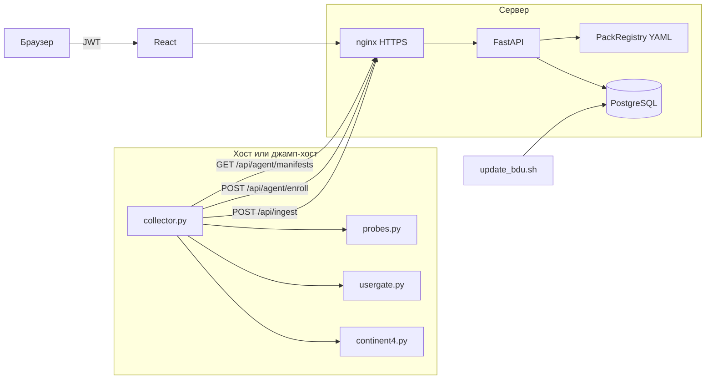
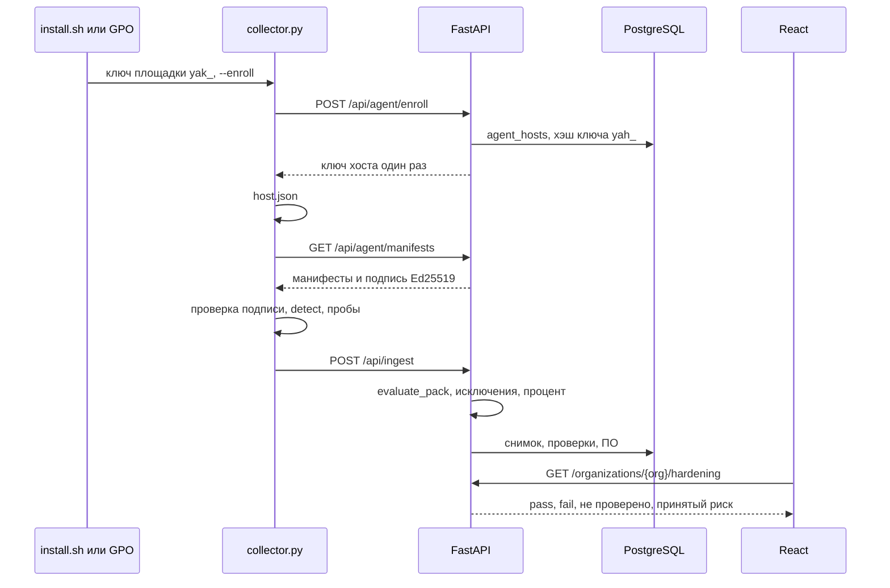

# Справочник «Как работает Харденинг»

Документ для автора диплома и научного руководителя. Он отвечает на вопросы собрания: откуда берутся данные, где и что с чем сравнивается, как получается оценка и находки.

Источник истины — код в `main` на **1 ноября 2026** (коммит, от которого собрана эта ветка документации). Заметки в `uploads/` использованы как подсказка и в конце сверены: расхождения перечислены в [истории и ограничениях](24-history-limits.md).

Главный принцип, который держит весь код: **агент собирает факты, сервер сравнивает их с нормой пака**. В манифесте, который уходит агенту, нет полей `assert`, `severity`, `title`, `remediation` и `refs` — их знает только сервер (`build_manifest` в `src/backend/app/services/packs/manifest.py`).

## Оглавление

| № | Раздел | О чём |
|---|---|---|
| 0 | [Шпаргалка на 5 минут](00-cheatsheet.md) | Схема, 7 шагов, формулы, 15 цифр |
| 1 | [Вход, JWT, роли, 2FA](01-auth.md) | Как человек попадает в систему |
| 2 | [Организации, окружения, хосты](02-organizations-hosts.md) | Куда складываются активы и кто их видит |
| 3 | [Ключи агента и enrollment](03-enrollment-keys.md) | Ключ площадки → ключ хоста |
| 4 | [Публикация дистрибутива](04-agent-publish.md) | `publish_agent.sh`, `version.json`, `/downloads/` |
| 5 | [Установка Linux и Windows](05-agent-install.md) | systemd, weekly, GPO, планировщик |
| 6 | [Режимы агента](06-agent-modes.md) | Онлайн, очередь, файл, CLI |
| 7 | [Паки](07-packs.md) | Формат YAML, каталог всех паков, подпись |
| 8 | [Пробы](08-probes.md) | Каждый тип сборщика |
| 9 | [Сетевые устройства](09-network-devices.md) | SSH, выгрузка, UserGate, Континент 4 |
| 10 | [Опрос](10-manual.md) | Анкеты в интерфейсе |
| 11 | [Приём и снимки](11-ingest-snapshots.md) | Что делает сервер с отчётом |
| 12 | [Оценка и методика ФСТЭК](12-scoring-fstec.md) | Процент, покрытие, 70 пунктов |
| 13 | [Принятый риск](13-exceptions.md) | Исключения |
| 14 | [БДУ и OVAL](14-bdu.md) | Загрузка, версии, критичность V |
| 15 | [Инвентаризация](15-inventory.md) | Паспорт железа и ПДн |
| 16 | [Отчёты](16-reports.md) | PDF, Excel, сравнение сканов |
| 17 | [Страницы интерфейса](17-ui.md) | Что показывает каждая страница |
| 18 | [API](18-api.md) | Метод, путь, кто имеет право |
| 19 | [Модель данных](19-data-model.md) | Таблицы и миграции |
| 20 | [Планировщики](20-schedulers.md) | Что крутится само, а что нет |
| 21 | [Развёртывание](21-deploy.md) | Docker, nginx, HTTPS, откат |
| 22 | [1000 хостов](22-scale.md) | Лимиты и очередь |
| 23 | [Тесты и CI](23-tests-ci.md) | Что и на каких ОС проверяется |
| 24 | [История и ограничения](24-history-limits.md) | Этапы и то, чего в коде нет |
| 25 | [FAQ и глоссарий](25-faq-glossary.md) | Сводка вопросов защиты |
| 26 | [Карта модулей](26-module-map.md) | Каждый файл → раздел |
| 27 | [След одной проверки](27-worked-examples.md) | SSH, Континент 4, БДУ и принятый риск на фрагментах из репозитория |

Цифры на 1 ноября 2026: **26** актуальных паков (**43** файла YAML с прошлыми версиями), **353** проверки в актуальных версиях, **19** миграций Alembic, голова `a1d9c4f27e63`. Тесты тем же днём: `pytest --collect-only` — бэкенд **629**, агент **300**; `npx playwright test --list` — **134**; утилиты интерфейса **7**. Подробности — в [тестах](23-tests-ci.md).

## Общая схема

Четыре способа, которыми факт попадает на сервер:

1. Агент на самом хосте (`LocalTransport`) — файлы, команды из белого списка, реестр Windows.
2. Агент рядом с устройством: обычный SSH (`SshTransport`), UserGate (`UserGateTransport`: XML-RPC, затем SSH), Континент 4 (`Continent4Transport`: три GET к API ЦУС по ГОСТ TLS).
3. Выгрузка конфигурации: каталог файлов у агента (`--offline-dir`) или загрузка тех же файлов в интерфейсе. Сервер гоняет тот же `probes.py`.
4. Опрос: аудитор отвечает на вопросы пака `transport: manual` в интерфейсе. Сравнение с нормой всё равно делает сервер.

## Сквозной сценарий

Один прогон хоста от установки до экрана «Харденинг».

По шагам, со ссылками на главы:

1. Администратор организации создаёт ключ площадки `yak_` на странице «Агенты». Сам ключ показывается один раз, в базе лежит SHA-256. [Ключи](03-enrollment-keys.md).
2. На Linux `install.sh` или Ansible ставит службу. На Windows GPO ставит `hardening-agent.exe` и задачу планировщика. [Установка](05-agent-install.md). Дистрибутив перед этим публикует [publish_agent.sh](04-agent-publish.md).
3. Первый запуск с `--enroll` обменивает ключ площадки на ключ хоста `yah_`. Дальше агент ходит только им и только от своего имени. [Enrollment](03-enrollment-keys.md).
4. Агент запрашивает манифесты актуальных паков нужного транспорта. Сервер подписывает канонический JSON ключом Ed25519. Неверная подпись останавливает весь прогон. [Паки](07-packs.md).
5. `select_manifests` оставляет паки, у которых совпали **все** правила `detect`. Подходят все совпавшие сразу: ОС, Docker и PostgreSQL уходят одним запросом. [Режимы](06-agent-modes.md), [пробы](08-probes.md).
6. Каждая проверка манифеста — это проба. Результат: `found`, `value`, `evidence`. Секреты маскируются. На сервер не уходят ожидания и критичность. [Пробы](08-probes.md).
7. `POST /api/ingest` в одной транзакции пишет актив, паспорт, список ПО, сырые пробы, текущие проверки и снимок. Сравнение делает `evaluate_pack`. [Приём](11-ingest-snapshots.md).
8. Процент — `pass / (pass + fail без принятого риска)`. «Не проверено» (`error`) в знаменатель не входит. Покрытие показывает, какая доля проверок вообще выполнилась. [Оценка](12-scoring-fstec.md).
9. Принятый риск не меняет статус: это по-прежнему `fail`, но с `risk_exception_id`. В процент он не входит. [Исключения](13-exceptions.md).
10. Список ПО сопоставляется с БДУ, когда открывают «Уязвимости» или «ФСТЭК», а не в момент приёма. [БДУ](14-bdu.md).
11. Человек видит это на страницах обзора, харденинга, уязвимостей, методики и сканов. [Интерфейс](17-ui.md).

Сетевое устройство проходит те же шаги 4–11, но транспорт другой: [сетевые устройства](09-network-devices.md). То, чего нет ни в файле, ни в API, закрывает [опрос](10-manual.md).

## Что считать «сравнением»

В продукте слово «сравнение» встречается в трёх разных местах. Их легко перепутать на защите.

| Что сравнивается | Где в коде | Результат |
|---|---|---|
| Значение пробы и поле `assert` пака | `check_assertion` в `services/packs/assertions.py`, вызывает `evaluate_pack` | `pass`, `fail` или `error` |
| Два снимка одной организации | `classify` в `api/routes/snapshots.py` | исправлено, ухудшилось, новое, риск принят |
| Версия пакета и диапазон версии в БДУ | `VersionRange.contains` в `services/bdu/versions.py` | находка или её нет |

Первое — это оценка харденинга. Второе — история. Третье — уязвимости ПО. Формулы и примеры — в соответствующих главах.
