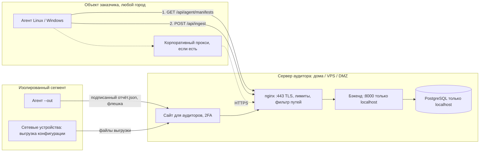

# Схема передачи данных агент — сервер через интернет 2026-10-11

Вопрос автора: проект отдаётся компании-аудитору; сервер и сайт — в одном месте, агенты — у заказчиков, в других сетях и городах. Ставить WireGuard на каждый объект — не вариант. Нужна рабочая схема передачи данных от агентов до сервера.

WireGuard (`10.8.0.1`) был временным решением для домашнего стенда за NAT, а не схемой продукта.

Копия заметки из vault (obsidian_hardening, 02-architecture); правится там, сюда — копия. Инструкции: `docs/deploy-server.md` (сервер), `docs/agent-install.md` (объект заказчика).

## Сводка статуса

| Этап | Статус |
|---|---|
| 1. Сеть и домен | ⏳ автор: белый IP, домен, DNS, проброс 80/443 |
| 2. Сервер в интернете | 🟡 всё подготовлено и проверено на тестовом сертификате; включается одной командой после этапа 1 |
| 3. Агент для работы через интернет | ✅ сделано, выкачено на прод |
| 4. Изолированные сегменты | ✅ сделано, выкачено на прод |
| 5. Передача компании-аудитору | 🟡 инструкции есть; docker-compose и скрипт бэкапа — не сделаны |

## Принцип

Агент **сам** обращается к серверу: забирает подписанные паки и отправляет результаты. К агенту никто не подключается. Так устроены агенты Qualys, Tenable, Kaspersky. От заказчика нужен только **исходящий HTTPS на 443 к одному адресу**: без входящих портов, VPN и белого IP. Такое легко согласовать со службой безопасности: «агент ходит только на `audit.<домен>:443`».



### Один прогон агента

```mermaid
sequenceDiagram
    participant A as Агент (объект заказчика)
    participant Q as Очередь на хосте
    participant N as nginx :443
    participant B as Бэкенд
    A->>N: TLS: проверка сертификата + закреплённый ключ сервера
    A->>N: GET /api/agent/manifests (ключ агента)
    N->>B: лимит 120/мин с адреса, X-Real-IP
    B-->>A: манифесты паков + подпись Ed25519
    A->>A: проверка подписи открытым ключом, пробы только на чтение
    A->>Q: сначала — досылка очереди (старые прогоны)
    A->>N: POST /api/ingest (run_id, collected_at)
    alt сервер недоступен / 429 / 5xx
        A->>Q: прогон в очередь (0600), код выхода 75
    else уже принят (409)
        A->>Q: удалить из очереди
    else принят
        B-->>A: оценка, снимок; у ключа — время и адрес обращения
    end
```

### Каналы

| Канал | Когда | Защита |
|---|---|---|
| HTTPS напрямую | у объекта есть выход в интернет | TLS 1.2/1.3, проверка сертификата, закрепление ключа сервера, ключ агента |
| HTTPS через прокси | интернет только через корпоративный прокси | то же; `--proxy` или `HTTPS_PROXY` |
| Файл | изолированный сегмент, аттестованные системы | отчёт подписан ключом агента — тот, кто переносит файл, не может подменить результаты |
| Криптошлюз заказчика (ViPNet, Континент, ГОСТ TLS) | ГИС, где требуется сертифицированная криптография | канал заказчика; агент и сервер не меняются. В диплом — как вариант развёртывания |

### Модель угроз канала

| Угроза | Мера | Статус |
|---|---|---|
| Перехват трафика | TLS; агент отказывается работать по `http://` с любым адресом, кроме localhost | ✅ агент; TLS на сервере — после домена |
| Подмена сервера (MITM, свой корневой сертификат в сети заказчика) | проверка сертификата + закрепление открытого ключа сервера (`--pin-sha256`) | ✅ |
| Подмена паков (агент выполнил бы чужие проверки) | подпись паков Ed25519: у агентов только открытый ключ | ✅ |
| Кража ключа агента на объекте | ключ на объект, срок действия, отзыв, время и адрес последнего обращения | ✅ |
| Подбор ключа или пароля, перегрузка | `limit_req` в nginx (429), размер тела запроса, 2FA; fail2ban | ✅ лимиты; ⏳ fail2ban |
| Сервер недоступен (нет света или интернета дома) | очередь на агенте, сервер не создаёт дубликатов | ✅ |
| Подмена отчёта при переносе файлом | подпись отчёта ключом агента, проверка при загрузке | ✅ |

## Пошаговый план со статусом

### Этап 1. Сеть и домен — делает автор ⏳

| № | Шаг | Статус |
|---|---|---|
| 1 | **Белый IP.** Сравнить WAN-адрес в роутере с адресом на 2ip.ru. Совпадают — белый. Не совпадают (CGNAT) — подключить у провайдера «белый IP», ~100–200 ₽/мес. Судя по WireGuard (клиент подключается снаружи), IP уже белый | ⏳ автор |
| 2 | **Статический или динамический.** Статический — 150–300 ₽/мес, лучший вариант. Динамический тоже подходит: DDNS-скрипт обновляет DNS-запись через API регистратора | ⏳ автор |
| 3 | **Домен** `.ru` / `.рф` (reg.ru, nic.ru, Beget) — 200–700 ₽/год, проверка по паспорту 1–2 дня. Например, `hardening-audit.ru`: свободен и уже используется в почте администратора | ⏳ автор |
| 4 | **DNS:** `A audit.<домен> → внешний IP` | ⏳ автор |
| 5 | **Роутер:** проброс TCP 443 → `192.168.0.147:443`, TCP 80 → `192.168.0.147:80` (80 — только для Let's Encrypt и переадресации на HTTPS). Если провайдер закрывает входящий 80 — сертификат через DNS-проверку (нужен API регистратора) | ⏳ автор |
| 6 | **Передать:** домен; статический IP или нет; API-токен регистратора (если нужен) — самому положить в файл на сервере, в чат не отправлять | ⏳ автор |

### Этап 2. Сервер в интернете 🟡

| № | Шаг | Статус |
|---|---|---|
| 7 | nginx на 443: TLS 1.2/1.3, 80 → 443, HSTS; Let's Encrypt с автопродлением; 443 в ufw | 🟡 готово: `deploy/nginx-tls.conf.template`, `deploy/enable_https.sh`. Проверено в отдельном контейнере с тестовым сертификатом (переадресация, HTTP/2, HSTS, отказ TLS 1.0/1.1). Включается после этапа 1 |
| 8 | Разделение путей: агентам — `/api/agent/manifests`, `/api/ingest` (только с ключом агента); интерфейс — пароль + 2FA; бэкенд и PostgreSQL снаружи не видны | ✅ `deploy/nginx/app.conf`, выкачено (пока по HTTP) |
| 9 | Лимиты: агенты 120/мин, вход 10/мин, API 600/мин с адреса → 429; тело `/api/ingest` ≤ 10 МБ | ✅ выкачено |
| 9а | fail2ban по журналу nginx; бан в цепочке `DOCKER-USER` (опубликованные порты Docker обходят INPUT) | ⏳ после домена |
| 10 | Открыты только 22, 80, 443, 51820. SSH — только по ключам | ⏳ нужен публичный SSH-ключ автора; затем `PasswordAuthentication no` |
| 10а | Сменить пароль sudo (≥ 14 символов): он остался в журналах сессий ИИ | ⏳ автор |
| 11 | Проверка снаружи: сайт с телефона через мобильный интернет; SSL Labs. Нет NAT loopback — домен в `/etc/hosts` сервера для локального агента | ⏳ после домена |
| 11а | DDNS, если IP динамический | ⏳ после выбора регистратора |

### Этап 3. Агент для работы через интернет ✅

| № | Шаг | Статус |
|---|---|---|
| 12 | Только `https://` (`http://` — localhost или явно `--allow-http`); `--ca-file`; `--pin-sha256` — отпечаток SPKI, как у `curl --pinnedpubkey`, можно текущий и резервный; `--show-server-pin`; TLS ≥ 1.2. Неверный пин или непроверенный сертификат — «Ошибка безопасности» и остановка, а не очередь | ✅ |
| 13 | `--proxy` / `HARDENING_PROXY` (служба под SYSTEM не видит прокси пользователя) | ✅ |
| 14 | Очередь: `/var/lib/hardening-agent/<экземпляр>/spool` (Windows — `C:\ProgramData\HardeningAgent\spool`), файлы 0600, до 50 прогонов и 30 дней, досылка раньше нового, код выхода 75. У прогона `run_id` и `collected_at`: сервер повтор не задваивает (409), время снимка — время сбора; отозванный ключ — очередь сохраняется | ✅ |
| 15 | Подпись паков Ed25519: сервер — `PACK_SIGNING_ED25519_KEY` (в `.env`), агент — проверка на чистом Python по RFC 8032 (тестовые векторы, сверка с `cryptography`). HMAC оставлен на переход; агент с открытым ключом HMAC не принимает | ✅ |
| 16 | Страница «Агенты»: ключ на объект, срок (90 дней / 1 год / 2 года / бессрочно), отзыв, время и адрес последнего обращения, готовый файл настроек, открытый ключ паков. Отозванный и просроченный ключ — одинаковый 401 | ✅ |

### Этап 4. Изолированные сегменты ✅

| № | Шаг | Статус |
|---|---|---|
| 17 | `--out отчёт.json` — прогон подписан HMAC ключом SHA-256(ключ агента): сервер хранит именно этот хэш и проверяет подпись, переносящий файл ключа не знает. Загрузка — «Агенты» → «Отчёт агента из файла». Отчёт, снятый после отзыва или окончания срока ключа, не принимается. В снимке, интерфейсе и PDF/Excel — «отчёт перенесён файлом, подпись ключа «…» проверена» | ✅ |

### Этап 5. Передача компании-аудитору 🟡

| № | Шаг | Статус |
|---|---|---|
| 18 | Инструкция «развернуть сервер у себя» | ✅ `docs/deploy-server.md` |
| 18а | Полный docker-compose (сейчас — скрипты `deploy/restart_*.sh` из-за особенности межсетевого экрана стенда) | ⏳ |
| 18б | Скрипт бэкапа по расписанию с копией вне сервера (сейчас бэкап делается вручную перед выкаткой) | ⏳ |
| 19 | Инструкция для объекта заказчика: что согласовать со службой безопасности, установка на Linux и Windows, проверка связи, разбор ошибок | ✅ `docs/agent-install.md` |
| 20 | В диплом: эта схема, модель угроз канала, варианты развёртывания | ⏳ при написании главы |
| 21 | Убрать `PACK_SIGNING_KEY` (HMAC), когда все агенты на открытом ключе | ⏳ |

## Что сделано 2026-10-11 — подробно

### Коммиты и выкатка

- hardening `e2dce7a` — код агента и сервера; `6b548c2` — nginx, HTTPS, инструкции; `a90642b` — исправление для Python 3.6 (RHEL 8).
- На прод выкачено 2026-10-11:
  - бэкап `~/backups/app_db-pre-agent-transport-20261011-234134.dump`;
  - копия настроек бэкенда `~/backups/backend.env.pre-agent-transport`;
  - образы для отката `hardening-backend:pre-agent-transport`, `hardening-frontend:pre-agent-transport`;
  - миграция `c4f2a8d6e913`: `ingestion_batches.run_id`, `collected_at`; `agent_api_keys.expires_at`, `last_used_ip`, `revoked_at`;
  - в `.env` бэкенда добавлен `PACK_SIGNING_ED25519_KEY`;
  - агент на хосте обновлён в `/opt/hardening-agent`, unit-файл — с каталогом очереди, в `/etc/hardening-agent/local.env` добавлен `HARDENING_PACK_PUBLIC_KEY` (копия старого — `local.env.pre-ed25519`). Прогон прошёл: в БД `run_id`, `collected_at`, у ключа — время и адрес.

### Где что лежит

| Что | Файл |
|---|---|
| Связь агента с сервером, очередь, подпись отчёта | `agent/collector.py` (раздел «связь с сервером») |
| Проверка Ed25519 | `agent/probes.py` (`ed25519_verify`, `load_verified_manifests`) |
| Подпись на сервере, генерация ключа | `src/backend/app/services/packs/manifest.py`, `python -m app.commands.pack_signing_key` |
| Ключи агентов, загрузка отчёта | `src/backend/app/api/routes/agent_keys.py`, страница `src/pages/AgentKeys.jsx` |
| Срок ключа, адрес обращения | `src/backend/app/api/deps.py` (`get_agent_organization_id`) |
| Повтор прогона, время сбора | `src/backend/app/api/routes/ingest.py` |
| nginx: лимиты, пути, HTTPS | `deploy/nginx/limits.conf`, `deploy/nginx/app.conf`, `deploy/nginx-tls.conf.template` |
| Включение HTTPS | `deploy/enable_https.sh`, режим HTTPS в `deploy/restart_frontend.sh` |
| Настройки агента (образец) | `agent/deploy/agent.env.example` |

### Как проверено

- Агент — 182 теста на Python 3.12 и 3.6 (Rocky 8): настоящий HTTPS-сервер в тесте — пин совпал / не совпал / резервный пин, недоверенный сертификат, коды ответа, очередь (порядок, повтор, 409, 422, 401, лимиты), подписанный отчёт, векторы RFC 8032.
- Бэкенд — 498 тестов: подпись сервера проверяется агентом, ключи (создание, список, отзыв, срок, адрес, права), повтор `run_id`, `collected_at` (будущее, слишком старое), загрузка отчёта (подмена, чужая организация, после отзыва).
- CI Windows: собранный `.exe` принимает подпись Ed25519 и отвергает чужой открытый ключ.
- Конфиг HTTPS — в отдельном контейнере с тестовым сертификатом: 80 → 301 на HTTPS, HTTP/2, HSTS, TLS 1.0/1.1 отклонены, TLS 1.3; перебор `/api/agent/manifests` получает 429; настоящий агент прошёл через TLS с пином, с чужим пином — остановка.

### Что важно знать

- Сайт пока работает по HTTP на 80, как раньше; HTTPS включается после домена.
- Агент через WireGuard (`http://10.8.0.1`) теперь запускается только с `--allow-http` в `HARDENING_EXTRA_ARGS`.
- Откат: образы `:pre-agent-transport`, бэкап БД и копия `.env` — см. выше; новые колонки миграции допускают NULL, старый код с ними работает.

## Что сделать автору — по порядку

1. Белый IP: сверить WAN-адрес роутера с 2ip.ru.
2. Купить домен, DNS `A audit.<домен> → внешний IP`.
3. Роутер: проброс TCP 80 и 443 на `192.168.0.147`.
4. На сервере: `sudo deploy/enable_https.sh audit.<домен> <email> --staging`, проверить, затем без `--staging`. Скрипт выведет отпечаток ключа сервера для агентов.
5. Открыть `https://audit.<домен>/health` с телефона через мобильный интернет.
6. Прислать публичный SSH-ключ → вход только по ключам.
7. Сменить пароль sudo (≥ 14 символов).

После этого — fail2ban, DDNS (если IP динамический), docker-compose и бэкап по расписанию.

## Стоимость и ограничения

| Что | Цена |
|---|---|
| Домен | 200–700 ₽/год |
| Статический IP (по желанию) | 150–300 ₽/мес |
| Сертификат Let's Encrypt | бесплатно |

Дома: если пропадёт свет или интернет, агенты в это время не отправят данные — очередь досылает позже (до 30 дней). Для дипломного стенда и демо этого достаточно. В реальной работе аудитор разворачивает то же у себя по `docs/deploy-server.md`.

## Связанные заметки (vault)

- «Продакшен-фронтенд — nginx на порту 80 2026-10-04»
- «Ситуация по проекту и что осталось — на 2026-10-04»
- «Масштабируемость на другие компании — честная оценка»
- «Сетевое оборудование и российские вендоры — план 2026-10-11»
- «Контроллер домена Active Directory — пак windows-dc 2026-10-11»
