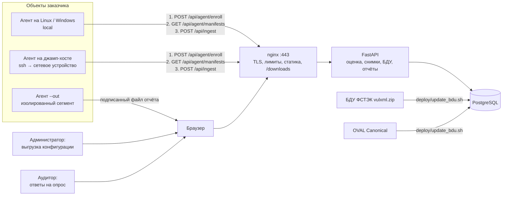
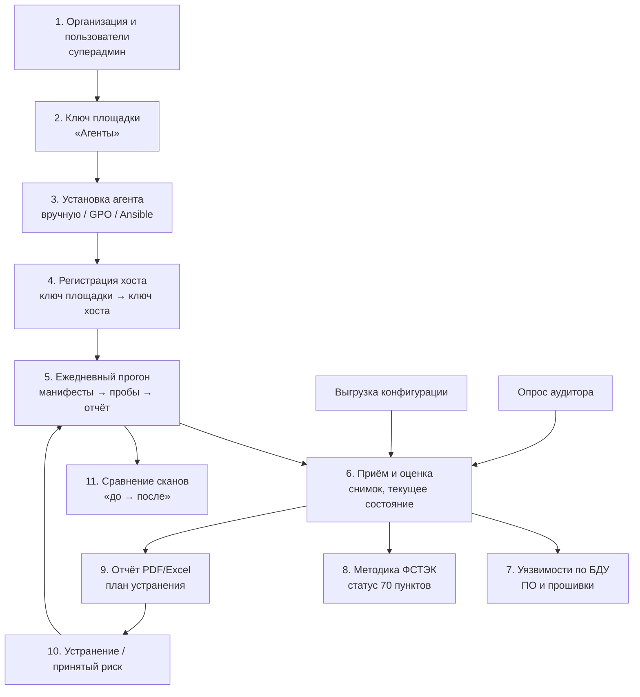
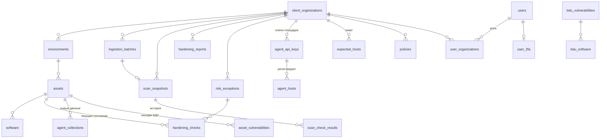
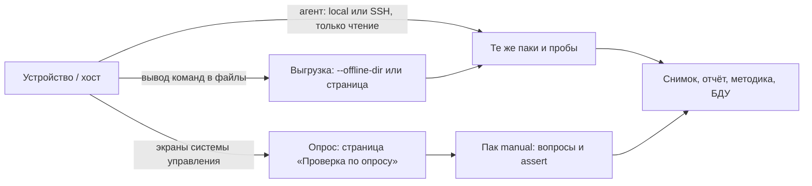

# Харденинг — полное описание проекта

Документ описывает систему целиком: назначение, технологический процесс от установки агента до отчёта,
каждую часть сервера и агента, контент-паки, базу данных (каждую таблицу и поле), каждую страницу
интерфейса, все ручки API, развёртывание, безопасность, тесты, текущее состояние и ограничения.
Состояние — на **16.10.2026** (коммит `c61002e`, выкачено на прод в тот же день).

Краткое описание и запуск — [`README.md`](../README.md). Формат пака — [`src/backend/app/packs/README.md`](../src/backend/app/packs/README.md),
агент — [`agent/README.md`](../agent/README.md), установка агента у заказчика — [`docs/agent-install.md`](agent-install.md),
сервер — [`docs/deploy-server.md`](deploy-server.md), канал агент — сервер через интернет — [`docs/internet-scheme.md`](internet-scheme.md),
архитектура паков и история этапов — [`docs/agent-packs/`](agent-packs/).

---

## Содержание

1. [Что это и зачем](#1-что-это-и-зачем)
2. [Общая схема](#2-общая-схема)
3. [Технологический процесс: от установки до отчёта](#3-технологический-процесс-от-установки-до-отчёта)
4. [Стек](#4-стек)
5. [Структура репозитория](#5-структура-репозитория)
6. [База данных](#6-база-данных)
7. [Агент](#7-агент)
8. [Контент-паки](#8-контент-паки)
9. [Подпись манифестов](#9-подпись-манифестов)
10. [Приём данных на сервере](#10-приём-данных-на-сервере)
11. [Оценка соответствия и покрытие](#11-оценка-соответствия-и-покрытие)
12. [Снимки и сравнение сканов](#12-снимки-и-сравнение-сканов)
13. [Принятый риск](#13-принятый-риск)
14. [Три способа сбора: агент, выгрузка, опрос](#14-три-способа-сбора-агент-выгрузка-опрос)
15. [Сетевое оборудование и средства защиты, в том числе российские](#15-сетевое-оборудование-и-средства-защиты-в-том-числе-российские)
16. [Уязвимости ПО по БДУ ФСТЭК](#16-уязвимости-по-по-бду-фстэк)
17. [Покрытие методики ФСТЭК по пунктам](#17-покрытие-методики-фстэк-по-пунктам)
18. [Критичность и сроки устранения](#18-критичность-и-сроки-устранения)
19. [Отчёты PDF и Excel](#19-отчёты-pdf-и-excel)
20. [Пользователи, роли, вход, 2FA](#20-пользователи-роли-вход-2fa)
21. [Политики](#21-политики)
22. [Агенты организации: ключи, хосты, охват](#22-агенты-организации-ключи-хосты-охват)
23. [Веб-интерфейс: каждая страница](#23-веб-интерфейс-каждая-страница)
24. [API: все ручки](#24-api-все-ручки)
25. [Работа на 1000+ хостах](#25-работа-на-1000-хостах)
26. [Развёртывание](#26-развёртывание)
27. [Безопасность сервера проекта](#27-безопасность-сервера-проекта)
28. [Тесты и CI](#28-тесты-и-ci)
29. [Текущее состояние](#29-текущее-состояние)
30. [Ограничения](#30-ограничения)
31. [Вопросы и ответы](#31-вопросы-и-ответы)
32. [Где что в коде](#32-где-что-в-коде)
33. [Хронология](#33-хронология)

---

## 1. Что это и зачем

**Харденинг** — система контроля защищённости конфигураций ИТ-инфраструктуры. Она собирает настройки
серверов, рабочих станций, контейнеров, СУБД, сетевого оборудования и средств защиты (SSH, пароли,
межсетевой экран, аудит, службы, реестр Windows, конфигурация коммутаторов, маршрутизаторов,
криптошлюзов, NGFW), сравнивает их с требованиями безопасности и показывает:

- что соблюдено, что нарушено и что не удалось проверить — по каждой проверке и каждому активу;
- оценку соответствия в процентах, её **покрытие** и динамику во времени;
- что изменилось между двумя любыми сканами (исправлено, ухудшилось, новое);
- какие пункты «Методики анализа защищённости ИС» ФСТЭК (25.11.2025) закрыты, а какие нет;
- какие версии установленного ПО и прошивок попадают в уязвимые диапазоны Банка данных угроз ФСТЭК,
  с уровнем критичности по методике ФСТЭК от 30.06.2025;
- что устранять в первую очередь и в какой срок.

**Проблема.** Харденинг вручную по чек-листам (CIS, методики ФСТЭК) не масштабируется: конфигурации
расходятся, проверка разовая, результат не повторить. В инфраструктуре одновременно Linux разных
семейств, российские ОС (Astra, РЕД ОС, Альт), Windows, Docker, СУБД и сетевое оборудование разных
вендоров, в том числе российских (Eltex, Qtech, SNR, ИнфоТеКС, Код Безопасности, С-Терра, UserGate,
Positive Technologies, InfoWatch ARMA, Фактор-ТС, Ideco). Нужна единая система, где **добавить
платформу — значит добавить данные (YAML-пак), а не переписать код**.

**Для кого.** Компания-аудитор (проверяет инфраструктуры заказчиков — у каждого своя организация в
системе) или служба ИБ организации (одна или несколько организаций — филиалы, контуры).

**Чем не является.** Не сетевой сканер уязвимостей и не пентест: система не атакует узлы и не
сканирует порты снаружи. Она читает конфигурацию изнутри хоста (агентом), из выгрузки конфигурации
или со слов аудитора (опрос) и сопоставляет версии ПО с БДУ.

---

## 2. Общая схема



**Главный принцип: агент собирает, сервер оценивает.** В манифест пака, который получает агент,
попадает только «как распознать платформу» и «что прочитать». Ожидаемые значения, критичность,
рекомендации и ссылки на методику остаются на сервере. Поэтому правила меняются без обновления
агентов, а сохранённые «сырые» данные можно переоценить новой версией правил.

**Агент только читает.** Нет ни одной пробы, которая что-то меняет на хосте. Белые списки команд и
путей — в самом агенте: даже подписанный злоумышленником манифест не заставит его выполнить лишнее.

---

## 3. Технологический процесс: от установки до отчёта



1. **Организация.** Суперадмин создаёт организацию заказчика и учётные записи (временный пароль),
   назначает роли. Пользователи при первом входе меняют пароль и подключают 2FA (обязательна).
2. **Ключ площадки.** Администратор организации на странице «Агенты» создаёт ключ площадки (офис,
   ЦОД, сегмент) со сроком действия. Ключ показывается один раз; в БД — только его SHA-256.
3. **Установка агента.** Linux — архив со страницы «Агенты» и `install.sh` (служба systemd с
   ежедневным таймером) или плейбук Ansible; Windows — `hardening-agent.exe` и задача планировщика
   или сценарий запуска компьютера через GPO. Архив и `.exe` сверяются по SHA-256 из `version.json`.
4. **Регистрация.** При первом запуске агент меняет ключ площадки на собственный **ключ хоста**
   (`POST /api/agent/enroll`) и хранит его в `host.json` (права только у агента и администраторов).
5. **Прогон** (раз в сутки, со случайной задержкой): агент забирает подписанные манифесты паков,
   проверяет подпись Ed25519, по правилам `detect` выбирает подходящие платформе паки, выполняет
   пробы (только чтение), собирает список ПО и отправляет одним запросом. Сервер недоступен — прогон
   ложится в очередь и досылается позже.
6. **Приём и оценка.** Сервер сравнивает значения проб с утверждениями паков, применяет принятые
   риски, перезаписывает текущее состояние актива, создаёт снимок с номером, пересчитывает оценку
   организации. То же делает загрузка выгрузки конфигурации и сохранение опроса.
7. **Уязвимости.** Установленное ПО и прошивки устройств сопоставляются с локальной копией БДУ ФСТЭК;
   для Ubuntu находки сверяются с OVAL Canonical; считается уровень критичности V.
8. **Методика ФСТЭК.** Каждая проверка паков ссылается на пункты методики — страница показывает
   статус каждого из 70 пунктов по текущему состоянию.
9. **Отчёт.** PDF или Excel по любому снимку: сводка, источник данных, план устранения по срокам,
   все результаты со свидетельствами.
10. **Устранение.** Администраторы хостов исправляют нарушения по рекомендациям; то, что устранять
    нельзя, оформляется как принятый риск с обоснованием и сроком.
11. **Повторный скан и сравнение.** Следующий прогон даёт новый снимок; сравнение показывает
    исправленное, ухудшившееся и новое.

---

## 4. Стек

| Часть | Технологии | Почему |
|---|---|---|
| Сервер | Python 3.12, FastAPI 0.116, SQLAlchemy 2.0, Alembic 1.16, Pydantic 2, Uvicorn 0.35 (2 процесса) | Типизированные схемы запросов, автоматическая валидация, OpenAPI. Тот же язык, что у агента: сервер выполняет код проб агента для выгрузок |
| БД | PostgreSQL 15 (`psycopg` 3) | JSONB (сырые данные агента, источник снимка, коды 2FA), `COPY` для загрузки БДУ, транзакционные миграции, `pg_trgm` для поиска ПО |
| Агент | Python 3.6+ (Linux), только стандартная библиотека; Windows — один `.exe` (PyInstaller) | Ставится на любой Linux (в том числе RHEL 8 с Python 3.6) без `pip`; `collector.py`, `probes.py` и `usergate.py` (доступ к UserGate) |
| Интерфейс | React 19, Vite 8, TailwindCSS 3, React Router 7, Recharts 3, lucide-react, framer-motion | Быстрая сборка, ленивая загрузка страниц (основной бандл ~400 КБ), графики |
| Отчёты | reportlab 4.4 (PDF, шрифт DejaVu), openpyxl 3.1 (Excel) | Формируются на сервере из одного источника данных |
| 2FA | pyotp 2.9 (TOTP, RFC 6238), qrcode | Стандарт для приложений-аутентификаторов |
| Пароли | bcrypt 4.0 | Медленный хэш с солью |
| Токены | JWT HS256 (python-jose) | Без серверного хранилища сессий; отзыв — по времени смены пароля |
| Шифрование | cryptography 45: Fernet (секрет 2FA в БД), Ed25519 (подпись паков) | Агент проверяет Ed25519 на чистом Python (RFC 8032) |
| Развёртывание | Docker, nginx-unprivileged 1.27, systemd (агент), Let's Encrypt (certbot), fail2ban, GitHub Actions | Контейнеры без root, лимиты ресурсов, воспроизводимая сборка |
| Тесты | pytest, Playwright 1.64 (E2E), node:test (утилиты интерфейса), ruff, ESLint, shellcheck | Каждый пуш — 7 workflow CI |

---

## 5. Структура репозитория

```
agent/                       агент: collector.py, probes.py, tests/, deploy/ (systemd, install.sh,
                             windows/gpo-startup.ps1, ansible/hardening-agent.yml)
src/backend/                 сервер
  app/main.py                приложение FastAPI, подключение маршрутов
  app/api/routes/            ручки API (auth, twofa, data, ingest, agent, agent_keys, coverage,
                             offline_scans, manual_scans, snapshots, exports, risk_exceptions,
                             policies, members, admin_users, admin_organizations, vulnerabilities, fstec)
  app/api/deps.py            проверка токена, ролей, ключей агента
  app/services/              логика: hardening_engine, packs/, bdu/, fstec/, offline_scan, manual_scan,
                             risk_exceptions, snapshot_export, remediation, login_guard, twofa_service
  app/packs/                 контент-паки (YAML), README формата
  app/commands/              команды: create_admin, create_agent_key, pack, bdu, pack_signing_key
  app/models/                модели SQLAlchemy
  alembic/versions/          19 миграций
  pack_tests/                образцы (фикстуры) паков
  pack_sources/              генераторы паков (Debian/Astra из Ubuntu, Windows)
  tests/                     тесты сервера
src/                         интерфейс: pages/, components/, api/, context/, utils/
e2e/                         сквозные тесты Playwright + seed.py
deploy/                      скрипты выкатки, nginx, fail2ban, сертификаты РФ, обновление БДУ, публикация агента
docs/                        документация
tools/loadtest/              нагрузочные тесты (агенты, страницы)
.github/workflows/           CI
```

---

## 6. База данных

PostgreSQL 15, база `app_db`, схема меняется только миграциями Alembic (19 миграций, текущая
`c9f2a7e4d815`). На старте контейнера миграции **не** выполняются: их запускают отдельным
одноразовым контейнером после бэкапа. Все времена — `timestamp with time zone` в UTC.

Иерархия: **организация → окружение → актив → результаты проверок, ПО, уязвимости**.



### 6.1 Организации, активы, данные агента

**`client_organizations`** — организации (заказчики). Данные разных организаций изолированы.
`id` (uuid), `name`, `industry`, `country`, `created_at`.

**`environments`** — окружения внутри организации (`prod`, `network`, …); создаются автоматически
при первом прогоне агента с новым именем окружения. `id`, `organization_id` → организация, `name`.

**`assets`** — активы (хосты и устройства). `id`, `environment_id` → окружение, `hostname`,
`ip_address`, `os` (pretty name ОС), `asset_type` (`linux-server`, `windows-server`, `network-device`,
…), `criticality` (`low|medium|high|critical`, CHECK), `platform_tags` (JSONB — теги платформы из
подошедших паков: класс → семейство → продукт, например `["linux-server","debian-family","ubuntu"]`;
по ним, например, `internet-facing` влияет на уровень V), `created_at`. Актив ищется по
(окружение, hostname).

**`software`** — установленное ПО актива по последнему прогону (заменяется целиком). `id`, `asset_id`,
`name`, `version`, `vendor`, `category` (для прошивок сетевых устройств — `firmware`), `type`,
`created_at`. Индексы: `asset_id`, `name`, триграммный GIN по «имя версия производитель» (поиск на
странице ПО по 1,5 млн строк).

**`ingestion_batches`** — каждый приём данных. `id`, `organization_id`, `received_at`, `source`
(`agent`, `offline-upload`, `manual`, `agent-report-file`), `status` (`pending|processing|completed|failed`),
`assets_count`, `software_count`, `checks_count`, `report_id` → отчёт организации, `notes`,
`scan_label`, `run_id` (uuid прогона агента — повтор не задваивается: уникальный индекс
`(organization_id, run_id)`), `collected_at` (время сбора на хосте — время снимка, даже если отчёт
пришёл из очереди позже).

**`agent_collections`** — сырые данные прогона (JSONB `collected_data`): факты старого режима и
результаты проб по каждому паку `{id, version, probe_results}` — чтобы перепрогнать оценку по новой
версии правил. `asset_id`, `batch_id`, `collected_at`.

**`hardening_checks`** — **текущее состояние** актива: последний результат каждой проверки,
перезаписывается целиком каждым прогоном. `id`, `asset_id`, `rule_id` (старый режим) или `check_id` +
`pack_id` + `pack_version` (паки), `actual_value`, `expected_value` (человекочитаемое ожидание:
«≤ 4», «одно из: …»), `status` (`pass|fail|error|skipped`), `title`, `severity`, `remediation`,
`evidence` (совпавшая строка, секреты замаскированы), `risk_exception_id` → принятый риск,
`checked_at`.

**`hardening_reports`** — отчёт организации: оценка по текущему состоянию всех активов после каждого
приёма. `organization_id`, `total_checks`, `passed`, `failed`, `compliance_score`, `generated_at`.
Источник графика «Динамика соответствия».

**`hardening_rules`** — правила старого режима (без паков): `rule_code` (`категория.ключ`, уникален),
`title`, `description`, `expected_value`, `product_type`, `source`, `severity` (CHECK), `remediation`.
14 стартовых правил (миграция).

### 6.2 Снимки (история)

**`scan_snapshots`** — снимок на каждый прогон, нумеруется в организации. `id`, `organization_id`,
`scan_number` (уникален в организации; номер выдаётся под блокировкой организации
`pg_advisory_xact_lock` — параллельные отчёты не получают одинаковых номеров), `ingestion_batch_id`,
`started_at`, `completed_at`, `total_assets`, `total_software`, `total_checks`, `passed`, `failed`,
`accepted_risks`, `compliance_score`, `snapshot_label` (метка прогона), `status`, `notes`,
`collection` (JSONB — **источник данных**, если это не живой прогон агента):

| `collection.source` | Что внутри |
|---|---|
| нет (`null`) | живой хост или устройство (агент) |
| `offline-config` | файлы выгрузки: команда, имя файла, SHA-256, дата выгрузки; `declared_pack` (пак задан оператором); кто загрузил |
| `manual` | `answered_by`, `answered_at`, `unanswered` (вопросы без ответа) |
| `agent-report` | `transfer: file`, `agent_key` (имя ключа, подпись которого проверена), кто загрузил |

`exported_pdf_path`, `exported_excel_path` — не используются (отчёты формируются на лету).

**`scan_check_results`** — результаты проверок внутри снимка — копия на момент скана, включая
`title`, `severity`, `remediation`, `evidence`, `risk_exception_id`: пак и риск могут измениться,
а старый снимок должен показывать то, что было. Индекс `(snapshot_id, asset_id)`.

**Почему два хранилища результатов.** Текущее состояние (`hardening_checks`) — для дашборда,
методики, принятого риска («что сейчас»). Снимки — для истории и сравнения («как было»). Снимок не
переписывается задним числом.

### 6.3 Агенты

**`agent_api_keys`** — **ключи площадок**. `id`, `organization_id`, `name` («Казань, ЦОД»), `key_hash`
(SHA-256 ключа, уникален; сам ключ показывается один раз), `is_active`, `created_at`, `expires_at`
(90 дней / 1 год / 2 года / бессрочно), `revoked_at`, `last_used_at`, `last_used_ip`, `direct_use`
(ключ, выданный до регистрации хостов: принимается напрямую, как раньше).

**`agent_hosts`** — **зарегистрированные хосты** и их собственные ключи. `id`, `organization_id`,
`enrollment_key_id` → ключ площадки (при удалении ключа — NULL), `hostname`, `hostname_norm`
(короткое имя в нижнем регистре: `pc-001.corp.local` = `PC-001`), `key_hash` (SHA-256 ключа хоста),
`os`, `status` (`active|revoked|replaced`, CHECK), `enrolled_at`, `enrolled_ip`, `last_seen_at`,
`last_seen_ip`, `revoked_at`. Уникальность имени активного хоста в организации — частичный индекс
`(organization_id, hostname_norm) WHERE status <> 'replaced'`.

**`expected_hosts`** — список ожидаемых компьютеров для «Охвата» (выгрузка из AD или CSV).
`organization_id`, `hostname`, `hostname_norm` (уникален в организации), `os`, `last_logon`,
`source`, `imported_at`, `imported_by`. Заменяется целиком при загрузке.

### 6.4 Принятый риск, политики

**`risk_exceptions`** — принятые риски. `organization_id`, `asset_id` (NULL — вся организация),
`check_key` (id проверки пака или код правила), `reason` (обоснование, обязательно), `expires_at`,
`created_by`, `created_at`, `revoked_at`, `revoked_by` — отзыв, а не удаление.

**`policies`** — реестр политик организации. `name`, `description`, `scope`, `status`
(`draft|active|review|archived`, CHECK), `owner_name`, `source`, `created_at`, `updated_at`.

### 6.5 Пользователи

**`users`** — учётные записи. `id`, `email` (уникален), `username` (уникален, старое поле),
`password_hash` (bcrypt), `full_name`, `display_name`, `is_active`, `is_superadmin`, `account_status`
(`pending|active|blocked`), `must_change_password` (временный пароль), `last_login_at`,
`failed_login_attempts`, `locked_until` (блокировка после подбора), `blocked_at`,
`password_changed_at` (токены, выданные раньше, недействительны), `created_at`, `updated_at`;
`role_id`, `organization_id` — поля исходной схемы, не используются.

**`user_organizations`** — членство и роль: `user_id`, `organization_id`, `role`
(`admin|auditor|viewer`), `created_at`, `updated_at`.

**`user_2fa`** — `user_id` (уникален), `secret_encrypted` (TOTP-секрет, Fernet), `is_enabled`,
`backup_codes_hashes` (JSONB, SHA-256 восьми резервных кодов), `confirmed_at`, `last_used_at`
(начало 30-секундного интервала последнего принятого кода — защита от повтора), `created_at`,
`updated_at`.

### 6.6 БДУ ФСТЭК и уязвимости

**`bdu_vulnerabilities`** — уязвимости БДУ: `bdu_id` (`BDU:2025-12460`), `name`, `cvss3`,
`cvss3_vector`, `cvss2`, `exploit_status`, `incident`, `fix_status`, `solution`, `cves`, `published`;
рассчитанные при импорте части формулы V: `icvss`, `cvss_version`, `iat` + `exploitation`, `iimp` +
`impact`.

**`bdu_software`** — уязвимое ПО: `bdu_id` → уязвимость, `product` (в нижнем регистре), `vendor`,
`version_expr` (текст БДУ: «до 4.2.1», «от 4.0.13 до 4.0.23.1 включительно»), разобранный диапазон
`lo`, `lo_incl`, `hi`, `hi_incl`. Индекс по `product`.

**`bdu_imports`** — журнал загрузок БДУ: время, источник, число уязвимостей, строк ПО, пропущенных.

**`distro_cve_status`** — статус CVE в релизах Ubuntu по OVAL Canonical: `distro`, `release`
(`noble`, `jammy`, `focal`), `cve`, `source_package`, `binary_package`, `fixed_version`, `priority`,
`usns`. **`distro_oval_imports`** — журнал загрузок OVAL.

**`asset_vulnerabilities`** — **сохранённые находки** по активам (раньше считались на каждый запрос:
на 1000 хостах это 310 с): `asset_id`, `organization_id`, `bdu_id`, `product`, `package`,
`installed_version`, `compared_version`, `vulnerable_versions`, `distro_status`, `distro` (JSONB:
исправленная версия, USN), `iinfr`, `v`, `level`, `level_rank`. Индекс `(organization_id, level_rank,
v DESC)` — страница «Уязвимости ПО» сразу отдаёт первые 100 по критичности.

**`asset_vulnerability_state`** — отметка, по каким данным посчитаны находки актива: время копии БДУ,
ключ релиза Ubuntu и времени OVAL, список продуктов, пропущенные пакеты. Новый отчёт агента, новая
БДУ или OVAL, смена ОС — находки актива устарели и пересчитываются при следующем открытии.

**`vulnerability_org_state`** — число активов организации, по которому посчитана доля L в формуле V
(при изменении числа активов уровни пересчитываются).

### 6.7 Не используются

`auditor_organizations`, `user_roles`, `configs` — таблицы исходной схемы, в текущей логике не
используются (оставлены, чтобы не ломать внешние ключи старых полей).

### 6.8 Индексы, важные для работы

| Таблица | Индекс | Зачем |
|---|---|---|
| `software` | `asset_id`; `name`; GIN `pg_trgm` | удаление ПО хоста при каждом отчёте (без индекса — полный проход, квадратичный рост на 1000 хостах); сортировка и поиск на странице ПО |
| `hardening_checks`, `scan_check_results`, `agent_collections`, `assets`, `environments` | по внешним ключам | каждый прогон и каждая страница |
| `scan_snapshots` | уникальный `(organization_id, scan_number)` | номера сканов без дублей |
| `ingestion_batches` | уникальный частичный `(organization_id, run_id)` | повтор прогона из очереди — 409, а не второй снимок |
| `agent_hosts` | уникальный частичный `(organization_id, hostname_norm) WHERE status <> 'replaced'` | одно имя — один активный хост |
| `risk_exceptions` | `(organization_id, check_key)`, `asset_id` | применение риска при каждом приёме |
| `asset_vulnerabilities` | `(organization_id, level_rank, v DESC)`, `bdu_id` | страница уязвимостей |
| `distro_cve_status` | `(distro, release, cve)` | статус Ubuntu |

---

## 7. Агент

Код: `agent/collector.py` (запуск, регистрация, связь с сервером, очередь, сбор ПО),
`agent/probes.py` (движок проб, транспорты, белые списки, проверка подписи, маскирование секретов)
и `agent/usergate.py` (XML-RPC и SSH к UserGate NGFW).
Только стандартная библиотека Python, совместимость с Python 3.6 (проверяется в CI на Rocky 8).

### 7.1 Режимы

| Режим | Включение | Что делает |
|---|---|---|
| **Паки** (основной) | `--use-packs` | Подписанные манифесты, распознавание платформы, пробы; сервер оценивает по пакам |
| Встроенные проверки (исходный) | без `--use-packs` | Зашитые в `collector.py` факты (SSH, firewall, обновления, пароли, ядро, Docker), сервер сравнивает с `hardening_rules`. Оставлен для совместимости |

### 7.2 Транспорты — откуда агент берёт данные

| Транспорт | Флаги | Для чего | Пробы |
|---|---|---|---|
| `local` | по умолчанию | сам хост (Linux, Windows) | файлы, команды из белого списка, службы, пакеты, реестр, политики Windows |
| `ssh` | `--ssh-host`, `--ssh-user`, `--ssh-key`, `--ssh-port` | сетевое устройство с джамп-хоста | `cli_config`, `cli_blocks`, `cmd_regex` — только команды на чтение |
| `offline-config` | `--offline-dir <каталог> --hostname <имя>` [`--pack <id>`] | устройство без доступа: сохранённый вывод команд | те же, что `ssh`; текст из файлов |

**SSH:** системный `ssh` без shell, `BatchMode=yes` (без интерактивного пароля),
`StrictHostKeyChecking=yes` (устройство обязано быть в `known_hosts` — иначе это подмена);
имя хоста и пользователя проверяются регулярным выражением (защита от `-oProxyCommand=…`); код 255
(ошибка самого `ssh`) — отказ пробы, а не «пустая конфигурация».

**Выгрузка:** файл на команду, имя — команда с заменой пробелов и `/` на `_` (`show_running-config.txt`,
`show_version.txt`, `iplir_option_get_antispoofing.txt`); кодировка UTF-8 или CP1251; пустой файл —
отказ пробы; символические ссылки не открываются; до 5 МБ; фильтры `| include` по файлу не
выполняются. В отчёт уходит `describe()`: файл, SHA-256, время.

### 7.3 Пробы

Проба — что прочитать. Тип задаёт пак, выполняет агент. Список закрыт.

| Тип | Что читает |
|---|---|
| `file_kv` | параметр «ключ значение»/«ключ=значение»; `Include` в `sshd_config` (до 5 уровней, 50 файлов); первое значение выигрывает, как у sshd; `default` — значение по умолчанию программы |
| `file_regex` | регулярное выражение по файлу |
| `file_stat` | права/владелец файла без чтения содержимого (так проверяются `/etc/shadow` и ключи) |
| `cmd_regex` | команда из белого списка + регулярное выражение по выводу |
| `cmd_foreach` | команда-список, затем команда на каждый элемент; значение — число совпадений (контейнеры Docker) |
| `service_state` | `systemctl is-active/is-enabled`; на Windows — `sc query` и реестр |
| `pkg_version` | версия пакета (`dpkg-query` / `rpm`) |
| `cli_config` | строка конфигурации сетевого устройства (`match`), раздел (`section`), признак настоящего вывода (`require`), **`default`** — значение, когда строки нет (устройство не показывает умолчания), **`multiline`** — выражение по всему выводу (запись из нескольких строк) |
| `cli_blocks` | **число блоков** конфигурации (по отступам) со строками `has` и без строк `lacks`, `within` — блок-родитель: «правила из зоны untrusted, разрешающие TCP без ограничения источника» |
| `reg_value` | значение реестра `HKLM\…` |
| `win_secpol` | политика безопасности из `secedit /export` |
| `win_auditpol` | политика аудита из `auditpol /backup` по GUID |
| `win_ad` | сведения Active Directory (контроллер домена) |
| `first_of` | несколько источников по порядку — первое найденное |

Результат пробы: `{found, value, evidence, error}`. `found=false` — проба не выполнилась (нет файла,
прав, команды, устройство ответило `% …`) — на сервере это **«не проверено» (error)**, а не нарушение
и не соблюдение.

### 7.4 Безопасность агента — «последний рубеж»

- **Только чтение**: проб, меняющих систему, нет.
- **Белый список локальных команд** (`LOCAL_COMMAND_POLICY`): исполняемый файл + выражение для
  аргументов (`systemctl` — только `is-active|is-enabled|is-failed <имя>`, `docker` — только `ps -q`,
  `inspect` с полями из закрытого списка). Без shell, фиксированный `PATH`; на Windows — только `System32`.
- **Запрещённые пути**: `/etc/shadow`, `/etc/gshadow`, `opasswd`, ключи хоста SSH, `~/.ssh/`, `*.key`,
  `*.pem`, `id_rsa`, `/proc/*/environ`; символические ссылки разворачиваются до проверки.
- **Реестр**: только `HKLM`, кусты `SAM` и `SECURITY` запрещены.
- **Сетевые устройства** — только команды на чтение (`is_readonly_cli`): `show …`, `display …`,
  `/export`, `… print`, просмотр ViPNet (`inet|iplir|machine|failover|mftp|ups show …`,
  `iplir option get …`, `version`); после `|` — только фильтры вывода.
- **Маскирование секретов** в свидетельстве и значении: всё после `password`, `secret`, `community`,
  `token`, `hash`, `psk`, `pre-shared-key`, `private-key`, `plaintext-password`, `encrypted-password`
  заменяется на `***` (кроме параметров политики: `password minimum-length 12`). Хэши паролей и
  SNMP-community не уходят на сервер.
- **Лимиты**: файл до 2 МБ, выгрузка до 5 МБ, команда до 15 с.
- **Подпись манифеста** проверяется до выполнения чего-либо (раздел 9).

### 7.5 Регистрация хоста

```mermaid
sequenceDiagram
    participant A as Агент
    participant S as Сервер
    Note over A: ключ площадки из GPO / Ansible / ручной установки
    A->>S: POST /api/agent/enroll (ключ площадки, имя хоста, ОС)
    S-->>A: ключ хоста (yah_…) — один раз
    Note over A: host.json: Linux 0600; Windows — только SYSTEM и «Администраторы»
    A->>S: GET /api/agent/manifests (ключ хоста)
    A->>S: POST /api/ingest (ключ хоста; отчёт только со своим именем)
```

- **Ключ площадки** — один на офис/ЦОД/сегмент: только регистрирует хосты и отдаёт манифесты; отчёт
  по нему не принимается (403). Его отзыв и срок не затрагивают зарегистрированные хосты.
- **Ключ хоста** — свой у каждого хоста; отчёт принимается только с именем этого хоста.
- Имя занято, пока хост на связи; хост, молчащий дольше 7 дней (`AGENT_REENROLL_AFTER_DAYS`),
  перерегистрирует новая установка (переустановка ОС); сразу — после «Удалить регистрацию».
  Отозванный хост не регистрируется заново, пока регистрацию не удалят (409).
- Регистрацию удалили на сервере — агент с ключом площадки регистрируется заново сам.
- Ключи до регистрации хостов (`direct_use`) принимаются напрямую — установленные агенты не сломались.
- Сетевое устройство по SSH — своя регистрация на имя устройства (свой каталог состояния).

### 7.6 Связь с сервером

- **Только HTTPS** (`http://` — только localhost или явно `--allow-http`), TLS ≥ 1.2, проверка
  сертификата (`--ca-file` — свой корень).
- **Закрепление ключа сервера** `--pin-sha256 sha256//…` (SPKI, как `curl --pinnedpubkey`; можно
  текущий и резервный); `--show-server-pin` — показать отпечаток. Неверный пин — «ошибка
  безопасности» и остановка, а не очередь.
- **Прокси** `--proxy` / `HARDENING_PROXY` (служба под SYSTEM не видит прокси пользователя).
- **Очередь**: сервер недоступен, 429, 5xx — прогон в `spool` (файлы 0600, до 50 прогонов и 30 дней),
  досылка раньше нового, код выхода 75. Повторы с паузами 15/45/120/240 с со случайной добавкой.
  `run_id` и `collected_at`: сервер повтор не задваивает (409 = «уже принят», агент удаляет из очереди).
- **Изолированный сегмент** — `--out отчёт.json`: прогон подписан HMAC ключом SHA-256(ключ агента);
  администратор загружает файл на странице «Агенты» → «Отчёт агента из файла»; сервер проверяет
  подпись (переносящий файл ключа не знает) и не принимает отчёт, снятый после отзыва или окончания
  срока ключа.
- `--dry-run` — собрать и показать, не отправлять; `--manifests-file` — манифесты из файла.

### 7.7 Агент как служба (Linux)

`agent/deploy/`: шаблон systemd `hardening-agent@.service` + таймер + `install.sh`.

- Экземпляр = файл настроек: `hardening-agent@local` → `/etc/hardening-agent/local.env` (этот хост),
  `hardening-agent@sw-core` → устройство по SSH.
- Пользователь `hardening-agent` без входа; код в `/opt/hardening-agent` принадлежит root.
- Настройки с ключами — `0640 root:hardening-agent`; состояние — `/var/lib/hardening-agent/<экземпляр>/`.
- Ужесточение: `NoNewPrivileges`, пустой `CapabilityBoundingSet`, `ProtectSystem=strict`,
  `ProtectHome=read-only`, `PrivateTmp`, `PrivateDevices`, `ProtectKernel*`,
  `RestrictAddressFamilies`, `MemoryDenyWriteExecute`.
- Таймер — раз в сутки, `RandomizedDelaySec=1h`, `Persistent=yes`; таймаут службы 30 мин (повторы).
- Где не хватает прав (например, `ufw status` требует root) — честное «не проверено» или чтение файла.

### 7.8 Агент на Windows

Один файл `hardening-agent.exe` (PyInstaller, собирается в CI на Windows Server). Запуск — Планировщик
заданий от SYSTEM, 03:00 с `RandomDelay` 1 ч и `StartWhenAvailable`. Агент читает нелокализуемые
источники (реестр, экспорт `secedit`, `auditpol /backup` по GUID, `sc query`) — на русской Windows
вывод `net accounts`/`netsh` переведён. Ключ хоста — `C:\ProgramData\HardeningAgent` (наследование
прав снято, доступ — SYSTEM и «Администраторы» по SID).

### 7.9 Массовая установка

- **GPO** — `agent/deploy/windows/gpo-startup.ps1`, сценарий запуска компьютера (от SYSTEM, повторный
  запуск ничего не меняет): `.exe` из общей папки или с сервера со сверкой SHA-256, регистрация,
  задача. Проверен в CI на Windows Server 2022 (PowerShell 5.1).
- **Ansible** — `agent/deploy/ansible/hardening-agent.yml`: архив со сверкой SHA-256, `install.sh`,
  настройки из шаблона (ключ площадки — ansible-vault), таймер, первый прогон; повторный запуск —
  `changed=0`. Проверен на Ubuntu 24.04.

### 7.10 Сбор ПО и прошивок

Linux — `dpkg-query` (Debian, Ubuntu, Astra), иначе `rpm -qa` (RHEL-семейство); Windows — реестр
установленных программ. Сетевое устройство — **модель и версия прошивки** по полю `firmware` пака
(раздел 8.5). Список ПО нужен модулю БДУ.

---

## 8. Контент-паки

Пак — YAML-файл в `src/backend/app/packs/`, описывающий одну платформу. **Данные, а не код**: новая
платформа или проверка не требует релиза агента. Файл на версию (`eltex-esr-1.0.0.yaml`); старые
версии не удаляются — результаты прогонов привязаны к версии.

### 8.1 Формат

```yaml
pack: eltex-esr                 # id
version: 1.0.0
maturity: draft                 # inventory | draft | baseline | full | certified
verified_on: []                 # обязателен для baseline и выше
tags: [network-device, eltex, eltex-esr]   # класс → семейство → продукт
transport: ssh                  # local | ssh | manual
asset_type: network-device
detect:                         # как распознать платформу; все условия должны совпасть
  - probe: { type: cli_config, cmd: show system, match: 'System type:\s+(Eltex v?ESR\S*.*)' }
    regex: '(?i)eltex v?esr'
firmware:                       # модель и версия ПО → БДУ (только ssh и manual)
  vendor: Eltex
  product_probe: { type: cli_config, cmd: show system, match: 'System type:\s+Eltex (v?ESR-?\S*)' }
  version_probe: { type: cli_config, cmd: show system, match: 'Software version:\s+(\d+(?:\.\d+)+)' }
checks:
  - id: eltex_esr.telnet_disabled      # категория.ключ — стабилен между версиями
    title: Telnet-сервер выключен
    probe: { type: cli_config, cmd: show running-config, require: '(?m)^exit\s*$', match: '^ip telnet server\b' }
    assert: { op: absent }
    severity: high
    remediation: "`no ip telnet server`; управление — только по SSH."
    refs:
      - { source: "Eltex ESR Hardening Guide", id: "3.8" }
      - { source: "Методика анализа защищённости информационных систем, ФСТЭК России, 25.11.2025", id: "УСИ.7" }
```

### 8.2 Утверждения (`assert.op`)

`eq`, `ne`, `in`, `not_in`, `lt`, `lte`, `gt`, `gte`, `between` (включительно), `regex`, `exists`,
`absent`, `mode_within` (права не шире заданных — побитово: `604` меньше `640`, но шире).
Результат: `pass`, `fail` или `error` («сравнивать нечего»). Принцип: **«нет факта» ≠ «нарушение»**.

### 8.3 Уровни зрелости

| Уровень | Смысл |
|---|---|
| `inventory` | только распознавание (и прошивка для БДУ); оценка не выставляется — пусто, а не 100 % |
| `draft` | проверки по документации, проверены на образцах/контейнерах, на реальной системе не подтверждены |
| `baseline` | подтверждены на реальной системе; `verified_on` обязателен |
| `full` / `certified` | полный набор / сверено вторым экспертом |

### 8.4 Транспорт пака

`local` — агент на хосте; `ssh` — агент по SSH **или** выгрузка (одни и те же паки); `manual` —
вопросы аудитору (раздел 14.3): только пробы `manual`, без `detect`, агенту не выдаются.

### 8.5 Прошивка (`firmware`)

`vendor`, `product` (постоянное имя) и/или `product_probe` (модель из вывода, приоритетна),
`version_probe`. Агент и загрузка выгрузки передают `{name: модель в нижнем регистре, version,
vendor, category: firmware}` как ПО актива; имя должно совпасть с продуктом БДУ целиком (`esr-200`,
`qsw-2800-28t-ac`, `vipnet coordinator hw1000`, `pt ngfw`). В паке `manual` версия — вопрос аудитору.

### 8.6 Валидация пака (первый рубеж)

`app/services/packs/models.py` (Pydantic): закрытый список типов проб; абсолютные пути; имена служб и
пакетов по выражениям; команды только из белого списка; для `ssh` — только `cli_config`/`cli_blocks`/
`cmd_regex` с командами на чтение; для `manual` — только вопросы и без `detect`; `firmware` не для
`local`; уникальные id; корректные регулярные выражения; `baseline` без `verified_on` и `inventory` с
проверками отклоняются. Битый пак — ошибка с именем файла.

Валидатор автора (`pack validate`) дополнительно: `refs` обязательны, имя файла = `pack-version.yaml`,
проба не той ОС (Linux-проба в Windows-паке), сравнение с предыдущей версией (удалённые проверки,
сменившаяся критичность — предупреждения).

### 8.7 Паки (последние версии)

25 паков, 347 проверок: 11 `local`, 11 `ssh`, 3 `manual`; 3 `baseline`, 21 `draft`, 1 `inventory`.

| Пак | Версия | Транспорт | Уровень | Проверок | Платформа и подтверждение |
|---|---|---|---|---|---|
| `ubuntu-server` | 1.4.0 | local | baseline | 25 | Ubuntu 24.04.4 (боевой сервер); CI 20.04/22.04/24.04 |
| `debian-server` | 1.1.0 | local | draft | 25 | Debian 11/12/13 (CI) |
| `astra-linux` | 1.2.0 | local | draft | 25 | Astra SE 1.8 (CI) |
| `alt-linux` | 1.1.0 | local | draft | 14 | Альт p10/p11 (CI) |
| `rhel-family` | 1.1.0 | local | draft | 19 | Rocky 8/9, Alma 9, Oracle 9, CentOS Stream 9, РЕД ОС 7.3/8 (CI) |
| `windows-server` | 1.0.0 | local | baseline | 40 | Windows Server 2022/2025 (CI) |
| `windows-client` | 1.0.0 | local | draft | 39 | Windows 10/11 (образцы) |
| `windows-dc` | 1.0.0 | local | draft | 26 | контроллер домена AD |
| `docker` | 1.2.0 | local | baseline | 11 | Docker Engine на боевом сервере |
| `postgresql` | 1.1.0 | local | draft | 9 | раздел СУБД методики |
| `samba` | 1.0.0 | local | draft | 1 | при наличии `smb.conf` |
| `cisco-ios` | 1.3.0 | ssh | draft | 12 | Cisco IOS/IOS XE (образцы) |
| `eltex-esr` | 1.0.0 | ssh | draft | 16 | Eltex ESR/vESR (настоящие конфигурации) |
| `eltex-mes` | 1.0.0 | ssh | draft | 10 | Eltex MES23xx/33xx/53xx (настоящая MES2324) |
| `qtech-qsw` | 1.0.0 | ssh | draft | 10 | Qtech QSW на ПО DCN |
| `snr-switch` | 1.0.0 | ssh | draft | 10 | SNR на ПО DCN |
| `vipnet-coordinator` | 1.0.0 | ssh | draft | 6 | ViPNet Coordinator HW/KB 4 |
| `s-terra-gate` | 1.0.0 | ssh | draft | 7 | С-Терра Шлюз 4.2 |
| `usergate-ngfw` | 1.1.0 | ssh | draft | 12 | UserGate NGFW 7: агент (XML-RPC/SSH) или выгрузка; прошивка → БДУ |
| `infowatch-arma-ngfw` | 1.0.0 | ssh | draft | 7 | InfoWatch ARMA Стена (NGFWOS) |
| `dionis-nx` | 1.0.0 | ssh | draft | 9 | Dionis-NX 2.x |
| `pt-ngfw` | 1.0.0 | ssh | inventory | 0 | PT NGFW: распознавание и версия |
| `kontinent-4` | 1.0.0 | manual | draft | 9 | Континент 4 (опрос) |
| `ideco-ngfw` | 1.0.0 | manual | draft | 6 | Ideco NGFW (опрос) |
| `pt-ngfw-settings` | 1.0.0 | manual | draft | 5 | PT NGFW — настройки в системе управления (опрос) |

Хосту может подходить несколько паков сразу (ОС + Docker + СУБД) — выполняются все, результат одним
снимком. Сетевые паки распознают платформу взаимоисключающе (тест: вывод каждого образца подходит
ровно одному паку). Debian и Astra генерируются из Ubuntu (`pack_sources/debian_family.py`), Windows —
из `pack_sources/windows.py`; тест следит, что YAML совпадает с генерацией.

### 8.8 Инструменты автора пака

```bash
python -m app.commands.pack validate        # схема и безопасность всех паков
python -m app.commands.pack test            # образцы «нарушение / соблюдение» (pack_tests/)
python -m app.commands.pack live            # паки на ЭТОЙ машине настоящими пробами
python -m app.commands.pack manifests --out m.json --transport ssh   # подписанные манифесты в файл
python -m app.commands.pack evaluate run.json --pack id              # оценить сохранённый прогон
```

Образцы (`src/backend/pack_tests/*.yaml`) прогоняют **настоящие пробы агента** поверх подставных
файлов и вывода команд (`FixtureHost`) и настоящую оценку сервера. Для паков `manual` — ответы
(`answers`). CI требует: фикстура у последней версии каждого пака; **каждая проверка показана и в
`pass`, и в `fail`**; у пака с `firmware` — сценарий, где модель и версия извлекаются.

---

## 9. Подпись манифестов

Манифест говорит агенту, что выполнить; его подмена (скомпрометированный прокси, подменённый сервер)
заставила бы агент прочитать не то.

- Сервер подписывает каждый манифест **Ed25519** закрытым ключом `PACK_SIGNING_ED25519_KEY` по
  каноническому JSON (сортировка ключей, без пробелов, UTF-8). У агентов — **только открытый ключ**
  (`--pack-public-key` / `HARDENING_PACK_PUBLIC_KEY`, показан на странице «Агенты»): компрометация хоста
  не даёт подписывать.
- Агент проверяет подпись на чистом Python (RFC 8032, тестовые векторы, сверка с `cryptography`);
  любая неверная подпись — остановка прогона («событие безопасности»), а не пропуск пака; проверяется
  версия схемы манифеста.
- HMAC-SHA256 (`PACK_SIGNING_KEY`) оставлен для агентов прежних версий; агент с открытым ключом HMAC
  не принимает.
- Ключ подписи отделён от ключа агента: ключ агента даёт право отправлять данные, ключ подписи —
  доверять командам. Без ключей подписи выдача манифестов отключена (503).
- Манифест без проверочной логики: только `detect`, пробы, теги, транспорт, `firmware`.
- Вторая линия защиты — белые списки агента: даже подписанный злоумышленником манифест не заставит
  выполнить команду вне списка или прочитать `/etc/shadow`.

---

## 10. Приём данных на сервере

### 10.1 `POST /api/ingest` (агент)

Аутентификация — заголовок `X-Agent-Api-Key` (ключ хоста или прежний ключ `direct_use`). Сервер
хранит только SHA-256; **организация берётся из ключа**, а не из тела запроса. Ключ хоста принимает
отчёт только со своим именем; ключ площадки — 403. Обращение пишет время и адрес (`last_seen_*`).

Шаги (`app/api/routes/ingest.py`, функция `ingest_payload` — общая для агента, выгрузки, опроса и
отчёта из файла):

1. Повтор `run_id` в организации → 409 (агент считает это успехом).
2. Все паки из запроса разрешаются по id и версии **до записи**: неизвестный пак — 422 без побочных
   записей; повтор пака — 422.
3. `ingestion_batch` (источник, `run_id`, `collected_at`).
4. Окружение и актив находятся или создаются; обновляются IP, ОС, тип, критичность, теги платформы.
5. ПО актива заменяется (пакетный `INSERT`), находки БДУ актива помечаются устаревшими.
6. Сырые данные — в `agent_collections`.
7. Оценка: `evaluate_pack` (значение пробы против утверждения); старые правила — только если пришли
   факты старого режима.
8. Действующие принятые риски.
9. Текущее состояние актива (`hardening_checks`) перезаписывается.
10. Снимок с номером под блокировкой организации и копией результатов.
11. Пересчёт отчёта организации.
12. Одна транзакция; ответ — счётчики, оценка, покрытие, итоги по каждому паку с уровнем зрелости.

### 10.2 Другие входы в тот же конвейер

| Вход | Ручка | Источник снимка |
|---|---|---|
| Регистрация хоста | `POST /api/agent/enroll` (ключ площадки) | — (выдаёт ключ хоста) |
| Выгрузка конфигурации | `POST /organizations/{id}/offline-scans` (multipart) | `offline-config` |
| Опрос | `POST /organizations/{id}/manual-scans` (JSON) | `manual` |
| Отчёт агента из файла | `POST /organizations/{id}/agent-reports` | `agent-report`, `transfer: file` |

---

## 11. Оценка соответствия и покрытие

- **Соответствие** = соблюдено / (соблюдено + нарушено) × 100 % (`hardening_engine.compute_compliance_score`).
- **Не проверено (error)** в оценку не входит, но рядом всегда **покрытие** = выполненные (pass + fail)
  / все применимые. Высокая оценка при низком покрытии сразу видна.
- **Принятый риск** — проверка остаётся `fail`, но не входит ни в «нарушено», ни в оценку и
  считается отдельно.
- Пак `inventory` даёт пустую оценку, а не 100 %.
- **Оценка организации** — по текущему состоянию всех активов (последний прогон каждого).

Пример (боевой сервер): 36 проверок, 33 соблюдено, 1 нарушено, 2 риска принято →
33 / (33 + 1) = **97,06 %**.

---

## 12. Снимки и сравнение сканов

Каждый прогон — снимок с номером. Любые два снимка организации с общими активами сравниваются
(`GET /api/snapshots/compare`). Ключ сравнения — (актив, id проверки); id стабилен между версиями
пака, поэтому сравниваются и снимки разных версий.

| Изменение | Когда |
|---|---|
| `regressed` — ухудшилось | было pass, стало fail (даже если риск принят — хост реально стал хуже) |
| `new` — новое | проверки не было, появилась |
| `still_failed` — не исправлено | fail → fail без принятого риска |
| `changed` — изменилось | с участием error: стало/перестало проверяться |
| `accepted` — риск принят | fail остался, между снимками приняли риск |
| `fixed` — исправлено | fail → pass |
| `removed` — убрано | проверка была и исчезла (пак перестал подходить, проверку переименовали) |

В таблице сначала требующее внимания, в конце — исправленное.

---

## 13. Принятый риск

Не каждое нарушение нужно устранять (`kernel.ip_forward = 1` нужен Docker и VPN). Администратор
организации создаёт исключение: проверка + актив или вся организация + обоснование + срок.

- Статус не меняется: `fail` остаётся фактом; результат ссылается на исключение и не входит в оценку.
- Исключение актива приоритетнее общего.
- Текущее состояние пересчитывается сразу; история снимков не переписывается.
- Истёкшее исключение перестаёт действовать со следующего прогона.
- Отзыв — с сохранением истории (кто, когда); на отозванное исключение ссылаются старые снимки.
- Смотрят все участники, создаёт и отзывает администратор организации.

---

## 14. Три способа сбора: агент, выгрузка, опрос



### 14.1 Агент

Основной способ: живой хост или устройство, раздел 7.

### 14.2 Проверка по выгрузке конфигурации

Для устройств без SSH-доступа (изоляция, запрет посторонним) и вендоров без стенда: проверяется
сохранённый вывод команд (бэкап Oxidized/RANCID, TFTP, от администратора).

- **Агентом:** `collector.py … --use-packs --offline-dir ./export --hostname sw-core-01 [--pack id]`.
- **В интерфейсе** («Проверка по выгрузке», администратор организации): пак → файл на каждую команду →
  имя устройства, IP, окружение, критичность, дата выгрузки, метка. Сервер выполняет **тот же код проб
  агента** (`agent/probes.py` в образе бэкенда) — результат совпадает с агентом. До 10 файлов по 5 МБ;
  команды — только из паков.
- **Распознавание:** есть выгрузка `show version` — платформа проверяется по ней; нет — пак задаёт
  оператор, это отмечается («пак задан оператором, платформа не подтверждена»); выгрузка противоречит
  паку — отказ.
- **Снимок помечен «по выгрузке»**: файлы, SHA-256, дата выгрузки, кто загрузил. Проверено состояние
  на момент выгрузки, а не живое устройство.
- Прошивка из выгрузки уходит в ПО актива (БДУ).

### 14.3 Проверка по опросу (`transport: manual`)

Для оборудования, конфигурацию которого не прочитать машинно: **Континент 4** (настройки только в
графическом Менеджере конфигурации ЦУС, по SSH — текстовое локальное меню, выгрузки нет), **PT NGFW**
(CLI только операционный, настройки — в веб-интерфейсе и API), **Ideco NGFW** (веб-интерфейс).

- Пак `manual` — вопросы: `question`, `hint` (где смотреть: раздел МК, пункт меню), тип ответа
  `yesno` / `number` (с единицей) / `choice` (варианты) / `text`. Утверждения — те же, что у проб.
- Страница «Проверка по опросу» (отвечает администратор организации): пак → вопросы (ответ +
  подтверждение: «скриншот МК, раздел SNMP, 12.10») → устройство и версия ПО.
- Сервер нормализует ответы (`да/нет/yes/no/true/false`, числа с запятой, варианты строго из списка),
  неверный ответ — 422 с понятным текстом.
- **Пропущенный вопрос — «не проверено», а не соблюдение.** Нет ни одного ответа — 422.
- Снимок помечен «по опросу» (кто и когда ответил, сколько без ответа); в PDF/Excel — «Опрос аудитора
  по экранам системы управления, не чтение конфигурации устройства».
- Версия ПО из ответа уходит в ПО актива (БДУ).
- Доверие ниже, чем к чтению конфигурации, и это видно в отчёте; так проверяют в аудите (анализ
  документации и опрос), когда иначе нельзя.

---

## 15. Сетевое оборудование и средства защиты, в том числе российские

| Вендор, продукт | Пак | Способ | Проверок | Источник проверок | Версия → БДУ |
|---|---|---|---|---|---|
| Cisco IOS / IOS XE | `cisco-ios` | SSH, выгрузка | 12 | рекомендации вендора | — |
| Eltex ESR / vESR | `eltex-esr` | SSH, выгрузка | 16 | ESR Hardening Guide; справочник CLI 1.5.10 (FSTEC) | да |
| Eltex MES | `eltex-mes` | SSH, выгрузка | 10 | руководство MES 6.6.12.1; «Настройки безопасности MES» | да |
| Qtech QSW (DCN) | `qtech-qsw` | SSH, выгрузка | 10 | руководство QSW; профиль NOC Project | да |
| SNR (НАГ) | `snr-switch` | SSH, выгрузка | 10 | руководство SNR S2985G/S2965 | да |
| ИнфоТеКС ViPNet Coordinator HW/KB 4 | `vipnet-coordinator` | SSH, выгрузка | 6 | справочник команд 4.2.0 | да |
| С-Терра Шлюз 4.2 | `s-terra-gate` | выгрузка из cs_console | 7 | Cisco-like команды 4.2 | нет в БДУ |
| UserGate NGFW 7 | `usergate-ngfw` | агент (XML-RPC, SSH), выгрузка | 12 | руководство администратора 7.1; вывод 7.4.1 | да |
| InfoWatch ARMA Стена | `infowatch-arma-ngfw` | SSH, выгрузка | 7 | руководство CLI | да |
| Фактор-ТС Dionis-NX 2.x | `dionis-nx` | SSH, выгрузка | 9 | руководство по настройке 2.0-2 | нет в БДУ |
| Positive Technologies PT NGFW | `pt-ngfw` + `pt-ngfw-settings` | SSH (распознавание) + опрос | 0 + 5 | справочный портал 1.11 | да |
| Код Безопасности Континент 4 | `kontinent-4` | опрос | 9 | документация 4.2.1 | да |
| Ideco NGFW | `ideco-ngfw` | опрос | 6 | документация v20 | да |

Примеры того, что проверяется:

- **Eltex ESR**: пароль admin не заводской (блок `username admin` без строки `password` — пароль по
  умолчанию), Telnet (по умолчанию выключен), `ip ssh access-addresses`, правила `security zone-pair
  untrusted self`, разрешающие TCP без ограничения источника (`cli_blocks`; на настоящем учебном vESR
  так открыт SSH из внешней зоны), `ip firewall disable`, AAA, журналирование команд, syslog, NTP,
  NTP broadcast-client, SNMP community, слабый обмен ключами SSH, антиспуфинг, длина и срок пароля.
- **Eltex MES**: Telnet, HTTP и HTTPS по умолчанию **включены** (проверяется наличие `no ip telnet
  server`), management ACL, сложность пароля и блокировка (по умолчанию выключены), SNMP public, AAA.
- **Qtech/SNR**: заводская учётка `admin/admin` (`password 0 admin`), пароли открытым текстом, Telnet и
  HTTP (по умолчанию включены), `authentication securityip`, RADIUS/TACACS+, `logging executed-commands`.
- **ViPNet Coordinator**: SNMP-пароли `public` (умолчание), антиспуфинг и блокирование не-IP протоколов
  (по умолчанию выключены), журнал не выключен и уходит на удалённый узел, тайм-аут сеанса.
- **С-Терра**: DES/3DES и MD5/SHA-1 в IKE, AES вместо ГОСТ, esp-null/DES/MD5 в наборах IPsec, SNMP
  public, `username … password` вместо `secret`, syslog.
- **UserGate**: политика паролей администраторов, блокировка, веб-консоль/CLI/XML-RPC/SNMP из зон
  Untrusted и Management не для любых адресов, антиспуфинг по зонам, защита от SYN/UDP/ICMP-флуда,
  нет включённого правила «любой — любой», выгрузка журналов; версия ПО — в БДУ.
- **ARMA Стена**: длина пароля (по умолчанию 1), блокировка, SNMP v2c, SNMPv3 на умолчаниях MD5/DES.
- **Dionis-NX**: Telnet и diweb, вход `adm` по SSH, ограничение SSH (`allow`), SNMP `acl public` и без
  адреса, удалённый журнал, `session timeout … none`.
- **Континент 4 (опрос)**: заводской пароль загрузчика `Passgrub.1` после обновления и BIOS `123456`
  (из документации), длина пароля, блокировка, персональные учётки и роли, SSH к локальному меню,
  тайм-аут, SNMP v3, syslog.

Все — `draft`: проверены на образцах (там, где нашлись, — настоящие конфигурации: vESR/ESR, MES2324 из
открытых репозиториев; пример Dionis из руководства). Образов для живой проверки в открытом доступе нет.

---

## 16. Уязвимости ПО по БДУ ФСТЭК

### 16.1 Данные

- **БДУ ФСТЭК** — `https://bdu.fstec.ru/files/documents/vulxml.zip` (~33 МБ архив, ~97,5 тыс.
  уязвимостей, ~490 тыс. записей ПО). Сертификат российского УЦ (цепочка в `deploy/certs/`, только для
  этого запроса), заголовок браузера обязателен.
- **OVAL Canonical** — статус CVE в Ubuntu 24.04/22.04/20.04.
- Загрузка: `deploy/update_bdu.sh` → `python -m app.commands.bdu import` — потоковый разбор
  (`iterparse`), `COPY`, замена целиком в одной транзакции (ошибка — остаётся прежняя копия). Архивы
  передаются в контейнер через stdin (бэкенд работает без root). Импорт ~2,5 мин; весь прогон ~15 мин
  из-за скачивания OVAL через прокси хоста — запускается в фоне.

### 16.2 Сопоставление (`app/services/bdu/`)

1. **Пакет → продукт БДУ** (`products.py`): явные псевдонимы (`openssh-server` → OpenSSH, `libssl3t64` →
   OpenSSL), иначе совпадение имени целиком (без подстрок: «git» не находит «GitLab»). Ядро Linux и
   заглушка `firefox` (snap) сознательно не сопоставляются — с объяснением в интерфейсе.
2. **Прошивки сетевых устройств** — имя модели из пака уже совпадает с продуктом БДУ (`esr-200`).
3. **Версии** (`versions.py`): версия пакета → версия исходного проекта (без эпохи `1:`, без ревизии
   `-3ubuntu13`, с учётом `+really`); диапазоны БДУ разбираются из текста.
4. Несколько пакетов одного продукта — берётся наибольшая версия.
5. **Совпадение = «потенциально уязвим»**: дистрибутивы переносят исправления без смены номера.
6. **Ubuntu (OVAL)**: исправление вышло, не установлено → подтверждено; исправления нет →
   подтверждено; исправлено → отсеивается; нет данных → потенциальная.
7. **Хранение**: находки — в `asset_vulnerabilities`, пересчёт только устаревших активов (новый
   отчёт, новая БДУ/OVAL, смена ОС); сравнение версий — по уникальным парам «продукт — версия». На 1000
   хостах страница открывается за 1,8 с (было 310 с и 1,9 ГБ ответа).

### 16.3 Уровень критичности V (методика ФСТЭК от 30.06.2025)

**V = Icvss × Iinfr × (Iat + Iimp)**; расчёт в точной десятичной арифметике одинаково в Python и SQL.

| Множитель | Что это | Как считается |
|---|---|---|
| Icvss | базовая оценка CVSS 3.1 | из БДУ; нет CVSS 3 — CVSS 2 с пометкой; нет оценки — V не считается |
| Iinfr | влияние на инфраструктуру = 0,5·K + 0,2·L + 0,3·P | K — тип компонента (сетевое устройство/МЭ 0,9; сервер 0,7; АРМ 0,5; СХД 0,4; иное 0,1); L — доля активов с уязвимостью (>70 % → 1,0; ≥50 % → 0,8; ≥10 % → 0,6; иначе 0,5); P — доступен из интернета 1,1 / нет 0,6 (тег `internet-facing`) |
| Iat | эксплуатация | эксплуатируется 0,6; есть эксплойт 0,3; нет сведений 0,1 |
| Iimp | последствия | по названию уязвимости: выполнение кода / повышение привилегий 0,5; обход защиты 0,4; …; XSS 0,1; не распознано 0,3 |

Уровни: V > 8 — критический; 5 ≤ V ≤ 8 — высокий; 2 ≤ V < 5 — средний; V < 2 — низкий.

---

## 17. Покрытие методики ФСТЭК по пунктам

«Методика анализа защищённости информационных систем», ФСТЭК России, 25.11.2025, таблица 3.
Каталог (`app/services/fstec/catalog.py`) — **70 пунктов** в 12 разделах: УСИ (сетевая
инфраструктура), СУД (удалённый доступ), СДИ (DNS), ИСС (иные сетевые службы), ДИС (доменные
службы), ОПС (ОС), СУБД, СВИ (виртуализация), СКО (контейнеризация), ВЕБ, ПРИ (прикладное ПО), МИИ
(модели машинного обучения):

- **44** закрываются проверками паков (в `refs` проверки указан id пункта);
- **10** — уязвимости ПО, модуль БДУ по продуктам пункта (УСИ.1 — по шаблонам моделей оборудования:
  `cisco ios`, `esr-*`, `mes[0-9]*`, `qsw-*`, `snr-*`, `vipnet coordinator*`, `pt ngfw`, UserGate,
  Континент, Ideco, ARMA);
- **16** — вне модели проекта, с причиной (активное тестирование, нужен стенд).

Статус пункта по текущему состоянию: `violated` → `accepted` → `not_checked` → `passed` →
`not_applied` (проверки есть, такой платформы нет) → `no_checks` → `out`. По каждому пункту —
счётчики проверок и первые 50 примеров (нарушения сначала).

---

## 18. Критичность и сроки устранения

`severity` проверки — `critical`, `high`, `medium`, `low` (+ `info`): **экспертная оценка опасности
нарушения автором пака**, а не рассчитанный V (у нарушения настройки нет CVSS вендора). Ориентир:
`critical` — эксплуатация без учётных данных (заводской пароль, privileged-контейнер); `high` —
компрометация при минимальном условии; `medium` — ослабление защиты; `low` — гигиена.

| Уровень | Срок (методика 30.06.2025) | Порядок (методика 25.11.2025) |
|---|---|---|
| Критический | до 24 часов | обязательно (п. 3.4.4) |
| Высокий | до 7 дней | обязательно (п. 3.4.4) |
| Средний | до 4 недель | после экспертной оценки (п. 3.4.5) |
| Низкий | до 4 месяцев | после экспертной оценки (п. 3.4.5) |

Таблица в двух местах: `app/services/remediation.py` (отчёты) и `src/utils/remediation.js` (интерфейс).

---

## 19. Отчёты PDF и Excel

`GET /api/exports/snapshots/{id}/download?format=pdf|excel` — по любому снимку, с проверкой доступа.
Формируются на сервере (`app/services/snapshot_export.py`): reportlab (альбомный A4, DejaVu для
кириллицы, номера страниц) и openpyxl.

Содержание: сводка (организация, снимок, дата, **источник данных** — агент / выгрузка от даты / опрос /
отчёт из файла с проверенной подписью, активы, проверки, соблюдено, нарушено, риск принят, не проверено,
соответствие, покрытие), план устранения по уровням со сроками, таблица результатов (актив, проверка,
критичность, статус, факт, ожидание, рекомендация, пак, свидетельство). Время — в поясе
`DISPLAY_TIMEZONE` (на проде Asia/Yekaterinburg); в БД и API — UTC, интерфейс переводит в пояс браузера.

---

## 20. Пользователи, роли, вход, 2FA

### 20.1 Роли

| Кто | Что может |
|---|---|
| **Суперадмин** | всё во всех организациях; организации и учётные записи («Пользователи и организации»). Создаётся только командой `python -m app.commands.create_admin` на сервере (пароль скрыт при вводе и проверяется политикой) |
| **Администратор организации** (`admin`) | участники и роли, политики, принятый риск, ключи агентов и хосты, охват, выгрузки, опрос, отчёт из файла |
| **Аудитор** (`auditor`), **наблюдатель** (`viewer`) | просмотр данных организации (сейчас права совпадают) |

Мультиарендность: ручки `/organizations/{id}/…` проверяют членство (`require_org_access`,
`require_org_admin`): чужая — 403, несуществующая — 404. Нельзя удалить или понизить последнего
администратора организации. Права в интерфейсе только скрывают кнопки — проверяет сервер.

### 20.2 Вход и сессии

- Пароли — bcrypt; политика: 12–128 символов, не только пробелы, не равен email.
- JWT HS256 на 8 часов; интерфейс раз в минуту проверяет сессию; 401 стирает токен.
- **Смена или сброс пароля отзывает все прежние токены** (`password_changed_at` против `iat`).
- **Временный пароль** от суперадмина: до смены сервер закрывает всё, кроме `/auth/me` и смены пароля.
- Промежуточный токен (после пароля, до кода 2FA, 5 минут) не принимается как токен доступа.
- Заблокированный пользователь отсекается на каждом запросе.

### 20.3 Защита от подбора

- 5 неудачных попыток подряд (пароль или код 2FA) → блокировка учётки на 15 минут (429); счётчик
  атомарный в SQL; во время блокировки пароль не проверяется; сброс — только после **полного** входа.
- Несуществующий email проверяется против фиктивного хэша (время ответа не выдаёт регистрацию).
- По адресу: nginx — 10 запросов входа в минуту; fail2ban — 10 неудачных входов за 10 минут → бан на
  час (повторно — дольше, до недели), в цепочке `DOCKER-USER`; адреса компании — в исключениях.

### 20.4 Двухфакторная аутентификация (TOTP)

- Подключение в два шага: `setup` — секрет (QR и строка), неактивен; `confirm` — включение только после
  верного кода.
- Секрет зашифрован (Fernet); 8 резервных кодов показываются один раз, хранятся SHA-256, списываются
  атомарно.
- Код засчитывается один раз (запоминается интервал последнего принятого).
- Отключение — пароль и код; потерявшему телефон 2FA сбрасывает суперадмин.
- **Обязательна** (`REQUIRE_2FA=true`): без 2FA после входа доступны только её подключение и смена
  временного пароля, остальной API — 403.

---

## 21. Политики

Реестр политик организации: название, описание, область, статус (`draft`, `active`, `review`,
`archived`), владелец, источник (например, методика ФСТЭК). Смотрят все, меняет администратор. Связь
политик с проверками паков — направление развития.

---

## 22. Агенты организации: ключи, хосты, охват

Страница «Агенты» (администратор организации):

- **Скачать агент** — архив для Linux, `.exe` для Windows, `gpo-startup.ps1`; версия, SHA-256, размер;
  команды установки (Linux, Windows, GPO) с подставленными адресом сервера и отпечатком ключа.
- **Новый ключ площадки** — имя и срок (90 дней / 1 год / 2 года / бессрочно); ключ показывается один
  раз вместе с готовым файлом настроек.
- **Ключи площадок** — последнее использование (время, адрес), срок, отзыв; ключи прежнего образца
  помечены.
- **Хосты** — зарегистрированные хосты: имя, ОС, площадка, последний отчёт и адрес; поиск; отметка
  «молчит больше 2 суток»; отзыв ключа хоста; удаление регистрации (для переустановки).
- **Охват** — загрузка списка компьютеров (выгрузка `Get-ADComputer … | Export-Csv`, любая таблица CSV
  с колонкой имени или список имён); отключённые в AD пропускаются; сравнение коротких имён без
  регистра. Итог: отчитываются (за сутки / 7 / 30 дней), давно молчат, агент не установлен, отозваны,
  отчитываются, но нет в списке; плитки-фильтры, поиск, любой срез — в CSV; «Удалить список».
- **Отчёт агента из файла** — загрузка отчёта `--out` из изолированного сегмента (подпись проверяется).
- **Открытый ключ подписи паков** — для настройки агентов.

---

## 23. Веб-интерфейс: каждая страница

React-приложение (`src/`). Страницы загружаются по требованию; при выкатке новой сборки открытая
вкладка перезагружается один раз. Сбой API показывается ошибкой, а не «нет данных». Даты — в поясе
браузера. Верхняя панель: выбор организации (запоминается), меню пользователя (смена пароля, 2FA,
выход); на телефоне — меню-«гамбургер».

| Страница | Путь | Кто | Что на ней |
|---|---|---|---|
| Вход | `/login` | все | email и пароль; затем код 2FA или резервный код; блокировка после 5 ошибок |
| Смена пароля | `/change-password` | все | смена своего пароля; при временном пароле — обязательна до работы |
| Двухфакторная защита | `/two-factor` | все | подключение (QR, код), резервные коды («Скопировать все»), отключение паролем и кодом |
| Обзор | `/dashboard` | все | ключевые показатели организации (окружения, активы, критичные, ПО, проверки: соблюдено / нарушено / риск принят / не проверено), соответствие и покрытие, итог последнего скана, «Динамика соответствия» по дням (последний отчёт дня, до 30 дней) |
| Активы | `/assets` | все | плитки сред (узлы, критичные, с нарушениями; клик — фильтр), поиск по имени, IP, ОС; таблица: имя, тип, контур, критичность, нарушений. `/project` ведёт сюда |
| Карточка актива | `/assets/:id` | все | IP, тип, контур, число ПО, выполнено и провалено проверок; проверки харденинга актива; установленное ПО |
| Инвентаризация ПО | `/software` | все | всё ПО организации постранично; поиск (название, версия, производитель, хост — триграммный индекс), фильтр по хосту, сортировка на сервере; плитки: программ, хостов, категорий |
| Харденинг | `/hardening` | все; риск — администратор | текущее состояние проверок постранично; поиск, фильтры статуса, уровня, хоста; плитки: всего, соблюдено, нарушено, риск принят, **обязательно к устранению** (критический и высокий); свидетельство, рекомендация, срок; принятие риска (область: актив или организация, обоснование, срок) и список принятых рисков с отзывом |
| Уязвимости ПО | `/vulnerabilities` | все | находки БДУ по 100 на страницу, сначала критичные; поиск (пакет, BDU, CVE, актив), фильтры уровня и статуса в Ubuntu (все, открытые, подтверждённые, без исправления, исправленные, без данных, не проверены); разложение V по множителям, USN; пакеты, которые не сопоставляются, и почему |
| Методика ФСТЭК | `/fstec` | все | 70 пунктов по разделам, фильтр статуса; по пункту — счётчики проверок, примеры (нарушения сначала), находки БДУ, причина «вне модели» |
| Политики | `/policies` | все; правка — администратор | реестр: плитки (всего, активные, на пересмотре), фильтр статуса, добавление, смена статуса, удаление |
| Отчёты | `/report` | все | история соответствия по дням (последний отчёт дня, до 90 дней), среднее и последнее соответствие; «Что устранить и в какие сроки» — план по уровням |
| Сканирования | `/scans` | все | снимки постранично, фильтр по хосту; оценка, счётчики, метка, источник («по выгрузке», «по опросу», «файлом»); PDF и Excel; выбор двух для сравнения |
| Проверка по выгрузке | `/offline-scan` | администратор | 1) пак; 2) файл на каждую команду; подтверждение пака без `show version`; 3) устройство — раздел 14.2 |
| Проверка по опросу | `/manual-scan` | администратор (видят все) | 1) пак; 2) вопросы с подсказкой «где смотреть», ответ (да/нет/не проверено, число, выбор) и подтверждение; счётчик «отвечено N из M»; 3) устройство и версия ПО для БДУ — раздел 14.3 |
| Агенты | `/agents` | администратор | раздел 22 |
| Сравнение сканов | `/scan-compare` | все | выбор «было» и «стало» (кнопка «Поменять местами»), итоги (исправлено, ухудшилось, новые проблемы, не исправлено, риск принят, удалено), подробные изменения по активам и проверкам |
| Управление доступом | `/organization-users` | администратор | участники организации: добавить по email (существующего пользователя), сменить роль, убрать (последнего администратора — нельзя) |
| Пользователи и организации | `/admin/users` | суперадмин | новая организация (название, отрасль); новый пользователь (email, ФИО, временный пароль от 12 символов, организация и роль); учётные записи: сброс пароля, сброс 2FA, блокировка и разблокировка, отметка заблокированных подбором |

**Качество интерфейса**: `aria-*` у полей и кнопок, клавиатурная навигация по сортировке, русские
подписи статусов, уровней и ролей, понятные пустые состояния; сквозные тесты проходят все страницы под
всеми ролями без ошибок в консоли и 5xx от API.

---

## 24. API: все ручки

Префикс `/api`. Пользователь — `Authorization: Bearer <JWT>`; агент — `X-Agent-Api-Key`.
«Доступ» — участник организации; «Админ» — администратор организации (или суперадмин).

| Метод и путь | Кто | Что делает |
|---|---|---|
| `POST /auth/login` | все | вход по паролю; при 2FA — промежуточный токен |
| `POST /auth/verify-2fa` | промежуточный токен | код или резервный код → токен доступа |
| `GET /auth/me` | пользователь | профиль, флаги временного пароля и 2FA |
| `POST /auth/change-password` | пользователь | смена пароля, отзыв прежних сессий |
| `GET /auth/2fa`, `POST /auth/2fa/setup`, `…/confirm`, `…/disable` | пользователь | состояние, подключение, подтверждение, отключение 2FA |
| `GET /organizations` | пользователь | организации пользователя |
| `GET /organizations/{id}/my-role` | доступ | своя роль |
| `GET /organizations/{id}/dashboard` | доступ | показатели обзора |
| `GET /organizations/{id}/environments` | доступ | окружения |
| `GET /organizations/{id}/assets`, `GET /assets/{id}` | доступ | активы, карточка |
| `GET /organizations/{id}/software`, `GET /assets/{id}/software` | доступ | ПО (постранично, поиск, хост, сортировка) |
| `GET /organizations/{id}/hardening`, `GET /assets/{id}/hardening` | доступ | текущие результаты (постранично, фильтры, сводка, план) |
| `GET /organizations/{id}/snapshots` | доступ | сканы (постранично, хост, «предыдущий скан») |
| `GET /organizations/{id}/reports` | доступ | отчёты организации |
| `GET /assets`, `GET /software`, `GET /scan-snapshots` | пользователь | прежние ручки (по доступным организациям) |
| `GET /snapshots/compare?before_snapshot_id&after_snapshot_id` | доступ к обоим | сравнение снимков |
| `GET /exports/snapshots/{id}/download?format=pdf\|excel` | доступ | отчёт PDF/Excel |
| `GET/POST /organizations/{id}/risk-exceptions`, `DELETE …/{exception_id}` | доступ / админ | принятые риски: список, создание, отзыв |
| `GET/POST /organizations/{id}/policies`, `PATCH/DELETE …/{policy_id}` | доступ / админ | политики |
| `GET/POST /organizations/{id}/users`, `PATCH/DELETE …/{user_id}` | админ | участники и роли |
| `GET /organizations/{id}/vulnerabilities` | доступ | находки БДУ (постранично, фильтры) |
| `GET /organizations/{id}/fstec-coverage` | доступ | покрытие методики |
| `GET /organizations/{id}/offline-scans/packs`, `POST …/offline-scans` | доступ / админ | паки и команды для выгрузки; загрузка (multipart) |
| `GET /organizations/{id}/manual-scans/packs`, `POST …/manual-scans` | доступ / админ | паки опроса и вопросы; ответы (JSON) |
| `GET/POST /organizations/{id}/agent-keys`, `POST …/agent-keys/{key_id}/revoke` | админ | ключи площадок |
| `POST /organizations/{id}/agent-hosts/{host_id}/revoke`, `DELETE …/agent-hosts/{host_id}` | админ | отзыв ключа хоста, удаление регистрации |
| `POST /organizations/{id}/agent-reports` | админ | отчёт агента из файла |
| `POST/DELETE /organizations/{id}/expected-hosts`, `GET …/coverage` | админ / доступ | список ожидаемых хостов, охват |
| `POST /agent/enroll` | ключ площадки | регистрация хоста |
| `GET /agent/manifests?transport=local\|ssh` | ключ агента | подписанные манифесты (кроме `manual`) |
| `POST /ingest` | ключ хоста | приём прогона |
| `GET/POST /admin/users`, `POST /admin/users/{id}/reset-password`, `…/reset-2fa`, `…/block`, `…/activate` | суперадмин | учётные записи |
| `POST /admin/organizations` | суперадмин | новая организация |
| `GET /health` | все (без префикса) | проверка работы |

Всего 61 ручка. Полная схема — OpenAPI `http://127.0.0.1:8000/docs` на сервере.

---

## 25. Работа на 1000+ хостах

**Приём (нагрузочный тест, `tools/loadtest/`).** Генератор ведёт себя как агенты за одним NAT:
регистрация, паки, отчёт 183 КБ (36 проверок, 1500 программ).

| Сценарий | Результат |
|---|---|
| 1000 хостов разом (50 одновременно) | 1000 из 1000 за 10,5 мин, без 500; 180 отчётов получили 503 и дослали повторами |
| 1000 хостов за 10 минут («утро») | 1000 из 1000, отчёт p50 0,38 с, p95 0,54 с |
| Последовательно / 4 параллельно | 118 / 151 отчёт в минуту (~9000 хостов в час) |

Что для этого сделано: индексы внешних ключей (удаление ПО хоста без полного прохода), номера сканов
под блокировкой, пакетная вставка ПО, 2 процесса uvicorn, обратное давление в nginx (`limit_conn`:
отчётов 6, паков и регистраций 10 одновременно, сверх — 503 с `Retry-After`), лимиты по ключу хоста
(30/мин), регистрации по ключу площадки (600/мин), общий по адресу (3000/мин), повторы агента с
разбросом.

**Страницы на 1000 хостов** (`tools/loadtest/ui_load.py`: 1000 хостов, 1,5 млн строк ПО, полная БДУ):

| Страница | Было | Стало |
|---|---|---|
| Уязвимости ПО | 310 с, 1,9 ГБ (процесс падал) | 1,8 с |
| Методика ФСТЭК | 125 с, 6,6 МБ | 1,6 с, 246 КБ |
| ПО, Харденинг, Сканирования, Отчёты | всё одним ответом | страницы и фильтры на сервере |

---

## 26. Развёртывание

### 26.1 Контейнеры

| Контейнер | Образ | Порт | Лимиты | Прочее |
|---|---|---|---|---|
| `hardening_frontend` | `nginx-unprivileged:1.27-alpine` + сборка Vite | `:80` → 8080 (переадресация на HTTPS), `:443` → 8443 | 128 МБ, 0,5 CPU | статика; `/api` и `/health` → бэкенд; `/downloads/` — агент; TLS 1.2/1.3, HSTS, CSP, `X-Frame-Options: DENY`, `nosniff`, `Referrer-Policy: no-referrer`; журнал — systemd-journal (fail2ban) |
| `hardening_backend` | `python:3.12-slim` + код + `agent/probes.py` | `127.0.0.1:8000` | 1 ГБ, 2 CPU | **без root** (uid 10001), 2 процесса uvicorn, только localhost |
| `diploma_db` | `postgres:15` | внутренняя сеть | — | compose в `~/diplom-hardening` (вне git) |

Все контейнеры с `no-new-privileges`; сеть `diplom-hardening_default` связывает их по именам; `icc`
на сети по умолчанию выключен. Скрипты `deploy/restart_backend.sh` и `deploy/restart_frontend.sh`
(файрвол хоста пропускает проброс порта только на `bridge`: контейнер сначала на `bridge`, затем в сеть
БД). `.dockerignore` не пускает секреты бэкенда в слой фронтенда.

### 26.2 Лимиты nginx (`deploy/nginx/`)

| Путь | Ограничения |
|---|---|
| `/api/ingest` | 30 запросов/мин по ключу (запас 20), 3000/мин с адреса, 6 одновременно, тело до 10 МБ |
| `/api/agent/manifests` | 30/мин по ключу, 3000/мин с адреса, 10 одновременно |
| `/api/agent/enroll` | 600/мин по ключу площадки, 3000/мин с адреса, 10 одновременно |
| `/api/auth/login`, `verify-2fa` | 10/мин с адреса (запас 5) |
| остальной `/api` | 600/мин с адреса |

`HARDENING_ADMIN_NETWORKS` (по желанию заказчика) закрывает сайт и API интерфейса для всех, кроме
перечисленных сетей; пути агентов остаются открытыми. Сейчас — `all` (сайт открыт, защищён 2FA).

### 26.3 Выкатка

```bash
# 1. бэкап и метки текущих образов — для отката
docker exec diploma_db pg_dump -U postgres app_db > ~/backups/pre-<изменение>-<дата>.sql   # права 600
docker tag hardening-backend:latest hardening-backend:pre-<изменение>
docker tag hardening-frontend:latest hardening-frontend:pre-<изменение>
# 2. миграции (если есть) — одноразовым контейнером из нового образа
docker build --build-context agent=./agent -t hardening-backend:latest ./src/backend
docker run --rm --network diplom-hardening_default --env-file ./src/backend/.env hardening-backend:latest alembic upgrade head
# 3. перезапуск
deploy/restart_backend.sh && deploy/restart_frontend.sh
# 4. если менялся agent/ — опубликовать агент (.exe берётся из CI)
deploy/publish_agent.sh
# 5. проверка
curl -s localhost:8000/health; docker exec hardening_backend alembic current
```

Откат — вернуть метку `pre-<изменение>` на `latest`, перезапустить; при необходимости — восстановить
дамп. Прод-выкатка — только с подтверждения автора.

### 26.4 Настройки

`src/backend/.env` (вне git): `DATABASE_URL`, `JWT_SECRET_KEY`, `TOTP_SECRET_ENCRYPTION_KEY`,
`PACK_SIGNING_ED25519_KEY` (и прежний `PACK_SIGNING_KEY`), `DISPLAY_TIMEZONE`, `ALLOWED_ORIGINS`,
`ACCESS_TOKEN_EXPIRE_MINUTES` (480), `LOGIN_MAX_FAILED_ATTEMPTS` (5), `LOGIN_LOCKOUT_MINUTES` (15),
`PRE_2FA_TOKEN_EXPIRE_MINUTES` (5), `REQUIRE_2FA` (true), `AGENT_REENROLL_AFTER_DAYS` (7),
`WEB_CONCURRENCY` (2), `PACKS_DIR`.

`deploy/frontend.env` (вне git): `HARDENING_DOMAIN` (включает HTTPS), `HARDENING_ADMIN_NETWORKS`,
`HARDENING_FAIL2BAN_IGNOREIP`.

### 26.5 Доступ из интернета

- Домен `audit.hardening-audit.ru` → белый IP; на роутере проброшены TCP 80 и 443.
- Сертификат Let's Encrypt (ECDSA, `--reuse-key` — отпечаток у агентов при продлении не меняется),
  автопродление `certbot.timer`, хук копирует в `/etc/hardening-tls`; `deploy/enable_https.sh`.
- Открыты: пути агентов (только с ключом), `/health`, `/downloads/`, сайт со входом (2FA, лимиты,
  fail2ban, CSP). Бэкенд и PostgreSQL снаружи не видны.
- **fail2ban** (`deploy/enable_fail2ban.sh`): журнал nginx из journald, бан в `DOCKER-USER`
  (опубликованные порты Docker обходят `INPUT` и ufw); пути агентов не учитываются (за одним NAT —
  сотня агентов).
- **Агент для скачивания** — `deploy/publish_agent.sh`: архив Linux из коммита, `.exe` из сборки CI с
  тем же кодом, `gpo-startup.ps1`, `version.json` (версии, SHA-256, адрес и отпечаток сервера).

### 26.6 Агент на самом сервере

Служба `hardening-agent@local` ежедневно проверяет сам сервер паками `ubuntu-server` и `docker` и
отправляет данные в демо-организацию тем же путём, что агенты заказчиков: по HTTPS на внешний адрес с
закреплённым ключом сервера, зарегистрирован как хост `hardening`.

### 26.7 Обновление БДУ

`deploy/update_bdu.sh` (в фоне, ~15 мин): БДУ ФСТЭК и OVAL Ubuntu; находки пересчитываются
автоматически.

---

## 27. Безопасность сервера проекта

Сервер проекта сам проверяется своим агентом — демонстрация «до → после»:

| Скан | Что сделано | Оценка |
|---|---|---|
| 1 | исходное состояние | 21 % |
| 2 | SSH, ufw, auditd | 57 % |
| 3 | агенту дан доступ к Docker | 71 % |
| 4 | парольная политика, faillock | 90 % |
| … | no-new-privileges, `icc: false`, блокировка USB-накопителей, удалён xrdp, закрыт 3389; принят риск по `ip_forward` и порту фронтенда | **97,06 %** |

Оставшееся нарушение — вход по паролю в SSH (`PasswordAuthentication`), закрывается после настройки
ключей. Принятые риски (до 04.10.2027): `kernel.ip_forward` (нужен Docker) и публикация порта 80
фронтенда на всех интерфейсах.

Прочее: бэкенд без root, только localhost; PostgreSQL недоступен снаружи; бэкапы БД в `~/backups` с
правами 600; ключи — в файлах с ограниченными правами, не в git; HTTPS, обязательная 2FA, fail2ban, CSP.

---

## 28. Тесты и CI

| Что | Где | Сколько |
|---|---|---|
| Сервер | `src/backend/tests/` — на одноразовом PostgreSQL (порт 5433), никогда на боевой БД | 603 |
| Агент | `agent/tests/` (+ отдельно на Python 3.6 в Rocky 8) | 243 |
| Паки | `pack validate` + `pack test`: 22 набора образцов, каждая проверка в pass и fail | все 25 паков |
| Сквозной агент ↔ сервер | `tests/test_agent_interop.py`: подписанный манифест → настоящий агент → `/ingest` → оценка | входит в 603 |
| Интерфейс E2E | `e2e/` — Playwright против настоящего бэкенда на одноразовой БД (второй бэкенд — с обязательной 2FA, как на проде); засев тем же путём, что прод (регистрация ключом площадки, отчёты настоящими пробами); все страницы под всеми ролями, кнопки, 2FA, выгрузки, опрос, PDF/Excel. Любая ошибка в консоли или 5xx — провал | 134 |
| Утилиты интерфейса | `npm run test:unit` (node:test) | 7 |
| Линтеры | ruff (сервер, агент), ESLint, shellcheck (скрипты деплоя) | — |

Предупреждения об устаревании в pytest — ошибки (не копятся до обновления, на котором сломается прод).

**GitHub Actions** (каждый push): Backend tests (PostgreSQL), Agent tests (+ Python 3.6), Frontend CI
(lint, build, unit), E2E, Shell scripts; **Linux packs** — агент внутри контейнеров 16 систем (Ubuntu
20.04/22.04/24.04, Debian 11/12/13, Astra SE 1.8, Альт p10/p11, Rocky 8/9, Alma 9, Oracle 9, CentOS
Stream 9, РЕД ОС 7.3/8), результат оценивается паком; **Windows packs** — настоящие Windows Server
2022/2025: пробы, распознавание, сборка `.exe`, регистрация и отчёт по подписанным манифестам, сценарий
GPO.

---

## 29. Текущее состояние

На 16.10.2026 в боевой системе:

- сайт `https://audit.hardening-audit.ru` открыт из интернета (обязательная 2FA, fail2ban, CSP);
- 25 паков (347 проверок), из них 14 для сетевого оборудования и средств защиты, 3 — опрос;
- 2 организации, 3 пользователя, 2 актива (сервер проекта и тестовый), 28 снимков;
- последний скан сервера: 36 проверок, 33 соблюдено, 1 нарушено, 2 риска принято — **97,06 %**;
- 1 582 записи ПО; 368 находок БДУ;
- копия БДУ: 97 562 уязвимости, 488 530 записей ПО; 550 698 записей статуса CVE Ubuntu;
- агент работает службой с ежедневным таймером по HTTPS, зарегистрирован как хост;
- агент для Linux и Windows опубликован (версия 2026.10.16-9c87069).

---

## 30. Ограничения

- **Подтверждено на реальных системах:** Ubuntu 24.04, Docker, Windows Server 2022/2025. Остальные
  паки — `draft`: контейнеры в CI, образцы вывода, ответы-образцы. В контейнере нет systemd — проверки
  служб RHEL-семейства там «не проверено».
- **Сетевое оборудование и СЗИ:** паки по документации, на живых устройствах не запускались — образов
  в открытом доступе нет (vESR, С-Терра, UserGate, Континент, PT — по запросу). Не охвачены: Eltex
  MES14xx/24xx, Qtech QSW-6900+, SNR на eNOS, ViPNet HW 5 (другие ОС), B4COM, Булат, Zelax (нет открытой
  документации CLI). Живой сбор UserGate делает установленный агент (XML-RPC, затем SSH);
  у С-Терра и ARMA по-прежнему основной путь — выгрузка.
- **PT NGFW и Ideco:** проверки через API не сделаны — методы API известны только на самом устройстве;
  сейчас — опрос.
- **Опрос** — ответы аудитора, а не чтение конфигурации; это видно в отчёте.
- **Astra Linux:** МКЦ, МРД, ЗПС не проверяются — нужна ВМ.
- **БДУ:** находки потенциальные, подтверждение только для Ubuntu (OVAL); для Debian/RHEL/Astra
  бюллетени не подключены; ядро Linux не сопоставляется; коэффициенты методики 30.06.2025 — из
  вторичного источника; Iimp — эвристика по названию.
- **Severity** проверок — экспертная оценка, а не рассчитанный V.
- **Текущее состояние актива** перезаписывается каждым прогоном (история — в снимках).
- **Роль аудитора** пока совпадает с наблюдателем; токен — в `localStorage`.
- **GPO** проверен в CI, на реальном домене заказчика — ещё нет.
- Импорт XCCDF/OVAL-контента CIS не сделан — лицензия CIS Benchmarks.

---

## 31. Вопросы и ответы

**Чем система отличается от сканера уязвимостей (Nessus, MaxPatrol)?** Проверяет «правильно ли
настроено» изнутри хоста по требованиям (харденинг), а не только «есть ли уязвимая версия»; модуль БДУ
дополняет это версиями ПО. Декларативные паки, агент без зависимостей, привязка каждой проверки к
пунктам методики ФСТЭК, честный учёт «не проверено» и уровней зрелости.

**Как добавить новую платформу?** YAML-пак: `detect`, `checks` (проба, утверждение, критичность,
рекомендация, ссылки на методику), образцы «нарушение / соблюдение», `pack validate` и `pack test`.
Агент обновлять не нужно — он получит пак с сервера.

**Что если оборудования нет в паках?** Агент вернёт «платформа не распознана» и ничего не отправит —
он не гадает. Решение — новый пак; для вендоров без стенда — по документации и проверка по выгрузке,
для СЗИ без машиночитаемой конфигурации — опрос.

**Почему оценка не завышена?** «Не проверено» не входит в оценку, рядом всегда покрытие; `inventory`
даёт пустую оценку; пропущенный вопрос опроса — «не проверено».

**Что если агент скомпрометирован?** Агент только читает, служба без привилегий с ФС только на чтение,
код принадлежит root. Подделать он может только данные о своём хосте (присуще любой агентной схеме);
отчёт от чужого имени ключ хоста не принимает; подписывать паки не может — у него только открытый ключ.

**Как защищены манифесты?** Ed25519, у агентов только открытый ключ, любая неверная подпись —
остановка; плюс белые списки самого агента.

**Как агенты работают через интернет и без интернета?** Только исходящий HTTPS к одному адресу,
закрепление ключа сервера, прокси, очередь при недоступности сервера; для изолированных сегментов —
отчёт в файл, подписанный ключом агента.

**Как развернуть на 1000 компьютеров?** Ключ площадки, GPO-сценарий или Ansible; регистрация выдаёт
каждому хосту свой ключ; «Охват» показывает, где агент не установлен или молчит. Нагрузочный тест —
1000 хостов за 10 минут.

**Почему сервер оценивает, а не агент?** Правила меняются без обновления агентов; сырые данные
переоцениваются; агент проще и безопаснее.

**Как считается V?** V = Icvss × Iinfr × (Iat + Iimp), раздел 16.3. Для нарушений конфигурации V не
считается — критичность экспертная.

**Почему находка БДУ «потенциальная»?** Дистрибутивы переносят исправления без смены номера;
подтверждение — по бюллетеню дистрибутива (Ubuntu — OVAL).

**Не обман ли принятый риск?** Осознанное решение администратора с обоснованием и сроком; нарушение
остаётся `fail`, видно отдельной строкой, в истории — кто и когда.

**Как изолированы организации?** Каждая ручка `/organizations/{id}` проверяет членство; агент привязан
к организации ключом; суперадмин — единственный с доступом ко всем.

**Как защищён вход?** bcrypt, политика паролей, блокировка после 5 ошибок, обязательная TOTP 2FA с
защитой от повтора и резервными кодами, отзыв токенов при смене пароля, лимиты nginx, fail2ban.

**Как проверяется российское оборудование без доступа к нему?** Паки по официальной документации
вендоров (Eltex Hardening Guide, справочники команд ИнфоТеКС, С-Терра, Кода Безопасности и др.),
образцы — настоящие конфигурации из открытых источников; проверка у заказчика — по выгрузке или
опросу; уровень `draft` честно говорит, что на живом устройстве не подтверждено.

**Почему в снимке хранятся название и критичность проверки?** Пак может измениться; отчёт по старому
снимку должен показывать то, что было.

**Почему миграции не запускаются при старте контейнера?** Чтобы схема менялась осознанно, после
бэкапа и с возможностью отката.

---

## 32. Где что в коде

| Что | Файл |
|---|---|
| Агент: запуск, регистрация, связь, очередь, ПО | `agent/collector.py` |
| Агент: пробы, транспорты, белые списки, подпись, маскирование, прошивка | `agent/probes.py` |
| Служба, GPO, Ansible | `agent/deploy/` |
| Паки, формат | `src/backend/app/packs/*.yaml`, `README.md` |
| Генерация паков, образцы | `src/backend/pack_sources/`, `src/backend/pack_tests/` |
| Модель пака, валидация, утверждения, оценка, манифест | `src/backend/app/services/packs/` |
| Инструменты автора пака | `app/services/packs/authoring.py`, `app/commands/pack.py` |
| Приём данных | `app/api/routes/ingest.py` |
| Манифесты, регистрация | `app/api/routes/agent.py` |
| Ключи, хосты, отчёт из файла | `app/api/routes/agent_keys.py` |
| Охват | `app/api/routes/coverage.py` |
| Выгрузка | `app/services/offline_scan.py`, `app/api/routes/offline_scans.py` |
| Опрос | `app/services/manual_scan.py`, `app/api/routes/manual_scans.py` |
| Оценка, покрытие, старые правила | `app/services/hardening_engine.py` |
| Данные для страниц | `app/api/routes/data.py` |
| Принятый риск | `app/services/risk_exceptions.py`, `app/api/routes/risk_exceptions.py` |
| Сравнение снимков | `app/api/routes/snapshots.py` |
| БДУ и OVAL | `app/services/bdu/`, `app/commands/bdu.py`, `deploy/update_bdu.sh` |
| Методика ФСТЭК | `app/services/fstec/` |
| Сроки устранения | `app/services/remediation.py`, `src/utils/remediation.js` |
| Отчёты PDF/Excel | `app/services/snapshot_export.py`, `app/api/routes/exports.py` |
| Вход, 2FA, подбор | `app/api/routes/auth.py`, `twofa.py`, `app/services/login_guard.py`, `twofa_service.py`, `app/core/security.py` |
| Права, роли, участники, суперадмин | `app/api/deps.py`, `routes/members.py`, `routes/admin_users.py`, `routes/admin_organizations.py` |
| Модели БД, миграции | `app/models/`, `alembic/versions/` |
| Интерфейс | `src/pages/`, `src/components/`, `src/api/`, `src/utils/` |
| Сквозные тесты | `e2e/` |
| Нагрузочные тесты | `tools/loadtest/` |
| Развёртывание | `deploy/`, `Dockerfile.frontend`, `src/backend/Dockerfile` |
| CI | `.github/workflows/` |

---

## 33. Хронология

| Дата | Что сделано |
|---|---|
| до сентября 2026 | исходный бэкенд (FastAPI, PostgreSQL), агент со встроенными проверками, интерфейс |
| 12.09–20.09 | этапы 0–2: контент-паки, `ubuntu-server`, несколько паков на актив, Docker, Cisco, Astra; подпись манифестов |
| до 27.09 | Debian, RHEL-семейство (РЕД ОС, Rocky, Alma), Альт, Windows Server/клиент, PostgreSQL; агент-служба; первый реальный прогон сервера (21 % → 90 %) |
| 04.10 | продакшен-фронтенд, БДУ ФСТЭК и уровень V, методика ФСТЭК от 25.11.2025 по пунктам, принятый риск; сервер 97,06 % |
| 11.10 | проверка по выгрузке; `windows-dc`; Ed25519, HTTPS с пином, очередь, ключи на объект, отчёт файлом |
| 12.10 | сайт в интернете: домен, Let's Encrypt, обязательная 2FA, fail2ban, CSP; регистрация хостов; 1000 хостов; GPO, Ansible, охват; агент для скачивания |
| 13.10 | страницы на 1000 хостов, сквозные тесты Playwright, CI на каждый пуш, бэкенд без root; выкачено 16.10 |
| 16.10 | российское сетевое оборудование и СЗИ (Eltex, Qtech, SNR, ViPNet, С-Терра, UserGate, ARMA, Dionis, PT NGFW), проверка по опросу (Континент 4, Ideco, PT NGFW), прошивки → БДУ; выкачено |
