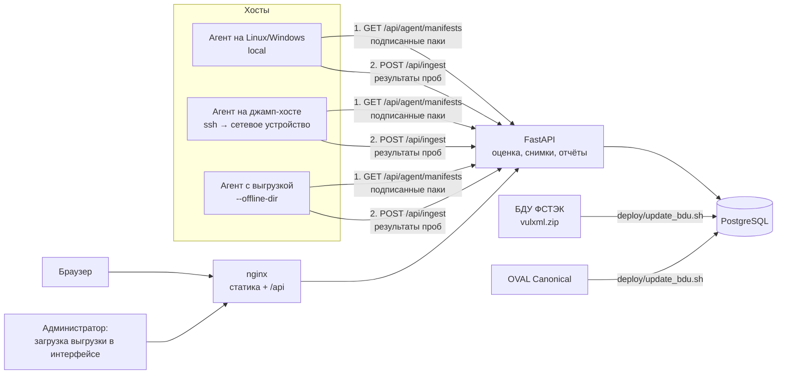

# Харденинг — полное описание проекта

Документ описывает, как устроена и работает каждая часть системы: агент, контент-паки, сервер, оценка,
снимки, принятый риск, проверка по выгрузке, уязвимости по БДУ ФСТЭК, покрытие методики ФСТЭК, отчёты,
пользователи и защита входа, интерфейс, развёртывание, тесты. В конце — ограничения и ответы на
типовые вопросы. Состояние — на 11.10.2026 (коммит `b5d7f64` и позже).

Краткое описание и запуск — в [`README.md`](../README.md). Архитектура паков подробно —
[`docs/agent-packs/`](agent-packs/), формат пака — [`src/backend/app/packs/README.md`](../src/backend/app/packs/README.md),
агент — [`agent/README.md`](../agent/README.md).

---

## Содержание

1. [Что это и зачем](#1-что-это-и-зачем)
2. [Общая схема](#2-общая-схема)
3. [Стек и почему он такой](#3-стек-и-почему-он-такой)
4. [Модель данных](#4-модель-данных)
5. [Агент](#5-агент)
6. [Контент-паки](#6-контент-паки)
7. [Подпись манифестов](#7-подпись-манифестов)
8. [Приём данных на сервере](#8-приём-данных-на-сервере-post-apiingest)
9. [Оценка соответствия и покрытие](#9-оценка-соответствия-и-покрытие)
10. [Снимки и сравнение сканов](#10-снимки-и-сравнение-сканов)
11. [Принятый риск](#11-принятый-риск)
12. [Проверка по выгрузке конфигурации](#12-проверка-по-выгрузке-конфигурации)
13. [Уязвимости ПО по БДУ ФСТЭК](#13-уязвимости-по-по-бду-фстэк)
14. [Покрытие методики ФСТЭК по пунктам](#14-покрытие-методики-фстэк-по-пунктам)
15. [Критичность и сроки устранения](#15-критичность-и-сроки-устранения)
16. [Отчёты PDF и Excel](#16-отчёты-pdf-и-excel)
17. [Пользователи, роли, вход, 2FA](#17-пользователи-роли-вход-2fa)
18. [Политики](#18-политики)
19. [Веб-интерфейс](#19-веб-интерфейс)
20. [API](#20-api)
21. [Развёртывание](#21-развёртывание)
22. [Безопасность сервера проекта](#22-безопасность-сервера-проекта)
23. [Тесты и CI](#23-тесты-и-ci)
24. [Текущее состояние](#24-текущее-состояние)
25. [Ограничения](#25-ограничения-честно)
26. [Вопросы и ответы](#26-вопросы-и-ответы-для-защиты)
27. [Где что в коде](#27-где-что-в-коде)

---

## 1. Что это и зачем

**Харденинг** — система контроля защищённости конфигураций. Она автоматически собирает настройки
хостов и устройств (SSH, пароли, межсетевой экран, аудит, службы, контейнеры, реестр Windows,
конфигурация коммутаторов и т. д.), сравнивает их с требованиями безопасности и показывает:

- что соблюдено, что нарушено и что не удалось проверить;
- оценку соответствия в процентах и её изменение во времени;
- что изменилось между двумя любыми сканами;
- какие пункты методики ФСТЭК закрыты, а какие нет;
- какие версии установленного ПО попадают в уязвимые диапазоны Банка данных угроз ФСТЭК;
- сроки устранения по критичности.

**Проблема, которую решает.** Харденинг вручную по чек-листам (CIS, методики ФСТЭК) не
масштабируется: конфигурации расходятся, проверка разовая, результат не повторить. В
инфраструктуре одновременно Linux разных семейств, российские ОС, Windows, Docker, СУБД и сетевое
оборудование. Нужна единая система, где добавить платформу — значит добавить данные, а не
переписать код.

**Чем не является.** Это не сканер уязвимостей по сети и не пентест: система не атакует узлы и не
сканирует порты снаружи. Она читает конфигурацию изнутри хоста (агентом) или из выгрузки
конфигурации. Модуль БДУ дополнительно сопоставляет версии установленного ПО с уязвимыми версиями.

---

## 2. Общая схема



**Поток одного прогона агента:**

1. Агент запрашивает у сервера манифесты паков (`GET /api/agent/manifests`) с ключом агента
   организации. Сервер отдаёт последние версии паков нужного транспорта, каждый подписан HMAC.
2. Агент проверяет подпись каждого манифеста ключом подписи. Любая подделка — остановка.
3. Агент по правилам `detect` определяет, какие паки подходят этой платформе (например,
   `ubuntu-server` + `docker`).
4. Выполняет пробы подошедших паков (только чтение) и собирает «сырые» значения.
5. Отправляет одним запросом `POST /api/ingest`: актив, список ПО, результаты проб по каждому паку.
6. Сервер сравнивает значения с утверждениями паков, применяет принятые риски, сохраняет текущее
   состояние актива и снимок, пересчитывает оценку организации.
7. Интерфейс показывает результат, историю, сравнение, отчёты.

**Главный принцип: агент собирает, сервер оценивает.** В манифест не попадают ожидаемые значения,
критичность и рекомендации — только «как распознать платформу» и «что прочитать». Поэтому правила
можно менять на сервере без обновления агента, а старые данные можно переоценить.

---

## 3. Стек и почему он такой

| Часть | Технологии | Почему |
|---|---|---|
| Сервер | Python 3.12, FastAPI 0.116, SQLAlchemy 2, Alembic, Pydantic 2, Uvicorn | Типизированные схемы запросов, автоматическая валидация, OpenAPI; Python — тот же язык, что у агента, поэтому сервер может выполнять код проб агента |
| БД | PostgreSQL 15 | JSONB (сырые данные агента, источник снимка, резервные коды 2FA), `COPY` для загрузки БДУ, транзакционные миграции |
| Агент | Python 3.6+ (Linux), только стандартная библиотека; Windows — один `.exe` (PyInstaller) | Ставится на любой Linux без `pip`; два файла: `collector.py` и `probes.py` |
| Интерфейс | React 19, Vite 8, TailwindCSS 3, React Router 7, Recharts, lucide-react | Быстрая сборка, компоненты, графики |
| Отчёты | reportlab (PDF), openpyxl (Excel) | Формируются на сервере — один источник данных, кириллица через шрифт DejaVu |
| 2FA | pyotp (TOTP, RFC 6238), qrcode | Стандарт для приложений-аутентификаторов |
| Пароли | bcrypt (passlib) | Медленный хэш с солью |
| Токены | JWT HS256 (python-jose) | Без серверного хранилища сессий |
| Секрет 2FA в БД | Fernet (cryptography) | Шифрование секрета TOTP ключом из `TOTP_SECRET_ENCRYPTION_KEY` |
| Развёртывание | Docker, nginx-unprivileged, systemd (агент), GitHub Actions (CI) | Контейнеры без root, лимиты ресурсов, воспроизводимая сборка |

---

## 4. Модель данных

Иерархия: **организация → окружение → актив → результаты проверок**.

| Таблица | Что хранит |
|---|---|
| `client_organizations` | Организации (клиенты). Данные разных организаций изолированы |
| `environments` | Окружения внутри организации (`prod`, `network`, …). Создаются автоматически при первом прогоне агента |
| `assets` | Активы: hostname, IP, ОС, тип (`linux-server`, `network-device`, …), критичность, `platform_tags` (теги платформы из паков) |
| `software` | Установленное ПО актива (последний прогон): имя, версия, категория |
| `agent_api_keys` | Ключи агентов: только SHA-256 хэш ключа, организация, активен ли, когда использовался |
| `ingestion_batches` | Каждый приём данных: источник (`agent` / `offline-upload`), статус, счётчики |
| `agent_collections` | Сырые данные прогона (JSONB): факты и результаты проб по пакам — чтобы перепрогнать по новой версии правил |
| `hardening_checks` | **Текущее состояние** каждого актива: последний результат каждой проверки (перезаписывается каждым прогоном) |
| `scan_snapshots` | **Снимки** (история): номер скана в организации, счётчики, оценка, метка, источник данных (`collection`, JSONB) |
| `scan_check_results` | Результаты проверок внутри снимка (с копией названия, критичности и рекомендации на момент скана) |
| `hardening_reports` | Оргуровневый отчёт: оценка по текущему состоянию всех активов организации после каждого прогона |
| `hardening_rules` | Правила «старого» режима (без паков): `категория.ключ` = ожидаемое значение. 14 стартовых правил |
| `risk_exceptions` | Принятые риски: проверка, актив или вся организация, причина, срок, кто принял, отзыв |
| `users`, `user_organizations` | Пользователи и их роли в организациях |
| `user_2fa` | Зашифрованный секрет TOTP, хэши резервных кодов, время последнего принятого кода |
| `policies` | Реестр политик организации |
| `bdu_vulnerabilities`, `bdu_software`, `bdu_imports` | Локальная копия БДУ ФСТЭК: уязвимости, уязвимое ПО с диапазонами версий, журнал загрузок |
| `distro_cve_status`, `distro_oval_imports` | Статус CVE в релизах Ubuntu по OVAL Canonical |
| `auditor_organizations`, `user_roles`, `configs` | Таблицы из исходной схемы, в текущей логике не используются |

Схема меняется только миграциями Alembic (`src/backend/alembic/versions/`, 12 миграций). На старте
контейнера миграции **не** выполняются: при выкатке их запускают отдельным одноразовым контейнером.

**Почему два хранилища результатов** — `hardening_checks` и `scan_check_results`. Текущее
состояние нужно для дашборда, покрытия методики, принятого риска («что сейчас»). Снимки нужны для
истории и сравнения («как было»). Снимок не переписывается задним числом: если позже приняли риск
или изменили пак, старый снимок показывает картину на момент скана.

---

## 5. Агент

Код: `agent/collector.py` (запуск, сбор ПО, отправка) и `agent/probes.py` (движок проб, транспорты,
ограничения безопасности). Только стандартная библиотека Python.

### 5.1 Два режима

| Режим | Как включается | Что делает |
|---|---|---|
| **Паки** (основной) | `--use-packs` | Берёт подписанные манифесты, сам определяет платформу, выполняет пробы, сервер оценивает по пакам |
| Встроенные проверки (исходный) | без `--use-packs` | Жёстко зашитые в `collector.py` факты (SSH, firewall, обновления, пароли, ядро, Docker), сервер сравнивает с `hardening_rules`. Оставлен для совместимости, только Linux |

### 5.2 Транспорты — откуда агент берёт данные

| Транспорт | Флаги | Для чего | Какие пробы доступны |
|---|---|---|---|
| `local` | (по умолчанию) | Сам хост, где запущен агент (Linux, Windows) | Файлы, команды из белого списка, службы, пакеты, реестр Windows, политики безопасности и аудита Windows |
| `ssh` | `--ssh-host`, `--ssh-user`, `--ssh-key`, `--ssh-port` | Сетевое устройство с джамп-хоста | Только `cli_config`/`cmd_regex`: команды на чтение (`show …`, `display …`, `/export`, `… print`) |
| `offline-config` | `--offline-dir <каталог> --hostname <имя>` [`--pack <id>`] | Устройство без доступа: проверка по сохранённому выводу команд | Те же, что `ssh`, но текст берётся из файлов |

**SSH-транспорт:** вызывается системный `ssh` без shell, с `BatchMode=yes` (без интерактивного
пароля) и `StrictHostKeyChecking=yes` — устройство должно быть в `known_hosts`, проверка ключа хоста
не отключается (иначе это подмена устройства). Имя хоста и пользователя проверяются регулярным
выражением (защита от внедрения опций `-oProxyCommand=…`). Код возврата 255 (ошибка самого `ssh`)
— отказ пробы, а не «пустая конфигурация».

### 5.3 Пробы (типы)

Проба — что прочитать. Тип задаёт пак, выполняет агент. Список закрыт: тип вне списка не выполняется.

| Тип | Что читает | Пример |
|---|---|---|
| `file_kv` | Параметр «ключ значение» / «ключ=значение» в файле; умеет `Include` в `sshd_config` (до 5 уровней, до 50 файлов), первое значение выигрывает как у sshd; `default` — значение по умолчанию программы | `MaxAuthTries` в `/etc/ssh/sshd_config` |
| `file_regex` | Регулярное выражение по файлу | `pam_faillock` в `/etc/pam.d/common-auth` |
| `file_stat` | Права/владелец файла (без чтения содержимого) | права `/etc/shadow` |
| `cmd_regex` | Команда из белого списка + регулярное выражение по выводу | `ufw status` → `Status: active` |
| `cmd_foreach` | Команда-список, затем команда по каждому элементу; значение — число совпадений | контейнеры (`docker ps -q`), у каждого `inspect … Privileged` |
| `service_state` | Состояние службы (`systemctl is-active/is-enabled`, на Windows — `sc query` и реестр) | `auditd` активна |
| `pkg_version` | Версия пакета (`dpkg-query` или `rpm`) | установлен ли `telnetd` |
| `cli_config` | Строка или раздел конфигурации сетевого устройства | `transport input` в блоке `line vty` |
| `reg_value` | Значение реестра `HKLM\…` (Windows) | `SMB1` |
| `win_secpol` | Политика безопасности из `secedit /export` (Windows) | `MinimumPasswordLength` |
| `win_auditpol` | Политика аудита из `auditpol /backup` по GUID подкатегории (Windows) | аудит входа |
| `first_of` | Несколько источников по порядку — первое найденное значение | параметр в `pwquality.conf` или в PAM |

Результат пробы: `{found, value, evidence, error}`. `found=false` — проба не смогла выполниться
(нет файла, нет прав, команда недоступна) — на сервере это **error («не проверено»)**, а не
«нарушение» и не «соблюдено». `evidence` — совпавшая строка для отчёта.

### 5.4 Безопасность агента — «последний рубеж»

Агент не доверяет манифесту слепо, даже подписанному:

- **Только чтение.** Нет проб, которые что-то меняют.
- **Белый список локальных команд** (`LOCAL_COMMAND_POLICY`): исполняемый файл + регулярное выражение
  для аргументов. Например, `systemctl` — только `is-active|is-enabled|is-failed <имя>`, `docker` —
  только `ps -q`, `inspect --format {{.HostConfig.Privileged}} <id>` из закрытого списка полей и
  флаг `icc` сети `bridge`; `run`/`exec`/`rm` — отказ. Команды запускаются без shell (список
  аргументов), `PATH` фиксирован (`/usr/sbin:/usr/bin:…`), на Windows — только `System32`.
- **Запрещённые пути** (`DENIED_PATH_PATTERNS`): `/etc/shadow`, `/etc/gshadow`, `/etc/security/opasswd`,
  ключи хоста SSH, `~/.ssh/`, `*.key`, `*.pem`, `id_rsa`, `/proc/*/environ`. Права таких файлов можно
  проверить только через `file_stat` — без чтения содержимого. Символические ссылки разворачиваются
  до проверки.
- **Реестр Windows:** только `HKLM`, кусты `SAM` и `SECURITY` запрещены.
- **Сетевые устройства:** только команды на чтение (`is_readonly_cli`), после `|` — только фильтры
  вывода (`include`, `exclude`, `section`, …).
- **Маскирование секретов:** в `evidence` и в значении `cli_config` всё после слов `password`,
  `secret`, `community`, `psk`, `key` и т. п. заменяется на `***`. Хэши паролей и SNMP-community не
  уходят на сервер.
- **Лимиты:** файл до 2 МБ (выгрузка до 5 МБ), команда до 15 с.
- **Подпись манифеста** проверяется до выполнения чего-либо (раздел 7).

### 5.5 Агент как служба (Linux)

`agent/deploy/`: шаблон systemd `hardening-agent@.service` + таймер + `install.sh`.

- Экземпляр = файл настроек: `hardening-agent@local` → `/etc/hardening-agent/local.env` (этот хост),
  `hardening-agent@sw-core` → `sw-core.env` (сетевое устройство по SSH).
- Отдельный системный пользователь `hardening-agent` без входа и домашнего каталога.
- Код агента принадлежит root (`/opt/hardening-agent`), агент не может его подменить.
- Ключи — в `.env` с правами `0640 root:hardening-agent`, не в unit-файле и не в истории shell.
- Ужесточение systemd: `NoNewPrivileges`, пустой `CapabilityBoundingSet`, `ProtectSystem=strict`
  (вся ФС только на чтение), `ProtectHome=read-only`, `PrivateTmp`, `PrivateDevices`,
  `ProtectKernel*`, `RestrictAddressFamilies=AF_INET AF_INET6 AF_UNIX`, `MemoryDenyWriteExecute`.
  Даже подменённый агент не сможет ничего изменить в системе.
- Таймер: раз в сутки со случайной задержкой до часа (`RandomizedDelaySec=1h`), чтобы хосты не
  приходили одновременно; `Persistent=yes` — пропущенный прогон выполнится после включения хоста.
- Где не хватает прав непривилегированному пользователю (например, `ufw status` требует root),
  проба честно даёт «не проверено» или читает файл конфигурации. Для проверок Docker агента
  добавляют в группу `docker`.

### 5.6 Агент на Windows

На Windows нет Python, поэтому агент собирается в один файл `hardening-agent.exe` (PyInstaller,
артефакт CI-workflow «Windows packs»). Запуск — Планировщик заданий. Почему не `net accounts`,
`netsh`, `auditpol /get`: на русской Windows их вывод локализован. Агент читает нелокализуемые
источники: реестр, экспорт `secedit` (INF), `auditpol /backup` (CSV по GUID), `sc query` (числовые
состояния). Проверено на настоящих Windows Server 2022 и 2025 в GitHub Actions.

### 5.7 Сбор ПО

`dpkg-query` (Debian/Ubuntu/Astra), иначе `rpm -qa` (RHEL-семейство), на Windows — реестр
установленных программ. Список ПО нужен модулю БДУ.

---

## 6. Контент-паки

Пак — YAML-файл в `src/backend/app/packs/`, описывающий одну платформу. **Данные, а не код:**
новая платформа или проверка не требует релиза агента.

### 6.1 Формат

```yaml
pack: ubuntu-server             # id
version: 1.4.0                  # файл на версию; старые версии не удаляются
maturity: baseline              # inventory | draft | baseline | full | certified
verified_on: ["Ubuntu 24.04.4 LTS"]
tags: [linux-server, debian-family, ubuntu]   # класс → семейство → продукт
transport: local                # local | ssh
asset_type: linux-server
detect:                         # как распознать платформу — все условия должны совпасть
  - probe: { type: file_kv, path: /etc/os-release, key: ID, separator: equals }
    equals: ubuntu
checks:
  - id: ssh.max_auth_tries      # категория.ключ — стабилен между версиями
    title: Ограничить число попыток аутентификации
    probe: { type: file_kv, path: /etc/ssh/sshd_config, key: MaxAuthTries, default: "6" }
    assert: { op: lte, value: 4 }
    severity: medium
    remediation: "MaxAuthTries 4 в /etc/ssh/sshd_config"
    refs:
      - { source: "Методика анализа защищённости информационных систем, ФСТЭК России, 25.11.2025", id: "СУД.1.1" }
```

### 6.2 Операторы утверждений (`assert.op`)

`eq`, `ne`, `in`, `not_in`, `lt`, `lte`, `gt`, `gte`, `between` (включительно), `regex`, `exists`,
`absent`, `mode_within` (права не шире заданных — побитово; числовое `lte` здесь неверно: `604`
меньше `640`, но шире).

Результат: `pass`, `fail` или `error`. `error` — сравнивать нечего (проба не дала значения) или тип
не подходит оператору. Принцип: **«нет факта» ≠ «нарушение»**.

### 6.3 Уровни зрелости (`maturity`)

| Уровень | Смысл |
|---|---|
| `inventory` | Только распознавание платформы и сбор ПО; оценка не выставляется (пусто, а не 100 %) |
| `draft` | Проверки написаны по документации, на реальной системе не подтверждены (образцы вывода, контейнеры) |
| `baseline` | Подтверждены на реальной системе; `verified_on` обязателен |
| `full` / `certified` | Полный набор / сверено вторым экспертом |

Валидатор не пропустит `baseline` без `verified_on` и `inventory` с проверками: уровень обязан
честно отражать, что реально проверено.

### 6.4 Валидация пака на сервере (первый рубеж)

`app/services/packs/models.py` (pydantic): закрытый список типов проб, абсолютные пути, имена служб
и пакетов по регулярным выражениям, команды — только из белого списка, для `transport: ssh` — только
`cli_config`/`cmd_regex` с командами на чтение, уникальные id проверок, корректные регулярные
выражения. Битый пак — ошибка с именем файла, а не тихий пропуск.

### 6.5 Паки (последние версии)

| Пак | Версия | Уровень | Транспорт | Проверок | Подтверждение |
|---|---|---|---|---|---|
| `ubuntu-server` | 1.4.0 | baseline | local | 25 | Ubuntu 24.04.4 (боевой хост); в CI 20.04 / 22.04 / 24.04 |
| `debian-server` | 1.1.0 | draft | local | 25 | контейнеры Debian 11 / 12 / 13 (CI) |
| `astra-linux` | 1.2.0 | draft | local | 25 | контейнер Astra SE 1.8 (CI) |
| `alt-linux` | 1.1.0 | draft | local | 14 | контейнеры Альт p10 / p11 (CI) |
| `rhel-family` | 1.1.0 | draft | local | 19 | Rocky 8/9, Alma 9, Oracle 9, CentOS Stream 9, РЕД ОС 7.3/8 (CI) |
| `windows-server` | 1.0.0 | baseline | local | 40 | Windows Server 2022 и 2025 (CI) |
| `windows-client` | 1.0.0 | draft | local | 39 | образцы |
| `docker` | 1.2.0 | baseline | local | 11 | Docker Engine 29.3.1 на боевом хосте |
| `postgresql` | 1.1.0 | draft | local | 9 | образцы |
| `cisco-ios` | 1.2.0 | draft | ssh | 12 | образцы `show running-config` |
| `samba` | 1.0.0 | draft | local | 1 | образцы |

Итого 11 паков, 220 проверок в последних версиях, 18 систем в CI. Хосту может подходить несколько
паков сразу (ОС + Docker + СУБД) — выполняются все, результат одним снимком.

**Debian и Astra генерируются из Ubuntu** (`src/backend/pack_sources/debian_family.py`): раскладка
файлов у них та же, поэтому общие проверки не копируются руками. Тест следит, что YAML совпадает с
результатом генерации. Windows-паки тоже генерируются (`pack_sources/windows.py`).

### 6.6 Инструменты автора пака

```bash
python -m app.commands.pack validate        # схема и безопасность всех паков
python -m app.commands.pack test            # сценарии «нарушение / соблюдение» на фикстурах (pack_tests/)
python -m app.commands.pack live            # паки на ЭТОЙ машине настоящими пробами
python -m app.commands.pack manifests --key-file k --out m.json --transport ssh   # подписанные манифесты в файл
python -m app.commands.pack evaluate run.json --pack id   # оценить сохранённый прогон агента (--dry-run)
```

Фикстуры (`src/backend/pack_tests/*.yaml`) прогоняют **настоящие пробы агента** поверх подставных
файлов и команд (`FixtureHost`) и настоящую оценку сервера: если пак и агент разойдутся, тест упадёт.

---

## 7. Подпись манифестов

**Зачем.** Манифест говорит агенту, что выполнить. Подмена манифеста (например, через
скомпрометированный прокси) могла бы заставить агент прочитать не то. Поэтому:

- сервер подписывает каждый манифест HMAC-SHA256 ключом `PACK_SIGNING_KEY` по каноническому JSON
  (сортировка ключей, без пробелов, UTF-8 — одинаковые байты на сервере и в агенте);
- агент проверяет подпись ключом `HARDENING_PACK_KEY` (`hmac.compare_digest`); любая неверная
  подпись — остановка всего прогона («событие безопасности», а не пропуск одного пака);
- версия схемы манифеста проверяется;
- ключ подписи **отделён** от ключа агента: ключ агента даёт право отправлять данные, ключ подписи —
  доверять командам.

**Ограничение (известное).** Ключ симметричный: тот же ключ, которым агент проверяет, позволяет
подписать. Компрометация хоста с агентом раскрывает ключ подписи. План — ключ на организацию и
переход на асимметричную подпись Ed25519 (интерфейс `sign/verify` и формат манифеста к этому готовы).
Вторая линия защиты — белые списки самого агента: даже подписанный злоумышленником манифест не
заставит его выполнить команду вне списка или прочитать `/etc/shadow`.

Если `PACK_SIGNING_KEY` на сервере не задан, выдача манифестов отключена (503).

---

## 8. Приём данных на сервере (`POST /api/ingest`)

Аутентификация агента — заголовок `X-Agent-Api-Key`. Сервер хранит только SHA-256 ключа;
**организация берётся из ключа, а не из тела запроса** — агент не может выдать себя за другую
организацию. Ключ выдаётся командой `python -m app.commands.create_agent_key` и показывается один раз.

Шаги (`app/api/routes/ingest.py`, функция `ingest_payload` — общая для агента и загрузки выгрузки):

1. Все паки из запроса разрешаются по id и версии **до записи** в БД: неизвестный пак → 422 без
   побочных записей. Повтор пака в запросе → 422.
2. Создаётся `ingestion_batch` (источник `agent` или `offline-upload`).
3. Окружение и актив находятся или создаются (по имени окружения и hostname в организации);
   обновляются IP, ОС, тип, критичность, теги платформы.
4. Список ПО актива заменяется новым.
5. Сырые данные (факты и результаты проб) сохраняются в `agent_collections`.
6. Оценка: проверки паков — `evaluate_pack` (значение пробы vs утверждение); старые правила —
   `evaluate_asset`, только если агент прислал факты старого режима.
7. Применяются действующие принятые риски.
8. Текущее состояние актива (`hardening_checks`) перезаписывается целиком.
9. Создаётся снимок (`scan_snapshots`) со следующим номером в организации и копией результатов
   (`scan_check_results`), включая название, критичность и рекомендацию на момент скана.
10. Пересчитывается оргуровневый отчёт по текущему состоянию всех активов.
11. Всё — в одной транзакции; ответ содержит счётчики, оценку, покрытие и итоги по каждому паку.

---

## 9. Оценка соответствия и покрытие

- **Соответствие (compliance score)** = соблюдено / (соблюдено + нарушено) × 100 %.
- **Не проверено (error)** в оценку не входит — но и не завышает её незаметно: рядом всегда
  показывается **покрытие** = выполненные (pass + fail) / все применимые проверки. Высокая оценка при
  низком покрытии сразу видна.
- **Принятый риск** — нарушение остаётся `fail`, но не входит ни в «нарушено», ни в оценку и
  считается отдельно.
- Пак уровня `inventory` даёт пустую оценку, а не 100 %.
- **Оценка организации** — по текущему состоянию всех её активов (последний прогон каждого актива).

Пример: 36 проверок, 33 соблюдено, 1 нарушено, 2 риска принято → 33 / (33 + 1) = 97,06 %.

---

## 10. Снимки и сравнение сканов

Каждый прогон — снимок с номером. Любые два снимка организации с общими активами можно сравнить
(`GET /api/snapshots/compare`). Ключ сравнения — (актив, проверка); id проверки стабилен между
версиями пака, поэтому сравниваются и снимки разных версий.

| Тип изменения | Когда |
|---|---|
| `regressed` — ухудшилось | было pass, стало fail (даже если риск принят — хост реально стал хуже) |
| `new` — новое | проверки не было, появилась |
| `still_failed` — не исправлено | fail → fail без принятого риска |
| `changed` — изменилось | с участием error: стало/перестало проверяться |
| `accepted` — риск принят | fail остался, но между снимками приняли риск |
| `fixed` — исправлено | fail → pass |
| `removed` — убрано | проверка была, исчезла (пак перестал подходить, проверку переименовали) |

В таблице сначала то, что требует внимания (ухудшения), в конце — исправленное. Переименованная
проверка честно видна как «убрано» + «новое».

---

## 11. Принятый риск

Не каждое нарушение нужно устранять: например, `kernel.ip_forward = 1` нужен Docker и VPN.
Администратор организации создаёт **исключение**: проверка + конкретный актив или вся организация +
обоснование + необязательный срок действия.

- Статус проверки не меняется: `fail` остаётся фактом с хоста; результат получает ссылку на
  исключение и не входит в оценку.
- Исключение конкретного актива имеет приоритет над общим.
- После создания или отзыва исключения текущее состояние пересчитывается сразу; история снимков не
  переписывается.
- Истёкшее исключение перестаёт действовать со следующего прогона.
- Отзыв — с сохранением истории (кто, когда).
- Смотреть могут все участники, создавать и отзывать — только администратор организации.

---

## 12. Проверка по выгрузке конфигурации

**Проблема.** Для сетевого оборудования часто нет SSH-доступа (изоляция, запрет посторонним), а у
многих вендоров (особенно российских: Qtech, SNR, B4COM, Булат, S-Terra) нет образов для стенда.
Без этого агент по такому устройству не вернул бы ничего.

**Решение — второй путь сбора, офлайн.** Проверяется сохранённый вывод команд (`show running-config`
и т. п.) из бэкапа (Oxidized, RANCID, TFTP) или от администратора.

**Через агент:**
```bash
python3 collector.py --api-url … --environment net --use-packs \
  --offline-dir ./export-sw-core-01 --hostname sw-core-01 [--pack cisco-ios]
```
Каталог содержит по файлу на команду: имя — команда, где пробелы и `/` заменены на `_`
(`show_running-config.txt`, `show_version.txt`, `display_current-configuration.txt`, `export.txt`).

**Через интерфейс** (страница «Проверка по выгрузке», только администратор организации): выбрать
пак, загрузить файл на каждую команду, указать имя устройства, окружение, дату выгрузки. Сервер
выполняет **тот же код проб агента** (`agent/probes.py` лежит в образе бэкенда), поэтому результат
загрузки и прогона агента по одной выгрузке одинаков. Ограничения: до 10 файлов по 5 МБ, команды —
только из паков.

**Правила:**
- паки и проба `cli_config` те же, что для SSH — новый вендор = новый YAML-пак;
- ничего не выполняется, файлы только читаются; символические ссылки не открываются; пустой файл —
  отказ пробы (а не «ничего не задано», иначе все проверки «параметра нет» ложно прошли бы);
- фильтры вывода (`| include`) по выгрузке не поддерживаются — их выполняет само устройство;
- **распознавание платформы:** если есть выгрузка `show version`, платформа проверяется по ней;
  если её нет — пак задаёт оператор явно, и это отмечается («пак задан оператором, платформа по
  выгрузке не подтверждена»). Если выгрузка есть и **противоречит** паку — проверка отклоняется;
- **источник данных хранится в снимке** (`scan_snapshots.collection`): файлы, SHA-256, дата выгрузки,
  кто загрузил. В интерфейсе снимок помечен «по выгрузке», в PDF/Excel — строка «Источник данных».
  Проверено состояние **на момент выгрузки**, а не живое устройство.

Статус пака отражает способ проверки: `draft` — образцы из документации; реальная выгрузка
заказчика повышает доверие; `baseline` — живое устройство.

---

## 13. Уязвимости ПО по БДУ ФСТЭК

### 13.1 Данные

- **БДУ ФСТЭК** — `https://bdu.fstec.ru/files/documents/vulxml.zip` (~650 МБ XML, ~97 тыс. уязвимостей).
  Сайт использует сертификат российского удостоверяющего центра (цепочка в `deploy/certs/`,
  передаётся только этому запросу) и требует заголовок браузера.
- Загрузка: `deploy/update_bdu.sh` → `python -m app.commands.bdu import` — потоковый разбор
  (`iterparse`) и запись через `COPY`, замена целиком в одной транзакции (при ошибке остаётся
  прежняя копия). ~70 с, ~180 МБ в БД.
- **OVAL Canonical** для релизов Ubuntu (noble, jammy, focal) — статус CVE в дистрибутиве.

### 13.2 Сопоставление

1. **Пакет → продукт БДУ** (`products.py`): явный список псевдонимов (`openssh-server` → OpenSSH,
   `libssl3t64` → OpenSSL, `linux-image-*` → Linux), иначе совпадение имени целиком. Подстрочных
   совпадений нет («git» не находит «GitLab»).
2. **Версии** (`versions.py`): версия пакета приводится к версии исходного проекта (без эпохи `1:`,
   без ревизии `-3ubuntu13.19`, с учётом `+really`). В БДУ версии — свободный текст; надёжно
   разбираются диапазоны и точные версии (~490 тыс. из 834 тыс. записей), остальные пропускаются.
3. Если пакетов одного продукта несколько (несколько ядер), берётся наибольшая версия.
4. **Совпадение = «потенциально уязвим»**, а не «уязвим»: дистрибутивы переносят исправления в
   старые версии без смены номера.
5. **Статус дистрибутива по OVAL** (только Ubuntu): исправление вышло, но не установлено → подтверждено;
   исправления нет → подтверждено; исправлено → отсеивается (в счёт не входит); нет данных →
   остаётся потенциальной. На боевом хосте это сократило открытые находки с 369 до 120.

### 13.3 Уровень критичности V (методика ФСТЭК от 30.06.2025)

**V = Icvss × Iinfr × (Iat + Iimp)**

| Множитель | Что это | Как считается в проекте |
|---|---|---|
| Icvss | Базовая оценка CVSS 3.1 вендора | Из БДУ; нет CVSS 3 — CVSS 2 с пометкой; нет оценки — V не считается |
| Iinfr | Влияние на инфраструктуру = 0,5·K + 0,2·L + 0,3·P | K — тип компонента (сетевое устройство/МЭ 0,9; сервер 0,7; АРМ 0,5; СХД 0,4; иное 0,1); L — доля активов с уязвимостью (>70 % → 1,0; ≥50 % → 0,8; ≥10 % → 0,6; иначе 0,5); P — доступен из интернета 1,1 / нет 0,6 (тег `internet-facing` у актива) |
| Iat | Эксплуатация | эксплуатируется в атаках 0,6; есть эксплойт 0,3; нет сведений 0,1 (поля БДУ) |
| Iimp | Последствия | по словам в названии уязвимости: выполнение кода / повышение привилегий 0,5; обход защиты 0,4; …; XSS 0,1; не распознано 0,3 |

Уровни: V > 8 — критический; 5 ≤ V ≤ 8 — высокий; 2 ≤ V < 5 — средний; V < 2 — низкий.

**Оговорки:** коэффициенты взяты из вторичного источника (pravo.ppt.ru) — сверить с официальным
текстом ФСТЭК; Iimp — эвристика по названию (формализованного поля «последствия» в выгрузке нет);
ядро Linux Canonical в OVAL не публикует; для Debian/RHEL/Astra бюллетени не подключены — находки там
остаются потенциальными.

---

## 14. Покрытие методики ФСТЭК по пунктам

«Методика анализа защищённости информационных систем», ФСТЭК России, 25.11.2025, таблица 3
(внутреннее сканирование). В каталоге проекта (`app/services/fstec/catalog.py`) **70 пунктов** в
разделах УСИ, СУД, СДИ, ИСС, ДИС, ОПС, СУБД, СВИ, СКО:

- **43** закрываются проверками паков (у проверки в `refs` указан id пункта);
- **10** — уязвимости ПО, закрываются модулем БДУ (по продуктам пункта);
- **17** — вне модели проекта, с причиной (активное тестирование, нужен стенд: AD, DNS-сервер,
  гипервизор, SQL-запросы к СУБД и т. п.).

Статус пункта по текущему состоянию активов организации (страница «Методика ФСТЭК»):
`violated` (есть нарушение без принятого риска) → `accepted` (все нарушения с принятым риском) →
`not_checked` (проверки есть, но не выполнились) → `passed` → `not_applied` (проверки в паках есть,
но такой платформы у организации нет) → `no_checks` (проверок ещё нет) → `out` (вне модели).

---

## 15. Критичность и сроки устранения

У каждой проверки пака — `severity`: `critical`, `high`, `medium`, `low` (+ `info`). Названия
совпадают с уровнями методики от 30.06.2025, но это **экспертная оценка опасности нарушения автором
пака**, а не рассчитанный V: у нарушения конфигурации нет CVSS вендора, а значимость ИС в паке
неизвестна. Ориентир выбора: `critical` — удалённая эксплуатация без учётных данных
(privileged-контейнер, пустые пароли по SSH); `high` — компрометация при минимальном условии
(подбор пароля, нет аудита); `medium` — ослабление защиты; `low` — гигиена.

| Уровень | Срок (методика 30.06.2025) | Порядок (методика 25.11.2025) |
|---|---|---|
| Критический | до 24 часов | обязательно (п. 3.4.4) |
| Высокий | до 7 дней | обязательно (п. 3.4.4) |
| Средний | до 4 недель | после экспертной оценки (п. 3.4.5) |
| Низкий | до 4 месяцев | после экспертной оценки (п. 3.4.5) |

Таблица одна в двух местах: `src/backend/app/services/remediation.py` (отчёты) и
`src/utils/remediation.js` (интерфейс).

---

## 16. Отчёты PDF и Excel

`GET /api/exports/snapshots/{id}/download?format=pdf|excel` — по любому снимку, с проверкой доступа к
организации. Формируются на сервере (`app/services/snapshot_export.py`): reportlab (PDF, шрифт
DejaVu для кириллицы) и openpyxl (Excel).

Содержание: сводка (организация, снимок, дата, **источник данных**, активы, проверки, соблюдено,
нарушено, риск принят, не проверено, соответствие, покрытие), план устранения по уровням критичности
со сроками, таблица результатов (актив, проверка, критичность, статус, факт, ожидание, рекомендация,
пак, свидетельство). Время — в поясе `DISPLAY_TIMEZONE` (на проде Asia/Yekaterinburg); в БД и API
время хранится в UTC, интерфейс переводит его в пояс браузера.

---

## 17. Пользователи, роли, вход, 2FA

### 17.1 Роли

| Кто | Что может |
|---|---|
| **Суперадмин** | Всё во всех организациях; управление учётными записями и организациями («Пользователи и организации»). Создаётся только командой `python -m app.commands.create_admin` на сервере — не через API, чтобы украденная сессия не могла размножить учётки с полными правами |
| **Администратор организации** (`admin`) | Участники и роли, политики, принятый риск, загрузка выгрузок |
| **Аудитор** (`auditor`), **наблюдатель** (`viewer`) | Просмотр данных организации. В текущей версии права аудитора совпадают с наблюдателем |

Мультиарендность: все ручки `/organizations/{id}/…` проверяют членство (`require_org_access`,
`require_org_admin`): чужая организация → 403, несуществующая → 404. Нельзя удалить или понизить
последнего администратора организации.

### 17.2 Вход и сессии

- Пароли — bcrypt. Политика: от 12 до 128 символов, не только пробелы, не совпадает с email.
- Токен — JWT HS256 на 8 часов, хранится в браузере. Интерфейс раз в минуту проверяет сессию
  (`useSessionTimeout`); 401 стирает токен.
- **Смена или сброс пароля отзывает все выданные ранее токены** (`password_changed_at` сравнивается
  с `iat` токена с точностью до долей секунды).
- **Временный пароль**, заданный суперадмином, нужно сменить при входе; до этого сервер закрывает
  все ручки, кроме `/auth/me` и смены пароля (а не только скрывает их в интерфейсе). Так суперадмин
  не знает действующий пароль пользователя.
- Заблокированный пользователь отсекается на каждом запросе.

### 17.3 Защита от подбора (`app/services/login_guard.py`)

- 5 неудачных попыток подряд (пароль или код 2FA) → блокировка на 15 минут (ответ 429).
- Счётчик увеличивается атомарно в SQL (параллельные запросы не обойдут порог).
- Во время блокировки пароль не проверяется вовсе — подбор бесполезен.
- Счётчик сбрасывается только после **полного** входа (с 2FA — после верного кода): иначе, зная
  пароль, можно было бы бесконечно подбирать код, чередуя попытки с верным паролем.
- Для несуществующего email пароль проверяется против фиктивного хэша — по времени ответа нельзя
  узнать, какие email зарегистрированы.
- Лимита по IP нет сознательно: за прокси все запросы с одного адреса, и такой лимит позволил бы
  одному атакующему закрыть вход всем. Блокировку чужой учётки может снять суперадмин.

### 17.4 Двухфакторная аутентификация (TOTP)

- Подключение в два шага: `setup` выдаёт секрет (QR и строку) и сохраняет его неактивным;
  `confirm` включает 2FA только после верного кода — нельзя включить 2FA с секретом, не попавшим в
  приложение.
- Секрет хранится зашифрованным (Fernet).
- 8 одноразовых резервных кодов: показываются один раз, хранятся только SHA-256; списываются одним
  атомарным `UPDATE` (нельзя использовать дважды параллельно).
- **Защита от повтора кода:** код засчитывается один раз — хранится начало 30-секундного интервала
  последнего принятого кода, код того же или более раннего интервала отклоняется.
- Вход с 2FA: после пароля выдаётся временный токен (`pre_2fa`, 5 минут), затем код или резервный код.
- Отключение требует пароль и код — украденной сессии недостаточно. Потерявшему телефон и коды
  сбрасывает 2FA суперадмин.

---

## 18. Политики

Реестр политик организации (`/organizations/{id}/policies`): название, описание, область, статус
(`draft`, `active`, `review`, `archived`), владелец, источник. Смотрят все участники, меняет
администратор. Справочный раздел: связь политик с проверками паков — развитие (этап 4 дорожной карты).

---

## 19. Веб-интерфейс

React-приложение (`src/`). Выбор организации — в верхней панели (запоминается). Страницы:

| Страница | Путь | Что показывает |
|---|---|---|
| Обзор | `/dashboard` | Окружения, активы, критичные активы, ПО, проверки (соблюдено / нарушено / риск принят / не проверено), оценка и покрытие, тренд по отчётам |
| Активы | `/assets`, `/assets/:id` | Среды организации (узлы, критичные, с нарушениями; клик — фильтр) и список активов; карточка: проверки актива, ПО, сведения. Старый адрес `/project` («Инфраструктура») ведёт сюда |
| Инвентаризация ПО | `/software` | Всё ПО активов организации |
| Харденинг | `/hardening` | Текущее состояние проверок: фильтры, критичность, сроки, свидетельство, рекомендация; принятие и отзыв риска (администратор) |
| Уязвимости ПО | `/vulnerabilities` | Находки БДУ: продукт, версия, уровень V с разложением множителей, статус в Ubuntu (OVAL), USN |
| Методика ФСТЭК | `/fstec` | Покрытие 70 пунктов по статусам, проверки и активы по каждому пункту |
| Политики | `/policies` | Реестр политик |
| Отчёты | `/report` | История оргуровневых отчётов |
| Сканирования | `/scans` | Снимки: оценка, счётчики, отметка «по выгрузке», PDF/Excel, выбор двух для сравнения |
| Проверка по выгрузке | `/offline-scan` | Загрузка выгрузки конфигурации сетевого устройства (раздел 12) |
| Сравнение сканов | `/scan-compare` | Любые два снимка: исправлено, ухудшилось, новое и т. д. |
| Управление доступом | `/organization-users` | Участники организации и роли (администратор) |
| Пользователи и организации | `/admin/users` | Суперадмин: создание организаций-заказчиков; учётные записи — создание, сброс пароля и 2FA, блокировка |
| Двухфакторная защита | `/two-factor` | Подключение и отключение 2FA |

Даты в интерфейсе — в часовом поясе браузера (`src/utils/datetime.js`). Права в интерфейсе только
скрывают кнопки — проверку выполняет сервер.

---

## 20. API

Префикс `/api`. Пользовательские ручки — `Authorization: Bearer <JWT>`; агент — `X-Agent-Api-Key`.

| Группа | Ручки |
|---|---|
| Вход | `POST /auth/login`, `POST /auth/verify-2fa`, `GET /auth/me`, `POST /auth/change-password` |
| 2FA | `GET /auth/2fa`, `POST /auth/2fa/setup`, `POST /auth/2fa/confirm`, `POST /auth/2fa/disable` |
| Агент | `GET /agent/manifests?transport=local|ssh`, `POST /ingest` |
| Данные | `GET /organizations`, `…/{id}/my-role`, `…/{id}/assets`, `/assets/{id}`, `…/{id}/environments`, `…/{id}/software`, `/assets/{id}/software`, `…/{id}/hardening`, `/assets/{id}/hardening`, `…/{id}/snapshots`, `…/{id}/reports`, `…/{id}/dashboard` |
| Снимки | `GET /snapshots/compare?before_snapshot_id&after_snapshot_id`, `GET /exports/snapshots/{id}/download?format=pdf|excel` |
| Выгрузка | `GET /organizations/{id}/offline-scans/packs`, `POST /organizations/{id}/offline-scans` (multipart) |
| Принятый риск | `GET/POST /organizations/{id}/risk-exceptions`, `DELETE …/{exception_id}` |
| БДУ, ФСТЭК | `GET /organizations/{id}/vulnerabilities`, `GET /organizations/{id}/fstec-coverage` |
| Политики | `GET/POST /organizations/{id}/policies`, `PATCH/DELETE …/{policy_id}` |
| Участники | `GET/POST /organizations/{id}/users`, `PATCH/DELETE …/{user_id}` |
| Суперадмин | `GET/POST /admin/users`, `POST /admin/users/{id}/reset-password`, `…/reset-2fa`, `…/block`, `…/activate` |
| Служебное | `GET /health` |

Полная схема — OpenAPI: `http://127.0.0.1:8000/docs` на сервере.

---

## 21. Развёртывание

### 21.1 Контейнеры на сервере

| Контейнер | Образ | Порт | Лимиты | Прочее |
|---|---|---|---|---|
| `hardening_frontend` | `nginx-unprivileged:1.27-alpine` + сборка Vite | `:80` → 8080 | 128 МБ, 0,5 CPU | nginx без root; статика + прокси `/api` и `/health` в бэкенд; заголовки `X-Content-Type-Options`, `X-Frame-Options: DENY`, `Referrer-Policy: no-referrer` |
| `hardening_backend` | `python:3.12-slim` + код + `agent/probes.py` | `127.0.0.1:8000` | 1 ГБ, 2 CPU | только localhost; снаружи — через nginx |
| `diploma_db` | `postgres:15` | только внутренняя сеть | — | compose в `~/diplom-hardening` (не в git) |

Все контейнеры с `no-new-privileges`. Сеть `diplom-hardening_default` связывает фронтенд, бэкенд и
БД по именам; в Docker отключён `icc` на сети по умолчанию.

Бэкенд и фронтенд запускаются скриптами `deploy/restart_backend.sh` и `deploy/restart_frontend.sh`,
а не `docker compose up`: файрвол хоста пропускает проброс порта только на сети `bridge`, поэтому
контейнер сначала поднимается на `bridge`, затем подключается к сети БД.

### 21.2 Выкатка (процедура)

```bash
# 1. бэкап БД и метки на текущие образы — для отката
docker exec diploma_db pg_dump -Fc -U postgres app_db > ~/backups/app_db-pre-<изменение>-<дата>.dump
docker tag hardening-backend:latest hardening-backend:pre-<изменение>
docker tag hardening-frontend:latest hardening-frontend:pre-<изменение>
# 2. новый образ и миграции одноразовым контейнером (на старте миграции не выполняются)
docker build --build-context agent=./agent -t hardening-backend:latest ./src/backend
docker run --rm --network diplom-hardening_default --env-file ./src/backend/.env hardening-backend:latest alembic upgrade head
# 3. перезапуск
./deploy/restart_backend.sh && ./deploy/restart_frontend.sh
# 4. проверка
curl -s localhost:8000/health; docker exec hardening_backend alembic current
```

Откат: вернуть метку `:pre-<изменение>` на `:latest`, перезапустить; при необходимости —
`pg_restore` из дампа.

`--build-context agent=./agent` нужен потому, что бэкенд выполняет пробы агента для загрузки
выгрузки, а каталог `agent/` вне контекста сборки бэкенда.

### 21.3 Настройки сервера (`src/backend/.env`, не в git)

`DATABASE_URL`, `JWT_SECRET_KEY`, `TOTP_SECRET_ENCRYPTION_KEY`, `PACK_SIGNING_KEY`,
`DISPLAY_TIMEZONE`, `ALLOWED_ORIGINS` (CORS), `ACCESS_TOKEN_EXPIRE_MINUTES` (480),
`LOGIN_MAX_FAILED_ATTEMPTS` (5), `LOGIN_LOCKOUT_MINUTES` (15), `PRE_2FA_TOKEN_EXPIRE_MINUTES` (5),
`PACKS_DIR`.

### 21.4 Агент на самом сервере

Служба `hardening-agent@local` (раздел 5.5) ежедневно проверяет сам сервер проекта паками
`ubuntu-server` и `docker` и отправляет данные в демо-организацию на `127.0.0.1:8000`.

---

## 22. Безопасность сервера проекта

Сервер проекта сам проверяется агентом — демонстрация «до → после»:

| Скан | Что сделано | Оценка |
|---|---|---|
| 1 | исходное состояние | 21 % |
| 2 | SSH, ufw, auditd | 57 % |
| 3 | агенту дан доступ к Docker | 71 % |
| 4 | парольная политика, faillock | 90 % |
| … | no-new-privileges, `icc: false`, блокировка USB-накопителей, удалён xrdp, закрыт порт 3389; принят риск по `ip_forward` и порту фронтенда | **97,06 %** |

Оставшееся нарушение — вход по паролю в SSH (`PasswordAuthentication yes`): закрывается после
настройки ключей. Принятые риски: `kernel.ip_forward` (нужен Docker и VPN) и публикация порта 80
фронтенда на всех интерфейсах — со сроком до 04.10.2027.

Прочее: бэкенд и PostgreSQL недоступны снаружи; бэкапы БД в `~/backups` с правами 600; ключи
агента и подписи — в файлах с ограниченными правами.

---

## 23. Тесты и CI

| Что | Где | Сколько |
|---|---|---|
| Сервер | `src/backend/tests/` — на одноразовом PostgreSQL (порт 5433), никогда на боевой БД: тесты очищают таблицы | 484 |
| Агент | `agent/tests/` | 140 |
| Паки | `pack validate` + `pack test` — сценарии «нарушение / соблюдение» на фикстурах для каждого пака | все паки |
| Сквозной тест агент ↔ сервер | `tests/test_agent_interop.py`: подписанный манифест сервера → настоящий агент → `/ingest` → оценка | входит в 484 |
| Интерфейс | `npm run lint`, `npm run build` | — |

**GitHub Actions** (на каждый push): тесты сервера (с PostgreSQL), тесты агента, линт и сборка
интерфейса; **Linux packs** — агент выполняется внутри контейнеров 16 систем (Ubuntu 20.04/22.04/24.04,
Debian 11/12/13, Astra SE 1.8, Альт p10/p11, Rocky 8/9, Alma 9, Oracle 9, CentOS Stream 9,
РЕД ОС 7.3/8) и результат оценивается паком; **Windows packs** — настоящие Windows Server 2022 и
2025: пробы, распознавание, сборка `.exe` и его работа по подписанным манифестам.

---

## 24. Текущее состояние

На 11.10.2026 в боевой системе:

- 1 организация («Демо — агент-сборщик (диплом)»), 1 актив — сам сервер проекта, 14 снимков (последний — №15);
- последний скан: 36 проверок, 33 соблюдено, 1 нарушено, 2 риска принято — **97,06 %**;
- 1 487 пакетов ПО на активе;
- копия БДУ: 96 856 уязвимостей, 478 568 записей уязвимого ПО; 419 679 записей статуса CVE в Ubuntu;
- 3 пользователя, у администратора включена 2FA;
- агент работает службой с ежедневным таймером.

---

## 25. Ограничения (честно)

- **Подтверждено на реальных системах:** Ubuntu, Docker, Windows Server 2022/2025. Остальные паки —
  `draft`: контейнеры в CI или образцы вывода. В контейнере нет systemd, поэтому проверки служб на
  RHEL-семействе там «не проверено».
- **Сетевое оборудование:** пак есть только для Cisco IOS (draft). Для других вендоров нужны паки;
  офлайн-путь позволяет писать и обкатывать их без стенда.
- **Средства защиты с центральным управлением** (Континент, ViPNet, UserGate, PT NGFW) — нужен
  API-транспорт; не реализовано.
- **Astra Linux:** собственные механизмы (МКЦ, МРД, ЗПС) не проверяются — нужна ВМ.
- **Подпись паков** симметричная (HMAC), ключ один на сервер; план — ключ на организацию и Ed25519.
- **БДУ:** находки — потенциальные, подтверждение только для Ubuntu (OVAL); ядро Linux не
  проверяется; коэффициенты методики 30.06.2025 — из вторичного источника.
- **Severity** проверок — экспертная оценка, а не рассчитанный V.
- **Текущее состояние актива** перезаписывается каждым прогоном: паки, не подошедшие в этот раз,
  из него выпадают (история — в снимках).
- **Нет HTTPS** на демо-стенде (нужен домен); нет заголовка Content-Security-Policy; токен в
  `localStorage`.
- **Роль аудитора** пока не отличается от наблюдателя.
- Импорт XCCDF/OVAL-контента (CIS) не сделан: блокер — лицензия CIS Benchmarks.

---

## 26. Вопросы и ответы (для защиты)

**Чем ваша система отличается от сканера уязвимостей (Nessus, MaxPatrol)?**
Она проверяет не «есть ли уязвимая версия», а «правильно ли настроено» — конфигурацию изнутри
хоста по требованиям (харденинг). Модуль БДУ дополняет это сопоставлением версий ПО. Ключевые
отличия: декларативные паки (платформа = данные), агент без зависимостей, привязка каждой проверки к
пунктам методики ФСТЭК, честный учёт «не проверено» и уровней зрелости.

**Как добавить новую платформу?** Написать YAML-пак: `detect` (как распознать), `checks` (проба +
утверждение + критичность + рекомендация + ссылки на пункты методики), фикстуры «нарушение /
соблюдение», `pack validate` и `pack test`. Агент обновлять не нужно — он получит пак с сервера.

**Что будет, если в компании оборудование, которого нет в паках?** Агент вернёт «платформа не
распознана» и ничего не отправит (он не гадает). Решение: новый пак. Для вендоров без стенда — пак
по документации и проверка по выгрузке конфигурации заказчика (раздел 12); статус пака честно
`draft`, пока не будет живого устройства.

**Почему оценка не завышена непроверенными проверками?** «Не проверено» не входит в оценку, но рядом
всегда показывается покрытие. Пак `inventory` даёт пустую оценку, а не 100 %.

**Что если агент на хосте скомпрометирован?** Агент только читает; служба работает от
непривилегированного пользователя с ФС только на чтение; код принадлежит root. Подделать он может
только свои данные о своём хосте (это присуще любой агентной схеме). Выдать себя за другую
организацию не может — организация берётся из ключа. Ключ подписи паков при этом раскрывается —
поэтому план на Ed25519 и ключ на организацию; белые списки агента всё равно не дают выполнить
лишнее.

**Как защищены манифесты?** HMAC-SHA256 по каноническому JSON, ключ подписи отдельно от ключа агента,
агент останавливается при любой неверной подписи (раздел 7).

**Почему агент на Python без зависимостей?** Его нужно ставить на произвольные серверы, в том
числе изолированные и с Python 3.6 (RHEL 8): `pip install` там невозможен или нежелателен.

**Почему сервер оценивает, а не агент?** Правила меняются без обновления агентов; сырые данные
сохраняются и могут быть переоценены; агент проще и безопаснее (меньше логики на хосте).

**Как считается V по методике ФСТЭК?** V = Icvss × Iinfr × (Iat + Iimp), подробно — раздел 13.3.
Для проверок конфигурации V не считается: у нарушения настройки нет CVSS вендора; критичность — экспертная.

**Почему находка БДУ — «потенциальная»?** Дистрибутивы переносят исправления в старую версию без
смены номера; подтвердить можно только по бюллетеню дистрибутива (для Ubuntu — OVAL, подключено).

**Что такое принятый риск и не обман ли это?** Осознанное решение администратора с обоснованием и
сроком; нарушение остаётся `fail` и видно в отчётах отдельной строкой, в оценку не входит. В истории
видно, когда и кем принят.

**Как обеспечена изоляция организаций?** Каждая ручка `/organizations/{id}` проверяет членство
пользователя; агент привязан к организации ключом; суперадмин — единственный с доступом ко всем.

**Как защищён вход?** bcrypt, политика паролей, блокировка после 5 ошибок, TOTP 2FA с защитой от
повтора кода и резервными кодами, отзыв токенов при смене пароля, временный пароль от администратора
с обязательной сменой (раздел 17).

**Что проверено на реальном оборудовании?** Ubuntu 24.04 и Docker (боевой сервер, «до → после»
21 % → 97 %), Windows Server 2022/2025 (CI). Остальное — контейнеры 16 Linux-систем в CI и образцы.

**Почему Debian и Astra — из Ubuntu?** Одинаковая раскладка файлов (сверено на официальных
образах); генерация из одного источника исключает расхождения между копиями.

**Почему в снимке хранятся название и критичность проверки?** Пак может измениться; отчёт по
старому снимку должен показывать то, что было на момент скана.

**Как проверка по выгрузке отличается от живого устройства?** Проверено состояние на момент
выгрузки; конфигурация могла измениться. Поэтому снимок помечен, в нём хэш и дата файлов.

**Почему миграции не запускаются при старте контейнера?** Чтобы схема менялась осознанно, после
бэкапа и с возможностью отката, а не при каждом перезапуске.

---

## 27. Где что в коде

| Что | Файл |
|---|---|
| Агент: запуск, сбор ПО, отправка | `agent/collector.py` |
| Агент: пробы, транспорты (`LocalTransport`, `SshTransport`, `OfflineConfigTransport`), белые списки, подпись | `agent/probes.py` |
| Служба агента | `agent/deploy/` |
| Паки | `src/backend/app/packs/*.yaml`, формат — `README.md` там же |
| Генерация паков | `src/backend/pack_sources/` |
| Фикстуры паков | `src/backend/pack_tests/` |
| Модель пака и валидация | `src/backend/app/services/packs/models.py` |
| Операторы утверждений | `src/backend/app/services/packs/assertions.py` |
| Оценка пака | `src/backend/app/services/packs/evaluate.py` |
| Манифест и подпись | `src/backend/app/services/packs/manifest.py` |
| Инструменты автора пака | `src/backend/app/services/packs/authoring.py`, `app/commands/pack.py` |
| Приём данных | `src/backend/app/api/routes/ingest.py` |
| Выдача манифестов | `src/backend/app/api/routes/agent.py` |
| Оценка, покрытие, старые правила | `src/backend/app/services/hardening_engine.py` |
| Принятый риск | `src/backend/app/services/risk_exceptions.py`, `app/api/routes/risk_exceptions.py` |
| Сравнение снимков | `src/backend/app/api/routes/snapshots.py` |
| Проверка по выгрузке (сервер) | `src/backend/app/services/offline_scan.py`, `app/api/routes/offline_scans.py` |
| БДУ и OVAL | `src/backend/app/services/bdu/`, `app/commands/bdu.py`, `deploy/update_bdu.sh` |
| Методика ФСТЭК | `src/backend/app/services/fstec/` |
| Сроки устранения | `src/backend/app/services/remediation.py`, `src/utils/remediation.js` |
| Отчёты PDF/Excel | `src/backend/app/services/snapshot_export.py` |
| Вход, 2FA, защита от подбора | `app/api/routes/auth.py`, `twofa.py`, `app/services/login_guard.py`, `twofa_service.py`, `app/core/security.py` |
| Права и роли | `src/backend/app/api/deps.py`, `routes/members.py`, `routes/admin_users.py` |
| Миграции | `src/backend/alembic/versions/` |
| Интерфейс | `src/pages/`, `src/components/`, `src/api/` |
| Развёртывание | `deploy/`, `Dockerfile.frontend`, `src/backend/Dockerfile`, `docker-compose.yml` |
| CI | `.github/workflows/` |
